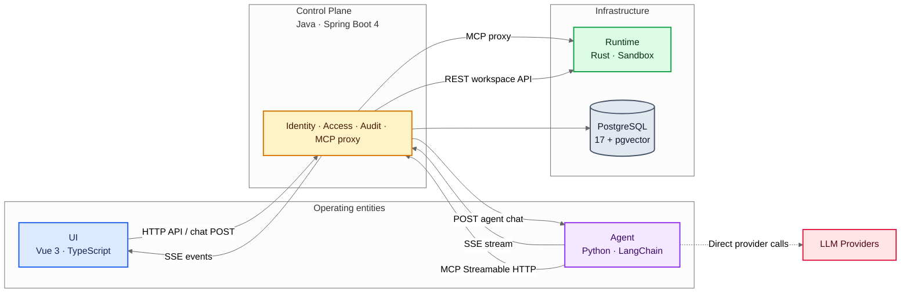

[简体中文](docs/i18n/zh-Hans/README.md)

<!-- Sync with docs/i18n/zh-Hans/README.md: architecture diagram, Quick Start commands, port, and stack summary. Feature status is maintained in the Chinese README. -->

# Xihe (羲和)

**Xihe, who watched the sky to set the seasons and drove the sun to keep the order.** *(羲和，观天以授时，御日以成序。)* People and agents each play to their strengths.

**A general-purpose multi-agent collaboration platform** for orchestration, tool access, sandboxed execution, and access control.

> Give agents the standing and boundaries of a human teammate.

**Development status:** Active development. APIs and data structures may change; production use is not recommended.

## 1. Quick Start

```bash
# Install the pinned toolchain and dependencies
mise install
mise run setup

# .env.dev is already checked in with safe placeholders
# Put personal credentials in the gitignored .env.local, never in .env.dev

# Start daily host development: PostgreSQL in Docker; other modules native
mise run dev:host
# Config import and Provider Connection setup are separate explicit CLI tasks
mise run xihe -- --help
```

**CLI (`xihe` command family, 23 groups)** — `mise run xihe -- --help`

| Group | Purpose |
|---|---|
| `dev` | host environment check / provider init |
| `config` | config read/write: get/set/unset/meta/put, import/export (instance layer) |
| `config-locks` | config key locks (admin): list/set/delete |
| `provider` | provider connections: add/update/list/catalog/verify/delete/limits |
| `credential` | credential lifecycle, bindings, reveal, rotation |
| `agent` | agent principals: create/bind/unbind/disable |
| `session` | session participants + reads: `session list/get/export` (export is Markdown) |
| `chat` | `chat send`; run status/cancel/approvals: `chat run/cancel/approvals/approve/reject` |
| `skill` | skills: list/import/bind/unbind/delete |
| `workspace` | workspace list/get; admin: create/delete/members/roots (write face) |
| `job` | workspace jobs: list/output/cancel |
| `checkpoint` | checkpoints: list / revert preview |
| `scheduled-task` | scheduled tasks: list; create/delete/rerun/remove/postpone |
| `audit` | audit entry queries |
| `auth` | token login/logout/status (local cache) |
| `api` | raw passthrough: `api [METHOD] <path>` |
| `me` | `me permissions` |
| `models` | model catalog per visible connection |
| `api-input-types` | `api-input-types list` |
| `events` | `events tail <sessionId> [--follow]` (SSE, one JSON line per event) |
| `status` | instance status summary |
| `verify` | end-to-end self check |
| `test` | host E2E entry |

`version` (`--check`) and `help` are two additional top-level entries. Examples: `mise run xihe -- status`, `mise run xihe -- config export --out cfg.json`, `mise run xihe -- config get agent-runtime`, `mise run xihe -- provider list --scope WORKSPACE`.

Exit-code contract: `0` success, `1` business/runtime failure (including `partial`), `2` usage error (unknown command, unknown option, missing required argument). With `--json`, stdout is `{ok,data}` or `{ok:false,error:{code,message}}`.

**Requirements (there is no installer yet):** a Windows host with mise for the pinned toolchain, plus Docker — Docker runs **only PostgreSQL**; the Control Plane, Agent, Runtime, and UI run as four native processes started by mise. Native packaging (PLAN-0632) is still in progress, so a single clone plus `dev:host` is the fastest path today and nothing is double-click-to-run yet.

The UI uses port `12630` by default (stack-1; parallel stacks shift the whole block, see "模式 D" in DEV-002). `dev:host` does not import config or create a provider connection; use the explicit `mise run dev:host:import-config` / `mise run dev:host:provider-init` tasks when needed. Before starting services, `dev:host` runs `mise run check:runtime-target`; the guard only prints at the watch level and blocks startup at the FORCE line (≥20 GB, or H: free <5 GB). See [DEV-002](docs/i18n/zh-Hans/DEV-002-developer-guide.md). `mise run dev:full` is **frozen (2026-10-07: only PostgreSQL remains in Docker; services run on host)** and commented out in `mise.toml` — use `dev:host`.

**This repository runs from a single clone** — no parent ONE workspace required: `mise run check:standalone` (`mise.toml:395`) verifies "no dependency on the one root". Port defaults are **sourced from this repository** (`scripts/lib/stack-ports.mjs`); the ONE-side `config/ports.mjs` is only a mirror for orchestration — change one side and you must change the other in the same batch, with `mise run check:ports` (`mise.toml:401`) asserting parity (it skips explicitly when ONE is absent).

**First use starts blank**: register/login no longer create any workspace (the response `workspaceId` may be `null`), so the first screen is an empty state; click "create your first workspace" and use **`direct_attach`** (pick a host directory; the capability preflight decides the execution mode) before creating an Agent and a session. Full steps and the per-criterion "what success looks like" table are in [DEV-033](docs/i18n/en/DEV-033-first-run-gold-path.md).

## 2. Architecture

People and agents are separate operating entities. The Control Plane provides shared routing, access control, and audit; Runtime supplies bounded workspace execution.



The UI chat request and event stream use separate HTTP directions. The Agent calls the model provider directly; tool calls use CP's MCP proxy. See [DEV-001](docs/i18n/zh-Hans/DEV-001-system-architecture.md) and [DEV-014](docs/i18n/zh-Hans/DEV-014-control-plane-architecture.md).

## 3. Modules and Stack

| Module | Responsibility | Main stack |
|---|---|---|
| UI | Human interaction | Vue 3, TypeScript, Vite 8, Pinia, Tailwind CSS 4 |
| Agent | LLM orchestration and tool selection | Python 3.12, FastAPI, LangChain, LangGraph, litellm |
| Control Plane | Authentication, routing, access control, audit | Java 25, Spring Boot 4 |
| Runtime | Sandboxed workspace and process execution | Rust toolchain, rmcp 3, Axum 0.8 |
| Data | Relational persistence and vector retrieval | PostgreSQL 17, pgvector |
| Development | Build and local orchestration | Node.js 24, pnpm 10, Maven 3.9, uv, Docker |

Dependency details are maintained in the [UI manifest](packages/ui/package.json), [Agent project](packages/agent/pyproject.toml), [Control Plane build](packages/control-plane/pom.xml), and [Runtime manifest and lockfile](packages/runtime/Cargo.toml). Each module also owns its version in that manifest; `GET /api/v1/version`, Agent health, Runtime `/ready`, and MCP `clientInfo` derive from it, and the bump checklist is in [DEV-002 §7](docs/i18n/en/DEV-002-developer-guide.md). Tool versions are managed in [mise.toml](mise.toml); the Rust toolchain is pinned in [rust-toolchain.toml](packages/runtime/rust-toolchain.toml), and container builds use `cargo build --locked`.

## 4. Status and Roadmap

Per-feature status, progress markers, and the current boundary of each capability are maintained in the **[Chinese feature status table](docs/i18n/zh-Hans/README.md)** — this English facade does not duplicate that table. The buckets below are the short version.

**Implemented**

- Four-module platform: UI, Control Plane, Agent, and Runtime on PostgreSQL 17 + pgvector.
- Multi-participant sessions: `PRIMARY` / `MEMBER` / `GUARD` roles, `@` mentions (including `@all`), wake policies `ALL_MESSAGES` / `MENTION` / `SCHEDULE`, respond policies `ALWAYS` / `WHEN_MENTIONED` / `JUDGE` / `MUTED`.
- Agent principals as first-class subjects: three scopes (`PERSONAL` / `WORKSPACE` / `INSTANCE`), separate create/bind/use authorizations, model intent without pinning a credential connection, connection/model resource limits, and preset guard principals with hook subscriptions (`advisors[{kind,on}]`).
- Write approval gate: allow / ask / deny, approval history, checkpoints and revert.
- Judge decisions: an independent decision model decides whether a participant should speak, audited in `judge_decisions` including failed invocations.
- Nested AGENTS.md injection: ancestor-chain JIT loading, an `untrusted-repo-instructions` envelope, and one shared injection-budget ledger.
- Workspace dock tabs (multi-tab plus a focus mode) with local layout persistence.
- The `xihe` CLI command family (`mise run xihe -- --help`) for development and operations.
- Local mode: loopback-only, password-less first user, behind a startup fail-fast gate.

**In progress**

- Memory bound to agent principals — tables and services landed; the model-visible slot is not wired, so memories do not reach the model yet.
- Skills platform — frozen design, no code yet.
- Subagent delegation — spawned child sessions gain a PRIMARY participant and the wake-chain depth is configurable; the delegation budget gate is still on a branch awaiting its test matrix, and delegation edges plus the session-tree UI are not in place yet.
- Native packaging / MVP distribution — CP native image, Agent PyInstaller, bundled pgvector, and the launcher are spiked; **no downloadable installer yet**.

**Frozen**

- The docker workspace execution backend. `storageMode` is required with no default and the only usable value is `direct_attach`; `managed_import` returns `409 BACKEND_DISABLED`; execution, files, environment, sessions, and chat on existing docker workspaces return `503 BACKEND_DISABLED` (fail-closed, no host fallback). Scope and thaw steps: [DEV-018](docs/i18n/zh-Hans/DEV-018-known-issues.md).

**Not yet available**

- A downloadable installer. The fastest way to run XH today is local dev mode: mise + Docker for PostgreSQL only + four native processes.

### Packaged product (PLAN-0632)

The packaged distribution has two rerunnable entry points (artifacts stay under `.tmp/`, never committed):

```bash
mise run pkg:launcher -- start --install <install-dir>  # PG -> CP -> Agent -> Runtime -> UI, each step readiness-gated
mise run pkg:launcher -- status --stack 1 --json        # read-only; on a dev machine `ok:false` = "not a packaged install"
mise run pkg:launcher -- stop
mise run pkg:installer                                  # NSIS build from existing service artifacts (-- --stage-only skips makensis)
```

The supervisor's order is the product contract, not a preference: PostgreSQL must accept TCP before the CP boots (Flyway runs on boot), the CP must answer `/actuator/health` 200 before the Agent starts (its config sync is fail-closed on `llm-provider`), and the UI is served same-origin by the CP.

## 5. Testing

```bash
mise run validate             # lint + typecheck + build + test (+ e2e fixture self-tests)
mise run check:types          # UI + e2e TypeScript gates (D-727; every verify window, ~20–40 s)
mise run validate:full        # validate + test:runtime + test:integration (no E2E; compose E2E lane is frozen)
mise run test:e2e:fixtures    # e2e fixture self-tests only (fake LLM chain state machine; no stack, seconds)
mise run test:runtime:lib:gate  # BL-262 race gate: serial 1 + parallel 3; milestone only, not part of validate
mise run test:cp:baseline       # BL-368: classify CP failures against scripts/cp-known-baseline.json (run after test:cp; baseline only shrinks)
mise run ledger:validate      # read-only ledger (BL/PLAN) validation; run from the ONE workspace root; report-only
mise run check:e2e-bypass     # PLAN-0687: in-page fetch bypass audit in e2e/real (report-only; annotation or allowlist required)
mise run test:e2e:host        # host E2E: stop dev:host first (DEV-002 §5); each round uses an isolated environment
```

Strategy: DEV-020/021/022/023. Environment cleanup and host-run requirements: [DEV-002](docs/i18n/zh-Hans/DEV-002-developer-guide.md).

Cargo tasks in this repo run through `scripts/cargo-run.mjs`, so with `XH_CARGO_TARGET_ROOT` set they build on that root instead of the H: volume; bare `cargo` and the IDE still follow `.cargo/config.toml` (see DEV-002 §6).

Reference scale (2026-11-02): Control Plane **2654** tests and UI **1256** unit tests run on every milestone gate; a full Control Plane L2 pass takes **~5 min** in a 2-shard split (single-process baseline was 598 s).

## 6. Documentation

| Entry | Use |
|---|---|
| [Chinese documentation index](docs/i18n/zh-Hans/INDEX.md) | Architecture, development, configuration, testing, and known issues |
| [English documentation](docs/i18n/en/) | English architecture, logging, test strategy, and ADRs |
| [User guide](docs/i18n/zh-Hans/USER-001-user-guide.md) | Product usage |
| [First run / gold path (DEV-033)](docs/i18n/en/DEV-033-first-run-gold-path.md) | Blank instance → first assistant reply; each success criterion mapped to an E2E assertion |
| [AGENTS.md](AGENTS.md) | Project conventions and development commands |
| [Project contract index](spec/README.md) | Agent/GitHub-only contracts; not rendered by the documentation site |
| [CHANGELOG.md](CHANGELOG.md) | Release notes |

The Chinese and English documentation indexes are maintained separately; use the index for the language you need.

## 7. Philosophy

An agent is a role on the team, not merely a tool. People and agents are treated as operating entities with defined responsibilities and access boundaries. The Control Plane applies shared policy and audit, while Runtime provides the constrained space in which agents can act.

## 8. License

Apache-2.0
