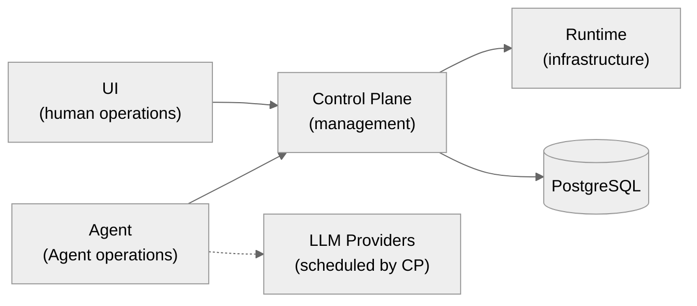
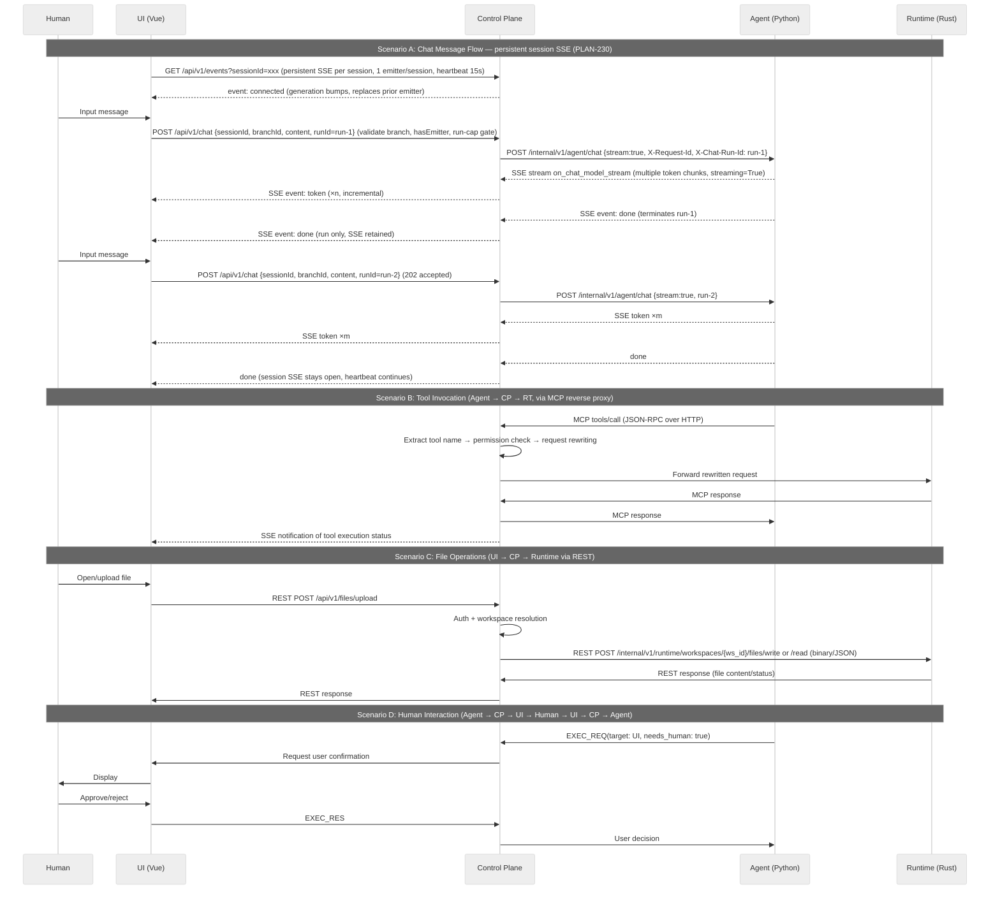
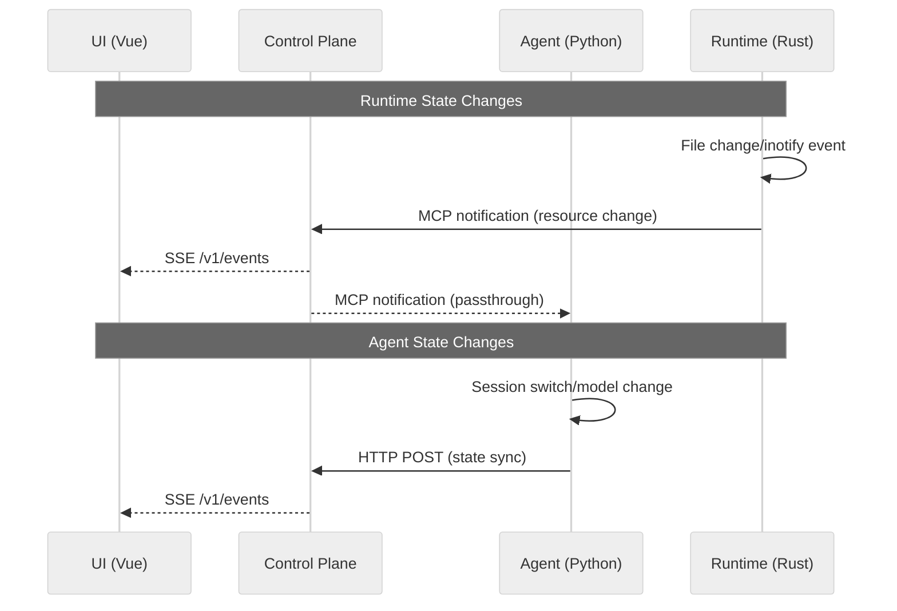

# DEV-001: xihe Agent System Architecture

> Newcomer-oriented: 5 minutes to build a mental model of the whole system (four-module split + two flows + protocol table). Module details live in DEV-010/013/014/015/016/017.
>
> xihe is a general-purpose Agent runtime platform providing multi-Agent orchestration, tool invocation, sandbox execution, permission control, and other capabilities. Four-module Hub-Module architecture: each module evolves, deploys, and uses its own technology stack independently; the core design philosophy is **decoupling**. Module deep-dives: UI in DEV-010, Agent in DEV-013, CP in DEV-014, Runtime in DEV-015, MCP in DEV-016, Session in DEV-017. This document keeps the overview and the implementation navigation; frozen cross-module contracts live in the root `spec/architecture/` and `spec/protocol/`.
>
> The project uses exam preparation (postgraduate entrance exam) as its initial entry point, but the architectural design is not limited to this — any scenario requiring Agent capabilities can use xihe.

## 1. Four modules in detail



### 1.1. UI Module — Vue/TypeScript

**Responsibility**: The entry point for human user interaction, covering Web, TUI, and potential future IDE Extension across multiple terminals.

| Aspect | Decision |
|--------|----------|
| Core Framework | Vue 3 + TypeScript (Composition API) |
| Package Manager | pnpm (workspace monorepo) |
| Build Tool | Vite 8 |
| Routing | Vue Router |
| State Management | Pinia + pinia-plugin-persistedstate |
| Component Library | shadcn-vue (unstyled accessible components via reka-ui) + Tailwind CSS v4, including Button, Card, Dialog, Input, MessageScroller, etc. |
| Icons | @lucide/vue + @iconify/vue |
| CSS Solution | Tailwind CSS v4 + HSL theme variables, supports dark mode. Utilities: class-variance-authority, clsx, tailwind-merge |
| Markdown Rendering | remark/rehype pipeline + Shiki syntax highlighting + KaTeX math formulas |
| AI Integration | `fetch-event-source` plus the custom SSE transport (the UI communicates only with the Control Plane) |
| Testing | Vitest + @vue/test-utils |
| Code Standards | oxlint + oxfmt |
| Communication | Only communicates with Control Plane (`EventSource` SSE + `fetch` POST), does not directly call Agent or Runtime |
| Constraints | Zero system calls, pure presentation + input collection. All business logic on the backend |

**Key Interfaces**:

- User Input → Control Plane (control commands, Agent commands)
- Control Plane → UI (status updates, execution results, approval requests)
- Control Plane → UI (Agent's intermediate thinking/decision streams)

### 1.2. Agent Module — Python / LangChain

**Responsibility**: LLM invocation, multi-Agent orchestration, tool selection, planning decisions.

| Aspect | Decision |
|--------|----------|
| Tech Stack | Python + LangChain + litellm (ChatLiteLLM, 100+ LLM Providers) |
| Build Tool | uv (Python project management, replaces pip/poetry) |
| Core | Multi-Agent orchestration (Agent Swarm / planning-execution loop) |
| Deployment | **Long-running backend service** (not CLI), no cold start issues |
| Boundary | Does not touch the file system or Shell — only does "thinking" |

**Key Capabilities**:

- Tool selection: Obtains the tool list registered by Runtime through Control Plane, then sends instructions to Control Plane after making decisions
- Multi-Agent: Supports delegation, parallel execution, and result merging between Agents
- Memory/Context: Session management (Control Plane assisted / self-owned storage)
- MCP Integration: Agent uses `langchain-mcp-adapters`'s `StreamableHTTPConnection` to treat CP as a unified MCP entry point. All tool calls (Runtime built-in tools + user-configured STDIO MCP servers) go through CP's three-layer routing (CP authentication → Runtime Gateway per-workspace dispatch → in-container `xihe-mcp-bridge` STDIO bridging). Agent only needs to configure one MCP endpoint (CP address) and is unaware of backend tool distribution. See [DEV-016-mcp-architecture.md](DEV-016-mcp-architecture.md)
- **LLM Provider Management**: Unified encapsulation via `langchain-litellm` (`ChatLiteLLM(BaseChatModel)`), with `litellm` automatically routing to 100+ Providers (OpenAI, DeepSeek, Anthropic, Xiaomi MiMo, Ollama, etc.) at the bottom layer. Adding new Providers requires no Agent code changes — add a record to the CP provider catalog (`packages/control-plane/src/main/resources/provider-catalog/providers.json`, served by `GET /api/v1/provider-catalog`). The UI `BUILTIN_PROVIDERS` list is an offline fallback only and no longer carries model defaults.
- **Internal Freedom**: LangChain ecosystem, custom Agents, new framework replacements — none affect other modules

### 1.3. Runtime Module — Rust

**Responsibility**: Sandbox execution environment for low-level system capabilities, exposing two sets of interfaces externally.

| Aspect | Decision |
|--------|----------|
| Tech Stack | Rust |
| Build Tool | cargo |
| Core | File system operations, Shell execution, process management |
| Security | Sandbox isolation (namespace/cgroup/seccomp), supports multi-tenancy. Only `execute_command` subprocesses enter the sandbox; the Runtime main process runs outside the sandbox |
| Deployment | Independent process (Axum), simultaneously exposes REST API + MCP Server interfaces |

**Dual Interface Design**:

```
Runtime
├── REST API          ← For UI/CP: file operations, uploads, management, and other command-type operations
│   Protocol: HTTP + JSON / raw binary
│   Consumer: UI → CP → Runtime
│   Advantage: Binary direct transfer with no encoding overhead, flexible path parameters, clear semantics
│
└── MCP Server        ← For Agent: tool invocation
    Protocol: MCP Streamable HTTP (JSON-RPC)
    Consumer: Agent → CP(MCP Proxy) → Runtime
    Advantage: Standard MCP protocol, tool auto-discovery, JSON Schema auto-generation
```

Both interfaces share underlying core functions like `fs.rs` — the same business logic, two transport protocols. Design principle: **REST API scope includes MCP Server scope** — all functions corresponding to MCP tools have corresponding REST endpoints, but REST can additionally provide capabilities that MCP protocol cannot easily express (such as binary transfer, large file streaming).

**REST API Endpoints** (registered by Axum router):

| Endpoint | Consumer | Purpose |
|----------|----------|---------|
| `POST /internal/v1/runtime/workspaces/{workspaceId}/files/read` | CP → Runtime | Read file content (optional `max_bytes` truncation; `200 {found,content,truncated}` with `found:false` for absent paths) |
| `POST /internal/v1/runtime/workspaces/{workspaceId}/files/write/{path}` | CP → Runtime | Write file (binary body) |
| `POST /internal/v1/runtime/workspaces/{workspaceId}/files/list` | CP → Runtime | List directory |
| `POST /internal/v1/runtime/workspaces/{workspaceId}/files/delete` | CP → Runtime | Delete file |
| `POST /internal/v1/runtime/workspaces/{workspaceId}/files/mkdir` | CP → Runtime | Create directory |
| `POST /internal/v1/runtime/workspaces/{workspaceId}/files/stat` | CP → Runtime | File metadata |
| `GET /health` | CP | Health check |
| `POST /api/v1/mcp` | Agent/UI | CP logical MCP tool invocation |
| `POST /internal/v1/runtime/workspaces/{workspaceId}/mcp/spawn` | CP → Runtime | Start in-container STDIO MCP bridge |
| `DELETE /internal/v1/runtime/workspaces/{workspaceId}/mcp/spawn/{serverId}` | CP → Runtime | Stop STDIO MCP bridge |
| `GET /internal/v1/runtime/workspaces/{workspaceId}/mcp/spawn` | CP → Runtime | List active STDIO servers |
| `POST /internal/v1/runtime/workspaces/{workspaceId}/mcp/stdio/{serverId}` | CP → Runtime | Route to in-container STDIO bridge |
| `POST /internal/v1/runtime/workspaces` | CP → Runtime | Create workspace |
| `POST /internal/v1/runtime/workspaces/delete` | CP → Runtime | Delete workspace (including bridge cleanup) |

**MCP Server** (`rmcp` SDK + `#[tool]` macro): Automatically generates JSON Schema. Runtime has three binaries:
- `xihe-runtime`: Gateway main process, registers `/internal/v1/runtime/workspaces/{ws_id}/mcp` series routes; workspace operations run inside the Sandbox via per-request Docker exec through `WorkspaceExecutionRouter` (PLAN-235, no HTTP channel, no instance token, no long-lived worker)
- `xihe-container-runtime`: In-container executor with `--oneshot` CLI mode (single operation JSON on stdin → single result JSON on stdout, EOF-delimited); handles built-in file/command tools and `/tmp/xihe-jobs` state-file background jobs
- `xihe-mcp-bridge`: In-container STDIO bridge, exposes user-configured STDIO MCP servers as HTTP endpoints

Tool names are mapped by CP reverse proxy when building the tool→server mapping table. When Agent calls a tool, CP looks up the table for routing. See [DEV-016-mcp-architecture.md](DEV-016-mcp-architecture.md).

| Tool Category | Examples |
|---------------|----------|
| File System | read_file, list_directory, glob, grep, read_media |
| Shell | execute_command (subprocess enters sandbox, with timeout) |
| Process | spawn, kill, signal |
| Environment | env vars, workspace info |

**State Flow Maintains MCP**: Runtime state changes (file events, etc.) are sent via MCP notifications, not REST. CP transparently forwards notifications to Agent (MCP) and UI (SSE). See §3.2.

### 1.4. Control Plane Module — System Core

**Responsibility**: Control Plane (abbreviated CP) is the heart of the system, responsible for routing + permission control + data processing + state broadcasting + session management + **unified configuration management**. Abbreviated as CP in the chain diagrams and protocol examples below.

| Aspect | Decision |
|--------|----------|
| Tech Stack | Java + Spring Boot + GraalVM |
| Build Tool | Maven (mvn) |
| Core | Chat message relay + MCP HTTP reverse proxy + permission arbitration + state broadcasting + audit logging, HTTP/SSE + MCP Streamable HTTP three channels |
| Data | Session state, routing tables, tool registry, permission policies, processing rules |
| ConfigService | **CP built-in unified configuration management layer**, all modules read runtime configuration through CP API. 3-tier ownership: system/admin/user. See DEV-002 §2.4 |
| Constraints | **Does not do module-specific business logic**, only handles routing, permission control, data processing, configuration management, and other cross-cutting concerns |

**ConfigService Architecture**: See [DEV-002-developer-guide.md](DEV-002-developer-guide.md) §2.4. Three modules access CP ConfigService through different clients:

| Module | Client | Access Method |
|--------|--------|---------------|
| **Control Plane** | `ConfigService.java` | Built-in `@Service`, imports system configuration from `env.{profile}.jsonc` at startup |
| **Agent** | `config_client.py` | CP API `GET /api/v1/config`, fetches full cache at startup |
| **Runtime** | `config_client.rs` | CP API `GET /api/v1/config`, fetches and periodically refreshes at startup |

**CP Three-Channel Responsibilities**:

- **Chat Channel** (`POST /api/v1/chat` + persistent `GET /api/v1/events` SSE): UI commands relayed through CP → Agent, Agent streaming responses distributed through CP to UI
  - **Session-scoped persistent SSE** (PLAN-230): `GET /api/v1/events?sessionId=` maintains one live emitter per session (`SseEmitterManager` stores `{sessionId, generation, emitter}` with `compareAndRemove`), each `POST /api/v1/chat` creates a `runId` and `done` ends the run only — **not** the session SSE, which is reused for subsequent turns. A `heartbeat` every 15s keeps the connection observable without entering `MessagePart` or resetting run counters.
  - **Run-cap gate**: `POST /api/v1/chat` validates `hasEmitter(sessionId)` (`409 SSE_SUBSCRIPTION_REQUIRED`) before persisting and admits up to `maxConcurrentRunsPerSession` (default 2, PLAN-0645 M0/M1) concurrent runs per session — only a full cap is rejected (`409 CHAT_IN_PROGRESS`); setting the key back to `1` restores the frozen single-flight behaviour without a code change. `requestId`/`runId` from `RequestIdFilter` are explicitly propagated via `X-Request-Id`/`X-Chat-Run-Id` to `execAsync` and the Agent (never inherited via thread-local `MDC`).
  - **UI transport**: `chatTransport` enforces single flight per session (`connectionGeneration` + `intentionalStops`), bounded backoff reconnect (`onerror` returns 250ms→5s, `onclose` schedules at most one reconnect, no second retry loop), `useSSE.ensureConnected()` plus at most one `SSE_SUBSCRIPTION_REQUIRED` recovery; `SSEStream` replaces streaming parts on every `token` via `chatStore.replaceStreamingParts`, fixing the old `lastSentCount`-only-on-`parts.length`-growth truncation.
- **MCP Reverse Proxy Channel** (`POST /mcp`): Agent's MCP tool calls parsed by CP as JSON-RPC → tool name extracted → permission check → request rewriting → three-layer routing forwarding:
  - **Layer 1 (CP)**: Authentication + tool-name routing, system tools → Runtime `/internal/v1/runtime/workspaces/{ws_id}/mcp`, user STDIO tools → `/internal/v1/runtime/workspaces/{ws_id}/mcp/stdio/{server_id}`
  - **Layer 2 (Runtime Gateway)**: Per-workspace dispatch, `CURRENT_WS_ID` task-local injection
  - **Layer 3 (In-container bridge)**: `xihe-mcp-bridge` manages STDIO subprocesses, HTTP ↔ STDIN/STDOUT bridging
  - See [DEV-016-mcp-architecture.md](DEV-016-mcp-architecture.md)
- **State Distribution Channel**: Runtime MCP notifications distributed through CP to UI (SSE) and Agent (MCP notification passthrough)

See Sprint 1 `DESIGN-007-mcp-gateway-reverse-proxy.md`.

**Transport Protocols**:

| Link | Transport Protocol | Reason |
|------|-------------------|--------|
| UI ↔ CP (chat command) | `POST /api/v1/chat` (`202` + `runId`) | `fetch POST` sent only after `GET /api/v1/events?sessionId=` persistent SSE is active; no emitter → `409 SSE_SUBSCRIPTION_REQUIRED`, session already at `maxConcurrentRunsPerSession` (default 2) → `409 CHAT_IN_PROGRESS` |
| UI ↔ CP (chat stream) | persistent `GET /api/v1/events?sessionId=` SSE (`fetch-event-source`) | `done` ends run only, SSE stays open; `heartbeat` every 15s never enters bubble; single active emitter + `generation` shields against stale callbacks |
| CP ↔ Agent (Chat) | `POST /internal/v1/agent/chat` → SSE (`text/event-stream`, `stream=true`) | Agent as HTTP Server receives CP-forwarded commands, `XiheLiteLLM._astream()` yields real `on_chat_model_stream` chunks converted via `LangGraphEventAdapter` per `run_id` into `token` → `done`, falling back to a single `token` only when streaming is unavailable |
| CP ↔ Agent (Tools) | MCP Streamable HTTP | Agent connects to CP reverse proxy via MCP Client, all tool calls unified through JSON-RPC over HTTP |
| **CP ↔ Runtime (REST)** | **HTTP** | UI-initiated file read/write/upload/management operations forwarded through CP REST API to Runtime REST endpoints. Supports binary direct transfer |
| **CP ↔ Runtime (MCP)** | **MCP Streamable HTTP** | Agent's tool calls reverse-proxied through CP to Runtime MCP Server. Runtime state changes notified to CP via MCP notifications |
| CP ↔ External MCP Server | MCP Streamable HTTP | External tools (websearch, etc.) transparently proxied by CP; Agent is unaware of external addresses |

### 1.5. Communication Protocol Summary

MVP uses the following protocols, each with a clear purpose:

| Protocol | Purpose | Link | Key contract |
|----------|---------|------|--------------|
| persistent SSE + `POST /api/v1/chat` | Chat messages: `GET /api/v1/events?sessionId=` builds a session long-lived connection (reused); `POST /api/v1/chat` (`202`) triggers a run; `token` streaming → `done` ends the run, SSE retained | UI ↔ CP ↔ Agent | `done` ≠ close SSE; `heartbeat` 15s not in bubble; one live emitter + `generation`; up to `maxConcurrentRunsPerSession` (default 2) concurrent runs per session (PLAN-0645) |
| MCP Streamable HTTP | Agent tool invocation: JSON-RPC over HTTP, unified through CP reverse proxy | Agent → CP → Runtime / External MCP Server | — |
| MCP notification | State synchronization: Runtime events distributed through CP to UI and Agent | Runtime → CP → UI / Agent | — |
| **HTTP (REST)** | **File operations/upload/management command-type operations: binary direct transfer** | **UI → CP → Runtime** | — |

> Runtime dual interface design: Agent tool invocation goes through MCP, UI file operations go through REST. State flow maintains MCP notification (§3.2), unchanged by the introduction of REST API.
>
> MVP uses zero additional infrastructure (no message queues, no WebSocket gateway). Modules connect directly through HTTP endpoints. Enterprise-grade cluster scaling can later introduce message middleware like Centrifugo as needed.

### 1.6. Design Notes

**Unified MCP Reverse Proxy** — Agent directs all MCP calls to CP's single entry point. CP determines the target backend (Runtime / external service) based on tool name prefix, performs permission checks, and forwards. Agent is unaware of backend tool distribution; external tool passthrough can be switched to authenticated mode at any time. See Sprint 1 `DESIGN-007-mcp-gateway-reverse-proxy.md`.

**Tool Name Namespace** — CP adds backend prefix to tool names during `tools/list` (`runtime__read_file`), and parses the prefix during `tools/call` for routing to the corresponding backend. See Sprint 1 `DESIGN-009-tool-namespace.md`.

**Tool Auto-Discovery** — Runtime exposes tool Schema through standard MCP `tools/list`. Agent auto-discovers through CP's MCP Client, requiring no manual synchronization. When Runtime adds new tools, they are automatically exposed with zero configuration on the Agent side.

**Zero MCP SDK Dependency (CP Side)** — CP acts as a pure HTTP reverse proxy with no dependency on any MCP SDK. CP directly parses JSON-RPC request bodies to extract `method`/`params`, performs permission checks and rewriting, then forwards. See Sprint 1 `DESIGN-001-decisions.md` §4.

## 2. Two-flow model

All inter-module communication falls into two types of flows:

1. **Command Flow** — Module A requests Module B to execute, with a complete request → execute → response lifecycle
2. **State Flow** — Modules asynchronously broadcast state changes, with no response expected, one-to-many distribution

**Command flow** — RPC pattern. Module A requests Module B to perform an operation. B can be any module — RT (tool), Agent (task), UI (human interaction). Responses are divided into **one-shot** (complete result) and **streaming** (token-by-token output, real-time stdout) types.



**State flow** — asynchronous state changes actively broadcast by modules. All modules are both publishers and subscribers, distributed through CP based on subscriptions.



State flow: Runtime/Workspace storage watcher → CP `POST /internal/v1/runtime/workspaces/{workspaceId}/events` → UI Workspace SSE (`GET /api/v1/workspaces/{workspaceId}/events`); ChatRun still goes through its own Session SSE (`GET /api/v1/events?sessionId=`). File bodies and directory trees continue over HTTP/MCP and do not enter the event stream.

## 3. Architectural advantages

1. **Multi-process Decoupling** — Compared to the single-process monoliths of Codex/OpenCode/PI/Kimi, xihe's modules can be independently deployed, scaled, and isolated. Agent crashes don't affect UI; Runtime OOM doesn't affect Agent.
2. **Multi-language Best-of-Breed** — Vue for UI (most mature web ecosystem), LangChain/Python for Agent (richest AI ecosystem), Java + Spring Boot for Control Plane (most mature server ecosystem, GraalVM native startup). Codex is locked to all-Rust (changing LLM requires modifying two crate layers), OpenCode/PI are locked to all-TS (no performance-sensitive layer).
3. **Explicit Message Routing** — Control Plane is the sole communication hub, naturally providing observability (audit logging, traffic monitoring). Compared to Codex/OpenCode's in-process implicit calls, xihe's message paths are fully traceable, interceptable, and replayable.
4. **Native Multi-tenancy** — Multi-process + Linux namespace is OS-level tenant isolation with zero overhead. Codex's sandbox is strong but designed only for single-user.
5. **Sandbox is First-Class** — Rust namespace/cgroup/seccomp is written into the architecture from day one, not added as a patch afterward. Compared to OpenCode/PI's no-sandbox design, xihe has native defense against LLM "hallucination execution."
6. **Native Multi-terminal Support** — Web, TUI, and mobile apps only need to implement Control Plane's protocol, without concerning themselves with backend language and implementation.

**File loading degradation** — loading large files entirely to the frontend causes OOM (PDF >10MB pdfjs.render and text >10MB JSON parse).

**Strategy Matrix**:

| File Type | Size Range | Strategy | Path |
|-----------|-----------|----------|------|
| PDF | <10MB | Full load | MCP `runtime__read_file` |
| PDF | 10MB–64MB | CP-side PDFBox splits into 10-page groups, loads current group | UI → CP(/upload) → PDFBox → Runtime(REST write) |
| PDF | >64MB or >500 pages | Reject Workspace file-tool upload; Chat attachments use their separate 500MB contract | CP-side Content-Length check |
| Text/Code | <10MB | Full load | REST `read` (no max_bytes) |
| Text/Code | 10MB–100MB | Server-side max_bytes=1MB truncation | REST `read` (max_bytes=1MB) |
| Text/Code | ≥100MB | Frontend intercept, Toast, empty content | Frontend fileService.ts check |

**Key Design Decisions**:

1. **Text truncation goes through REST, not MCP** — Runtime REST read endpoint supports `max_bytes` parameter; MCP `runtime__read_file` maintains full read (Agent needs complete content).
2. **PDF splitting belongs to CP** — CP (Java + PDFBox) splits during upload or lazily, then writes chunk files through Runtime REST API. Runtime is not coupled with PDF naming conventions.
3. **File deletion cascades cleanup** — CP side looks up and cleans up same-name chunks (`{name}.p*.pdf`) when deleting files.
4. **Chunk naming convention**: `{name}.p{start}-{end}.pdf`, e.g., `report.p1-10.pdf`.

---

## 4. Unified session and attachments (summary — see DEV-017)

Chat and workspace can collaborate in the same work surface, but Workspace is an independent resource and Session is only an optional binding and context layer:

- Chat uses `/chat/:sessionId`, Workspace uses `/workspace/:workspaceId`.
- A Workspace may have no Session; when chatting is needed, select or create a Session bound to that Workspace.
- `useSessionStore` carries a UI-local view over server-side Session data; `useChatStore`/`useWorkspaceStore` are view-layer state.
- Attachments persist into a backend per-Session space (`{base}/{sessionId}/{fileId}`) and still render after a refresh.
- The domain model, store boundaries, branch/follow-up contracts, and the attachment read-only convention live in DEV-017.

## 5. Remote MCP and OAuth boundaries (summary — see DEV-016/DEV-014)

- The UI starts Authorization Code + PKCE; CP stores encrypted refresh tokens and issues short-lived access tokens scoped to user/workspace/server.
- The Agent connects only to the CP logical MCP endpoint; the Runtime host-side connector owns remote-MCP egress; workspace sandboxes do not reach the network directly.
- Fake OAuth/Fake MCP are real integration/E2E fixtures only.
- The frozen data path, fields, and error codes live in DEV-016 (MCP) and DEV-014 (CP).

## 6. ChatRun and tool boundary (PLAN-247)

- `POST /api/v1/chat` is the only chat submission endpoint; `GET /api/v1/events?sessionId=` is persistent session SSE and `done` terminates only the current run.
- After the CP gate passes, CP persists a `ChatRun` and user `Message`, deduplicated by `(userId, sessionId, Idempotency-Key)`; the request hash includes the selected `branchId`, which is persisted on Run/Message; `Message.runId` links the durable terminal outcome.
- `success`, `error`, `partial`, and `ambiguous` are distinct outcomes. A disconnect whose provider execution cannot be ruled out is `ambiguous`, with no automatic retry; a confirmed manual retry uses a new idempotency key.
- The UI creates an assistant bubble only after the first token/reasoning/artifact; an empty failure leaves no ghost row and exposes both inline state and a toast.
- Normal Chat is fixed to `toolMode=none` and does not trigger MCP discovery. Workspace/tool actions explicitly use `toolMode=workspace`; Agent MCP clients never reuse tools across workspaces and fail fast when isolation is unavailable.
