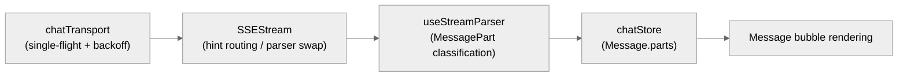

# DEV-010: UI Architecture

> Vue 3 + Pinia + vue-router + Vite + Tailwind CSS 4 + reka-ui. The UI only talks to CP (`fetch POST` + persistent SSE); it never calls the Agent or Runtime directly. Boundary with DEV-017 is "UI implementation vs Session domain": routing/views/components/transport live here; store responsibility boundaries and cross-view sync live in DEV-017.

### SPEC pointer

Cross-page interaction state, design system, and accessibility contracts live in the root-level proposed SPECs:

- [`spec/ui/interaction-model.md`](../../../spec/ui/interaction-model.md)
- [`spec/ui/design-system.md`](../../../spec/ui/design-system.md)
- [`spec/ui/accessibility.md`](../../../spec/ui/accessibility.md)

These SPECs neither copy the OpenAPI/SSE schemas nor replace the concrete page flows of a feature PLAN.

## 0.1 Workspace context (PLAN-0559)

- The workspace lives in the URL + sessionStorage; localStorage keeps only token/user.
- Each workspace-scoped request carries X-Workspace-Id; switching clears workspace-scoped caches and discards stale responses.
- Roles: OWNER/EDITOR/VIEWER. VIEWER write affordances are hidden; CP remains authoritative with 403.
- Cross-tab logout uses BroadcastChannel + storage fallback; workspace switches are not broadcast.

## 1. Routing and layout

`packages/ui/src/router/index.ts`:

| Route | Component | Behavior |
|---|---|---|
| `/` | redirect | → `/workspace` |
| `/workspace` | `WorkspacePicker` (inside `AppLayout`, when no tab context) | **Explicit workspace picker** (PLAN-0608): roles come from the authoritative `GET /workspaces`; with a tab context the guard redirects to `/workspace/{id}` |
| `/workspace/:workspaceId` | `WorkspaceView` (inside `AppLayout`) | Workbench (file tree / main area / dock); may show the no-Session empty state |
| `/workspace/:workspaceId/chat/:sessionId` | `WorkspaceView` (inside `AppLayout`) | Selects a Session belonging to the Workspace and displays Chat |
| `/workspace/:workspaceId/environment` | `WorkspaceEnvironmentView` (inside `AppLayout`) | Workspace execution environment |
| `/workspace/:workspaceId/settings` | `WorkspaceSettingsView` (inside `AppLayout`, PLAN-0560) | General (OWNER rename/delete) / Config (workspace-layer 9 domains) / MCP sections; `?tab=config\|mcp` deep links |
| `/workspace/:workspaceId/scheduled-tasks` | `WorkspaceScheduledTasksView` (inside `AppLayout`) | Scheduled tasks; participates in routing as one tab of the **middle route tab bar** (`router/index.ts`) |

All Workspace routes share `AppLayout`. `AppLayout` is **two-tier left nav + main area**: leftmost `NavRail` (fixed **56px**, icons only, no text labels) + navigation panel (default **280px**, collapsible and draggable 220–360) + main area. Workbench content is owned by `WorkspaceWorkbench` (structure see next section), with the **middle route tab bar** `WorkspaceTabBar` on top (a projection of the existing routes — no new routes; `chat` is always open, the other three are a per-workspace persisted open set). Visiting `/workspace` with no tab context renders the **explicit workspace picker** `WorkspacePicker` (PLAN-0608). Chat is a Session view inside the Workspace feature, so there is no standalone `/chat` route; unmatched paths fall back to `/workspace`. A Session ID does not replace a Workspace ID (PLAN-222).

## 2. View layering

- **WorkspaceView** (`features/workspace/pages/WorkspaceView.vue`): an **assembly layer** — it only wires routing/layout; the workbench body is owned by `WorkspaceWorkbench` (rail 56 + navigation panel + file tree / main area / dock, see §1 and this bullet). It mounts Chat when a Session is selected, otherwise shows the create-Session empty state; on `400 WORKSPACE_CONTEXT_CONFLICT` / `409 WORKSPACE_CONTEXT_REQUIRED` it falls back to the workspace picker `WorkspacePicker` (PLAN-0608) instead of a dead-end toast. The single workspace-creation entry is `WorkspaceCreateDialog` (PLAN-0384: empty-state entry + toolbar "Add Workspace" share one dialog). Flow = storage mode (managed copy / direct use of a directory) → Runtime-visible source browser for direct-attach only → execution-mode cards gated by real capability probes (MXC experimental / windows-host high risk / docker disabled later) → confirmation summary and host-risk confirmation → create (`Idempotency-Key`). Managed copy v1 is file-import only (docker execution comes later) and offers no execution-mode choice; workspace rename/delete go through `WorkspaceSettingsView` (`features/workspace/pages/WorkspaceSettingsView.vue`, PLAN-0560: general section lets OWNER edit/delete with a second confirmation; config section reuses `ConfigLayerPanels`; MCP is `WorkspaceMcpPanel`; the old `WorkspaceSettingsDialog` is retired); mobile (<768px) uses a separate IA (§7: tree Sheet + Chat bottom drawer).
- **ChatPanel** (`features/workspace/chat/components/ChatPanel.vue`): the embedded conversation component for Workspace Chat (message list + input + `SSEStream`); receives a `sessionId` prop; the attachment write entry is `handleSend`.
- **FollowUpQueuePanel** (`features/workspace/chat/components/FollowUpQueuePanel.vue`, PLAN-0442): the inline durable Follow-up queue surface inside ChatPanel, driven purely by snapshots — FIFO count (hard cap 5), per-item withdraw, whole-queue Continue while paused, capacity footer; admitted children cannot be withdrawn, and attempted `child_ambiguous` completed items are echoed via message status. While a Run is in progress, `InputArea` exposes an explicit "Queue" action (`chat-queue-button`, `POST /api/v1/sessions/{sessionId}/follow-ups` with an Idempotency-Key) that is distinct from normal send semantics — while the queue is non-empty CP rejects normal sends with 409. Refresh/reconnect restores from snapshot rather than SSE memory; design preview and user visual approval are in `plans/PLAN-0442-XH-run-guidance-follow-up/design.md` decision #24.
- **GuidancePanel** (`features/workspace/chat/components/GuidancePanel.vue` + `composables/useGuidance.ts`, PLAN-0530): a separate "guide the running run" surface for in-flight Runs, fully separated from Send/Follow-up/Stop (own i18n namespace `chat.guidance*`). Its single data source is the CP snapshot `GET /api/v1/chat/runs/{runId}/guidance` (no Guidance SSE event — option ① of the ruling); submission goes through `POST .../guidance` + `Idempotency-Key`. It lists source/time/status (`pending`/`consumed`/`terminal_expired`) in ascending CP `sequence` order. Input is enabled only when the UI-projected state ∈ `{executing, thinking, awaiting_approval}` (mapping CP `{running, streaming, awaiting_approval}`); after a Run reaches a terminal state the input hides but the **list stays** (`ChatPanel.lastRunId`) and clears on Session switch. Refresh triggers: mount, after submission, streaming stop, the `runRecovery` signal, and session SSE reconnect (`handleDerivedStateRefresh`). Terminal convergence is in `spec/session/chat-run-operation.md` §Run Guidance. Error recovery (PLAN-0536): `409 GUIDANCE_RUN_NOT_ACTIVE` → inline banner + **clear the draft** (`useGuidance.submit` returns `ok|clear|keep`); other errors keep the draft. The former cannot be asserted in a browser (by the time the 409 arrives the Run is not active and the input is unmounted per §3.1), so `__tests__/GuidancePanel.spec.ts` covers it.
- **WorkspaceToolbar**: keeps only **chat-level** controls (upload/refresh); **the session dropdown is removed** (PLAN-0582 T4.1/S1) — session switching only happens through the navigation panel; page-level entries (Environment / Settings / scheduled tasks) moved to the **middle route tab bar** (`WorkspaceTabBar`, S3a) instead of full-page jumps from the toolbar; on mobile it collapses to + (new chat) and a ⋯ overflow menu.
- **FileNodeMenu** (`features/workspace/components/FileNodeMenu.vue`): reka-ui `ContextMenu` wrapper; files: Rename/Move/Duplicate/Copy Path/Delete; directories: New File/New Directory/Rename/Move; text goes through `write_file` MCP, binaries through `POST /api/v1/files/upload` FormData (PLAN-262 M0/B-3).
- **Sidebar (navigation panel)**: panel head = **workspace row** (current workspace name/switch/create/import/members entry) + new chat + session search box + session tree; "New Chat" opens the create-Session flow in the current Workspace; clicking a Session navigates to `/workspace/:workspaceId/chat/:sessionId`. The **orphan bottom "Workspace" nav item is removed** (PLAN-0582 S1): workspace entry only exists in the panel head, `<1024` collapses the panel into a sheet drawer, and a missing workspace fails closed.

## 3. Five component families

Located in `packages/ui/src/components/ui/` — chat UI components developed in-house (replacing the old third-party virtual-list approach):

Design lessons (cross-checked against official shadcn-vue components; details in PLAN-243 appendix A):

- **Layering discipline**: alignment/avatar/timestamp belong to Message; Bubble only owns the surface (already done in-house — confirmed).
- **Explicit state**: upload state is driven by a `state` prop, never derived from the service.
- **Accessibility baseline**: decorative icons `aria-hidden`, disabled buttons `inert` + `tabindex=-1`, thinking state `role=status` (missing items are filled during the a11y pass).
- **BubbleGroup**: merges consecutive sends by the same sender, preventing tool-call bursts from flooding.
- **Footer actions slot**: the standard position for copy/retry/feedback; the hover bar converges there.
- **Coupling verdict**: the five families themselves have zero store references (verified); container-level coupling is normal separation; MessageItem holding three roles is an observed candidate for splitting.

| Family | Purpose |
|---|---|
| `message-scroller/` | Scroll container: following-bottom → free-scrolling → anchored-to-message → settling-jump state machine; `shallowRef` + `data-*` to avoid high-frequency reactivity |
| `message/` | Message cards: Message / MessageGroup / Avatar / Content / Header / Footer |
| `bubble/` | user / assistant / system bubbles, managed by cva |
| `attachment/` | Media/file/action buttons with state/size/orientation variants |
| `marker/` | Time/status separators |

## 4. Transport layer (persistent session-level SSE, PLAN-230)

> Layering principle: **all transport primitives are third-party; in-house code only handles session semantics**. Primitives: `@microsoft/fetch-event-source` (UI), Spring `SseEmitter` (CP), HTTP SSE; about 800 in-house lines: chatTransport (single-flight/backoff) + useSSE + SSEStream + useStreamParser, plus CP `SseEmitterManager` (single active/generation/lease/409). Off-the-shelf options (AI SDK useChat, TanStack ChatClient) solve generic chat over standard protocols; the bespoke session semantics have no off-the-shelf implementation. Tracking TanStack AI (PLAN-243 TD-2); re-evaluate when multi-device/multi-session arrives.

- **chatTransport** (`services/chatTransport.ts`): single-flight connection per `sessionId` (`connectionGeneration` + `intentionalStops`); `onerror` applies exponential backoff (from 250ms, capped at 5s); `onclose` schedules reconnects (no retry cap; stops only on `intentionalStops`); 401 clears the token and redirects to `/login`.
- **useSSE** (`features/workspace/chat/composables/useSSE.ts`, returns `connect/disconnect/sendMessage`; no ensure-connected method): before sending, `SSEStream` manually confirms the connection (if not connected: `connectSession` + wait); CP-side 409 (`SSE_SUBSCRIPTION_REQUIRED` / `CHAT_IN_PROGRESS`) is handled by the caller — the UI has no automatic 409 retry branch.
- **SSEStream**: tokens carrying a hint (`reasoning`/`text`) append via `chatStore.appendToParts`; tokens without a hint go through `useStreamParser.handleToken` and then a full `replaceStreamingParts` replacement; `done` only ends the run; `heartbeat` (15s) never enters a business bubble.
- **Run-level fan-out (PLAN-0645 M2, 2026-11-04)**: the session SSE is persistent and one connection may carry **`maxConcurrentRunsPerSession` (default 2) runs** at once (admission was opened in M0/M1). Therefore the entire path from transport to view fans out by `runId` — no assumption of "one live bubble per session" is allowed:
  - Callback signatures: `onStart(runId?)`, `onToken(token, hint?, runId?)`, `onDone(outcome?, runId?)`; `onStart` fires once per run (new bubble) and `done`/`error` only converge **their own** run.
  - `useSSE` scope is `Map<runId,{contentStarted}>` (the `""` key is the fallback scope for runId-less legacy events and never preempts runId-carrying tokens); `isStreaming` is a session-level aggregate (false only when the last scope closes).
  - `chatStore` live bubbles are addressed by the composite key `(sessionId, runId)` (`getStreamingMessageId(sessionId, runId?)`, `appendToParts(..., runId?)`, `finalizeStreaming(sessionId, runId?)`…); when `202` arrives late, `adoptRunId` re-keys the fallback-scope bubble to the real runId (otherwise an extra bubble appears).
  - `SSEStream.vue` parser / terminal errors / responder attribution are all per-run (three Maps: `parsers`/`terminalErrors`/`responders`); the envelope's `participantId` carries no runId and is consumed by the next run-level callback into the corresponding bubble.
  - **Wire prerequisite (T0.2 clause, see OpenAPI `GET /api/v1/events`)**: run-level events must carry `runId`; CP stamps it at the relay/dispatch exit (an explicit producer value wins). Any new run-level event must carry `runId`, otherwise clients cannot fan out.
- **useStreamParser** (`features/workspace/chat/composables/useStreamParser.ts`): classifies tokens in real time into `MessagePart[]` (`text`/`reasoning`/`citation`/`artifact`); `Message.parts` replaces the old `marked`; code rendering goes through `MarkstreamCodeBlockAdapter` + `parts/TextPart`.

### 4.2 Multi-principal thread rendering (PLAN-0659)

A session is **multi-principal** (human participants + multiple Agent principals), so one thread mixes producers. Four UI contracts (all **presentation-layer projections** — no SSE wire change, no delivery-backend change, no new design tokens):

- **Run grouping (T1.1)**: `chat/runView.ts` provides `runShortCode` (**display only** — any assertion or identity uses the full `runId`) and `formatRunDuration` (`createdAt → terminalAt`; no duration while in flight and no timers). `MessageList` segments by adjacent `runId`: in grouped mode each run gets a `RunGroupHeader` (run short code · principal name · status · duration) and member messages are indented (`run-group-body` left border); **runs ≤1 are not grouped** (no extra noise for a single run); **failed/cancelled runs collapse by default** into a one-line run header, expandable on click. Sources: `GET /chat/sessions/{id}/runs` summaries + each message's own `runStatus/terminalOutcome` fallback; `ChatPanel.sessionRuns` has **only the catch-up loop as consumer while a session is active** (each tick writes summaries; terminal-point fetches happen only when no catch-up loop is running) — two consumers of the same event would drift call-count semantics (BL-228 lesson).
- **Actor badge (T1.2)**: `chat/actorView.ts#actorOf` derives only from **server-side attribution** (`Message.participantId` → session participant roster row); no attribution ⇒ render nothing, never guess PRIMARY. `hasMultipleActors` (≥2 distinct producers) decides whether **process rows** (thinking/tool cards in `ProcessRow`) carry a badge: initial-letter dot + name, with `data-actor-principal-id`/`data-actor-kind` as DOM assertion surfaces. **Color-neutral** (no per-principal colors — D31-10): legibility comes from initial + name + kind.
- **Delivery semantics (T1.3)**: `chat/deliveryView.ts` emits the three-state message header `Send→(A) · @mentioned(highlighted chip) · CC→(B,C)`. TO/CC come from composer send parameters (`asParticipantId` / `cc`) and are turned by `ChatPanel` into a **local send-state view** on `Message.delivery` (not persisted to localStorage, not on the wire); `@` is rebuilt from the body + roster (longest name first, full tokens only). The three states are de-duplicated (@ never enters the CC list); only `role=user` does @ rebuilding. **Limitation (BL-239, P3)**: delivery semantics have no durable carrier ⇒ TO/CC is lost after a session reload, while `@` survives.
- **Delegation DAG (T1.4)**: `chat/delegationGraph.ts` projects sessions into a parent→child graph (`kind=SPAWN` + `spawnedFromSessionId`, same source as the 0655 session tree); node status comes from the parent session's derived state and budgets from the root session's delegation usage. `DelegationDagPanel` lives in the right dock (tab `delegation`, toolbar entry) and draws edges with SVG (no graph library); **truncated/orphan/cycle dirty data is made explicit** (a `truncated` hint, orphans are not force-attached, cycles are rooted at the current session with recursion protection). Root = the top of the current session's ancestor chain; DFS order, `depth` starts at 0.
- **Projection prerequisites**: session lists must pass through `kind`/`spawnedFromSessionId`/`spawnedAt` (required in the OpenAPI `Session` contract; `api.ts#normalizeSession` once dropped all three, making the 0655 tree / 0659 DAG permanently empty on the real path — fixed in `d880d705`). When historical messages have no `participantId` attribution (**BL-197**), neither the identity row nor the actor badge is rendered — no guessing.

### 4.1 Workspace-level event SSE (PLAN-0350)

- `useWorkspaceSSE` opens a separate subscription per `workspaceId`, also active when the Workspace has no Session; the connection key uses `workspace:<id>` and never shares Session semantics with Chat SSE.
- `WorkspaceEvent` only carries relative paths, change type, source, and the Workspace-local `sequence`; `Last-Event-ID` is saved by `chatTransport` and sent on reconnect.
- `file_changed` triggers a Workspace store refresh; unmodified open files are re-read, and files with unsaved local edits only show a conflict hint; `snapshot_required` triggers the existing HTTP/MCP file-tree compensation.
- File contents, directory trees, and large payloads never enter SSE; the full contract is `docs/api/inventory.md` and `plans/PLAN-0350-XH-channel-heartbeat/spec/`.

## 5. Attachments UI flow / i18n / theme

- **Attachments**: `services/attachmentService.ts` (function module) batch-uploads via `POST /api/v1/sessions/{sessionId}/attachments` with front-end whitelist/500 MiB size validation; the upload entry is `InputArea` (`ChatPanel.handleSend` only sends the message + passes fileIds through); with text, attachments are merged into the send, without text it is an attachment-only message; `MessageItem` renders via `/api/v1/files/{fileId}`; workspace files are writable through `POST /api/v1/files/upload` with a 64 MiB per-file limit (attachment read-only convention in DEV-017).
- **Images**: drag/select triggers automatic Canvas compression (`maxDimension(file, 2048)`); PDFs preview via pdfjs-dist (dynamic import) plus text extraction.
- **i18n**: `t()` based, `zh-CN`/`en-US` locales; convention: `t()` messages must avoid `{...}` placeholders (some historical copy still contains them — known exception).
- **Theme**: dark / light / system (`ConfigSettings` dropdown); reka-ui (coexisting with the shadcn-vue wrapper layer) + Tailwind v4 HSL variables. **Default visual language = B (dense, D31-M2)**: tokens live in `:root` of `packages/ui/src/styles/main.css` (body 13px/1.45, 3.5px step, primary radius 4px, single accent `#2450c8`); A/C exist only via `?variant=a|c` for comparison and regression, and components must not scatter new color values.
- **Feedback**: Toast (vue-sonner) is the primary channel; plus confirm dialogs (ApprovalModal/ConfirmModal) and inline form errors; console / IndexedDB 10k log paths both work, telemetry sending is currently disabled (see DEV-004).

## 6. ChatRun and toolMode

`ChatPanel` defaults to `toolMode=none`; `WorkspaceView` explicitly passes `toolMode=workspace`. `SSEStream` submits `provider`, `model`, `toolMode`, and a fresh `Idempotency-Key` together. Chat UI, ChatStore, and Chat lifecycle UI adaptation live in `features/workspace/chat/`; SessionStore and CP's canonical Session/Message/ChatRun lifecycle do not move with the UI feature.

Send state has two layers — transport run and assistant content: a user message is added only after CP returns `runId`, and an assistant message is created only on the first token/reasoning/artifact. `error`, `partial`, and `ambiguous` end the send state while keeping recoverable state; an empty assistant is removed; inline errors and toasts use the same payload.

## 7. Workspace mobile standalone IA (PLAN-262 decision 15)

> **Mobile: no new adaptation or features during the MVP phase (user ruling 2026-11-10); the existing implementation and test cases stay as they are.**
> New UI does not add mobile layouts, drawers or breakpoints. The implementation described in this section, and the existing mobile tests that cover it, are kept unchanged and keep running — they are the regression protection for the existing design. Released by the user once the desktop MVP is accepted.

Mobile (`<768px`, Tailwind `md:` breakpoint) is not a responsive compression of the desktop three-column layout but a separate information architecture:

- **Single-column stack**: top bar hamburger button (opens the file-tree Sheet) + breadcrumbs + Environment entry; editor full screen; desktop left/right columns hidden via `hidden md:flex`.
- **File tree**: `Sheet side="left"` full-height drawer (`features/workspace/components/MobileWorkspaceSheet.vue`); the tree component is shared with desktop `FileTree` (same store/controlled expanded).
- **Chat**: bottom drawer (`features/workspace/components/MobileChatSheet.vue`, `Sheet side="bottom"` `h-[75vh]`) + floating Chat button at bottom right; shares the Session store with the desktop ChatPanel.
- **Context menu**: long-press triggers ContextMenu on mobile (reka-ui native semantics); complex operations use a bottom action Sheet.
- **Dialogs**: Create/Settings/Prepare become full-screen Sheets on mobile (`SheetContent side="bottom"`).
- **Acceptance**: desktop 1440 is the M3/M4 Visual baseline; mobile 390px uses an independent Playwright viewport + screenshot acceptance (PLAN-262 §5.1).

## 8. Workspace complex-UI foundation (PLAN-262 decision 14)

The workspace file-management UI is built on reka-ui headless primitives plus local vendored wrappers (`components/ui/context-menu/`, `components/ui/tree/`); component sources follow shadcn-vue design conventions without depending on the shadcn-vue CLI package:

- **ContextMenu** (`ContextMenu/ContextMenuTrigger/Content/Item/Separator`): keyboard navigation/focus management/ARIA/submenus built in; `@select` is the selection event (`preventDefault` prevents closing); long-press = right-click on mobile.
- **Tree** (`TreeRoot/TreeItem`, controlled `v-model:expanded`): `getKey=node.path`, `getChildren=node.children`; `expandedPaths` (a store `Set`) ↔ array two-way mapping; `update:expanded` is not written back while searching (search expansion is a temporary union).
- **Constraints**: the `TreeVirtualizer` wrapper exists but is disabled by default (trees currently load fully recursively; virtualization gains await large-data validation); `AlertDialogAction` closes unconditionally on click — scenarios needing "stay open on validation failure" (e.g. delete confirmation) must use a plain destructive `Button` (PLAN-262 E-3).
- **Test constraints**: programmatic MenuItem selection in reka-ui is not feasible under jsdom (the internal armed ref cannot be set by synthetic events; six combinations verified); component interaction wiring is covered by Playwright, unit tests only cover menu content decisions and store branches (PLAN-262 §5.1 note).

## 9. Settings information architecture (PLAN-0752, implemented)

Settings is no longer "one route per page": **layer × domain** is the only skeleton — **the layer comes from the route** (`/settings/instance/**` and `/settings/user/**` are separate pages, so the URL is shareable and browser back works), and the domain picks the tab.

- **Single source of the matrix**: `packages/ui/src/lib/settingsIa.ts` (this module only **queries and groups**: `LAYER_DOMAINS` is **supplied by `stores/config`**, and the module header at `:13` describes it as the mirror of the two CP whitelists in `ConfigService.java:90-96` — instance 12 / user 9 / workspace 9; the domain list itself follows CP `ConfigService.java:76-96`), `settingsLayerForPath()` (the catch-all page derives the layer from the path so a 404 never wears the wrong layer title), `settingsDomainPath()` (domain → settings route).
- **Routing** (`packages/ui/src/router/index.ts`): `/settings/:layer/:domain` serves instance/user, `/workspace/:workspaceId/settings` serves the workspace layer through `?tab=`, and `/settings/*` is the catch-all 404. The legacy `/settings/knowledge` route was **removed outright — there is no redirect** (decision 10). Knowledge is a **backend gap (G3: no library entity)**, so `/resources/knowledge` only explains the gap, and `KnowledgeBaseView` has no reachable mount point today; its behaviour is pinned by component-level tests.
- **Sidebar**: `components/settings/SettingsSidebar.vue` (**entries grouped by layer in collapsible groups; there is no layer switcher** — the layer lives in the address, the current layer is expanded by default, expanding the other one is just a look, and clicking one of its entries navigates to that layer's route) plus `components/settings/SettingsResourceNav.vue` (resource groups; backend gaps render as a **gap-flagged button** with an explanation dialog, never as a usable-looking entry). Global settings has **instance / user** layers only; workspace settings live inside each workspace (next bullet), so the rail never shows a workspace layer.
- **Two permission faces, never mixed**: `components/settings/SettingsPermissionGate.vue` — `variant="no-atom"` is an info bar (`data-testid="settings-no-atom-notice"`, the page still loads because CP has no such atom); `variant="atom-denied"` is a 403 card (`data-testid="settings-atom-denied"`, names the missing atom, states "not a backend gap", and the body is not mounted so no useless requests fire). The five-page decision table and request-count assertions live in `internal/A03-xihe/docs/settings-m2-migration-matrix.md` §8.2 (cross-repo, one private layer).
- **Workspace layer is tabs, not new pages**: `features/workspace/pages/WorkspaceSettingsView.vue` has exactly two **real tabs**, `general` and `members` (`SettingsTab`, `:42`; `data-testid="ws-settings-tab-*`, with `members` hidden when `canViewMembers === false`, BL-344). `mcp`, `credentials` and `knowledge` are **not tabs** — they are `LegacyResourceTab` values (`:48`): a stale `?tab=<resource>` falls back to *General* and renders a migration notice at the top (`data-testid="ws-settings-resource-moved"`, static, no extra request: it names the destination and links to `/resources/<id>?layer=WORKSPACE`, `:363-384`). Those three names therefore survive only inside that "you followed an old address" notice. `config` retired with task-253, and `?tab=config` likewise falls back to *General*, silently. The `?tab=` whitelist is exactly `tabFromQuery()` plus `legacyResourceTab()` (`:50-64`); that pair is the single judge of what counts as a tab.
- **Evidence**: PLAN-0752 `tasks.md` M2–M4 are done; browser harnesses live in `one/.tmp/xh/task-{78,81,82,89,91}/verify.cjs` (temp dir, not shipped).

## 10. Layout and region naming contract (user ruling 2026-11-10)

> This section is the **single authoritative text** for region naming and layout. The disciplines below bind **newly written** documents, code and testids from this date onward; existing prose is aligned in batches per §10.7.
>
> **Implementation status `partial`** (backfilled 2026-11-11): the splitter interaction described in §10.3 **is implemented** for the three workspace columns (file:line below); the `GlobalRail` / `ModuleStage` names in §10.1 and the two-level global structure in §10.2 **have landed** (`f97bdf039`, T2.1/T2.2); the `ListPane` / `MainPane` / `ContextPane` column names and the hover grip are **not implemented yet** (see the "Current state" column and §10.6).
>
> **Relationship to PLAN-0582 S2**: the S2 note at `composables/useWorkspaceLayout.ts:18-20` (fixed 56px icon-only / `48<->176` dual state gone) is **superseded by this contract for the global rail only** — the 2026-10-31 ruling governed the **rail inside Workspace**; the 2026-11-10 ruling asks for a dual-state **cross-module global rail**, which is a different bar. The collapse semantics of the Workspace navigation panel (`NavPanel`) **do not change**. That S2 code comment is updated **together with the PLAN-0762 M1 implementation**; this card only touches documentation, not source.

### 10.1 Region naming table (the only sanctioned names)

| Name (zh) | English / code | testid | What qualifies | Current state (backfilled 2026-11-11) |
| --- | --- | --- | --- | --- |
| 全局导航条 | `GlobalRail` | `global-rail` | single, leftmost, switches modules, collapsible (56px icons ↔ icon+label) | **landed** (`f97bdf039`, T2.1): `components/sidebar/GlobalRail.vue` — `SidebarProvider` + `collapsible="icon"` + `SidebarRail` dual state (persisted as `xihe-global-rail-open`), testid `global-rail`; mounted in `App.vue:65`. The old `components/sidebar/NavRail.vue` has **zero product mounts** (its only import is the entry-less design sheet `src/preview/mock/screens/S1SettingsAfter.vue` plus `NavRail.spec.ts`; both removed with this deletion), and it now contradicts D-933 (admin entry) / D-899 (language entry) ⇒ **deleted** (`38c5b833`, 5 files −1,369 lines; task-38 read-only judgement + user approval 2026-11-11; evidence: `internal/A03-xihe/evidence/2026-11-11-navrail-residue/removal.md`) |
| 模块舞台 | `ModuleStage` | `module-stage` | container right of the global rail, holds exactly one module at a time | **landed** (`f97bdf039`, T2.2): `layouts/ModuleStage.vue:13` (testid `module-stage`), wrapping the single `router-view` in `App.vue:66-68`; in-module layout stays with each module's own layout (`AppLayout` / `SettingsLayout`) |
| 模块内导航 | `SettingsNav` / `WorkspaceNav` | `settings-nav` / `workspace-nav` | in-module section/list navigation | **partial**: `settings-nav-*` already conforms (`components/settings/SettingsResourceNav.vue`); no `workspace-nav` on the Workspace side |
| 内容列 | `ListPane` / `MainPane` / `ContextPane` | `list-pane` / `main-pane` / `context-pane` | collapsible, resizable data column | **not implemented**: four segments today — navigation panel (`sidebar-resizer`) / file tree (`tree-resizer`) / main area (route container `workspace-route-viewport`) / dock (`dock-resizer`, i.e. `ContextPane`) |

**Three disciplines** (mandatory for new content):

1. **No bare "left/right/side bar"**: a qualifier is required (global / module / list / main / context).
2. **"Bar" only for a collapsible or resizable vertical container**; pure navigation is called a **nav** (`XxxNav`), never a bar.
3. **Four words, no overlap**: `Rail` = icon strip · `Nav` = navigation list · `Pane` = content column · `Stage` = container.

### 10.2 Three-level layout model and MVP scope

- **Global level**: `GlobalRail` + `ModuleStage`. The MVP global rail carries **two modules only: the main Workbench and Settings** (user ruling 2026-11-10, "these two first"). Extending the module list is **pending a ruling** (§10.6).
- **Workbench module**: hosts sessions (including sessions that belong to no workspace) plus workspaces (list / switch / new / import / members). "Workspace" is an object under the Workbench module, not a module name.
- **Main Workspace**: left (session/task list, `ListPane`) + centre (`MainPane`) + right (`ContextPane`, i.e. today's dock); left and right are collapsible.
- **Settings**: left = settings navigation (`SettingsNav`, **not** the global rail) + right = content. **MVP is two columns; no right pane** (§10.5).

### 10.3 Collapse and resize interaction spec (sash pattern, explicitly requested 2026-11-10)

**Contract**:

- **Edge drag**: 4–6px hit area (1px visual line), `cursor: col-resize`, **no visible arrow buttons**.
- **Hover grip**: entering the edge shows a vertical three-dot "⋮" at the column's vertical centre plus a highlighted edge line; both disappear on leave.
- **Dragging**: live width change plus a px bubble; **clamp to min/max**, and narrow-viewport clamping **affects rendering only, never writes back** the user's value.
- **Double-click reset**: double-clicking the edge restores that column's default width.
- **Collapse button toggles state only**: expanding returns to the **remembered width** (not the default); collapsed state and width are **persisted separately**.
- **Keyboard reachability (must not be dropped)**: `role="separator"` + `aria-valuenow/min/max`, `←/→` ±16px, `Home`/`End` to the bounds. VS Code's sash is keyboard-unreachable; **we must keep this** (WCAG).
- **Global-rail exception**: it is a two-state "icons ↔ icon+label" control (`shadcn-vue Sidebar` with `collapsible="icon"` + `⌘/Ctrl+B` + `SidebarRail` hover) and **offers no free dragging** — intermediate widths carry no information (VS Code's activity bar is likewise fixed).

**Current state** (item-by-item, HEAD `4204d7be8`):

| Item | Status | Where |
| --- | --- | --- |
| Three splitters + a11y | implemented | nav `layouts/AppLayout.vue:379-391` (`sidebar-resizer`), file tree `features/workspace/components/WorkspaceWorkbench.vue:674-686` (`tree-resizer`), dock `features/workspace/components/WorkspaceDock.vue:203-217` (`dock-resizer`): `role="separator"` + `aria-orientation` + `aria-valuenow/min/max` |
| 4–6px hit area / no arrow buttons | implemented | all three use `w-1` (4px) + `cursor-col-resize` + `hover:bg-primary/20` / `focus-visible:bg-primary/30` |
| Keyboard ±16 / `Home`·`End` | implemented | constants `composables/useWorkspaceLayout.ts:35/41/48`; the dock handles them explicitly in `WorkspaceDock.vue:180-185` (`Home`→MIN, `End`→MAX); nav and file tree go through `RESIZE_KEYS` in `composables/useSplitterPanelBridge.ts:60` |
| Live px bubble | implemented (dock) | `WorkspaceDock.vue:219+`, `data-testid="dock-resize-bubble"`, display only, never persisted |
| Double-click reset | implemented | `@dblclick` at `AppLayout.vue:390` / `WorkspaceWorkbench.vue:685` / `WorkspaceDock.vue:214` |
| Collapsed state vs width persisted separately | implemented | `composables/useWorkspaceLayout.ts:26-27` (`xihe-layout-global` / `xihe-layout-ws:<id>`), `:88-99` (`navOpen` / `treeCollapsed` / `dockCollapsed` stored apart from their widths) |
| Narrow-viewport clamp not written back | implemented | `composables/useSplitterPanelBridge.ts:24` (stored-width clamp applied on keyboard/dblclick/release only); same stance for `clampNavWidthForViewport` |
| **Hover vertical three-dot grip** | **not implemented** | only a comment mentions `GripVertical` (`WorkspaceWorkbench.vue:673`) and `src` never imports it; today the hover state is a background highlight |
| **Global-rail dual state / `SidebarRail` / `⌘B`** | **landed** (`f97bdf039`) | `components/ui/sidebar/` is vendored (**26 files: 24 `.vue` + `index.ts`/`utils.ts`**, counting command in the evidence) — **the old reason "the `shadcn-vue Sidebar` family is not vendored yet" no longer holds**; `SidebarProvider.vue:57-62` is the `⌘/Ctrl+B` handler, `SidebarRail.vue` toggles on hover, and `GlobalRail.vue:62-71` uses both; unit test `components/__tests__/GlobalRail.spec.ts:118-130` |

**Reuse, do not fork**: the single owner of layout geometry is `composables/useWorkspaceLayout.ts` (constants `:24-51`, state interface `:88-99`) plus `composables/useSplitterPanelBridge.ts`; new columns must go through it — **no second layout state**.

### 10.4 Mobile: scope unchanged during MVP

See the banner at the top of §7: **no new mobile adaptation or features during the MVP phase**, while the existing implementation and existing tests are kept and keep running. Not repeated here.

### 10.5 Out of scope: Settings right pane `ContextPane` (BL-566)

A right pane on Settings (domain notes / inheritance chain / provenance) is **out of MVP scope** and registered as **BL-566** (number confirmed by the Lead; registration itself is not part of this card). Current Settings structure is in §9; this section only pins the "not doing it" decision so it is not read as an omission later.

### 10.6 Pending rulings

Among the three items below, anything still marked **pending** must not be decided by implementers; where an item is already ruled, the ruling's source and date are recorded in place (see item 3):

1. **Which modules join the global rail later**: MVP carries two (main Workspace / Settings); when and what a third module would be is pending a user ruling.
2. **Right-pane parameters for Settings**: what `ContextPane` carries, its default width and whether it collapses — follows from the "not doing it" decision in §10.5 and is decided after the desktop MVP is accepted.
3. ~~**`shadcn-vue Sidebar` fixed three-tier width vs today's free 220–360 drag**~~ → **ruled: the global rail adopts `Sidebar`** (source: PLAN-0762 "Resolved conflicts" + decision 1, user ruling 2026-11-10 that `Sidebar` may be used throughout at fixed widths; landed `f97bdf039`, 2026-11-11). **Boundary (do not widen it)**: only the global rail and the Settings left nav use `Sidebar`'s CSS-variable steps; **the in-workspace 220–360 continuous drag model is unchanged**, and the three columns' geometry still has `useWorkspaceLayout.ts` as its single owner.

### 10.7 Existing wording to align (in batches)

This contract takes effect 2026-11-10; **existing prose is deliberately left untouched in this change** (a four-edit card must not become a twenty-edit card). The following spots still use unqualified wording; align them from this list in a later batch and run `mise run lint:links` in the same batch:

| Where (line numbers as of this change) | Current wording | Suggested naming |
| --- | --- | --- |
| **:47** (§1 `AppLayout` paragraph) | "two-tier **left nav** + main area" | global rail + in-module nav + module stage |
| **:142** (§7 "single-column stack" bullet) | "desktop **left/right columns** hidden via `hidden md:flex`" | list pane / context pane |
| **:164** (§9 skeleton, first bullet) | "`Sidebar`: `SettingsSidebar.vue` …" | in-module navigation (`SettingsNav`) |

