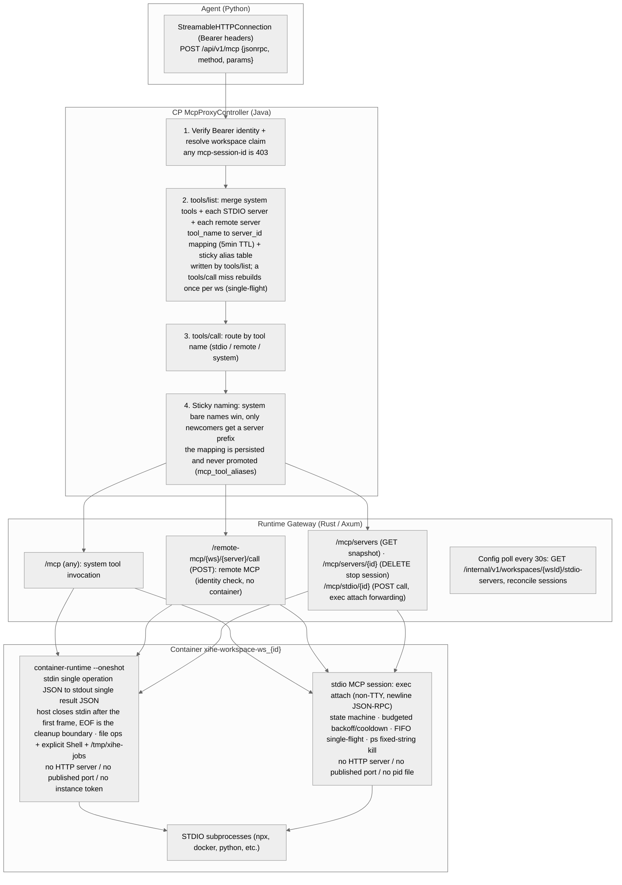

# DEV-016: MCP Three-Layer Routing Architecture

## 0.1 Workspace context (PLAN-0559)

- User-facing MCP resolves the workspace from X-Workspace-Id; VIEWER may call read-only `tools/call` (`read_file` / `read_file_range` / `list_directory` / `get_file_info` / `glob` / `grep` / `watch_directory` / `extract_pdf_text`); mutating `tools/call` returns `403 WORKSPACE_READ_ONLY`; `initialize`/`tools/list`/`resources/read` are allowed.
- The service path still uses InternalTokenFilter + explicit X-Workspace-Id + session-owner checks.
- Shared workspaces have no file/directory locks in v1; use fork/branch, declare-before-edit, checkpoints, and avoid workspace-wide revert.


## 1. Overview

MCP (Model Context Protocol) requests from Agent to tool execution pass through three routing layers:

1. **CP McpProxyController** — Authentication + tool-name-based routing
2. **Runtime Gateway** — Per-workspace dispatch
3. **stdio session (PLAN-0347)** — the host attaches an exec straight to the in-container MCP server process (no in-container HTTP bridge; a session is a state machine plus a budget and FIFO single-flight)

> **Protocol version note (2026-11-10 erratum: read it as two layers)**
>
> - **① CP wire contract = `2026-07-28`**: the logical endpoint serves `MCP-Protocol-Version: 2026-07-28` (rmcp 3.7.0's stateless protocol face, SEP-2567); the header and `params.protocolVersion` **must agree**, otherwise the CP answers `-32600` (measured text: `Invalid Request: MCP-Protocol-Version header (2026-07-28) does not match initialize params.protocolVersion (…)`).
> - **② rmcp's own negotiated value = `2025-11-25`**: the Runtime `initialize` result advertises `protocolVersion: "2025-11-25"` (rmcp 3.7.0's supported version). The previous wording ("the current MCP `Protocol-Version: 2026-07-28` (rmcp 3.7.0)") implied the negotiated value was the same — it is not; both facts hold at once.
> - **Sessionless (stateless) holds only with the `2026-07-28` header**: call the Runtime endpoint without it and the request is treated as sessionful (`400 Session ID is required`); with it, every request must also carry `params._meta` with `io.modelcontextprotocol/protocolVersion` and `io.modelcontextprotocol/clientCapabilities` (the CP fills these in `normalizeRuntimeBody`).
>
> Everything else is unchanged: CP must carry the `Mcp-Method` and `Mcp-Name` HTTP headers when forwarding `tools/list` / `tools/call` to Runtime (see commit `a9923e3`); omitting them yields an empty system tool list and `UNKNOWN_TOOL`. CP neither issues nor accepts `mcp-session-id`: any inbound value returns 403 `MCP_SESSION_INVALID` (PLAN-0537). Measured snapshot and the tool catalog: [`docs/api/mcp-tools.md`](../../api/mcp-tools.md).

## 2. Architecture Diagram



Anchors: `McpProxyController.java`, `main.rs: route registration`, `mcp_session.rs` (CONFIG_POLL_INTERVAL / state machine), `spec/session-lifecycle.md`. There is no HTTP container-runtime channel and no instance token (exec itself is the authentication boundary, PLAN-235); there is no in-container bridge and no published port or container IP (PLAN-0347).

## 3. Data Transfer Flow

### 3.1. Tool Discovery (tools/list)

```
Agent → CP /mcp
  CP: Verify Bearer + workspace claim → Read DB mcpServers JSON
  CP → Runtime: GET /internal/v1/runtime/workspaces/{workspaceId}/mcp (system tools/list)
  CP → Runtime: POST /internal/v1/runtime/workspaces/{workspaceId}/mcp/stdio/{serverId} (each STDIO tools/list)
  CP: Merge tool lists + Build tool_name → server_id mapping (cached)
  CP → Agent: Return merged tool list
```

### 3.2. Tool Invocation (tools/call)

```
Agent → CP /mcp (tool_name, args)
  CP: Lookup tool_name → server_id mapping
  CP: Miss (mapping cleared by the 5min TTL or never filled) → refill __system__
      → still missing → rebuild the stdio/remote catalog once per workspace
      (single-flight, same merge routine as tools/list)
  ├─ System tools → Runtime: POST /internal/v1/runtime/workspaces/{workspaceId}/mcp
  │               → XiheRuntime executes Rust function
  └─ User tools → Runtime: POST /internal/v1/runtime/workspaces/{workspaceId}/mcp/stdio/{serverId}
                  → stdio session: exec attach → newline JSON-RPC → Result returned
  CP → Agent: Passthrough result
```

### 3.2.1. CP-owned read-only git tools (PLAN-0686 G8)

`git_status`/`git_diff`/`git_log` are **CP-owned tools**: they are not forwarded through the Runtime `/mcp` system catalog; the CP dispatches them locally after authorization and returns a normal MCP tool-result.

- **Registration and dispatch**: tool-name constants `McpProxyController.java:94-96`; the `tools/list` catalog injection and `inputSchema` live in `populateSystemTools`; `tools/call` goes through `dispatchCpOwnedGit` (`:1536-1590`).
- **Face and authorization**: all three are in `ToolFaceRegistry.READ_TOOLS` (`:91-104`) ⇒ `read` atom + `STRUCTURED`; no new action atom, no `extraFaces` ([`spec/protocol/mcp.md`](../../../spec/protocol/mcp.md) §3.1). The gate is the §3.2 chain (`loadContext → allowsByGrant → faceOf`); an unauthorized caller gets a `TOOL_GRANT_DENIED` tool-result plus an audit record, never a bare 403.
- **Data source**: `git_status` **reuses** the public read face's one path `RuntimeCheckpointClient.workspaceGitStatus` → `/internal/v1/runtime/workspaces/{workspaceId}/git-status` (the CP keeps no second git implementation); `git_diff`/`git_log` call the Runtime read-only endpoints `git-diff`/`git-log` (wire contract in [`docs/api/inventory.md`](../../api/inventory.md)).
- **Read-only constraints (Runtime side)**: the user repository is used as `GIT_DIR`/`GIT_WORK_TREE`, `GIT_INDEX_FILE` is **never** set, `GIT_DIR` never points at the shadow repository, `GIT_OPTIONAL_LOCKS=0`, and diff runs with `--no-ext-diff --no-textconv`; `ShadowGit` is not called and index/refs are not written, so these reads can run lock-free alongside checkpoint capture/restore.
- **Failure shape**: Runtime unreachable/timeout → 503 `RUNTIME_UNAVAILABLE` (`dependency=runtime`, `retryable=true`) and **never** an empty diff/log; a Runtime refusal → an `isError=true` tool-result carrying the Runtime `reason`; invalid arguments → `INVALID_ARGUMENTS`. Audit lands in the AUDIT JSONL (`allow`/`tool_error`/`dependency_unavailable`) with shape facts only — no patch body, no commit subject.

True-chain evidence (allow/deny probes + audit read-back) belongs to PLAN-0686 T2.3 and is not claimed here; write tools (commit/branch) are out of v1.

### 3.3. Failure classification (PLAN-0557 / BL-109)

CP must not disguise an **upstream dependency failure** as "unknown tool". The error contract for `tools/list` and `tools/call`:

| Scenario | HTTP | code | Diagnostic fields |
|---|---|---|---|
| System tool catalog fetched successfully, the name is genuinely absent | 400 | `UNKNOWN_TOOL` | none (audit `unknown_tool`) |
| Runtime connection refused / DNS refusal | 503 | `RUNTIME_UNAVAILABLE` | `dependency=runtime`, `reason=unreachable`, `retryable=true` |
| Runtime read timeout or upstream 408/504 | 503 | `RUNTIME_UNAVAILABLE` | `reason=timeout`, `retryable=true` |
| CP service credential rejected by Runtime (401/403) | 503 | `RUNTIME_UNAVAILABLE` | `reason=auth_failed`, `retryable=false` |
| Any other non-2xx upstream / unparseable response | 503 | `RUNTIME_UNAVAILABLE` | `reason=upstream_error` |
| The caller itself is unauthenticated / unauthorized / awaiting approval | existing 4xx | unchanged | — |

- The `reason` enum is frozen as `unreachable|timeout|auth_failed|upstream_error`; dependency failures are audited as the action `dependency_unavailable`, accounted separately from `unknown_tool`.
- When the system catalog is unreachable, `tools/list` answers **503 as a whole** and never a partial 200 carrying only the CP-owned tools; `tools/call` for the CP-owned `spawn_agent` / `acquire_credential` is still dispatched locally by the CP.
- `ModelsProxyController` follows the same rule: an upstream failure returns 503 `AGENT_UNAVAILABLE` + `dependency=agent`, and a descriptor assembly error no longer reports the Agent as unavailable.
- The detail is fixed copy: no internal URL, port, token or upstream raw body.
### 3.4. Tool mapping lifecycle (PLAN-0583 / BL-124)

The `tool_name → server_id` mapping is an in-process cache with exactly three rules:

1. **Write**: the `tools/list` merge routine (system catalog + every STDIO server + every remote server + sticky aliases) persists the whole table once, at the end.
2. **One single-flight rebuild per workspace on a miss**: `tools/call` first tops up the `__system__`/CP-owned catalog; only if the name is **still** missing does it rebuild the stdio/remote catalog, reusing the **same** merge routine as `tools/list` (alias stickiness and `generation` semantics unchanged, issued names never drift). Rebuilds are serialized per workspace (in-process per-workspace lock + double check) so concurrent misses fan out once; a repeated true absence within one mapping epoch does not rebuild again and answers 400 directly — this bounds the fan-out caused by hallucinated tool names.
3. **5-minute expiry**: the next read (run dispatch / `tools/list` / `tools/call`) clears the whole table and stamps a fresh timestamp. A `tools/call` therefore never observes an "expired" flag — the trigger must be the **miss**, never "expired".

Error semantics stay as established by PLAN-0557: rebuilt but still absent → `400 UNKNOWN_TOOL` (audit reason `after_refresh`); dependency unavailable during the rebuild → dependency problem body (503 family), never `UNKNOWN_TOOL`.
Evidence logs: `event=tool_map_miss` and `event=tool_map_refresh` (`rebuilt` / `outcome` / `durationMs` / fan-out counts).
The TTL defaults to 300s; `cp.mcp.toolmap.ttl-seconds` is a test/stack override channel only — not a business config key, not surfaced in the UI.

### 3.5. Correlation headers and execution-domain accounting (PLAN-0463 frozen contract)

The cross-service correlation headers of one `tools/call` (full contract in
`plans/PLAN-0463-xh-mcp-execution-domain/evidence/wire-contract.md`):

| Header | Direction | Meaning |
|---|---|---|
| `X-Chat-Run-Id` | Agent→CP→Runtime | ChatRun ID (lease check + log correlation) |
| `X-Tool-Call-Id` | Agent→CP→Runtime | canonical MCP tool-call ID (a non-UUID value is normalised by the CP via `nameUUIDFromBytes`) |
| `X-Mcp-Invocation-Id` | CP→Runtime | `mcp_invocations.id`, used to correlate a late termination |
| `X-Job-Id` | CP→Runtime | optional correlation to the Workspace Job domain ID |

- **Correlation rules**: the Runtime in-flight/cancel key is `toolCallId`; the Job backend handle is a separate `runtimeJobId` and must not be confused with the Workspace Job domain `jobId`.
- **Write path**: the gate creates the `mcp_invocations` row (`source=agent`) before the grant check; the SSE relay's `agent_tool` attempt and the Proxy's `cp_forward` attempt land in `mcp_attempts`, and transitions append to `mcp_dispatch_history`; an uncertain dispatch network result is recorded as `unknown` and a late confirmation as `unknown → late_confirmed`.
- **Grant check**: the only main path is `ChatRun lease + invocation active + scope`; a missing invocation row or an owner mismatch always fails closed.
- **Late termination**: `POST /internal/v1/mcp/invocations/{invocationId}/late-termination`; the Runtime must supply the MCP invocation ID, and there is no compatibility fallback route.

## 4. Key Technical Decisions

| Decision | Choice | Reason |
|------|------|------|
| MCP transport | Streamable HTTP | MCP community has deprecated SSE |
| STDIO carrier | host `exec attach` long-lived session (PLAN-0347) | an HTTP+port bridge is Docker-only leakage and unreachable on native Windows; a session is transparent to the MCP protocol |
| STDIO deployment | no in-container component (the session talks to the MCP server process directly) | one less in-image binary and one less hop |
| Routing strategy | tool-name based (three routes: system / stdio / remote; a `McpServer` table hit means remote) | the Agent need not know `server_id` |
| Tool conflicts | sticky: bare system names win, only a newcomer gets a `serverId__` prefix, and the persisted mapping never upgrades | zero renames without conflicts; history replays by `(serverId, backendName, generation)` |
| serverId source | dual: STDIO passes the user config key through, remote uses an `mcp_remote_servers` row | no id generator; a table hit outranks a JSON key |
| remote execution | identity check (does the spec exist + authorization), no container; unknown fails explicitly | prevents privilege and billing escapes; SSRF is bounded by allowlist + DNS |
| remote auth | `authMode: oauth/no-auth`; no-auth skips the broker (a redundant Bearer is ignored, measured) | public servers need no OAuth |
| spawn state | retired (410 `MCP_SESSION_ENDPOINT_RETIRED`); sessions are managed by a 30s poll + lazy per-invocation creation | PLAN-0347 decisions #12/#18; no known caller |
| Config format | Claude Desktop JSON textarea (the mixed `mcp-config` entry splits by field: stdio / remote) | industry standard, users copy-paste directly |
| Config storage | `mcp_stdio_servers` (workspace_id + name + config JSONB, decision #27) | type validation + index support; decoupled from the three config layers |
| workspace isolation | task-local (not an env var) | supports several workspaces in one process |
| Backward compatibility | none | all components upgrade together |
| LLM visibility | workspace_id transparent | infrastructure concerns never leak into the LLM layer |

## 5. stdio session design points (PLAN-0347)

`mcp_session.rs` maintains one long-lived `exec attach` session per `(workspace, serverId)`, running the MCP server process directly.

- State machine: `starting / ready / restarting(n) / failed / stopped`; every transition writes the structured log `mcp_session_transition`.
- Retry: a budget of 3 per failure cycle, backoff 1/5/15s; past the budget ⇒ `failed` + a 5-minute cooldown (half-open).
- Concurrency: FIFO single-flight per key; queueing past the cap ⇒ `MCP_SESSION_BUSY`; cancelling one call only affects that call and never kills the session (decision #20).
- Pairing: responses pair by JSON-RPC `id`; id-less notifications (e.g. `notifications/tools/list_changed`) are recorded on a side channel.
- Termination: a fixed-string `ps` match inside the container + `kill` (SIGTERM → SIGKILL); `inspect_exec` pids live in the host namespace and cannot be used to kill inside the container; EOF does not guarantee exit.
- Reclamation: container rebuild/evict/destroy ⇒ `cleanup_workspace`; the Runtime start-up `cleanup_orphans` pass is the safety net.
- Boundaries: 1 MiB frame cap in both directions; stderr is redacted into the log; a session is never reused across workspaces.

**Retired (historical note)**: the former `xihe-mcp-bridge` design (an in-container HTTP server exposing STDIO subprocesses: `Mutex` per subprocess, streaming `Body::from_stream`, 30s read timeout, 1MB buffer, `/_spawn`, `/_kill/{id}`, `/_health`, `POST /{server_id}`) was retired by PLAN-0347 in favour of the session model above; the image no longer builds a bridge binary.

## 6. Configuration Synchronization

```
user → UI workspace-level MCP editor → PUT /api/v1/workspaces/{wsId}/mcp-config (mixed entry)
  → CP: validate JSON → split by field: stdio writes mcp_stdio_servers; remote goes to mcp_remote_servers
  → Runtime every 30s: GET /internal/v1/workspaces/{wsId}/stdio-servers (generation/hash/servers, Bearer service token)
  → Runtime: reconcile sessions (spec changed/removed → stop; first invocation creates the session lazily)
```

The public/internal contract for stdio config (`generation` optimistic lock + `hash`) is in `docs/api/openapi.yaml` and `docs/api/inventory.md`; remote servers use the `mcp_remote_servers` table (the class name `McpServer.java` stays, decision #38②): `workspaceId/name/endpoint/authConfig/enabled/authMode`, the CP routes by table lookups, and the Runtime fetches a short-lived token through the CP broker (no-auth skips it). The read side of the mixed entry returns non-sensitive fields only (remote returns just `url`/`type`; OAuth metadata is never returned).

### 6.1 OAuth token broker (PLAN-0349)

`POST /internal/v1/oauth/token` is served by the CP `OAuthCredentialService` + `OAuthTokenBroker`; the Runtime only ever consumes a short-lived access token:

- **Cache and single-flight**: the access token is cached in-process per `(userId, workspaceId, serverId)` with TTL = `clamp(expires_in − 60, 0, 300)` seconds (300s conservative default when the provider omits `expires_in`; `ttl = 0` returns without caching); concurrent calls for the same key trigger one provider refresh, and waiters share the same result or the same failure.
- **Rotation write-back**: refreshes run inside the credential row lock (`SELECT ... FOR UPDATE` + the PLAN-0346 `SET LOCAL lock_timeout`), so concurrent refreshes consume the rotation chain serially instead of invalidating each other; a lock wait timeout ⇒ 503 `OPERATION_LOCK_TIMEOUT`.
- **Two error tiers**: 401 `OAUTH_REAUTH_REQUIRED` (missing credential / state not AUTHORIZED / scope mismatch / an explicit provider refusal such as 4xx or `invalid_grant`); 503 `OAUTH_TOKEN_UNAVAILABLE` (provider unreachable / timeout / 5xx). The Runtime consumes by HTTP status and never parses the problem code.
- **Revocation**: set `REVOKED` locally + invalidate the cache immediately, and after commit notify the provider best-effort (RFC 7009; the revocation endpoint is discovered via RFC 8414 / OpenID metadata, and a missing endpoint or a failure is only logged).
- **Observability**: structured events `oauth_token_hit` / `oauth_token_miss` / `oauth_token_refresh` / `oauth_token_merge` / `oauth_token_revoke` / `oauth_token_failure` (with `requestId` and the three-part ids); neither the plaintext token nor the provider response body is ever logged.

### 6.2 stdio session visibility (PLAN-0366)

`GET /api/v1/workspaces/{workspaceId}/mcp/servers` is a thin CP proxy (visible to members): it calls the Runtime `GET /internal/v1/runtime/workspaces/{ws_id}/mcp/servers` and performs the **single explicit key mapping** on the CP side (`server_id/state/attempt/last_error/since_ms/epoch` → `serverId/state/attempt/lastError/sinceMs/epoch`; `state` keeps the Runtime lowercase literal), without recomputing state semantics or changing the Runtime back (decisions #2/#13). Error table: the Runtime 404 `WORKSPACE_NOT_FOUND` / 409 `WORKSPACE_DESTROYING|WORKSPACE_BUSY` / 503 `WORKSPACE_MATERIALIZATION_FAILED` allowlist is passed through; unreachable, timeout, unparseable response or an unknown code ⇒ 502 `RUNTIME_UNAVAILABLE`. The Runtime handler calls `ensure_workspace` first, so the first query may trigger materialisation (an accepted side effect; later queries are pure registry reads).

The workspace tab of the settings page merges rows from `stdio-servers` (config name) ∪ this endpoint (snapshot `server_id`): five-state badges (starting/ready/restarting/failed/stopped) + a "no record" row + the failure reason; fetch on open + manual refresh + a 30s poll (paused while the page is hidden; on failure the last state is kept and marked "state may be stale", with no automatic retry storm).

The same wave fixed the CP `toolServerCache` invalidation: when a forwarded stdio `tools/list` answers non-2xx, **all** old mappings for that serverId are dropped (a warn records wsId/serverId/status), and a partial failure does not affect the mappings or tool merge of other servers — so `tools/call` never keeps routing to an unavailable server (the call side prefers "unknown tool"). The planning-rework section (§3.4) **reuses that eviction semantics verbatim**: a server whose rebuild failed leaves no stale route behind.

## 7. Test Strategy

| Layer | Content | Command |
|------|---------|------|
| Unit | session state machine / budget / pairing / kill command | `cargo test --lib -- mcp_session::` |
| Unit | Gateway route forwarding | `cargo test --lib` (counts as measured) |
| Unit | CP McpProxyController | `mvn test -Dtest=McpProxyTest` |
| Unit | MCP configuration (ConfigSettings) | `pnpm vitest run` |
| Integration | real container session (lazy create / self-heal / cleanup) | `cargo test --test mcp_session_test` |
| E2E | settings page screenshot | `npx playwright test e2e/real/settings-visual.spec.ts` |

### 7.1. Agent manual verification runbook (PLAN-242 addendum)

For an Agent operator verifying that a remote tool is reachable end to end (a no-auth public server as the example):

1. Register: insert one `mcp_remote_servers` row (`workspaceId`, `name=deepwiki`, `endpoint=https://mcp.deepwiki.com/mcp`, `authMode=no-auth`, `enabled=true`).
2. Discover: `POST /api/v1/mcp` with `tools/list`; confirm the response contains the remote tool names (bare names when there is no conflict).
3. Invoke: `tools/call` with the tool name from the previous step; confirm the result is passed through.
4. Audit: check the audit log; `detail` carries the four-part `serverId/deepwiki backendName/<original name> generation=<n>`.
5. No-container assertion: `docker ps` shows no new workspace container (remote tools create none).
6. Smoke (not a gate): call the endpoint directly with `initialize` (both with and without a Bearer should answer 200, see M1.3).

## 8. Related Files

| File | Description |
|------|-------------|
| `packages/agent/.../mcp_client.py` | Agent MCP client (StreamableHttpConnection) |
| `packages/runtime/src/mcp_session.rs` | stdio MCP session (direct `exec attach`; replaces the retired bridge) |
| `packages/runtime/src/container_runtime.rs` | In-container xihe-container-runtime binary (file ops + command execution, oneshot) |
| `docker/images/workspace/Dockerfile` | xihe/workspace container image multi-stage build (no bridge since PLAN-0347) |
| `packages/runtime/src/workspace.rs` | Container lifecycle (bridge machinery deleted) |
| `packages/runtime/src/main.rs` | Route registration + config polling |
| `packages/control-plane/.../McpProxyController.java` | CP layer routing proxy (three-way split + sticky merge) |
| `packages/control-plane/.../entity/McpServer.java` (table `mcp_remote_servers`, `authMode`) | remote server row (carries the no-auth marker; the class name stays, decision #38②) |
| `packages/control-plane/.../entity/McpStdioServer.java` (table `mcp_stdio_servers`) | stdio server row (workspace scoped, decision #27) |
| `packages/control-plane/.../entity/McpToolAlias.java` | Persisted sticky aliases (`workspace_id + issued_name` primary key) |
| `packages/control-plane/.../ConfigController.java` | MCP config API (stdio-servers public/internal endpoints + mixed `mcp-config` split) |
| `packages/ui/src/views/settings/ConfigSettings.vue` (workspace-level MCP editor + `saveMcpConfig`) | MCP config UI (a workspace settings entry since PLAN-0307 T2.17) |

## 9. Appendix: retirement of the session signature (PLAN-0537)

> The historical chapter "MCP Session-id Signing Rule" was retired by PLAN-0537. It required a session-id to be HMAC-SHA256 signed with a deployment-injected key and verified server-side — that described the session model before PLAN-0308 decision #34.

Current state (since 2026-10-19):

- The logical MCP is served with **no session** semantics (wire protocol version `2026-07-28`; the two-layer version semantics are in §1 "protocol version notes"), and the CP **never issues, echoes or forwards** `mcp-session-id`.
- An inbound request that carries that header is **always 403 `MCP_SESSION_INVALID`**; no signing key is involved.
- That HMAC signing key has been removed from code, config, scripts and deployment templates.
- `mcp-session-id` between the Runtime and an upstream remote MCP server is unaffected — it is a different boundary (see `packages/runtime/src/remote_mcp.rs`).

The full module-to-module authentication chain and key matrix are in [DEV-024 module authentication and key matrix](DEV-024-authentication-matrix.md).

## 10. Runtime MCP tool catalog (snapshot; the handshake is authoritative)

The tool catalog is a **runtime property**, not a static contract: it is decided by the `#[tool(...)]` registration sites in `packages/runtime/src/main.rs` and declared to callers by the `tools/list` handshake. The catalog itself lives in [`docs/api/mcp-tools.md`](../../api/mcp-tools.md).

**Read it this way**: that document is a **snapshot**; the **authoritative** value is always a live `tools/list` answer. When they disagree, the handshake wins and the document is what gets corrected. The snapshot carries per-tool `name` / `description` / `inputSchema` summary, side effects, the CP policy face (`ToolFaceRegistry`), and the commands to regenerate and re-verify it.

**Three faces, one catalog** (measured 2026-11-11 on dev stack `stack-2`, base `4b5a7a3d44ab`; the first measurement on `stack-1`, 2026-11-10, gave the same numbers):

| Face | Caller | Tools | Note |
|---|---|---|---|
| Runtime MCP server | CP only (`/internal/v1/runtime/workspaces/{id}/mcp`) | **23** | the full "system tools" set |
| CP logical entry, user/agent token | Agent, user-facing MCP clients | **23** | plus workspace-configured STDIO/remote tools (none on a fresh workspace) |
| CP logical entry, internal service token | CP-internal faces (sub-agent / credential / skill / git) | **29** | 23 + **6 CP-owned tools** |

The CP-owned tools (`spawn_agent`, `acquire_credential`, `skill_read`, `git_status`, `git_diff`, `git_log`) are injected by `populateSystemTools` only when `access.internalService()` is true (`McpProxyController.java:605-622`) — **a user/agent face never sees them** (which is also why the three git tools in §3.2.1 are service-face capabilities, not model-face ones).

**Re-verification (run both, then align line by line)**:

1. source side — `#[tool(` count in `packages/runtime/src/main.rs` is 23 and the method-name set equals the handshake `name` set;
2. runtime side — send `tools/list` to `/api/v1/mcp` (stateless; an `mcp-session-id` is rejected with 403) and read `result.tools`. Two traps worth recording: **a freshly started stack has an empty database — create a workspace first**, otherwise the tenant filter answers `401` (that is missing workspace context, not an auth or endpoint problem); for the service face (29) repeat the same request with `.env.dev`'s `XIHE_AGENT_API_TOKEN` as the bearer.

The runnable script and acceptance criteria are in [`docs/api/mcp-tools.md`](../../api/mcp-tools.md) §6, together with the six discrepancies/clarifications of the moment (the entry where `start_background_process` advertised a `truncate_limit` it ignored is now fixed by dropping the parameter: the background path returns no output, so output is read page-wise through `read_command_output` and truncated by the per-stream 1 MiB retention budget).

**Re-verification log**:

- **2026-11-11** (base `4b5a7a3d44ab`, dev stack `stack-2`, live handshake succeeded): `tools/list` measured on both faces — user face **23**, internal-service face **29** (= 23 + 6 CP-owned). The 23 registration sites (`:455`–`:806`) re-extracted and aligned line by line against the handshake: `name` set, `description` (23/23 byte-identical), `inputSchema` property names/required/leaf types and the 13/10 `outputSchema` split were all **0-diff** (compared after resolving `$defs`; the handshake serializes nested objects as `$ref` while the static extractor inlines them — a serialization difference, not a schema difference). Same run re-checked §5's protocol claims: inbound `mcp-session-id` → `403 MCP_SESSION_INVALID`; `GET`/`DELETE` with a workspace context → `405`; `MCP-Protocol-Version: 2026-07-28` disagreeing with `params.protocolVersion=2025-11-25` → `400 -32600`; `initialize` echoes `2025-11-25`; the `tools/list` result carries only `tools`/`resultType`/`cacheScope`/`ttlMs` (no `nextCursor`). No true `inputSchema` bug surfaced — the only apparent "diff" was the `$ref` shape of `apply_patch.patches.items`. Evidence and re-runnable script: `plans/PLAN-0763-XH-api-contract-docs/evidence/m3-tools-snapshot/` and `docs/api/mcp-tools.md` §6.
- **2026-11-11 (earlier round, superseded by the entry above)** (base `84ec2462618f`, dev stack down): the 23 `#[tool(` registration sites (`:455`–`:806`) were re-extracted — name set, required params and return types (13 `Json` / 10 `String`) all match this section and the catalog 0-mismatch (alignment table: `plans/PLAN-0763-XH-api-contract-docs/evidence/m3-tools-snapshot/alignment.md`). The 14:2x re-probe still found no candidate port listening (12631/12633/12640–44), so the byte-level source↔handshake description diff remains blocked-on-stack (probe record in the same dir). Once a stack is back, run `mcp-tools-verify.mjs` from that directory for the handshake side. §7#1 (`truncate_limit`) confirmed fixed by task-241 (removed + three Rust tests pinning the behavior, `main.rs:7382-7450`).

**Change rule**: adding/removing a tool, or changing a `description` or `inputSchema`, is a tool-surface change — update the catalog in the same batch and re-run the §6 check. Code without the catalog update is documentation debt.

**Three easy-to-misread points**:

- **Two protocol-version layers** (CP wire contract `2026-07-28` vs rmcp negotiated `2025-11-25`) and **the condition for sessionless mode** (`MCP-Protocol-Version: 2026-07-28` + `params._meta`): see the erratum in §1; not repeated here.
- **Do not document `X-Workspace-Id` as optional**: a single-workspace dev stack returns the same catalog without it, but multi-workspace behavior is unverified, so the user face must send it.
