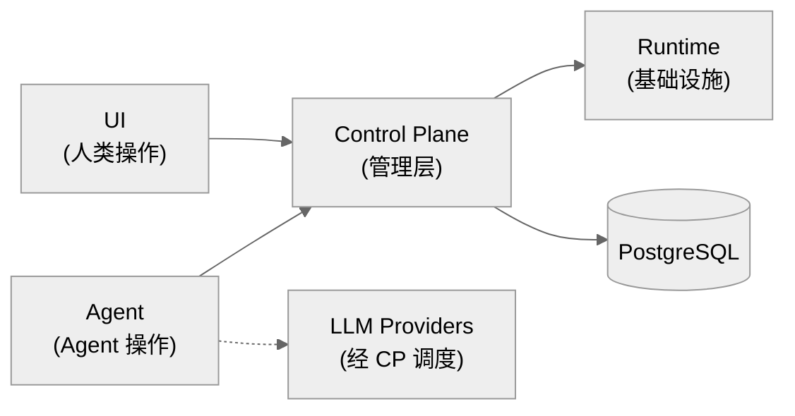
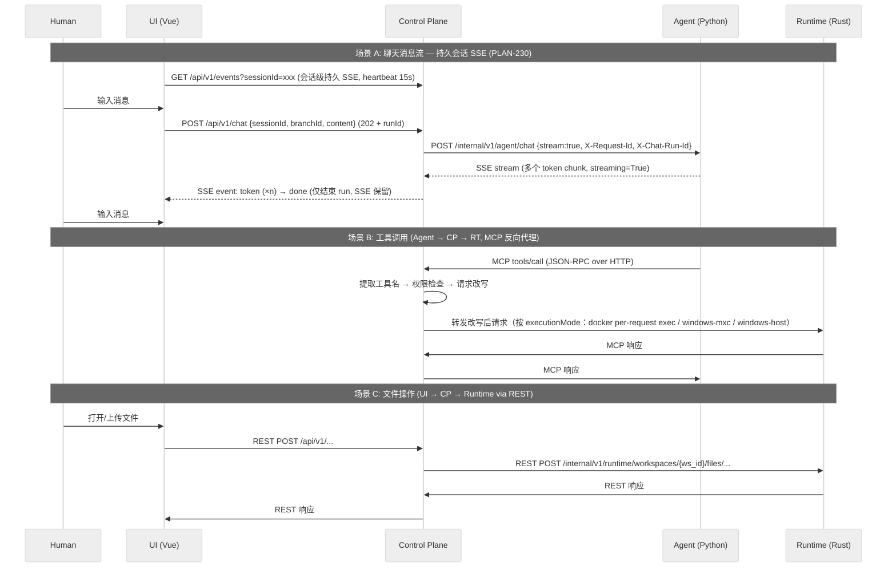

# DEV-001: xihe Agent 系统架构

> 面向新人阅读：5 分钟建立全系统心智模型（四模块分工 + 两流 + 协议总表）。模块细节见 DEV-010/013/014/015/016/017。
>
> xihe 是一个通用 Agent 运行时平台，提供多 Agent 编排、工具调用、沙盒执行、权限控制等能力。四模块 Hub-Module 架构：各模块独立演进、独立部署、独立技术栈。模块专篇：UI 见 DEV-010、Agent 见 DEV-013、CP 见 DEV-014、Runtime 见 DEV-015、MCP 见 DEV-016、Session 见 DEV-017；本文保留总览与实现导航，冻结的跨模块契约见根级 `spec/architecture/` 与 `spec/protocol/`。

## 1. 四模块详解

四模块的分层与调用主线（结构图用内联 SVG，口径见 DEV-030 §6.1）：

<svg viewBox="0 0 660 300" width="100%" role="img">
  <title>四模块分层与调用主线</title>
  <rect x="160" y="18" width="340" height="34" rx="5" fill="#f3f4f6" stroke="#9ca3af"/>
  <text x="330" y="40" font-size="13" fill="#374151" text-anchor="middle">操作入口</text>
  <rect x="40" y="84" width="180" height="52" rx="5" fill="#ffffff" stroke="#9ca3af"/>
  <text x="130" y="106" font-size="13" fill="#374151" text-anchor="middle">UI 模块</text>
  <text x="130" y="124" font-size="11" fill="#6b7280" text-anchor="middle">人类交互</text>
  <rect x="440" y="84" width="180" height="52" rx="5" fill="#ffffff" stroke="#9ca3af"/>
  <text x="530" y="106" font-size="13" fill="#374151" text-anchor="middle">Agent 模块</text>
  <text x="530" y="124" font-size="11" fill="#6b7280" text-anchor="middle">编排与思考</text>
  <rect x="160" y="168" width="340" height="52" rx="5" fill="#eef2ff" stroke="#4f46e5"/>
  <text x="330" y="190" font-size="13" fill="#312e81" text-anchor="middle">CP 模块</text>
  <text x="330" y="208" font-size="11" fill="#4338ca" text-anchor="middle">路由 · 权限</text>
  <rect x="160" y="250" width="180" height="40" rx="5" fill="#ffffff" stroke="#9ca3af"/>
  <text x="250" y="275" font-size="13" fill="#374151" text-anchor="middle">Runtime 模块</text>
  <rect x="380" y="250" width="120" height="40" rx="5" fill="#ffffff" stroke="#9ca3af"/>
  <text x="440" y="275" font-size="12" fill="#374151" text-anchor="middle">PostgreSQL</text>
  <path d="M130 136 L130 158 L165 158 L165 168" stroke="#9ca3af" fill="none"/>
  <path d="M530 136 L530 158 L495 158 L495 168" stroke="#9ca3af" fill="none"/>
  <path d="M300 220 L300 250" stroke="#9ca3af" fill="none"/>
  <path d="M380 270 L330 270" stroke="#9ca3af" fill="none"/>
  <path d="M330 52 L330 64" stroke="#9ca3af" fill="none"/>
  <text x="330" y="78" font-size="11" fill="#6b7280" text-anchor="middle">两条入口汇入 CP</text>
</svg>

### 1.1. UI 模块 — Vue/TypeScript

职责：人类交互入口。

| 方面 | 选型 |
|------|------|
| 框架 / 语言 | Vue 3 + TypeScript（Composition API） |
| 包管理 / 构建 | pnpm / Vite 8 |
| 路由 / 状态 | Vue Router / Pinia + persistedstate |
| 组件 / 样式 | reka-ui + Tailwind CSS v4 |
| 图标 / 富文本 | @lucide/vue / remark + rehype + Shiki + KaTeX |
| 测试 / 规范 | Vitest + @vue/test-utils / oxlint |

通信：

- 只与 CP 对话（`fetch POST` + 持久 `EventSource` SSE），不直接调用 Agent 或 Runtime。
- 零系统调用：纯展示 + 输入采集。

### 1.2. Agent 模块 — Python / LangChain

职责：LLM 调用（直调 provider，不经 CP，见 DEV-013 §2.3）、多 Agent 编排、工具选择、规划决策。Python + LangChain + litellm（`ChatLiteLLM`，100+ Provider）、uv、长驻后端服务；不碰文件系统/Shell，只做"思考"。

| 方面 | 选型 |
|------|------|
| 语言 / 包管理 | Python + uv |
| 编排 / LLM | LangChain + litellm（`ChatLiteLLM`，100+ Provider） |
| 部署 / 边界 | 长驻后端服务；不碰文件系统/Shell，只做“思考” |

关键能力：

- 经 CP 获取工具清单并决策；Agent 间委派 / 并行 / 合并。
- Event Sourcing 上下文（PLAN-035）：只消费 CP Context projection 读模型（由事件重建）的 `AgentContext` 快照。
- MCP 集成经 CP 单一入口。
- `AgentRunner` / `BaseAgentTool` / `EventAdapter` / `LLMProvider` 接口隔离实现。

详见 DEV-013。

### 1.3. Runtime 模块 — Rust

职责：Agent 的本地执行面——文件系统、Shell、命令、后台 Job、stdio MCP 会话、checkpoint 与远程 MCP 出网。Rust + cargo。

**执行后端（现实现）**：Workspace 操作按 `ExecutionSpec.executionMode` 分三种后端——`docker`（容器内 `xihe-container-runtime --oneshot` 的 per-request exec）、`windows-mxc`（宿主侧 MXC 受限沙盒，`wxc-exec` + policy 的 `readwritePaths`/`readonlyPaths`）、`windows-host`（宿主直连，仅路径守卫、`canIsolateFilesystem=false`）。三者共用 `WorkspaceExecutionRouter` 与 `SandboxBackend` 接缝，消费方按能力声明分支，缺失能力显式 `UNSUPPORTED`、不静默回退（见 DEV-031）。**`docker` 已冻结**（PLAN-0612 M4 自 2026-10-31 起门禁、PLAN-0618 于 2026-11-01 裁定完全冻结：CP 侧 `XIHE_WORKSPACE_DOCKER_BACKEND` 默认 disabled，以 `409/503 BACKEND_DISABLED` fail-closed，见 DEV-014 §8b）。历史沿革：PLAN-235 时执行模型是「Strict / Coding / Isolated 三 profile 的 Workspace 文件、命令、PDF、后台操作全部经 `WorkspaceExecutionRouter` 以 per-request Docker exec 在 Sandbox 内执行」；此后 MXC / host 两条后端路径承接执行面，三 profile 现只作用于 docker 路径（`sandbox.rs` 的 `SecurityProfile` 仍由 docker 容器创建消费）。详见 DEV-015。

| 约束 | 说明 |
|------|------|
| 无静默回退 | 后端不可用 / 未知 workspace 显式失败（`UNSUPPORTED` / `BACKEND_DISABLED`），不得自动降级到宿主 |
| 无旁路通道 | 无 HTTP container-runtime 通道 / instance token / 长驻 worker；容器内 `exec attach` 本身即认证边界 |
| 隔离按后端分级 | docker：namespace/cgroup/seccomp + `network_mode` none/bridge、不发布端口；`windows-mxc`：`wxc-exec` policy 的路径白名单；`windows-host`：`canIsolateFilesystem=false`，只做路径守卫 |

四 binary：

| Binary | 角色 |
|--------|------|
| `xihe-runtime` | Gateway 主进程 + MCP server |
| `xihe-container-runtime` | 容器内执行器（`--oneshot` 单帧 EOF） |
| `xihe-stdio-fixture` | 测试用 stdio 回显进程（非产品 binary） |
| `xihe-plugin-fixture` | 插件 T2.4a 工艺样本，只给 `tests/plugin_runner_test.rs` 用（不是产品插件） |

> `xihe-mcp-bridge` 已随 PLAN-0347 退役：容器内 HTTP bridge、发布端口与容器 IP 解析全部删除，stdio MCP 改为宿主 `exec attach` 长驻会话直连（见 DEV-016 §5）。

CP→Runtime REST 端点（Axum，`/internal/v1/runtime/...`）——完整路由表见 `packages/runtime/src/main.rs` 的 `build_app_router`：

| 用途 | 方法 | 路径 |
|------|------|------|
| 创建 / 删除 workspace | POST | `workspaces` / `workspaces/delete` |
| workspace 状态 / 物化 / 释放 / 导入 | GET / POST | `workspaces/{ws_id}/{status,materialize,release,imports}` |
| MCP 调用 | any / POST | `workspaces/{ws_id}/mcp`（系统工具）、`workspaces/{ws_id}/mcp/stdio/{server_id}`（stdio 会话）、`remote-mcp/{workspace_id}/{server_id}/call`（host 出网） |
| MCP 会话管理 | GET / DELETE | `workspaces/{ws_id}/mcp/servers`（会话快照）、`workspaces/{ws_id}/mcp/servers/{server_id}`（停单个会话）；`mcp/spawn` 已退役，固定返回 `410 MCP_SESSION_ENDPOINT_RETIRED` |
| 文件操作 | POST（body 传参） | `files/{read,list,delete,mkdir,stat,search}` |
| 文件写入 | POST（二进制，路径参数） | `files/write/{*path}` |
| checkpoint / git / jobs | POST / GET | `checkpoints/*`、`git-status`/`git-diff`/`git-log`/`git-facts`、`jobs/{start,status,output,cancel,cleanup,capabilities}` |
| 能力探针 / 诊断 | POST / GET | `capabilities/direct-attach/probe`、`diagnostics` |
| 健康 | GET | `/health`、`/ready` |

MCP 工具（rmcp `#[tool]`，`main.rs` 共 23 个）：

| 组 | 工具 |
|----|------|
| 文件 | read_file、read_file_range、write_file、list_directory、get_file_info、mkdir、delete_file、delete_directory、move_file、copy_file、edit_file、apply_patch |
| 检索 | glob、grep、extract_pdf_text、web_fetch |
| 命令 | execute_command、read_command_output、watch_directory |
| 后台 | start_background_process、list_background_processes、get_background_process、cancel_background_process |

### 1.4. Control Plane 模块 — 系统核心

职责：路由 + 权限控制 + 数据加工 + 状态广播 + 会话管理 + 统一配置管理。

| 方面 | 选型 |
|------|------|
| 语言 / 构建 | Java + Spring Boot、Maven |
| 能力 | 聊天中转 + MCP 反向代理 + 权限裁决 + 审计 |
| 协议 | HTTP/SSE + MCP Streamable HTTP 三通道 |
| 配置 | ConfigService 三层作用域 instance / workspace / user（详见 DEV-003） |
| 约束 | **不做模块专属业务逻辑** |

CP 三通道：

| 通道 | 契约 |
|------|------|
| 聊天 | `POST /api/v1/chat` + 持久 `GET /api/v1/events?sessionId=`（PLAN-230：单会话单活 emitter + generation、`done` 只结束 run、`heartbeat` 15s、409 准入门；PLAN-0645 M0/M1 起同会话可并发 `maxConcurrentRunsPerSession`（默认 2）条 run，cap 满才 `409 CHAT_IN_PROGRESS`） |
| MCP 反向代理 | `POST /api/v1/mcp`（认证 + tool-name 路由 + 三层转发） |
| 状态分发 | Runtime notification → UI SSE / Agent 透传 |

详见 DEV-014。

### 1.5. 通信协议总结

| 协议 | 用途 | 链路 | 关键契约 |
|------|------|------|----------|
| 持久 SSE + `POST /api/v1/chat` | 聊天：`GET /api/v1/events?sessionId=` 建会话长连接；`token` 增量 → `done` 结束 run，SSE 保留 | UI ↔ CP ↔ Agent | `done` ≠ 关 SSE；单活 emitter + generation；同会话并发上限 `maxConcurrentRunsPerSession`（默认 2，PLAN-0645） |
| MCP Streamable HTTP | Agent 工具调用（JSON-RPC over HTTP，经 CP 反代） | Agent → CP → Runtime / 外部 | tool-name 路由 |
| MCP notification | 状态同步 | Runtime → CP → UI / Agent | — |
| HTTP (REST) | 文件操作/上传/管理（二进制直传） | UI → CP → Runtime | `/internal/v1/runtime/...` |

MVP 零额外基础设施（无消息队列/WS 网关）；后续可按需引入消息中间件做集群扩展。

### 1.6. 设计备注

- **统一 MCP 反向代理**：Agent 所有 MCP 调用指向 CP 单一入口，按工具名前缀路由后端；Agent 不感知后端分布。（历史设计名：DESIGN-007）
- **工具名命名空间**：`ToolNameRewriter`（`read_file` ↔ `serverId__read_file`）冲突时策略，已接线（PLAN-242 M2；无冲突零改名，映射落盘永不晋升）。（历史设计名：DESIGN-009）
- **工具自发现**：Runtime 经标准 `tools/list` 暴露 Schema，Agent 经 CP 自动发现，零手动同步。
- **零 MCP SDK 依赖（CP 侧）**：CP 纯 HTTP 反代，直接解析 JSON-RPC 做权限检查与改写。（历史设计名：DESIGN-001）

## 2. 两流模型

1. **指令流** — RPC 模式：request → execute → response；响应分一次性与流式（逐 token / 实时 stdout）。
2. **状态流** — 异步广播，无响应预期，一对多经 CP 分发。

状态流：Runtime/Workspace storage watcher → CP `POST /internal/v1/runtime/workspaces/{workspaceId}/events` → UI Workspace SSE（`GET /api/v1/workspaces/{workspaceId}/events`）；ChatRun 仍独立走 Session SSE（`GET /api/v1/events?sessionId=`）。文件正文与目录树继续走 HTTP/MCP，不进入事件流。

## 3. 架构优势

1. **多进程解耦** — 模块独立部署/扩缩/故障隔离；Agent Crash 不影响 UI，Runtime OOM 不影响 Agent。
2. **多语言各取所长** — Vue（Web 生态）、LangChain/Python（AI 生态）、Java + Spring Boot（服务端生态）。
3. **显式消息路由** — CP 是唯一通信枢纽，消息路径全程可追踪、可拦截、可 replay。
4. **多租户与隔离分级** — 多进程边界 + 按后端声明的隔离等级（docker namespace、MXC policy、宿主路径守卫）。
5. **执行后端接缝** — `SandboxBackend` + `WorkspaceExecutionRouter` 把执行面抽象成能力声明，后端可替换（docker / windows-mxc / windows-host）；缺失能力显式失败，对 LLM「幻觉执行」按后端分级防御。
6. **多终端天然支持** — Web/TUI/App 只需实现 CP 协议。

## 4. 统一 Session 与附件（摘要，详见 DEV-017）

chat 与 workspace 可以在同一工作界面协作，但 Workspace 是独立资源，Session 只是可选绑定与上下文层：

- Chat 用 `/chat/:sessionId`，Workspace 用 `/workspace/:workspaceId`。
- Workspace 可以没有 Session；需要聊天时再选择或创建绑定该 Workspace 的 Session。
- `useSessionStore` 承载服务端 Session 数据的 UI 本地视图；`useChatStore`/`useWorkspaceStore` 为视图层状态。
- 附件持久化到后端 Session 专属空间（`{base}/{sessionId}/{fileId}`），刷新仍可渲染。

## 5. 远程 MCP 与 OAuth 边界（摘要，详见 DEV-016/DEV-014）

- UI 发起 Authorization Code + PKCE；CP 保存加密 refresh token，按 user/workspace/server 发短期 access token。
- Agent 只连 CP logical MCP endpoint；Runtime host-side connector 负责远程 MCP 出网；workspace sandbox 不直接出网。
- Fake OAuth/Fake MCP 只作真实 integration/E2E fixture。

## 6. ChatRun 与工具边界（PLAN-247）

- `POST /api/v1/chat` 是唯一聊天提交入口；`GET /api/v1/events?sessionId=` 是会话级持久 SSE，`done` 只结束当前 run。
- CP 在 gate 通过后持久化 `ChatRun` 与 user `Message`，以 `(userId, sessionId, Idempotency-Key)` 幂等；request hash 含所选 `branchId`，并由 Run/Message 固化；`Message.runId` 关联 durable terminal outcome。
- `success`、`error`、`partial`、`ambiguous` 是不同终态。连接断开且无法证明 provider 未执行时为 `ambiguous`，禁止自动 retry；人工确认后使用新 idempotency key。
- UI 仅在首个 token/reasoning/artifact 后创建 assistant bubble；空失败不会留下 ghost row，错误同时有 inline 状态和 Toast。
- 普通 Chat 固定 `toolMode=none`，不触发 MCP discovery；Workspace/tool 操作显式使用 `toolMode=workspace`。Agent MCP client 不跨 workspace 复用，无法隔离时 fail-fast。
