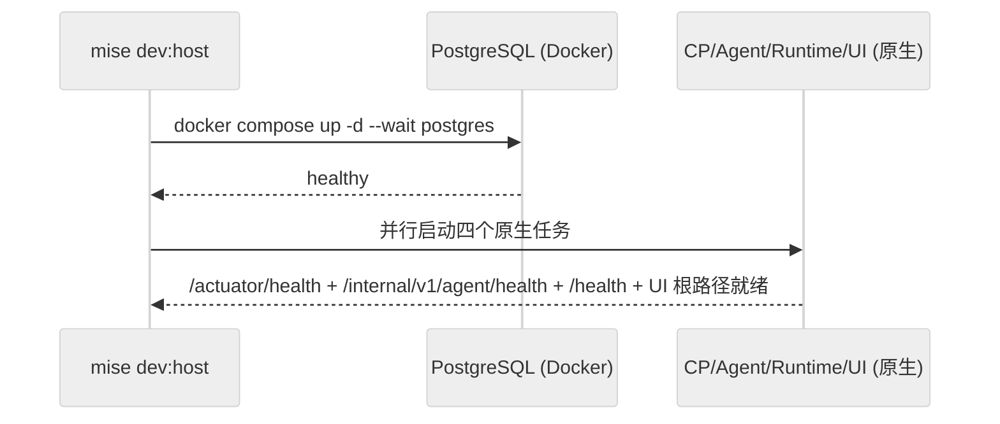

# DEV-002: 开发者指南

> 环境搭建、运行模式与全栈调试。配置管理详见 DEV-003，日志详见 DEV-004，测试策略见 DEV-020/021/022/023。

## 1. 项目结构

```text
xihe/
├── packages/
│   ├── ui/                    # Vue 3 + Vite + Tailwind + reka-ui
│   │   ├── src/               # components / composables / stores / router / i18n / mocks / types
│   │   └── e2e/               # Playwright（mock/ + real/）
│   ├── control-plane/         # Java 25 + Spring Boot 4 + Maven
│   │   └── src/main/java/.../cp/  # auth / chat / mcp / config / context / files / session / audit
│   ├── agent/                 # Python 3.12 + LangChain/LangGraph + uv
│   │   └── src/xihe_agent/    # interfaces / agent_runner / adapters / context / tools / llm / rag / registry
│   └── runtime/               # Rust 1.97.1 edition 2024 + cargo
│       └── src/               # main / executor / workspace / container_runtime / fs / sandbox / mcp_bridge / hydrate
├── docs/i18n/{zh-Hans,en}/    # 公开文档（编号规则见 DEV-030）
├── scripts/                   # dev-host / reset-admin / scan-log-secrets 等辅助脚本
├── docker/images/workspace/   # xihe/workspace 容器镜像
├── mise.toml                  # 工具链与跨模块任务
└── docker-compose.yml         # 全容器基线编排
```

包管理规则：

- 根 `pnpm-workspace.yaml` 仍有效（`packages/*` 约束 + 构建白名单），但日常不走 pnpm workspace 安装：UI 依赖仅在 `packages/ui/` 内用 pnpm 管理。
- `Taskfile.yml` 已移除（PLAN-245 M5），统一入口为 `mise run ...`。

## 2. 环境与安装

```bash
mise install
mise run setup
cp .env.example .env.dev
# 编辑 .env.dev（端口/DB/JWT/Workspace 根等，详见 DEV-003 §2）
```

前置：Node 22+ / pnpm 10+ / Python 3.12+ + uv / Java 25+ + Maven 3.9 / Rust 1.97.1+ / Docker（Desktop for Windows 需 WSL2 集成）。

模块级等价命令：

| 模块 | 命令 |
|------|------|
| UI | `cd packages/ui && pnpm install`（pnpm workspace 根与 lock 均位于 UI 包）|
| Agent | `cd packages/agent && uv sync --all-extras` |
| CP | `cd packages/control-plane && mvn dependency:resolve` |
| Runtime | `cd packages/runtime && cargo fetch` |

## 3. 运行模式

### 模式 A：`dev:host` 日常开发（推荐）

```bash
mise run dev:host
```



要点（锚点：`mise.toml: dev:host` + `scripts/dev-host-watch.mjs`）：

- PostgreSQL 跑在 Docker，其余 CP/Agent/Runtime/UI 由 mise 原生并行管理。
- 默认启动**不导入配置，也不创建/更新 Provider Connection**。
- 需要配置时，CP ready 后显式运行 `mise run dev:host:import-config`；该命令只导入非密钥 JSONC。
- **`mise run dev:host` 不加载 `.env.dev`**：内部服务 token 需自行注入，否则回落到 dev 占位值。正解：`scripts/dev-host.ps1 -Start`（自动生成内部 token）或显式注入 env；后者脚本的 `Start-Process` 在非 TTY 调用下会因句柄继承挂住调用方（服务实际已起），自动化场景改用可追踪后台进程逐服务启动（端口 12631/12632/12633 做 ready 探针）。模块认证与密钥清单见 [DEV-024](DEV-024-authentication-matrix.md)。
- **LLM 就绪前置**：未导入 `llm-provider` profile 时 Agent 报 `llmReady=missing_credentials`，`POST /api/v1/chat` 直接 503 `LLM_NOT_CONFIGURED`；`POST /api/v1/config/import?layer=instance` **只接受纯 JSON**（`config.import.local.jsonc` 的行注释需先剥离，或直接用上面 CLI）。
- **脚本化链路三要点**：session 创建时自带 root branch（`POST /sessions/{id}/branches` 是 fork 语义、需 `sourceBranchId`+`anchorMessageId`，不要"再建一个"）；`POST /api/v1/chat` 前须有活跃 SSE 订阅（否则 409 `SSE_SUBSCRIPTION_REQUIRED`）；Bearer 只活 900s，`reset-admin`→`login` 取的 token 落 Temp 并在每批前刷新（勿入库）。
- 需要创建 Provider Connection 时，单独运行 `mise run dev:host:provider-init -- --provider xiaomi --scope USER --label xh-local --api-key-env XIHE_XIAOMI_API_KEY`。
- Runtime 用 `XIHE_WORKSPACE_HOST_ROOT`（默认 `A03-xihe/.xihe-workspaces`）作**进程级宿主存储基目录**：managed workspace 路径由其 + `storageRef` 派生，shadow 在 `<hostRoot>/.xihe-shadow`；不是每个 workspace 一个根，也不是用户路径白名单。launcher 注入的进程值必须绝对；源配置可相对（`.env.dev` 的 `../../.xihe-workspaces` 以 `packages/runtime` 为基准）。
- `/health` 为 liveness，`/ready` 不等待全部 Sandbox 物化；Workspace 按 `workspaceId` 首次操作时懒物化。

常用命令：

| 命令 | 说明 |
|------|------|
| `mise run xihe -- --help` | 查看 CLI 命令 |
| `mise run dev:host:check` | 检查开发环境 |
| `mise run dev:host:import-config` | 显式导入非密钥配置 |
| `mise run dev:host:provider-init` | 创建或复用 Provider Connection |
| `mise run test:e2e:host:real` | 运行指定真实 MiMo 用例 |
| `mise run dev:host:watch` | 健康监督 + 故障重启任务组 |
| `mise run dev:host:stop` | 停 PG；先 Ctrl+C 停原生任务 |
| `mise run dev:reset` | 默认 dry-run；`-Reset` 后备份重建 dev 数据，workspace 进回收站，不删 device identity |
| `mise run reset-admin` | 重置 dev `admin@xihe.local` 密码，随机 24 字节 base64url，免重启；目标栈解析 `-StackId`/`--stack` 参数 > `XIHE_STACK_ID` env > stack-1 缺省，栈内 DSN 解析顺序 `--url` > `XIHE_CP_DATASOURCE_URL` > `localhost:$XIHE_PG_PORT/$POSTGRES_DB`（缺省 `12634/xihe_1`，与 0533 起 `xihe_<n>` 命名一致），运行时会打印实际目标 |

命令示例：

```bash
mise run dev:host:provider-init -- --provider xiaomi --scope USER --label xh-local --api-key-env XIHE_XIAOMI_API_KEY
mise run xihe -- provider add xiaomi --scope USER --label xh-local --api-key-env XIHE_XIAOMI_API_KEY
mise run xihe -- provider update <connection-id> --api-key-env XIHE_XIAOMI_API_KEY
mise run xihe -- provider list
mise run xihe -- provider verify <connection-id>
mise run test:e2e:host:real -- e2e/real/real-tool-roundtrip.spec.ts --route openai-compat
```

CLI 与 UI 并列调用 CP API；Agent 不调用运维 CLI。Provider Key 经 CP 加密保存。real E2E 通过 Agent 的独立环境变量路径运行，不代表验证了 Provider Connection lease。

### 运维 CLI 命令面（PLAN-0574）

```bash
mise run xihe -- status                                              # /status + /health + /version 聚合
mise run xihe -- workspace list
mise run xihe -- workspace get <wsId>                                # 含 environment
mise run xihe -- job list <wsId>
mise run xihe -- job output <wsId> <jobId> [--stream stdout|stderr] [--offset N] [--limit N]
mise run xihe -- job cancel <wsId> <jobId>                           # 幂等语义透传（changed:false）
mise run xihe -- checkpoint list <wsId>                              # 含 retention（失败显式报告）
mise run xihe -- checkpoint preview-revert <wsId> <sliceRef>         # 仅预览，不执行 revert
mise run xihe -- scheduled-task list <wsId> [--page N] [--size N]
mise run xihe -- audit list [--type T] [--page N] [--size N]
mise run xihe -- config export [--include-secrets] [--out <file>] [--force]   # 默认不含密
mise run xihe -- provider delete <id> [--yes]                        # 先展示 delete-impact
mise run xihe -- version [--check]
```

- 全命令支持 `--json`（stdout 单对象 `{ok:true,data}` / `{ok:false,error:{code,message}}`），人类输出为单行/表格摘要；详见 `mise run xihe -- --help`。
- stack 端口覆盖（bootstrap 白名单）：`node scripts/stack-run.mjs <cp|agent|runtime> --set XIHE_CP_PORT|XIHE_AGENT_PORT|XIHE_RUNTIME_PORT=<1..65535>`——仅白名单三键、仅注入实际消费该键的目标；重复/未知/敏感/非法值在启动任何进程前拒绝且不回显输入值；`XIHE_CP_URL` / `XIHE_AGENT_URL(_BASE_URL)` / `XIHE_RUNTIME_URL` 已显式设置时端口只改监听端并提示断链风险。机制详见 DEV-003 §2 与 `spec/configuration/env-effective.md`。

`--api-key-env` 指向当前进程已注入的变量；交互终端缺少变量时 CLI 会以无回显方式提示，非交互任务则失败。CLI 不自行读取 `.env.local`；无人值守时由调用方安全注入环境变量。

### 凭据 CLI（PLAN-0575）

```bash
mise run xihe -- credential list [--owner-type USER|WORKSPACE --owner-id <id>]
mise run xihe -- credential references <id> --workspace <wsId>
mise run xihe -- credential events <id> --workspace <wsId>
mise run xihe -- credential precheck --permissions <atom[,atom...]>
mise run xihe -- credential create --kind token --owner-type <USER|WORKSPACE> --owner-id <id> --label <label> [--delivery-tier lease|reveal] --secret-env <NAME>
mise run xihe -- credential create --kind key_pair --owner-type <USER|WORKSPACE> --owner-id <id> --label <label> --access-key-env <NAME> --secret-key-env <NAME>
mise run xihe -- credential replace <id> --kind token|key_pair --workspace <wsId> (--secret-env <NAME> | --access-key-env <NAME> --secret-key-env <NAME>)
mise run xihe -- credential delete <id> --workspace <wsId> [--yes]   # 先展示 references，再确认删除
mise run xihe -- credential bind <id> --workspace <wsId> --agent <principalId[,principalId...]>
mise run xihe -- credential unbind <id> --workspace <wsId> --agent <principalId[,principalId...]>
mise run xihe -- credential reveal <id> --workspace <wsId> (--password-env <NAME> | TTY) [--out <file> [--force]]
```

- **密钥通道**：`create`/`replace` 的 token 与 key_pair 只从 `--*-env <NAME>`（环境变量名）或 TTY 无回显读取；**不接受值参数**，不读 JSONC/输入文件；错误与日志只报变量名，不回显值。
- **显式 workspace**：除 `list` 与 `create --owner-type USER` 外，凭据命令必须显式 `--workspace`，`X-Workspace-Id` 与之一致；`create --owner-type WORKSPACE` 要求 `--owner-id` 等于 `--workspace`。CLI 不依赖 CP 的 token claim/首个 membership 回退。
- **reveal**：用户显式请求时以登录密码独立 step-up（`--password-env` 或 TTY），输出到终端或 `--out` 普通文件（既存文件需确认或 `--force`；符号链接/目录拒绝）；终端与文件是唯一允许的明文输出路径，错误/进度/日志不含密码或值。CP 审计：成功 `credential_revealed`，错误密码仅 `credential_reveal_failed`；其余拒绝分支不写事件/审计。
- **delete 门**：默认先 `GET …/references` 展示，再 `--yes`/交互确认执行；`409 CREDENTIAL_IN_USE` 原样透传并提示重查 references，不声称预览即完整报告。
- 错误码保留 CP 原码（`CREDENTIAL_NOT_FOUND`/`CREDENTIAL_IN_USE`/`CREDENTIAL_TIER_MISMATCH`/`CREDENTIAL_REVEAL_STEP_UP_FAILED`/`CREDENTIAL_REVEAL_RATE_LIMITED` 等），写请求 5xx/超时提示结果不确定且**不自动重放**；全部命令支持 `--json`（I8 形态）。

`real-tool-roundtrip` 最多提交两轮模型提示，可能产生相应费用；Playwright 整条用例自动重试已关闭，失败后需操作者决定是否重跑。

### 模式 B：Docker Compose 全栈（一次性基线）

> 🧊 **已冻结（2026-10-07 用户裁定；2026-10-09 mise 已注释）**：XH 服务容器化与 docker 构建全部暂缓——只有 PostgreSQL 保留容器，其余全 host。本模式命令与 `mise run dev:full` / `dev:backend` 均停用，仅作历史参考；日常启动用 `dev:host`，隔离 E2E 用 `test:e2e:host`。解冻须用户明确裁定并同步 AGENTS/DEV-002/DEV-020。冻结只涉及服务容器化与镜像构建；工作区执行后端不变：`managed_import` 仍只允许 `docker`，`direct_attach` 仍只允许 `windows-mxc`/`windows-host`（见 DEV-031）。

> ⚠️ **拓扑限制（先读）**：当前 Compose 已挂载 Runtime 的 Docker Engine socket 并对齐 `XIHE_AGENT_API_TOKEN`/`XIHE_CP_API_TOKEN`（PLAN-0401 修复），但容器内 WorkspaceStorage 映射仍缺（runtime 挂载 `./logs/runtime:/logs` 与 `/var/run/docker.sock`，无宿主工作区目录映射）。因此 Compose 模式**仍不能替代 `dev:host` 主链路**，workspace/MCP/截图类验证必须在 host 模式执行，不得把 Compose 失败归因于 host v1。另：Agent 单 workspace MCP 绑定与“每 E2E 用例独立 workspace”冲突属架构级已知边界（见项目 AGENTS Known Issues）。

```bash
# [已冻结 2026-10-07 — 勿执行，日常走 dev:host]
docker compose up -d --build   # 或 mise run dev:full（CP ready 后按导入语义处理 config.import.local.jsonc，见下）
```

启动 postgres + control-plane + agent + runtime（UI 宿主）。端口映射（stack-1；多栈见「模式 D」）：CP 8080→12631、Agent 8000→12632、Runtime 8001→12633、PG 5432→12634。资源约束 pg 512m / cp 768m / agent 640m / runtime 128m，沙盒 512MB + 2 CPU。

配置导入（`scripts/dev-host-import-config.mjs`，`mise run dev:host:import-config` 显式触发）：默认**不自动导入**——`DataSeeder` 为 `admin@xihe.local` 生成随机密码且不打印，脚本无法登录。启动后执行 `mise run reset-admin` 获取密码并手动 `POST /api/v1/config/import?layer=instance`（非密钥八域配置；凭证走 `provider_connections`）；或提供 `XIHE_DEV_ADMIN_PASSWORD` 启用自动导入——注入通道（PLAN-0547）：OS 环境变量 > `.env` 文件链（`.env` → `.env.$XIHE_ENV` → `.env.local`，与 CP `DotenvLoader` 同语义；本机受控值写 `.env.local`，禁止写入 git/脚本/日志）。

### 模式 C：单模块宿主测试

CP 支持无外部数据库的 H2 独立启动（需同时覆盖 datasource URL/driver/dialect 并关闭 Flyway，PowerShell 示例）：

```powershell
# 仅启动 CP，使用内存 H2，不依赖 PostgreSQL 或 Docker
$env:XIHE_CP_DATASOURCE_URL = 'jdbc:h2:mem:xihe;MODE=PostgreSQL;DATABASE_TO_LOWER=TRUE;DEFAULT_NULL_ORDERING=HIGH;DB_CLOSE_DELAY=-1'
$env:XIHE_CP_DATASOURCE_DRIVER = 'org.h2.Driver'
$env:XIHE_CP_DATASOURCE_USERNAME = 'sa'
$env:XIHE_CP_DATASOURCE_PASSWORD = ''
$env:XIHE_CP_JPA_DIALECT = 'org.hibernate.dialect.H2Dialect'
$env:SPRING_FLYWAY_ENABLED = 'false'
$env:SPRING_JPA_HIBERNATE_DDL_AUTO = 'create-drop'

mvn -f packages/control-plane/pom.xml spring-boot:run
```

文件级命令见 A03-xihe/AGENTS.md（UI lint/typecheck/test:unit、Agent 单文件 pytest、CP 单类 mvn、Runtime `cargo test --lib`）。

### 模式 D：多栈并行（PLAN-0533）

同一 worktree 可同时跑多套 host 栈。栈身份由 `XIHE_STACK_ID`（`stack-1`..`stack-8`，缺省 `stack-1`）声明；启动器据此派生端口、compose project、PG 库名、沙箱容器前缀与日志/host root/state 三个路径面，模块仍只读派生后的 `XIHE_*_PORT`。**本文其余示例中的 1263X 端口均为 stack-1 默认值。**

```bash
# 起第二套栈（stack-2）；stack-1 的端口与路径与单栈时逐项相同
mise run dev:stack -- --stack 2
# 等价写法
XIHE_STACK_ID=stack-2 mise run dev:host
# 只看某栈会占用哪些端口（不启动）
node ../scripts/ports.mjs plan xihe --stack 2
```

| 栈 | UI | CP | Agent | Runtime | PG | compose project |
|---|---|---|---|---|---|---|
| stack-1（默认） | 12630 | 12631 | 12632 | 12633 | 12634 | `a03-xihe` |
| stack-2 | 12640 | 12641 | 12642 | 12643 | 12644 | `xihe-stack-2` |
| stack-3 / 4 | 12650 / 12660 段 | … | … | … | … | `xihe-stack-3/4` |
| stack-5..8 | 12700 / 12710 / 12730 / 12740 段 | … | … | … | … | `xihe-stack-5..8` |

- stack-1 路径不变（`.xihe-workspaces` / `logs` / `.xihe-state`）；stack≥2 落在 `.xihe-stacks/<n>/{workspaces,logs,state}`（已 gitignore）。
- 非法或未登记的 `XIHE_STACK_ID`（如 `stack-9`、`foo`）启动即失败，不回退默认栈。
- `dev:host:stop` / `dev:reset` 只作用于当前栈的进程、compose project 与沙箱容器（按 `xihe.stack-id` 标签；无标签视为 stack-1）。
- 建议同时最多 2 套栈（每栈一套 PG + 四个服务）。

## 4. 全栈调试（自 DEV-005-fullstack 并入）

```bash
# 1. 启动（日常用 dev:host；Compose 基线 dev:full 已冻结 2026-10-07）
mise run dev:host

# 2. 逐端点验证（公开 /api/v1，服务间 /internal/v1）
# 以下为 Bash/Git Bash 示例（Windows 建议在 Git Bash 中执行）
```

```bash
# 2.1 登录并提取 JWT accessToken；登录失败时后续请求会得到 401
#   -sS：静默但保留错误输出；-X POST：登录接口；-H：JSON 头
TOKEN=$(
  curl -sS -X POST "http://localhost:12631/api/v1/auth/login" \
    -H 'Content-Type: application/json' \
    -d '{"email":"...","password":"..."}' |
  python3 -c 'import sys,json; print(json.load(sys.stdin)["accessToken"])'
)

# 2.1a 查询当前 Workspace 与一个已绑定的 Agent principal
WORKSPACE_ID=$(
  curl -sS -H "Authorization: Bearer $TOKEN" "http://localhost:12631/api/v1/auth/me" |
  python3 -c 'import sys,json; print(json.load(sys.stdin)["workspaceId"])'
)
# 从当前 Workspace 的 Agent principal 列表中选择一个 principalId
curl -sS -H "Authorization: Bearer $TOKEN" "http://localhost:12631/api/v1/workspaces/$WORKSPACE_ID/agents"
AGENT_PRINCIPAL_ID="<principalId>"

# 2.2 创建一个真实 Session（/events 要求 Session 已属于当前用户和 Workspace，不会自动创建）
SESSION_ID=$(
  curl -sS -X POST "http://localhost:12631/api/v1/sessions" \
    -H "Authorization: Bearer $TOKEN" \
    -H 'Content-Type: application/json' \
    -d "{\"title\":\"curl verification\",\"agentPrincipalId\":\"$AGENT_PRINCIPAL_ID\"}" |
  python3 -c 'import sys,json; print(json.load(sys.stdin)["id"])'
)

# 2.2a 查询服务端创建的 root branch；Chat 不再隐式回退到 root
BRANCH_ID=$(
  curl -sS -H "Authorization: Bearer $TOKEN" "http://localhost:12631/api/v1/sessions/$SESSION_ID/branches" |
  python3 -c 'import sys,json; print(next(x["branchId"] for x in json.load(sys.stdin)["items"] if x["parentBranchId"] is None))'
)

# 2.3 终端 A：保持 SSE 长连接（阻塞；用第二个终端执行 2.4/2.5）
#   -N 禁止 curl 缓冲输出，实时看到 connected/token/done
#   仅测试 SSE 握手时可在命令末尾追加 --max-time 3（超时退出属预期）
curl -sS -N \
  -H 'Accept: text/event-stream' \
  -H "Authorization: Bearer $TOKEN" \
  "http://localhost:12631/api/v1/events?sessionId=$SESSION_ID"
```

```bash
# 2.4 终端 B：查询模型列表
curl -sS -H "Authorization: Bearer $TOKEN" "http://localhost:12631/api/v1/models"

# 2.5 终端 B：提交聊天任务（返回 202 + runId；token/done 在终端 A 的 SSE 中返回）
curl -sS -X POST "http://localhost:12631/api/v1/chat" \
  -H "Authorization: Bearer $TOKEN" \
  -H 'Content-Type: application/json' \
  -d "{\"sessionId\":\"$SESSION_ID\",\"branchId\":\"$BRANCH_ID\",\"content\":\"hi\"}"
```

| 陷阱 | 排查 |
|------|------|
| 404 路径 | Vite 不再重写 API 路径；统一用 `docs/api/openapi.yaml` 的 `/api/v1`（公开）/ `/internal/v1`（服务间） |
| SSE 401 | JWT filter 需支持 query param token；401 后 `chatTransport` 清 token 跳 `/login`，勿循环重试 |
| `409 SSE_SUBSCRIPTION_REQUIRED` | 先 `GET /api/v1/events?sessionId=` 再 chat；`SSEStream` 发送前手工确认连接（UI 无自动 409 重试分支，见 DEV-010 §4） |
| 连续第二条 409 | 查 `SseEmitterManager` generation 递增 + `removeIfCurrent` 身份比对；正常为 `replaced` + 新 `registered`（历史文档旧称，已按源码 `removeIfCurrent` 统一） |
| `done` 后 SSE 关闭 | 确认 `ChatController` 仅在断开/session 删除/不可写时 `complete` |
| 长回复卡首字符 | `SSEStream` 按 hint 分流（reasoning/text 追加、无 hint 经 parser 整量替换；旧 `lastSentCount` 追加已废弃，见 DEV-010 §4） |
| 无增量流式 | `XiheLiteLLM` 须 `streaming=True`（`on_chat_model_stream`）；`on_chat_model_end` 仅 fallback |
| 日志泄露 | `litellm.suppress_debug_info=True` + `log_redact` + `node scripts/scan-log-secrets.mjs`（读取失败即失败） |

Chat SSE 结构化事件与日志字段见 DEV-004 §6.3；UI 传输层见 DEV-010 §4；跨层协议核对（Controller 契约/JWT/`effective` 域键与 env 兜底键/LLM `provider/model` 格式）改一层查一层。

### 一键验证命令（`mise run xihe -- verify`，PLAN-0574 收编）

上面 2.1–2.5 的手工链路可一键跑（实现位于 `scripts/xihe-cli/verify.mjs`）：

```bash
XIHE_VERIFY_PASSWORD=<admin 密码> mise run xihe -- verify \
  --stack 2 --email admin@xihe.local --workspace <wsId> --yes
```

- **目标必须显式**：`--stack`、`--email`、`--workspace` 三项必填，缺失即失败（exit 2），CLI 从不回退到登录响应的默认 workspace；`--yes` 只确认执行提示，不替代目标参数。非交互未加 `--yes` 时需 TTY 交互确认。
- **凭据**：密码取 `XIHE_VERIFY_PASSWORD`，回退 `XIHE_DEV_ADMIN_PASSWORD`（OS env > `.env` 文件链），TTY 下可无回显输入；无密码 exit 2，token 不回显。密码用 `mise run reset-admin` 生成（目标栈按 `-StackId` > `XIHE_STACK_ID` 解析，栈内按 `--url` > `XIHE_CP_DATASOURCE_URL` > `XIHE_PG_PORT`/`POSTGRES_DB` 解析，运行时会打印实际目标）。
- **栈派生**：经 `node scripts/stack-run.mjs env-json --stack <id>` 取端口；非法/未登记栈 exit 2。
- **副作用**：会创建 agent principal（workspace 尚无绑定时）、session 与 chat run，并真实调用模型 provider，可能产生费用；请使用隔离栈与测试 workspace，并先确认执行提示。
- **判定与退出码**：A 档（CP health / 登录 / workspace 可访问 / principal / session+分支 / messages / SSE / 模型列表 / Agent health）必过；B 档 `POST /api/v1/chat` 受理（200/202 且返回 `runId`）保持原语义。`0`=A/B 通过且 run 终态 `succeeded`、`4`=A 通过但 B 前置缺失、`1`=失败（含 run 终态失败）、`2`=缺目标/凭据或派生失败、`5`=run 等待超时（`--wait-seconds`，默认 120；超时先 `POST /api/v1/chat/runs/{runId}/cancel` 再删本次 session）。
- **清理与残留**：结束或失败时先关闭 SSE，再 `DELETE /api/v1/sessions/{sessionId}` 删除本次创建的 session；本次新建的 agent principal 无可确认的删除接口，保留并在结果中报告（`cleanup.principal`）；不会修改或删除已存在的 principal。审计与模型侧记录可能保留。
- **agent principal**：建 session 必须带 `agentPrincipalId`；按「显式 `XIHE_VERIFY_AGENT_PRINCIPAL_ID` → workspace 已绑定的第一个 → 自动新建」解析。只有新建后才调 `PUT …/agents/{id}` 绑定——对已有 principal 调该接口会**收窄**它的 workspace cap。诊断只输出白名单状态字段，不打印 Agent 原始日志。

## 5. 测试入口

- 单元：`mise run test`（UI + Agent + CP + Runtime lib）；`mise run validate`（lint + typecheck + build + test，Docker 自动管理）。
- 静态检查：UI `pnpm run lint` 顺序执行 `oxfmt --check .` 与 `oxlint .`。Oxlint 启用 `typescript`、`import`、`unicorn`、`oxc`；Vitest 插件作用于 `src/**/__tests__/**`、`src/**/*.spec.ts` 和 `src/**/*.test.ts`，`require-mock-type-parameters` 与 `require-to-throw-message` 为阻断规则，其余 Vitest 规则关闭。Vue 插件与 Vue template lint 不属于当前门禁；SFC/TypeScript 类型检查由 `pnpm run typecheck`（`vue-tsc --noEmit`）负责。Vue template lint 为**已知限制**（现状仅 `<script>` 被 lint）：等待 oxlint 原生支持，跟踪 oxc language-plugins umbrella #23207 / Phase-1 #24597 与 compatibility 页；复查触发条件为 oxlint 版本升级或出现真实 template 结构缺陷（`v-for` 缺 key、重复属性等）；裁定见 PLAN-0479 决策 #4。Oxfmt 版本固定为 0.68.0，`.oxfmtrc.jsonc` 显式设置 `tabWidth: 4`、`printWidth: 100`，忽略 Markdown 与 `AGENTS.md`，`proseWrap` 保持未设置以维持原有零漂移。其他 style warnings 仍须看完整输出，不代表零告警；全包 formatter 已在独立波次全量格式化并接入 `lint`（419 个历史漂移文件清零）。
- CP 静态检查：`mise run lint:cp` 对 `checkstyle.xml` **全部规则**按 error 阻断（基线 0 违规；规则与项目约定对齐后风格告警已清零，详见 PLAN-0458 evidence），不得回退为 warning 或全局抑制。
- Agent 静态检查：`mise run lint:agent` 的 mypy 对 `src/` 真实阻断（`pyproject.toml` 已移除全局 `ignore_errors`，当前 0 error）；发现类型错误必须修复，不得以全局/整模块 ignore 换取绿灯。
- 集成：`mise run test:integration`（T2；T3 需 Docker）。
- E2E：`mise run test:e2e:compose`（**已冻结 2026-10-07，mise 已注释，勿用**；旧名 `test:e2e` 一并冻结）；`mise run test:e2e:host`（需先 `dev:host`，每轮隔离 DB/host root，成功/失败/中断必 teardown）。
- 全量：`mise run validate:full`。策略详见 DEV-020/021/022/023。

## 6. Rust 构建缓存策略

> 约束：H 盘为开发专供，不迁移 `CARGO_TARGET_DIR`。`packages/runtime/target/` 在 stable cargo 下无自动回收（`-Zgc` 仅管 `~/.cargo` 全局缓存，不管本地 `target/`），叠加 Windows PDB（150~200MB/个）+ 4 bin + 11 test target，多 hash 孤儿可堆到 40GB（2026-09-05 实测 39.5GB，H 剩 1.6GB）。单次编译不需要 40GB，常态活集约 6~10GB。

水位线（`target/`）：正常 ≤12GB，12–15GB 观察，≥15GB 告警，≥20GB 强制；H 余量 <5GB 直接走强制。巡检入口：`mise run check:runtime-target`（输出占用与判定，exit 1 = 强制线、exit 2 = 检查不完整；脚本 `scripts/check-runtime-target.mjs`），双周先跑它、超线再按下面顺序清理。

日常（双周，无重编代价）：`mise run clean:runtime-sweep`（`cargo sweep --time 7 && cargo sweep --maxsize 12GB`，只删孤儿 rlib/pdb/rmeta，活指纹保留）。前提一次性 `cargo install cargo-sweep`。注意 `--time 14` 在高频构建下可能清零（孤儿全部 <14 天），以 `--maxsize` 为准。

月度/告警（小代价）：删 `target/debug/incremental`（sweep 不处理增量目录，它是最大头，实测 20.3GB/286 个残留目录）。代价下次本地增量构建 +1~2min，deps 指纹不受影响，不触发全量重编。

特殊：工具链统一由 `packages/runtime/rust-toolchain.toml` + mise `[tools].rust` 固定为 1.97.1（2026-09 对齐后；沿用 1.88 等其他版本仍会产生整套孤儿 target）/ `Cargo.lock` 大升级后 `cargo clean -p xihe-runtime`；诡异链接错误 `cargo clean`；`build:runtime` 发版后 `cargo clean --release`（release 产物日常用不到，实测 sweep 后 release 1.9GB→0.1GB）。

实测（2026-09-05）：`target` 39.5→4.1GB（sweep 清 deps 孤儿 ~17GB + 增量清除 ~20GB），H 余量 1.6→27.3GB；sweep 后离线增量构建 70s（deps 复用、无重编）、`cargo test --lib` 137 passed/17s、`cargo check --all-targets` 52s。

注意：构建尾段若报 `failed to remove ...exe（os error 5 拒绝访问）`，为 `mise run dev:host` 常驻的 xihe-runtime 进程占住旧 exe，属预期行为；停栈后重链即可，不影响上述验证结论。

## 7. 版本 bump（PLAN-0534）

四个模块**独立**版本，权威来源只有各自 manifest；业务代码不得出现版本字面量。

| 模块 | 唯一权威 | 运行时派生 |
|---|---|---|
| UI | `packages/ui/package.json` 的 `version` | Vite `define` → `VITE_XIHE_SERVICE_VERSION` |
| CP | `packages/control-plane/pom.xml` 的 `<version>` | Maven 过滤 `pom.properties` → `GET /api/v1/version` / MCP `clientInfo` |
| Agent | `packages/agent/pyproject.toml` 的 `version` | `importlib.metadata.version("xihe-agent")` → health / `/version` |
| Runtime | `packages/runtime/Cargo.toml` 的 `version` | `env!("CARGO_PKG_VERSION")` → `/ready` / `/version` |

### 7.1 bump 清单

1. 选模块与 semver：0.x 阶段破坏性变更/新功能 → minor，修复/内部优化 → patch（见 `spec/version-contract.md` §2）。
2. 只改该模块 manifest 的版本号；不要手改 `uv.lock` / `Cargo.lock` / `pnpm-lock.yaml` 中的本模块条目。
3. 需要时让工具刷新锁文件：Agent `uv lock`、Runtime `cargo check`（或 `cargo update -p xihe-runtime`）、UI `pnpm install --lockfile-only`。
4. 在根 `CHANGELOG.md` 的 `[Unreleased]` 增条目；发布时再切到 `## [x.y.z] — YYYY-MM-DD`。
5. 跑校验：`node scripts/check-versions.mjs`（检查四个 manifest 可解析、生产源码无版本字面量、派生锚点仍在、CHANGELOG 结构存在）。
6. 重启该模块，确认 `/internal/v1/agent/health`、Runtime `/ready`、`GET /api/v1/version` 与 UI「系统状态」显示的版本一致。
7. 同批更新受影响文档中的版本引用；不要在 README 抄写会漂移的版本号。

### 7.2 部署身份字段

`GET /api/v1/version`（USER/ADMIN，同 `/api/v1/status`）返回：

- `stackId`：`XIHE_STACK_ID`，缺省 `stack-1`；这是模块读该 env 的唯一允许位置。
- `releaseChannel`：`XIHE_RELEASE_CHANNEL`（`stable|beta|dev`，缺省 `dev`）。
- `startedAt`：CP 进程启动时间。
- `commit` / `modules.*.commit`：`XIHE_BUILD_COMMIT`（7–40 位十六进制）；未注入为 `null`。
- `modules.cp/agent/runtime`：各模块版本；Agent/Runtime 不可达时该模块字段为 `null`，端点仍返回 200。
- **不含 `modules.ui`**：UI 版本由前端用自身 `VITE_XIHE_SERVICE_VERSION` 展示。

### 7.3 已知限制

- CP 在 IDE 内直接运行且未委托 Maven 资源过滤时，`pom.properties` 可能是原始 `@project.version@` 占位符；`BuildVersion` 校验失败会返回 `null` 并 WARN，`/version` 的 `cp.version` 为 `null`。用 `mvn spring-boot:run` 或 Maven 构建即可得到真实版本。
- 不伪造 commit；没有构建期注入就显示「未注入」。
