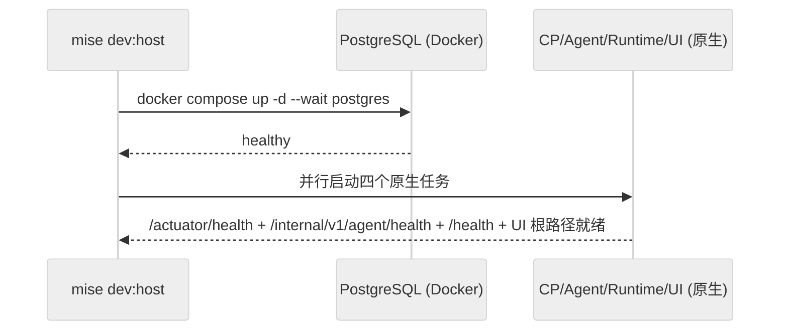

# DEV-002: 开发者指南

> 环境搭建、运行模式与全栈调试。配置管理详见 DEV-003，日志详见 DEV-004，测试策略见 DEV-020/021/022/023。

## 1. 项目结构

```text
xihe/
├── packages/
│   ├── ui/                    # Vue 3 + Vite + Tailwind + reka-ui
│   │   ├── src/               # components / composables / stores / router / i18n / mocks / types
│   │   └── e2e/               # Playwright（mock/ + real/）
│   ├── control-plane/         # Java 25 + Spring Boot 4 + Maven
│   │   └── src/main/java/.../cp/  # auth / chat / mcp / config / context / files / session / audit
│   ├── agent/                 # Python 3.12 + LangChain/LangGraph + uv
│   │   └── src/xihe_agent/    # interfaces / agent_runner / adapters / context / tools / llm / rag / registry
│   └── runtime/               # Rust 1.97.1 edition 2024 + cargo
│       └── src/               # main / executor / workspace / container_runtime / fs / sandbox / mcp_bridge / hydrate
├── docs/i18n/{zh-Hans,en}/    # 公开文档（编号规则见 DEV-030）
├── scripts/                   # dev-host / reset-admin / scan-log-secrets 等辅助脚本
├── docker/images/workspace/   # xihe/workspace 容器镜像
├── mise.toml                  # 工具链与跨模块任务
└── docker-compose.yml         # 全容器基线编排
```

包管理规则：

- 根 `pnpm-workspace.yaml` 仍有效（`packages/*` 约束 + 构建白名单），但日常不走 pnpm workspace 安装：UI 依赖仅在 `packages/ui/` 内用 pnpm 管理。
- `Taskfile.yml` 已移除（PLAN-245 M5），统一入口为 `mise run ...`。

## 2. 环境与安装

```bash
mise install
mise run setup
# .env / .env.dev / .env.test / .env.prod 均已入库（仅非敏感占位值），无需复制或覆盖
# 本机个性化覆盖写 gitignored 的 .env.local（端口/DB/JWT/Workspace 根等见 DEV-003 §2）
```

前置：Node 22+ / pnpm 10+ / Python 3.12+ + uv / Java 25+ + Maven 3.9 / Rust 1.97.1+ / Docker（Desktop for Windows 需 WSL2 集成）。

> **Checkpoint 存储（PLAN-0653 P3）**：`XIHE_CHECKPOINT_STORAGE=git|dual|self`，**默认 `git`**；`self` 必须显式设置且 `XIHE_ENV=dev|staging` + `XIHE_CHECKPOINT_SELF_ACK=1`（安装版镜像不得预置 self）。`XIHE_CHECKPOINT_STORE_PATH` 指向 workspace 外的独立目录（默认 `<hostRoot>/.xihe-store`）。self 模式下 **store 是主路径、git shadow 是 best-effort 备份**：git 缺失只降级备份（WARN + `shadowBackupFailures`），不阻断 capture/startup；因此 **self 链路不再把 git 列为硬前置**（git 模式/dual 与 `Opaque`/`Reject` 策略仍需 git）。legacy shadow 历史迁移见 `.local/evidence/plan-0653/p3/migration-sop.md`；开关/回切操作手册见 `.local/evidence/plan-0653/p2.4-sop.md`。

> **本仓库可单独 clone 运行（PLAN-0612）**：不依赖上层 ONE 工作区。`mise run check:standalone`会导出无父级副本并验证 `stack-run`/`dev check` 不依赖 one 根；端口默认值的**事实源在本仓库** `scripts/lib/stack-ports.mjs`，ONE 侧 `config/ports.mjs` 只是编排镜像（见「模式 D」末两条）。

模块级等价命令：

| 模块 | 命令 |
|------|------|
| UI | `cd packages/ui && pnpm install`（pnpm workspace 根与 lock 均位于 UI 包）|
| Agent | `cd packages/agent && uv sync --all-extras` |
| CP | `cd packages/control-plane && mvn dependency:resolve` |
| Runtime | `cd packages/runtime && cargo fetch` |

## 3. 运行模式

### 模式 A：`dev:host` 日常开发（推荐）

```bash
mise run dev:host
```

> 首次接触 XH（空白实例 → 首条回复）请直接看 [DEV-033](DEV-033-first-run-gold-path.md)：本文只讲环境与运行模式，DEV-033 讲本地模式三条件、onboarding 步骤与「看到什么算成功」的逐条判据。
>
> **启动顺序（PLAN-0632 T4.4）**：`dev:host` 里 cp/runtime/ui 仍并行，但 **Agent 会先等 CP readiness** —— `dev:host:wait-for-cp` 轮询 CP `/actuator/health` 到 200（**预算按起栈路径分层**：复用已构建 **60 s**，重建路径（stale/missing/dirty ⇒ 本次会先 `clean compile`）默认 **240 s；`XIHE_WAIT_FOR_CP_TIMEOUT` 覆盖两路径，`XIHE_WAIT_FOR_CP_REBUILD_TIMEOUT` 仅重建路径），等不到就**显式失败并打印 CP 日志路径**，**不会**在 CP 缺席时把 Agent 起成 degraded（旧行为会白跑约 2.8 s 启动 config sync）。单独起 Agent 仍用 `mise run dev:host:start:agent`（它已自动带这个等待）。



要点（锚点：`mise.toml: dev:host` + `scripts/dev-host-watch.mjs`）：

- PostgreSQL 跑在 Docker，其余 CP/Agent/Runtime/UI 由 mise 原生并行管理。
- 启动前先跑一次 `mise run check:runtime-target`（runtime target 水位；watch 只打印，FORCE 线 ≥20GB 或 H 余量 <5GB 会阻止启动）。
- 默认启动**不导入配置，也不创建/更新 Provider Connection**。
- 需要配置时，CP ready 后显式运行 `mise run dev:host:import-config`；该命令只导入非密钥 JSONC。
- **`mise run dev:host` 不加载 `.env.dev`**：内部服务 token 需自行注入，否则回落到 dev 占位值。正解：`scripts/dev-host.ps1 -Start`（自动生成内部 token）或显式注入 env；后者脚本的 `Start-Process` 在非 TTY 调用下会因句柄继承挂住调用方（服务实际已起），自动化场景改用可追踪后台进程逐服务启动（端口 12631/12632/12633 做 ready 探针）。模块认证与密钥清单见 [DEV-024](DEV-024-authentication-matrix.md)。
- **LLM 就绪前置**：未导入 `llm-provider` profile 时 Agent 报 `llmReady=missing_credentials`，`POST /api/v1/chat` 直接 503 `LLM_NOT_CONFIGURED`；`POST /api/v1/config/import?layer=instance` **只接受纯 JSON**（`config.import.local.jsonc` 的行注释需先剥离，或直接用上面 CLI）。
- **脚本化链路三要点**：session 创建时自带 root branch（`POST /sessions/{id}/branches` 是 fork 语义、需 `sourceBranchId`+`anchorMessageId`，不要"再建一个"）；`POST /api/v1/chat` 前须有活跃 SSE 订阅（否则 409 `SSE_SUBSCRIPTION_REQUIRED`）；Bearer 只活 900s，`reset-admin`→`login` 取的 token 落 Temp 并在每批前刷新（勿入库）。
- 需要创建 Provider Connection 时，单独运行 `mise run dev:host:provider-init -- --provider xiaomi --scope USER --label xh-local --api-key-env XIHE_XIAOMI_API_KEY`。
- Runtime 用 `XIHE_WORKSPACE_HOST_ROOT`（默认 `A03-xihe/.xihe-workspaces`）作**进程级宿主存储基目录**：managed workspace 路径由其 + `storageRef` 派生，shadow 在 `<hostRoot>/.xihe-shadow`；不是每个 workspace 一个根，也不是用户路径白名单。launcher 注入的进程值必须绝对；源配置可相对（`.env.dev` 的 `../../.xihe-workspaces` 以 `packages/runtime` 为基准）。
- `/health` 为 liveness，`/ready` 不等待全部 Sandbox 物化；Workspace 按 `workspaceId` 首次操作时懒物化。
- **栈构建新鲜度（PLAN-0662）**：常驻栈不会自动跟随 `develop`，`health UP` 也不等于"跑的是最新代码"（BL-240 的误判就是这么来的）。构建产物带 `classes/META-INF/build-info.properties`（`commit`/`builtAt`/`dirty`），启动日志有一行 `cp.build commit=… built=… dirty=…`。运维口径：**重启前先看 verdict** ——`mise run dev:host:status`（加 `-- --json` 取固定字段，lane 脚本按此断言）；`verdict=fresh` 才说明这棵 classes 来自当前 HEAD；`verdict=dirty`（BL-325）= commit 对但构建时树脏，**按非 fresh 处理**（不是 stale：stale 只表示不是这个 commit）。
  - `stale`/`missing` 时**默认重建**：`mise run dev:host:start:cp`、`dev:host`、`dev:stack` 都在 `mvn` 前比对 build-info 与 `git rev-parse HEAD`，不一致先 `clean compile` 再启动（单一实现 `scripts/stack-run.mjs`）。确实要"用旧类先把栈拉起来"时加 `--no-rebuild`，日志会留 `WARNING` 与旧 commit，事后可追。
  - 外部复用栈跑 E2E 时（`XIHE_E2E_EXTERNAL_SERVER=1`），runner 启动前断言 CP build commit == `XIHE_E2E_EXPECT_CP_COMMIT`（未声明则取本 checkout HEAD），不匹配或**读不到 build-info** 都 fail-fast，提示先重建/重启 CP——避免拿旧构建当产品缺陷（BL-240）。
  - **构建目录按栈/按 commit 隔离（BL-253 L3，运维口径）**：每套栈编译进自己的目录
    `C:/xihe-build/cp/<stackId>/<sha12>[-dirty]`（根可由 `XIHE_CP_BUILD_ROOT` 覆盖），旁边
    `<stackId>/.current` 记录**该栈最后一次启动实际用的目录**——status/E2E 断言读它，所以
    `cpBuild.targetDirSource` 会告诉你是 `pointer`（栈自己的记录，最可信）/`newest`（磁盘最新
    构建槽）/`env`（显式 `XIHE_CP_TARGET_DIR`）/`derived`（还没构建，按 HEAD 推出来的路径）。
    **重启前先看 verdict 与 source**：`pointer+fresh` 才是"这栈在跑当前代码"。
  - 保留只走**显式清理**：`mise run dev:host:cp-build:clean` 默认 **dry-run** 打印每栈
    `keep N / prune M`，确认后加 `-- --apply` 才删；每栈保留最新 3 个 + `.current` 指向的目录
    永留，只扫 `cp/<stack-N>/<sha12>`，`dev-host`/`bl240-cp`/`e2e`/rust target 等 legacy 目录
    永不匹配。**回滚通道**仍是显式 `XIHE_CP_TARGET_DIR`（优先级最高，原样透传）。
  - 注意：切到隔离布局后，**某栈下一次重启**会首次编译进它自己的 `<sha12>`（约 60s，期间该栈
    不可用）；谁重启谁负责核四端口 + `verdict=fresh`，不要为了"刷新"去重启别人的栈。

常用命令：

| 命令 | 说明 |
|------|------|
| `mise run xihe -- --help` | 查看 CLI 命令 |
| `mise run dev:host:check` | 检查开发环境 |
| `mise run dev:host:status` | 每栈 CP 构建新鲜度（`runningCommit`/`headCommit`/`behind`/`stale`/`verdict`）+ 服务健康；`-- --json` 固定契约 |
| `mise run dev:host:import-config` | 显式导入非密钥配置 |
| `mise run dev:host:provider-init` | 创建或复用 Provider Connection |
| `mise run test:e2e:host:real` | 运行指定真实 MiMo 用例 |
| `mise run test:e2e:fixtures` | e2e 夹具自测（fake LLM `mode=chain` 状态机；不起栈、秒级；已并入 `validate`） |
| `mise run test:mock:smoke` | Mock S1 浏览器快车道（29 个 spec；[实测] 106 passed / 1 flaky / 2 skipped、95 s 墙钟、`--workers=4`、headless；不需要后端 —— Playwright 自起 Vite）。**`XIHE_UI_PORT` 必须显式设置**：`playwright.config.ts` 默认 12630 落在窗口禁用段 12630-12633，未设置或设入该段直接 exit 2 |
| `mise run test:mock` | **已存在，本次未实测** —— 全量 mock lane（同一 config，不限定 spec 文件）。**待补**：耗时/用例数/红点数均未在本轮实测，勿引用二手数字 |
| `mise run test:cp:baseline` | BL-368 CP 已知基线判定：读 `test:cp` 刚写的 surefire 报告，失败 ⊆ `scripts/cp-known-baseline.json` 才 exit 0；转绿只 WARN、`reviewBy` 过期失败；**不接 `validate`** |
| `mise run test:runtime:lib:gate` | BL-262 竞态复验门：串行 1 + 并行 3 连跑（里程碑/竞态修复后跑；**不进 `validate`**） |
| `mise run test:runtime:lib:ignored:isolated` / `:functional` / `:mxc` | BL-262 ignored 套件三档（显式列名 + 实测超时；`:mxc` 的 4 条 MXC 边界用例需 `XIHE_MXC_EXECUTABLE`，缺 env 会按可执行消息失败；**不进 `validate`**） |
| `mise run ledger:validate` | 只读校验台账（BL/PLAN 结构，在 ONE 工作区根运行）；**报告不阻断**，保留工具退出码 |
| `mise run check:font` | **字体子集覆盖门**（task-258）：源码用字 ⊆ vendored 子集 + **两份产物 sha256 逐文件一致** + `check-font-face --selftest` 自证；实测 1.1–2.8 s，已并入 `validate`（T1 叶子档）。判据与反例见 ONE 侧 `internal/A03-xihe/docs/font-stack-decision.md` §7.2 |
| `mise run check:docs-index` | **A03 私有文档索引门**（`one/` 根运行）：顶层 md 是否全部登记 / 链接是否存在 / §2 子目录计数是否等于实测 / S4 行是否可判定 / **H6 §1.0 所有权表形态与措辞**（8 行 × 5 列、过期判据必须含命令或阈值）/ **H7 已废弃文档引用**。2026-11-12 起本任务带 `--strict-deprecated` ⇒ **H7 阻断**（同批已把 `dev-hot-loop.md` 那行从「试行」改标 `status: deprecated`，先绿再上闸）；**仍不接 `validate`** |
| `mise run dev:host:watch` | 健康监督 + 故障重启任务组 |
| `mise run dev:host:stop` | 停 PG；先 Ctrl+C 停原生任务 |
| `mise run dev:reset` | 默认 dry-run；`-Reset` 后备份重建 dev 数据，workspace 进回收站，不删 device identity |
| `mise run reset-admin` | 重置 dev `admin@xihe.local` 密码，随机 24 字节 base64url，免重启；目标栈解析 `-StackId`/`--stack` 参数 > `XIHE_STACK_ID` env > stack-1 缺省，栈内 DSN 解析顺序 `--url` > `XIHE_CP_DATASOURCE_URL` > `localhost:$XIHE_PG_PORT/$POSTGRES_DB`（缺省 `12634/xihe_1`，与 0533 起 `xihe_<n>` 命名一致），运行时会打印实际目标。**D-766 起它是手动重置入口**：`dev-stack` 起栈会自动注入并 upsert 密码（见 §4「dev 管理员密码自动注入」）。**BL-523**：密码走 stdin 或 `XIHE_RESET_ADMIN_PASSWORD`（`--password`/`-Password` 保留但废弃），且账号行不存在时显式失败（exit 3）而非自建 |

命令示例：

```bash
mise run dev:host:provider-init -- --provider xiaomi --scope USER --label xh-local --api-key-env XIHE_XIAOMI_API_KEY
mise run xihe -- provider add xiaomi --scope USER --label xh-local --api-key-env XIHE_XIAOMI_API_KEY
mise run xihe -- provider update <connection-id> --api-key-env XIHE_XIAOMI_API_KEY
mise run xihe -- provider list
mise run xihe -- provider verify <connection-id>
mise run test:e2e:host:real -- e2e/real/real-tool-roundtrip.spec.ts --route openai-compat
```

CLI 与 UI 并列调用 CP API；Agent 不调用运维 CLI。Provider Key 经 CP 加密保存。real E2E 通过 Agent 的独立环境变量路径运行，不代表验证了 Provider Connection lease。

### 运维 CLI 命令面（PLAN-0574）

```bash
mise run xihe -- status                                              # /status + /health + /version 聚合
mise run xihe -- workspace list
mise run xihe -- workspace get <wsId>                                # 含 environment
mise run xihe -- job list <wsId>
mise run xihe -- job output <wsId> <jobId> [--stream stdout|stderr] [--offset N] [--limit N]
mise run xihe -- job cancel <wsId> <jobId>                           # 幂等语义透传（changed:false）
mise run xihe -- checkpoint list <wsId>                              # 含 retention（失败显式报告）
mise run xihe -- checkpoint preview-revert <wsId> <sliceRef>         # 仅预览，不执行 revert
mise run xihe -- scheduled-task list <wsId> [--page N] [--size N]
mise run xihe -- audit list [--type T] [--page N] [--size N]
mise run xihe -- config export [--include-secrets] [--out <file>] [--force]   # 默认不含密
mise run xihe -- provider delete <id> [--yes]                        # 先展示 delete-impact
mise run xihe -- version [--check]
```

- 全命令支持 `--json`（stdout 单对象 `{ok:true,data}` / `{ok:false,error:{code,message}}`），人类输出为单行/表格摘要；详见 `mise run xihe -- --help`。
- stack 端口覆盖（bootstrap 白名单）：`node scripts/stack-run.mjs <cp|agent|runtime> --set XIHE_CP_PORT|XIHE_AGENT_PORT|XIHE_RUNTIME_PORT=<1..65535>`——仅白名单三键、仅注入实际消费该键的目标；重复/未知/敏感/非法值在启动任何进程前拒绝且不回显输入值；`XIHE_CP_URL` / `XIHE_AGENT_URL(_BASE_URL)` / `XIHE_RUNTIME_URL` 已显式设置时端口只改监听端并提示断链风险。机制详见 DEV-003 §2 与 `spec/configuration/env-effective.md`。

`--api-key-env` 指向当前进程已注入的变量；交互终端缺少变量时 CLI 会以无回显方式提示，非交互任务则失败。CLI 入口会按 `.env` → `.env.$XIHE_ENV` → `.env.local` 链**补齐缺失键**（PLAN-0547 `loadEnvFileChain`，已存在的 OS env 永不被文件覆盖）；secret 仍只从 env 或 TTY 读取，绝不进 argv、日志或报告。无人值守时由调用方安全注入环境变量。

### 凭据 CLI（PLAN-0575）

```bash
mise run xihe -- credential list [--owner-type USER|WORKSPACE --owner-id <id>]
mise run xihe -- credential references <id> --workspace <wsId>
mise run xihe -- credential events <id> --workspace <wsId>
mise run xihe -- credential precheck --permissions <atom[,atom...]>
mise run xihe -- credential create --kind token --owner-type <USER|WORKSPACE> --owner-id <id> --label <label> [--delivery-tier lease|reveal] --secret-env <NAME>
mise run xihe -- credential create --kind key_pair --owner-type <USER|WORKSPACE> --owner-id <id> --label <label> --access-key-env <NAME> --secret-key-env <NAME>
mise run xihe -- credential replace <id> --kind token|key_pair --workspace <wsId> (--secret-env <NAME> | --access-key-env <NAME> --secret-key-env <NAME>)
mise run xihe -- credential delete <id> --workspace <wsId> [--yes]   # 先展示 references，再确认删除
mise run xihe -- credential bind <id> --workspace <wsId> --agent <principalId[,principalId...]>
mise run xihe -- credential unbind <id> --workspace <wsId> --agent <principalId[,principalId...]>
mise run xihe -- credential reveal <id> --workspace <wsId> (--password-env <NAME> | TTY) [--out <file> [--force]]
```

- **密钥通道**：`create`/`replace` 的 token 与 key_pair 只从 `--*-env <NAME>`（环境变量名）或 TTY 无回显读取；**不接受值参数**，不读 JSONC/输入文件；错误与日志只报变量名，不回显值。
- **显式 workspace**：除 `list` 与 `create --owner-type USER` 外，凭据命令必须显式 `--workspace`，`X-Workspace-Id` 与之一致；`create --owner-type WORKSPACE` 要求 `--owner-id` 等于 `--workspace`。CLI 不依赖 CP 的 token claim/首个 membership 回退。
- **reveal**：用户显式请求时以登录密码独立 step-up（`--password-env` 或 TTY），输出到终端或 `--out` 普通文件（既存文件需确认或 `--force`；符号链接/目录拒绝）；终端与文件是唯一允许的明文输出路径，错误/进度/日志不含密码或值。CP 审计：成功 `credential_revealed`，错误密码仅 `credential_reveal_failed`；其余拒绝分支不写事件/审计。
- **delete 门**：默认先 `GET …/references` 展示，再 `--yes`/交互确认执行；`409 CREDENTIAL_IN_USE` 原样透传并提示重查 references，不声称预览即完整报告。
- 错误码保留 CP 原码（`CREDENTIAL_NOT_FOUND`/`CREDENTIAL_IN_USE`/`CREDENTIAL_TIER_MISMATCH`/`CREDENTIAL_REVEAL_STEP_UP_FAILED`/`CREDENTIAL_REVEAL_RATE_LIMITED` 等），写请求 5xx/超时提示结果不确定且**不自动重放**；全部命令支持 `--json`（I8 形态）。

`real-tool-roundtrip` 最多提交两轮模型提示，可能产生相应费用；Playwright 整条用例自动重试已关闭，失败后需操作者决定是否重跑。

### 模式 A2：detached 全栈（PLAN-0603，并行栈唯一启动路径）

`mise run dev:host` 是**前台** mise 任务：终端/agent turn 结束会连带回收四服务。需要「跨 turn 存活 + 四服务 ready」时，用仓库内 supervisor（命令/cwd/栈 env 全部复用 `scripts/stack-run.mjs`，**不依赖仓库上层目录**）：

```bash
# 在 A03 checkout 根执行；主 checkout 与 .worktrees/<name> 均可
node scripts/dev-stack.mjs start --stack 4 --with-pg
mise run dev:stack -- --stack 4 --with-pg        # 等价入口（转发参数）
node scripts/dev-stack.mjs status --stack 4
node scripts/dev-stack.mjs stop --stack 4                 # 默认保留 PostgreSQL
node scripts/dev-stack.mjs stop --stack 4 --with-pg       # 显式停 PG 容器（卷保留）
```

- 服务 = CP/Agent/Runtime/UI；`start` 等待四服务 HTTP ready（默认 300s，`--timeout` 可调），失败退出码 2 并指向 `.xihe-stacks/<n>/logs/*.err.log`。
- 日志/pid：`.xihe-stacks/<n>/logs/<svc>.{out,err}.log`、`dev-stack-pids.json`；`--json` 给机器可读输出。
- `mise run dev:stack -- --stack N` 转发到本脚本；xihe **不支持 `--next`**（统一用 `--stack`）。
- **并行 worktree 必须用不同 stack**（同一 stack 共享 PG 库 `xihe_<n>`）；worktree 首次运行需 `pnpm install --offline`（`packages/ui`）。若你在 one workspace 内，`CARGO_TARGET_DIR`/`UV_PROJECT_ENVIRONMENT` 的外置约定见 one 侧文档；单独 clone 时用默认缓存即可。
- `stop` 只终止 pid 文件记录且命令行匹配 `stack-run.mjs` 的 wrapper 进程树，不按端口盲杀。
- **dev 管理员密码自动注入（D-766）**：`start` 自己解析/持久/注入 dev 管理员密码，并在四服务 ready 后把它 upsert 进库；来源优先级、跳过条件与日志口径见 §4「dev 管理员密码自动注入」。

### 模式 B：Docker Compose 全栈（一次性基线）

> 🧊 **已冻结（2026-10-07 用户裁定；2026-10-09 mise 已注释）**：XH 服务容器化与 docker 构建全部暂缓——只有 PostgreSQL 保留容器，其余全 host。本模式命令与 `mise run dev:full` / `dev:backend` 均停用，仅作历史参考；日常启动用 `dev:host`，隔离 E2E 用 `test:e2e:host`。解冻须用户明确裁定并同步 AGENTS/DEV-002/DEV-020。

> ⚠️ **两件事别混**：本条冻结的是**服务容器化/镜像构建**；**工作区 docker 执行后端**是另一件事，且自 PLAN-0618（2026-11-01 用户裁定）起**也完全冻结**（产品面 + 测试面 + 默认值三面一起冻；新建工作区只有 `direct_attach` 可用）。工作区后端冻结范围与解冻步骤见 [DEV-018](DEV-018-known-issues.md)「docker 后端冻结范围」，加载项细节见 [DEV-031](DEV-031-sandbox-backend-contract.md)。

> ⚠️ **拓扑限制（先读）**：当前 Compose 已挂载 Runtime 的 Docker Engine socket 并对齐 `XIHE_AGENT_API_TOKEN`/`XIHE_CP_API_TOKEN`（PLAN-0401 修复），但容器内 WorkspaceStorage 映射仍缺（runtime 挂载 `./logs/runtime:/logs` 与 `/var/run/docker.sock`，无宿主工作区目录映射）。因此 Compose 模式**仍不能替代 `dev:host` 主链路**，workspace/MCP/截图类验证必须在 host 模式执行，不得把 Compose 失败归因于 host v1。另：Agent 单 workspace MCP 绑定与“每 E2E 用例独立 workspace”冲突属架构级已知边界（见项目 AGENTS Known Issues）。

```bash
# [已冻结 2026-10-07 — 勿执行，日常走 dev:host]
docker compose up -d --build   # 或 mise run dev:full（CP ready 后按导入语义处理 config.import.local.jsonc，见下）
```

启动 postgres + control-plane + agent + runtime（UI 宿主）。端口映射（stack-1；多栈见「模式 D」）：CP 8080→12631、Agent 8000→12632、Runtime 8001→12633、PG 5432→12634。资源约束 pg 512m / cp 768m / agent 640m / runtime 128m，沙盒 512MB + 2 CPU。

配置导入（`scripts/dev-host-import-config.mjs`，`mise run dev:host:import-config` 显式触发）：默认**不自动导入**——`DataSeeder` 为 `admin@xihe.local` 生成随机密码且不打印，脚本无法登录。启动后执行 `mise run reset-admin` 获取密码并手动 `POST /api/v1/config/import?layer=instance`（非密钥八域配置；凭证走 `provider_connections`）；或提供 `XIHE_DEV_ADMIN_PASSWORD` 启用自动导入——注入通道（PLAN-0547）：OS 环境变量 > `.env` 文件链（`.env` → `.env.$XIHE_ENV` → `.env.local`，与 CP `DotenvLoader` 同语义；本机受控值写 `.env.local`，禁止写入 git/脚本/日志）。

> 📌 **supersede（D-766，2026-11-09）**：上一段「`DataSeeder` 生成随机密码且不打印 ⇒ 脚本无法登录」**只对 `mise run dev:host`（模式 A）成立**。`node scripts/dev-stack.mjs start`（模式 A2 / `mise run dev:stack`）已自动注入确定性密码并在四服务 ready 后 upsert（来源优先级/落盘位置/跳过条件见 §4「dev 管理员密码自动注入」），该路径无需先手工 `reset-admin` 即可登录。

### 模式 C：单模块宿主测试

CP 支持无外部数据库的 H2 独立启动（需同时覆盖 datasource URL/driver/dialect 并关闭 Flyway，PowerShell 示例）：

```powershell
# 仅启动 CP，使用内存 H2，不依赖 PostgreSQL 或 Docker
$env:XIHE_CP_DATASOURCE_URL = 'jdbc:h2:mem:xihe;MODE=PostgreSQL;DATABASE_TO_LOWER=TRUE;DEFAULT_NULL_ORDERING=HIGH;DB_CLOSE_DELAY=-1'
$env:XIHE_CP_DATASOURCE_DRIVER = 'org.h2.Driver'
$env:XIHE_CP_DATASOURCE_USERNAME = 'sa'
$env:XIHE_CP_DATASOURCE_PASSWORD = ''
$env:XIHE_CP_JPA_DIALECT = 'org.hibernate.dialect.H2Dialect'
$env:SPRING_FLYWAY_ENABLED = 'false'
$env:SPRING_JPA_HIBERNATE_DDL_AUTO = 'create-drop'

mvn -f packages/control-plane/pom.xml spring-boot:run
```

文件级命令见 A03-xihe/AGENTS.md（UI lint/typecheck/test:unit、Agent 单文件 pytest、CP 单类 mvn、Runtime `cargo test --lib`）。

### 模式 D：多栈并行（PLAN-0533）

同一 worktree 可同时跑多套 host 栈。栈身份由 `XIHE_STACK_ID`（`stack-1`..`stack-8`，缺省 `stack-1`）声明；启动器据此派生端口、compose project、PG 库名、沙箱容器前缀与日志/host root/state 三个路径面，模块仍只读派生后的 `XIHE_*_PORT`。**本文其余示例中的 1263X 端口均为 stack-1 默认值。**

```bash
# 起第二套栈（stack-2）；stack-1 的端口与路径与单栈时逐项相同
mise run dev:stack -- --stack 2
# 等价写法
XIHE_STACK_ID=stack-2 mise run dev:host
# 只看某栈会占用哪些端口（不启动）
node scripts/stack-run.mjs env-json --stack 2
```

| 栈 | UI | CP | Agent | Runtime | PG | compose project |
|---|---|---|---|---|---|---|
| stack-1（默认） | 12630 | 12631 | 12632 | 12633 | 12634 | `a03-xihe` |
| stack-2 | 12640 | 12641 | 12642 | 12643 | 12644 | `xihe-stack-2` |
| stack-3 / 4 | 12650 / 12660 段 | … | … | … | … | `xihe-stack-3/4` |
| stack-5..8 | 12700 / 12710 / 12730 / 12740 段 | … | … | … | … | `xihe-stack-5..8` |

- stack-1 路径不变（`.xihe-workspaces` / `logs` / `.xihe-state`）；stack≥2 落在 `.xihe-stacks/<n>/{workspaces,logs,state}`（已 gitignore）。
- **按需起栈（D-808① 反转 PLAN-0656 的「常态化双栈」）**：`stack-1..8` 槽位机制仍是端口/隔离基础设施，按需起栈即可，**不追两条常驻栈**；并行开发以**四模块常驻分支**（`m/ui` / `m/cp` / `m/agent` / `m/runtime`，D-810）为主。`node scripts/dev-stack.mjs status --all`（或 `mise run dev:stack -- status --all`）一览**已起栈**的端口/health/DB/compose/构建 target（未起栈不是故障）。构建面三条纪律：**per-stack cargo target**——非默认栈自动注入 `CARGO_TARGET_DIR=<root>/<stackId>`（`<root>` = `XH_CARGO_TARGET_ROOT`，未设时回落 `<workspace>/.tmp/cargo-target`；默认栈沿用 `.cargo/config.toml` 的共享 `main` 热缓存；已显式设置 `CARGO_TARGET_DIR` 时永不覆盖），杜绝两栈互踩 exe（BL-221）；**孤儿清扫**——`dev-stack stop` 与 `stack-run <service>` 启动前按"本栈端口 + 服务进程画像"清理残留进程并逐条留日志（外来进程只占 WARN 不杀）；**E2E 构建隔离**——`test:e2e:host` 用独立的 `cargo-target/e2e` 与 `C:/xihe-build/e2e`，不再要求停栈（见 §5 测试入口）。`cargo-target` 下的 `main` / `stack-N` / `e2e` / worktree 名目录均为可安全清理的构建缓存（按 workspace `worktree-lifecycle` 的成对清理纪律）；`check:runtime-target` 水位仍按"当前解析到的单个 target"计量，不做跨栈求和（避免 A 栈的缓存把 B 栈的启动门禁误判）。
- **构建产物根可配（task-80，2026-11-08）**：整个 target 家族的位置由 `XH_CARGO_TARGET_ROOT` 决定（本机值写进 gitignored 的 `mise.local.toml`；仓库内不写机器绝对路径），布局 `<root>/{main,stack-N,e2e}`；linked worktree 再加一层 `<root>/<worktree 目录名>/`，两个 lane 跑同一 stack 不互相覆盖 exe。优先级 `CARGO_TARGET_DIR` > `XH_CARGO_TARGET_ROOT` > 旧推导 `<one>/.tmp/cargo-target`；**未设变量时行为逐字节不变**。详见 §6「Rust 构建缓存策略」（含 fail-fast、wrapper 覆盖范围与裸 `cargo`/IDE 残余）。
- 非法或未登记的 `XIHE_STACK_ID`（如 `stack-9`、`foo`）启动即失败，不回退默认栈。
- `dev:host:stop` / `dev:reset` 只作用于当前栈的进程、compose project 与沙箱容器（按 `xihe.stack-id` 标签；无标签视为 stack-1）。
- 建议同时最多 2 套栈（每栈一套 PG + 四个服务）。
- **端口事实源（PLAN-0612）**：默认端口的唯一事实源在本仓库 `scripts/lib/stack-ports.mjs`（`STACK_PORTS` + `deriveStack()`）；ONE 工作区的 `config/ports.mjs` 只是编排镜像。改任一侧必须在**同批**改另一侧，并用 `mise run check:ports`（逐栈 × 逐端口 + 派生字段 + `.env.dev` 自洽性）校验。该门**fail-closed**（task-61 P1-3）：带 `--require-mirror` 跑，找不到 ONE 工作区即 exit 2 —— 「跳过」不再等于「通过」。单独 clone 里需要自检时直接跑裸脚本 `node scripts/check-ports-parity.mjs`（只打 `SKIP`、json `skipped:true`、exit 0），不要把这条门当成能过的门。
- **单 clone 自检**：`mise run check:standalone`导出无父级副本并验证启动/自检不依赖 one 根。
- **OpenAPI 契约门（BL-162）**：`mise run check:openapi` 校验 `docs/api/openapi.yaml`（3.1 文档头、path 唯一性、路径参数声明、Problem Details，以及 checkpoint revert / session 读面的冻结契约切片）。它是 **`test:cp` 的依赖**，所以跑 CP 测试就会查契约；PLAN 收尾/波次验收必须显式过一遍。失败时输出 path 数、首个失败点与修复提示（`docs/api/openapi.yaml` 就是唯一事实源）。注意它**不做**路由 ↔ 契约双向比对（"实现有路由但契约没写"属已知盲区，另立 BL）。
- **API 文档生成门（PLAN-0763 M4）**：`mise run check:api-docs` 校验 `docs/api/inventory.generated.md` 与 `docs/api/openapi.yaml` **逐字节一致**（`--check`：落后 ⇒ exit 1 并打印首个差异行 + `fix: mise run gen:api-docs`；找不到 PyYAML 解释器 ⇒ exit 2，不静默放行）；重新生成用 `mise run gen:api-docs`。解析委托 `packages/agent/.venv` 的 PyYAML（**零新增依赖**，脚本自身不手写 YAML parser），分组按 `x-tagGroups` 两级 ÷ `operation.tags[0]`；契约无 tags 时退化为按 path 前缀单级并留 TODO。**人工叙述版 `docs/api/inventory.md` 保留、不替代**——路由迁移对照、调用方、错误契约这些 yaml 表达不了。该门与 `check:openapi` 同在 `validate` 依赖链（不与 `check:openapi` 合并依赖：那会让纯 Maven 的 `test:cp` 车道被迫依赖 python）。
- **迁移号登记门（task-164 判据 / task-168 接线）**：`mise run check:migrations` 核对 `packages/control-plane/src/main/resources/db/migration` 的 Flyway 号与工作区登记册 `one/internal/A03-xihe/docs/migration-numbers.md`（重号 / 登记册落后 / 新号未登记）。**exit 0/1/2 三态：1 = 有 finding（逐条打 code + 文件）；2 = 判不了（迁移目录或登记册读不到、登记册头三个值解析不出）—— 2 不是绿**。登记册属工作区（不在本仓），定位顺序 = `mise run check:migrations -- --registry <path>` > 本仓兄弟目录 `../internal/…` > **主检出**（worktree/lane 场景，输出打 `NOTE 跨仓登记册`）；三条都不成立 ⇒ exit 2 并打印两条修法。判据自测 `node scripts/check-migration-numbers.mjs --selftest`（5 条判据夹具 + 4 条定位夹具）。**不接 `validate`**：先证明它能响，再谈挂流水线。
- **迁移测试覆盖门（task-181 交付 / task-192 接线）**：`mise run test:cp:migration` 的执行体是 `scripts/run-migration-tests.mjs`：它先用 `scripts/check-migration-test-coverage.mjs --test-filter` 求清单，再在 `packages/control-plane` 下跑 `mvn -o test -Dtest=<清单>`，只跑「登记迁移 ↔ 测试类」映射覆盖到的 CP 测试；漏映射时脚本自身先 exit 1 并点名文件。**为什么不把 mvn 直接写进 `mise.toml`**：本机 mise 用 `cmd.exe` 执行 run 串，`$(...)` 不展开（2026-11-13 实测 mvn 报 `No tests matching pattern "$(node … --test-filter)"`）—— 命令的**可执行形态**与**判据**分开写，判据仍只在那个脚本里。**判据一句话**：这条任务存在 ⇒「有没有漏」由脚本回答；不存在 ⇒ 仍由人的记忆回答。**不并入 `test:cp`**（并入会吞掉 mvn 输出）。
- **提交信息门禁（2026-11-06）**：`mise run check:commit-msg` **已阻断**并作为 `mise run validate` 的依赖（D-216 翻闸实测：自 `a632de77` 起 32 条、违规率 0%）。口径：首行 `<type>(<scope>): <摘要>`，**摘要显示宽度 ≤72 列（CJK 记 2 列，约 36 汉字）、merge ≤100 列**，非 merge 须引用 `PLAN-####`/`BL-###`/`D-###`。壳脚本 `scripts/check-commit-msg.mjs`（`--file` 供 hook、`--range` 复查、`--stats` 观察窗统计；**阻断是默认行为**，`--report-only` 才只打印不失败，`--enforce` 只是显式声明口径）；本地 hook 可用 `git config core.hooksPath scripts/hooks` 启用。**翻阻断的判据按提交次数、不按日历时间**（D-213）：自 `a632de77` 起累计 **≥30 条** 为观察窗（12h 为上限，先到为准），窗内 `E_*` 违规率 ≤10% 且 merge 零超宽。**实测值（D-216，2026-11-06 02:02 `--range a632de77..HEAD --stats`）：32 条、违规 0、违规率 0%** ⇒ 判据满足后由 report-only 翻 `--enforce` 并接入 `validate`（两个数字性质不同：30 是判据阈值，32 是翻闸时的实测样本）。

### 模式 E：打包产物（PLAN-0632，`pkg:launcher` / `pkg:installer`）

面向"双击安装包 → 服务自启 → 浏览器访问 localhost"的分发形态（不是日常开发路径；日常仍用模式 A）。

```bash
mise run pkg:launcher -- start --install <安装目录>   # 顺序 PG(TCP) -> CP(/actuator/health 200) -> Agent -> Runtime -> UI(同源 /)
mise run pkg:launcher -- status --stack 1 --json      # 只读状态（健康/端口/PID）
mise run pkg:launcher -- stop                          # 逆序树 kill + 残留端口复核
mise run pkg:installer                                 # 从既有四个服务产物构建 NSIS（-- --stage-only 只组装 stage）
```

- **顺序是契约**：PG 必须先接受 TCP（CP 启动即跑 Flyway，没有 PG 起不来）→ CP `/actuator/health` 200 → Agent（其启动 config sync 对 `llm-provider` fail-closed）→ Runtime → UI（D32-06 同源伺服）。每一步都是 readiness probe + 显式 timeout，**没有固定 sleep**（实现见 `scripts/lib/service-supervisor.mjs`）。
- 参数用 `--` 透传（`--install` / `--stack` / `--exe <service>=<path>` / `--skip <service>`），与 `dev:stack`、`dev:host:provider-init` 同惯例。
- **两条 launcher 的分工（别混）**：`mise run pkg:launcher`（Node，`scripts/pkg/launcher.mjs`）是**开发/冒烟 supervisor**，按 install-relative manifest 起五个阶段，**不做 first-run**（数据目录未初始化会直接报 `PostgreSQL data directory is not initialized`）；**产品首启**（解压 PG / initdb / secrets / 数据根 / JDBC 引导 / 打开浏览器）由**随包 Java Launcher** 负责（`scripts/pkg/launcher/src/com/cc01cc/xihe/pkg/Launcher.java`，由 `build-installer.mjs` 编进安装包）。
- **产物只落 `.tmp/pkg/`（gitignored），不入库**；安装包不进主仓发行目录。
- 开发机上 `pkg:launcher status` 会把 `dev:host` 的监听报成 `foreignListeners` 并返回 `ok:false`（exit 1）—— 这是"当前不是打包安装"的正确回答，不是故障。
- 未覆盖的能力清单（本版不做自动更新/开机自启/代码签名/多用户服务安装）见 `plans/archive/PLAN-0632-xh-mvp-self-contained-packaging/installer-scope.md`。

## 4. 全栈调试（自 DEV-005-fullstack 并入）

```bash
# 1. 启动（日常用 dev:host；Compose 基线 dev:full 已冻结 2026-10-07）
mise run dev:host

# 2. 逐端点验证（公开 /api/v1，服务间 /internal/v1）
# 以下为 Bash/Git Bash 示例（Windows 建议在 Git Bash 中执行）
```

> 热循环口径（dev 通道「改一行 ≤30 s」、验证通道保持 per-sha 构建根、两条禁令）见 ONE 工作区 `internal/A03-xihe/docs/dev-hot-loop.md`——**跨仓路径，不入本文正文**。

```bash
# 2.1 登录并提取 JWT accessToken；登录失败时后续请求会得到 401
#   -sS：静默但保留错误输出；-X POST：登录接口；-H：JSON 头
TOKEN=$(
  curl -sS -X POST "http://localhost:12631/api/v1/auth/login" \
    -H 'Content-Type: application/json' \
    -d '{"email":"...","password":"..."}' |
  python3 -c 'import sys,json; print(json.load(sys.stdin)["accessToken"])'
)

# 2.1a 查询当前 Workspace 与一个已绑定的 Agent principal
WORKSPACE_ID=$(
  curl -sS -H "Authorization: Bearer $TOKEN" "http://localhost:12631/api/v1/auth/me" |
  python3 -c 'import sys,json; print(json.load(sys.stdin)["workspaceId"])'
)
# 从当前 Workspace 的 Agent principal 列表中选择一个 principalId
curl -sS -H "Authorization: Bearer $TOKEN" "http://localhost:12631/api/v1/workspaces/$WORKSPACE_ID/agents"
AGENT_PRINCIPAL_ID="<principalId>"

# 2.2 创建一个真实 Session（/events 要求 Session 已属于当前用户和 Workspace，不会自动创建）
SESSION_ID=$(
  curl -sS -X POST "http://localhost:12631/api/v1/sessions" \
    -H "Authorization: Bearer $TOKEN" \
    -H 'Content-Type: application/json' \
    -d "{\"title\":\"curl verification\",\"agentPrincipalId\":\"$AGENT_PRINCIPAL_ID\"}" |
  python3 -c 'import sys,json; print(json.load(sys.stdin)["id"])'
)

# 2.2a 查询服务端创建的 root branch；Chat 不再隐式回退到 root
BRANCH_ID=$(
  curl -sS -H "Authorization: Bearer $TOKEN" "http://localhost:12631/api/v1/sessions/$SESSION_ID/branches" |
  python3 -c 'import sys,json; print(next(x["branchId"] for x in json.load(sys.stdin)["items"] if x["parentBranchId"] is None))'
)

# 2.3 终端 A：保持 SSE 长连接（阻塞；用第二个终端执行 2.4/2.5）
#   -N 禁止 curl 缓冲输出，实时看到 connected/token/done
#   仅测试 SSE 握手时可在命令末尾追加 --max-time 3（超时退出属预期）
curl -sS -N \
  -H 'Accept: text/event-stream' \
  -H "Authorization: Bearer $TOKEN" \
  "http://localhost:12631/api/v1/events?sessionId=$SESSION_ID"
```

```bash
# 2.4 终端 B：查询模型列表
curl -sS -H "Authorization: Bearer $TOKEN" "http://localhost:12631/api/v1/models"

# 2.5 终端 B：提交聊天任务（返回 202 + runId；token/done 在终端 A 的 SSE 中返回）
curl -sS -X POST "http://localhost:12631/api/v1/chat" \
  -H "Authorization: Bearer $TOKEN" \
  -H 'Content-Type: application/json' \
  -d "{\"sessionId\":\"$SESSION_ID\",\"branchId\":\"$BRANCH_ID\",\"content\":\"hi\"}"
```

| 陷阱 | 排查 |
|------|------|
| 404 路径 | Vite 不再重写 API 路径；统一用 `docs/api/openapi.yaml` 的 `/api/v1`（公开）/ `/internal/v1`（服务间） |
| SSE 401 | JWT filter 需支持 query param token；401 后 `chatTransport` 清 token 跳 `/login`，勿循环重试 |
| `409 SSE_SUBSCRIPTION_REQUIRED` | 先 `GET /api/v1/events?sessionId=` 再 chat；`SSEStream` 发送前手工确认连接（UI 无自动 409 重试分支，见 DEV-010 §4） |
| 连续第二条 409 | 查 `SseEmitterManager` generation 递增 + `removeIfCurrent` 身份比对；正常为 `replaced` + 新 `registered`（历史文档旧称，已按源码 `removeIfCurrent` 统一） |
| `done` 后 SSE 关闭 | 确认 `ChatController` 仅在断开/session 删除/不可写时 `complete` |
| 长回复卡首字符 | `SSEStream` 按 hint 分流（reasoning/text 追加、无 hint 经 parser 整量替换；旧 `lastSentCount` 追加已废弃，见 DEV-010 §4） |
| 无增量流式 | `XiheLiteLLM` 须 `streaming=True`（`on_chat_model_stream`）；`on_chat_model_end` 仅 fallback |
| 日志泄露 | `litellm.suppress_debug_info=True` + `log_redact` + `node scripts/scan-log-secrets.mjs`（读取失败即失败） |

Chat SSE 结构化事件与日志字段见 DEV-004 §6.3；UI 传输层见 DEV-010 §4；跨层协议核对（Controller 契约/JWT/`effective` 域键与 env 兜底键/LLM `provider/model` 格式）改一层查一层。

### 一键验证命令（`mise run xihe -- verify`，PLAN-0574 收编）

上面 2.1–2.5 的手工链路可一键跑（实现位于 `scripts/xihe-cli/verify.mjs`）：

```bash
XIHE_VERIFY_PASSWORD=<admin 密码> mise run xihe -- verify \
  --stack 2 --email admin@xihe.local --workspace <wsId> --yes
```

- **目标必须显式**：`--stack`、`--email`、`--workspace` 三项必填，缺失即失败（exit 2），CLI 从不回退到登录响应里的 workspace（0614 起登录只返回该账号**第一个活跃** workspace，新账号可为空）；`--yes` 只确认执行提示，不替代目标参数。非交互未加 `--yes` 时需 TTY 交互确认。
- **凭据**：密码取 `XIHE_VERIFY_PASSWORD`，回退 `XIHE_DEV_ADMIN_PASSWORD`（OS env > `.env` 文件链），TTY 下可无回显输入；无密码 exit 2，token 不回显。密码用 `mise run reset-admin` 生成（目标栈按 `-StackId` > `XIHE_STACK_ID` 解析，栈内按 `--url` > `XIHE_CP_DATASOURCE_URL` > `XIHE_PG_PORT`/`POSTGRES_DB` 解析，运行时会打印实际目标）。若该栈由 `dev-stack` 起，密码也已持久在 `.local/dev/admin-password`（D-766，见 §4「dev 管理员密码自动注入」），可直接取用而无需再重置。
- **栈派生**：经 `node scripts/stack-run.mjs env-json --stack <id>` 取端口；非法/未登记栈 exit 2。
- **副作用**：会创建 agent principal（workspace 尚无绑定时）、session 与 chat run，并真实调用模型 provider，可能产生费用；请使用隔离栈与测试 workspace，并先确认执行提示。
- **判定与退出码**：A 档（CP health / 登录 / workspace 可访问 / principal / session+分支 / messages / SSE / 模型列表 / Agent health）必过；B 档 `POST /api/v1/chat` 受理（200/202 且返回 `runId`）保持原语义。`0`=A/B 通过且 run 终态 `succeeded`、`4`=A 通过但 B 前置缺失、`1`=失败（含 run 终态失败）、`2`=缺目标/凭据或派生失败、`5`=run 等待超时（`--wait-seconds`，默认 120；超时先 `POST /api/v1/chat/runs/{runId}/cancel` 再删本次 session）。
- **清理与残留**：结束或失败时先关闭 SSE，再 `DELETE /api/v1/sessions/{sessionId}` 删除本次创建的 session；本次新建的 agent principal 无可确认的删除接口，保留并在结果中报告（`cleanup.principal`）；不会修改或删除已存在的 principal。审计与模型侧记录可能保留。
- **agent principal**：建 session 必须带 `agentPrincipalId`；按「显式 `XIHE_VERIFY_AGENT_PRINCIPAL_ID` → workspace 已绑定的第一个 → 自动新建」解析。只有新建后才调 `PUT …/agents/{id}` 绑定——对已有 principal 调该接口会**收窄**它的 workspace cap。诊断只输出白名单状态字段，不打印 Agent 原始日志。
- **模板与连接前置（PLAN-0601）**：B 档要求 Session 显式绑定「已发布 api-request-template 三元组 + chat provider connection」。CLI 自动解析（`GET /api/v1/config/api-request-templates?layer=user|workspace|instance` 取 published 且与连接 API Type 对齐的模板；连接取 `GET /api/v1/provider-connections` 中 `status=READY` 且 `operation=chat` 的一条），并在建 session 时带上 `providerConnectionId` / `modelProvider` / `modelName` / `contextTemplateLayer|Id|Version`。缺模板报 `VERIFY_TEMPLATE_MISSING`、缺连接报 `VERIFY_CONNECTION_MISSING`（均 exit 2 并给出发布/建连的可操作提示），不再以裸 `409 API_TYPE_REBIND_REQUIRED` 失败；模板发布是 ADMIN 实例层操作（设置页 → 配置 → API 请求模板 → 发布）。

### dev:host 与 dev:stack 的语义差别（2026-11-12 实测口径）

- **`dev:host`**：**前台**在当前终端跑 4 个服务（CP/Agent/Runtime/UI），**不写 `lease` / `pidFile`**；记账（`.xihe-stacks/<n>/`）只由 detached supervisor 写。
- **`dev:stack`**（= `node scripts/dev-stack.mjs start`）：**detached** 启动，**写租约**，进程与终端脱钩；中途关终端不影响服务。
- **因此**：用 `dev:host` 起过一轮后再看状态，`dev-stack status` 会先报 **`orphan` + `lease-pid-dead`**（服务 4/4 在听，但租约指向已死的旧 pid）。**这不是故障**，执行 `node scripts/dev-stack.mjs acquire --stack 1` 认领后即回到 `healthy`。
- **`--stack` 同 flag 两语义（易踩）**：
  - `scripts/dev-stack.mjs --stack 1` ⇒ **栈号**，租约落 `.xihe-stacks/1/`；
  - `scripts/cp-build-clean.mjs --stack stack-1` ⇒ **目录名**；若误写 `--stack 1`，会**静默空转 exit 0**并打印 `nothing to prune`（依据 `planForStack:72` 的 `join(root, stackId)`），不报错、不提示。

### `dev-stack` 状态与租约契约（PLAN-0694）

`node scripts/dev-stack.mjs`（verbs 用法见 §3 模式 A2）自 PLAN-0694 起用**租约**记录"这栈是谁起的"，`status` 对**每个**租约字段做一次**独立于租约本身**的事实核对。判据方向是单向的：**事实压过意图**——租约说什么不重要，端口/进程/心跳核得上才算数（"没人校验的字段等于注释"）。

- **租约位置与形状**：`.xihe-stacks/<n>/lease.json`（原子写：tmp + rename；`version: 2`）。字段 = `instanceId`/`projectRoot`/`stackId`/`ports`/`pids{svc:{launcher,listener}}`/`cpVersion`/`startedAt`/`heartbeatAt`，task-75 起多一个可选 `phase`（`starting`|`started`|`stopping`，缺省 = `started`，**旧租约无该字段照常合法**），停止失败时多一个 `releaseFailed{at,services,reason}`。`ports` **只含四个受管服务**（CP/Agent/Runtime/UI）。
- **退出码**：`0` = 可开窗/健康（`status` 全部 checks 通过；`status --all` 无栈非 healthy；`gc` 无候选）；`1` = 硬伤（有栈非 healthy、`gc` 有候选、或 `stop` 有残留端口/pid 台账）；`2` = 参数或环境错误（未知 verb、**未知选项也走 2**、非法/未登记 `--stack`、派生失败）。`status --json` 一律"先解析 stdout 再读退出码"，`1` 不等于"工具坏了"。
- **`ok = factsOk && checks.allOk`**：`factsOk` = pid 台账进程活 + 四个服务端口在听 + PG 在听；`checks` 逐字段交叉校验 —— pid 死活（`launcher-dead`/`listener-dead`）、端口是否在听（`port-not-listening`）、心跳是否过期（`lease-cold`，**信息项**：不进 `mismatch[]`、不拦 `allOk`，见下条）、`instanceId` 是否符（`instance-mismatch`）、`cpVersion` 是否符（`cp-version-mismatch`）、pid 是否漂移（`pid-drift`）、端口声明是否符（`port-declared-mismatch`）等。失配进 `mismatch[]`；**声明了但当前核不了**进 `unverifiable`（同样拦住 `healthy`）；**没声明**才记 `skipped`（不拦）。因此不存在"租约自己说的就算过"的字段。
- **`heartbeatAt` = 最近一次核对通过的时间**：由 `status` 在 checks 全绿时刷新（`--json` 的 `leaseRenewed` 显式说明本次是否刷新），**不是**进程自述的存活时长；`gc` / `status --all` 严格只读、绝不刷心跳。TTL = `DEFAULT_STALE_AFTER_MS`（10 min，单一来源，**不另设常数**）。
- **冷暖与 verdict 是两个维度（任务 75，Lead 裁定）**：`verdict` 只由事实决定；心跳超 TTL 单独表达为 `lease.state` = `live` | `cold`（`cold` 语义 = **这栈最近 10 分钟没人跑过一次 `status` 交叉核对**，不是"栈坏了"）。`cold` 只出一条 P3 提示（`P3 lease-cold 32min > 10min`），**不进 `reasons`、不拦 `allOk`、不触发 exit 1**。反例动因（2026-11-08 实测）：两个 `factsOk=4/4`、`mismatch=0` 的健康栈只因心跳 32min 过期被旧实现判 `verdict=stale` + exit 1 ⇒ 任何"只认 exit 0"的自动化把健康栈当故障；旧实现还自锁——`refreshHeartbeat` 要求 `healthy` 才续租，而心跳过期又把 `healthy` 降级，于是永远冷。
- **谁续租**：只有"真的做过一次全绿交叉核对"的入口——`status`（现行）。**禁止**守护进程定时续租：那会把"无人值守"这个信号本身擦掉（`cold` 必须能真实反映没人管）。
- **版本策略**：`isShapedLease` 对 `version` 是**严格等值**比较 ⇒ 未来 bump 到 3 时现存 v2 租约判 `corrupt` ⇒ `status --all` 全报 `ghost` + exit 1。这是**响亮拒绝**（期望行为）；引入 v3 必须先把读取侧放宽为集合判定，并同批迁移（因此 task-75 追加可选 `phase` 时**没有** bump）。
- **PG 不进租约 `ports`**：PG 由 compose 常驻、supervisor 不管它生死，写进租约只会造出"声明了却永远核不上"的字段；PG 事实仍单独走 `status.pg`（`{port, listening}`）。
- **旧栈迁移（不是故障）**：升级前起的栈没有租约 ⇒ 首次 `status` / `status --all` 会报 `verdict: ghost`（reasons 含 `lease-missing`）并 exit 1。处理方式二选一：`node scripts/dev-stack.mjs acquire --stack <n>` 认领（按当前事实补写租约；它**不新建 pid 台账**，只复用已存在的，所以本 checkout 没有台账时仍是 `verdict: healthy` 而 `ok: false`——台账属于事实层的 substantiation），或重启一次该栈。
- **跨 checkout 的 ghost**：端口空间是全局的、租约空间按 checkout 隔离 ⇒ **别的 checkout 起的活栈在本 checkout 眼里也长得像 ghost**。`gc --dry-run` 的候选因此额外带 `serving`（端口上服务是否还响应）与 `ownTrace`（本 checkout 有无租约/pid 痕证）供分流，**不要**据此直接 `stop`：先确认归属——到那个 checkout 执行 `stop`，或在此处 `acquire` 认领。`gc` 恒零 kill，不提供 `--apply`（`--dry-run` 可传，行为恒为 dry-run）。

### dev 管理员密码自动注入（D-766，`dev-stack` 起栈路径）

`node scripts/dev-stack.mjs start`（模式 A2 / `mise run dev:stack`）自 D-766 起**自己决定** dev 管理员密码并注入子进程环境，不必先手工 `mise run reset-admin`（实现：`scripts/lib/dev-admin-password.mjs`；**0 产品面改动**，CP 侧仍只认 `XIHE_DEV_ADMIN_PASSWORD`，见 PLAN-0547）。

- **来源优先级**（高 → 低，**B′ 四层序**，2026-11-11 用户裁定；与 Spring Boot / AWS CLI / Ansible / Docker Compose 的「显式 override > 持久文件（真相）> 打包默认」同构）：① 显式 OS env `XIHE_DEV_ADMIN_PASSWORD`（调用方/CI 指定，**不落盘**）；② `.local/dev/admin-password` 里已持久的值（目录 `0700` / 文件 `0600`，`.local/` 已在 `.gitignore`）—— **持久单源 = 真相**；③ 本机 `.env` 链（`.env` → `.env.$XIHE_ENV` → `.env.local`，与 CP `DotenvLoader` 同语义、fill-gaps）—— **仅首次种子**，② 存在时不参与；④ 前三层都没有时生成 24 字节 base64url（32 字符）并持久到 ② 的路径，此后跨重启稳定复用。空 / 纯空白值一律视为未配置（`.env.example` 的空占位不会被当成空密码）。
- **注入点**：`start` 在 spawn 之前把值写进 supervisor 的子进程 env（`childEnv.XIHE_DEV_ADMIN_PASSWORD`）⇒ CP 的 `DataSeeder` 对**空库**直接按该密码建 `admin@xihe.local`（原有 `childEnv` 的其它键——`XIHE_STACK_ID`/`XIHE_ENV`——行为不变）。
- **upsert 时机**：四个服务 `waitReady` 通过、租约翻 `started` **之后**，复用既有 `scripts/reset-admin.ps1`（内部 `ResetAdmin.java`）**只做 UPDATE**——`DataSeeder` **只建不更**，**存量库**靠这一步拿到同一个密码；不新写 SQL。**BL-523 起该入口不再自建账号**：`admin@xihe.local` 行不存在时显式失败（exit 3）并提示 `mise run dev:reset` 或重启该栈让 `DataSeeder` 建行（旧 INSERT 分支写 `users.role`，而 V89 已删该列，必然 SQL 报错；自建行还会缺 instance owner / SUPER_ADMIN 绑定）。
- **跳过条件**（都会打印跳过原因）：非 Windows（`reset-admin.ps1` 仅 Windows，提示手动 `mise run reset-admin`）；栈未 ready。
- **失败不阻塞起栈**：upsert 失败只 WARN 并给补救命令（`mise run reset-admin` 或重跑 `start`）；**密码解析/落盘失败**同样降级为 WARN + 跳过注入（既不注入 `XIHE_DEV_ADMIN_PASSWORD`，也不做 upsert）——`start` 的退出码仍只由四端口就绪决定，不会因为在 spawn 前读不到/写不进密码而中断。
- **日志不含密码值**：只打 `source`/`file`/`persisted`（附 `value=not-logged`；PLAN-0770 起**连 `length` 也不打** —— 长度是派生量）；密码经子进程 env 传给入口，**不进命令行**。reset-admin 那条链路用 **`XIHE_RESET_ADMIN_PASSWORD`**（BL-523：入口内优先级 `stdin > env > --password`，最后者保留但打 deprecation WARN；需要确定性管道输入时用 `--password-stdin`）；`-Password` 参数只是由 wrapper 转成 env，**argv 里不再出现明文**。完整结论与建议见内部台账 `internal/A03-xihe/docs/BL-523-reset-admin-insert-broken.md`（跨仓路径）。- **首次 upsert 可能占一次构建位**：若 `packages/control-plane/target/reset-admin-classpath.txt` 缺失或早于 `pom.xml`，那一次 upsert 会先跑 `mvn dependency:build-classpath`——**不是编译**，但确实会进 Maven，**别当成编译竞争误报**；该缓存生成一次后长期复用。
- **与旧描述的关系**：模式 A（`mise run dev:host`）**不走这条路径**，其「随机密码且不打印、需手动 `reset-admin`」结论仍然成立（见模式 B 段落上的 supersede 注）。
- **怎么确认「当前这套栈用的是哪一层」（PLAN-0770 INV-3）**：`node scripts/dev-stack.mjs status --stack <n>` 现在会多打一行非密元数据——
  ```
  dev-admin user=admin@xihe.local source=file stack=stack-2 db=xihe_2 hasFile=true persisted=.local/dev/admin-password upsert=ok
  ```
  `--json` 同名字段在 `devAdmin` 块里（`{user, source, envFile, stack, database, persistedPath, hasFile, wouldGenerate, upsert, upsertAt, upsertReason, bootSource, bootAt}`）；`node scripts/stack-run.mjs env-json --stack <n>` 的 `devAdmin` 块同源同口径（供 PowerShell 侧消费）。`source` 五值：`env`（OS env，显式覆盖）/ `file`（`.local/dev/admin-password`，真相）/ `env-file`（`.env` 链，`via` 后缀指明是哪个文件；仅无文件时）/ `generated`（本次生成并落盘，只出现在 `start` 日志）/ `missing`（三层都没有；`status` 的活视图，**下次起栈会生成并落盘**）。`upsert`/`bootSource` 是**上一次 `start` 的落库结果**（`ok`/`failed`/`skipped`/`not-run` + 原因；`bootSource` 是那次起栈实际用的层），而 `source` 是**活视图**（现在再起一次会用哪层）—— 两个时间基不同，不一致时行尾会补 `bootSource=…(上次起栈 <时间>)`。`status` 自己不做 upsert（读命令不产生副作用）。**这四类读数都不含密码值、长度或 hash。**
- **`.env` 链只做首次种子（B′）**：只要该 checkout 已有持久文件，**改了 `.env.local` 不再生效** —— 看 `status` 的 `source` 确认（`file` = 文件在生效；`env-file` = 还没有文件、走种子）。这也正是「一个 checkout 一份持久源」的落地方式；要换密码用 `mise run reset-admin`，不要改 `.env.local`。**恢复/轮换**：`mise run reset-admin`（内部带 `-WriteBack`）成功后会把**同一个值**写回 `.local/dev/admin-password`（打印 `written=<相对路径>`，不打印值），让 DB 与文件不再漂。**直接调 `scripts/reset-admin.ps1` 默认不写回**——`start` 的起栈 upsert 也走这个 wrapper，默认写回等于每次起栈都改写持久文件，那属另一种语义，未启用。

### springdoc 调试面（`/v3/api-docs`、`/swagger-ui/**`）—— 默认关闭（task-244 / PLAN-0763 D-800）

`docs/api/openapi.yaml` 是 API wire 契约的唯一 SSOT；CP 的 `/v3/api-docs` 与 Swagger UI 只是**调试/对账产物**。因此**出厂默认关闭**（`application.properties`：`springdoc.api-docs.enabled` / `springdoc.swagger-ui.enabled` = `${XIHE_SPRINGDOC_ENABLED:false}`），打包与生产向部署不再匿名暴露整份路由索引。

- **本地怎么开（一行）**：
  - PowerShell：`$env:XIHE_SPRINGDOC_ENABLED='true'; mise run dev:host`
  - POSIX shell：`XIHE_SPRINGDOC_ENABLED=true mise run dev:host`
- **已自动开启的 profile**：`dev` / `e2e` / `test`（`application-{dev,e2e}.properties`、`src/test/resources/application-test.properties`）。`dev:host` 走的是**默认 profile**，所以它需要上面那行 env，或显式 `--spring.profiles.active=dev`。
- **关闭时的样子**：`GET /v3/api-docs` 与 `/swagger-ui.html` 返回 **404**（handler 不存在）。`SecurityConfig` 里那几条 `permitAll`（含显式补的 `/v3/api-docs.yaml`）只在该面被显式开启时才有意义，**不是常开的匿名口子**。
- **实测两态（task-194，2026-11-11；下两态均为实测，非推断）**：默认 profile 起独立 CP（`XIHE_CP_PORT=18081` + 一次性库，**未动 `stack-1`**），同一个 jar 只差一个 env：
  | 路径 | 关闭（默认 profile） | `XIHE_SPRINGDOC_ENABLED=true` |
  | --- | --- | --- |
  | `/v3/api-docs` | **404**（RFC 9457 `not_found` 体） | **200**（`{"openapi":"3.1.0"…}`） |
  | `/v3/api-docs.yaml` | **404** | **200**（YAML 正文） |
  | `/swagger-ui/index.html` | **404** | **200**（Swagger UI） |
  | `/swagger-ui.html` | **404** | **302** → `/swagger-ui/index.html` |
  | `/actuator/health` | **200** `UP` | **200** `UP` |
  关态的 404 是**真 404（handler 不存在）**，不是 500 也不是空 JSON —— 这正是「关闭=没这个面」与「开着但报错」的分界。
  `[源码]` 顺带修正的一处：`/v3/api-docs.yaml` 曾两态都 401，因为 `SecurityConfig` 的 `permitAll("/v3/api-docs/**")` 不覆盖 `.yaml` 后缀（`/**` 需后续路径段）；task-194 已把 `/v3/api-docs.yaml` 显式加入 permitAll 与 `UiStaticServingFilter` 的 bypass 列表（`SecurityConfig.java`、`UiStaticServingFilter.java`）。
- **「不依赖 springdoc」怎么证**：不是靠数字相同——两态 `implemented` 本身就差 4（springdoc 自注册的 4 条路由，develop 实测 `279` vs `275`）。证明形式是 **两态 `documented` 相同 + `unexpected` 双侧 0**：契约侧不随开关移动，判定侧既不 fail-open 也不 fail-closed。`[实测]`
- **不要拿它当契约或分母**：它比 live `RequestMappingHandlerMapping` **少报路由**，也不收录 `/internal/**`；对账与守恒一律以 `RouteContractParityTest`（live mapping）为准。

## 5. 测试入口

- 单元：`mise run test`（UI + Agent + CP + Runtime lib）；`mise run validate`（`check:mise-env` + `check:openapi` + `check:openapi:lint` + `check:api-docs` + `check:commit-msg` + lint + typecheck + build + test + `test:e2e:fixtures` + `lint:links`）。
- **类型门（D-727）**：`mise run check:types` 依次跑 UI `typecheck`（vue-tsc）与 `typecheck:e2e`（e2e spec），失败即非 0，约 **20–40 s**；**每个 verify 窗必跑**——`validate` 里的 `typecheck` 只覆盖 UI，曾漏掉 0706 的 `humanizeErrorCode` 未用 `detail` 回归。**全链没有 Docker 步骤**：CP 默认 H2 且 Surefire 默认排除 `@Tag("docker-frozen")`（`-Dgroups=docker-frozen` 恢复）、Runtime 只跑 `--lib`、Agent 默认排除 integration，`lint:links` 在 ONE 主检出（及其 `scripts/check-doc-links.sh`）缺失时跳过并 exit 0。
- 静态检查：UI `pnpm run lint` 顺序执行 `oxfmt --check .` 与 `oxlint .`。Oxlint 启用 `typescript`、`import`、`unicorn`、`oxc`；Vitest 插件作用于 `src/**/__tests__/**`、`src/**/*.spec.ts` 和 `src/**/*.test.ts`，`require-mock-type-parameters` 与 `require-to-throw-message` 为阻断规则，其余 Vitest 规则关闭。Vue 插件与 Vue template lint 不属于当前门禁；SFC/TypeScript 类型检查由 `pnpm run typecheck`（`vue-tsc --noEmit`）负责。Vue template lint 为**已知限制**（现状仅 `<script>` 被 lint）：等待 oxlint 原生支持，跟踪 oxc language-plugins umbrella #23207 / Phase-1 #24597 与 compatibility 页；复查触发条件为 oxlint 版本升级或出现真实 template 结构缺陷（`v-for` 缺 key、重复属性等）；裁定见 PLAN-0479 决策 #4。Oxfmt 版本固定为 0.68.0，`.oxfmtrc.jsonc` 显式设置 `tabWidth: 4`、`printWidth: 100`，忽略 Markdown 与 `AGENTS.md`，`proseWrap` 保持未设置以维持原有零漂移。其他 style warnings 仍须看完整输出，不代表零告警；全包 formatter 已在独立波次全量格式化并接入 `lint`（419 个历史漂移文件清零）。
- CP 静态检查：`mise run lint:cp` 对 `checkstyle.xml` **全部规则**按 error 阻断（基线 0 违规；规则与项目约定对齐后风格告警已清零，详见 PLAN-0458 evidence），不得回退为 warning 或全局抑制。
- Agent 静态检查：`mise run lint:agent` 的 mypy 对 `src/` 真实阻断（`pyproject.toml` 已移除全局 `ignore_errors`，当前 0 error）；发现类型错误必须修复，不得以全局/整模块 ignore 换取绿灯。
- 集成：`mise run test:integration`（T2；T3 需 Docker）。
- CP 并行构建（task-8，2026-11-04）：**同一 checkout 内两条 lane 并行时，各给一个独立输出目录即可，无需另建 worktree**。`mvn -o -q "-Dxihe.target.dir=<绝对路径>" test-compile`（`test -Dtest=…` 同样适用，surefire 报告也落在该目录；例如 `H:\zeotmp\cp-build-a`，跨卷如 `C:/xihe-cp-build-a` 更快 —— H: 卷小文件写入约 120–200 ms/文件）。属性默认 `${project.basedir}/target`，**不传时行为完全不变**；`-Dxihe.build.suffix=-b`（`target-b/`）仍可用，两者同时给时 `xihe.target.dir` 优先。**一个输出目录仍只能有一个写者**：同目录并发 `test-compile` 两次都 exit 0 且无告警（`TestClasspathGuard` 只在测试期打印横幅，编译期竞态无护栏），所以并行的正确形态是不同目录；细则见 [`packages/control-plane/AGENTS.md`](../../../packages/control-plane/AGENTS.md) §同 checkout 的两条 lane 并行。
- E2E：`mise run test:e2e:compose`（**已冻结 2026-10-07，mise 已注释，勿用**；旧名 `test:e2e` 一并冻结）；`mise run test:e2e:host` 由 `scripts/e2e-host.mjs` 自举每轮隔离 PostgreSQL 与 CP/Agent/Runtime/UI host 服务、独立 DB/host root 与**独立构建 target**（runtime `CARGO_TARGET_DIR=<workspace>/.tmp/cargo-target/e2e`、CP `-Dxihe.target.dir=C:/xihe-build/e2e`；两者都已显式设置时以设置值为准），并在成功/失败/中断时收尾。**PLAN-0656 R2 起无需为 E2E 停止 dev 栈**——往昔"先停 dev:host"的要求源于共享 cargo target 的 exe 锁（BL-221 同族），构建隔离后该前提不复存在；复用栈需显式使用 `--persistent` / `XIHE_E2E_EXTERNAL_SERVER=1`。PLAN-0584 Native Image lane 用 `--jar-mode=native`（native 产物仍落在 checkout `target/`，属显式选入模式），不会静默退回 Jar/Maven。新手首跑车道用 `--batch=goldpath` / `goldpath-closed` / `goldpath-first-run`（含义与跳过原因见 [DEV-033](DEV-033-first-run-gold-path.md) §5.4）。

- **DEV-only 预览页**：UI dev server 下打开 `/preview.html`（Vite 多入口，非产品路由、非构建入口）；其中「Modal 内 Popover」区块用于**层级回归手测**——验证 BaseModal backdrop 与 Popover/Select 的 z-index（PLAN-0714/BL-518）。该页不请求 `/api/v1/**`，全部为 mock。
- E2E in-page bypass 静态门（PLAN-0687，report-only）：`mise run check:e2e-bypass` 扫描 `packages/ui/e2e/real/**` 的 `page.evaluate(...)` 块内 `fetch(` 调用（浏览器页内直连后端 API，可能绕过被测产品 UI）。每个命中必须带 `// fixture-only: <理由>` 或 `// read-only: <理由>` 标注（0644 §4.3 的两条允许通道），或在 `config/e2e-inpage-bypass-allowlist.json` 登记；默认 report-only 永不因存量命中失败（显式 `--enforce` 才阻断），不进 `validate`。完成产品行为的 in-page fetch 必须改走产品 UI 路径，不得用标注洗白；mock lane 不在判据内。自测：`node --test scripts/__tests__/check-e2e-inpage-bypass.test.mjs`。判据与裁定见 PLAN-0687。
- **i18n 门禁（task-96，2026-11-10）**：`mise run lint:i18n`（= `node scripts/i18n-scan.mjs`，已并入 `mise run lint`）**只读**扫描三件事 —— ①zh-CN/en-US 键集合差集 ②同一键两侧 `{placeholder}` 集合是否一致 ③源码里 `t("…")` 的静态引用能否在两侧解析。**通过时零输出、exit 0**；有问题 exit 1 并逐条点名（第 ③ 类带 `file:line`）；脚本自身/仓库结构坏掉 exit 2（脚本问题不算产品问题）。`-- --json` 出结构化报告，`-- --root <dir>` 扫别的根（单测夹具用）。为什么要有这道门：2026-11-10 它抓到 `ApprovalModal.vue` 把 `workspace.approvalResolvedElsewhereDraftKept` 写成 `chat.*` ⇒ **用户看到一串裸 key**（静态类型不报、单测不崩、页面照渲染）。自动测：`node --test scripts/i18n-scan.test.mjs`（含缺键/占位漂移/未解析引用/结构坏掉四类负例）。
- **env 变量登记门（task-131 → task-273 fail-closed → task-313 接线）**：`mise run check:mise-env`（= `node scripts/check-mise-env.mjs`）扫 `packages/**/*.properties` 里的 `${XIHE_*}`，未在 `AGENTS.md` / `xc-cross-cutting-checklist` §env 变量登记 登记且不在内建白名单 ⇒ **WARN 且 exit 1**（fail-closed；脚本崩溃也保持非 0，不许绿着死）。**2026-11-12 task-313 起挂 `validate.depends` 最前** —— 毫秒级（实测 26 文件 / 52 变量），最便宜的失败放第一位；此前它已 fail-closed 但**零自动执行者**。自测 `node scripts/check-mise-env.mjs --selftest`。
- **OpenAPI 规范级 lint（task-133 → task-313 接线）**：`mise run check:openapi:lint`（redocly）查 `$ref` 可解析 / `operationId` 唯一 / unused，**2026-11-12 task-313 起接入 `validate.depends`**（紧跟 `check:openapi`）。**判据只有 errors（当前 0）**：redocly 默认按 errors 退出、本命令也没设 `--max-warnings` ⇒ 实测 **124 条 warnings 不阻断**（存量清账归 task-245）。四轴分工禁止混用：`check:openapi`（语法 + 冻结切片）/ `check:openapi:lint`（规范级自洽）/ `check:api-docs`（doc ↔ contract）/ `RouteContractParityTest`（contract ↔ code）。
- **文档三门（D-1062 10b）**：`mise run check:docs-gates` 聚合 `check:docs-index` + `check:doc-bytes` + `check:md-tables`（三者全跑、任一失败 exit 非 0、report-only）。**执行者是 monitor 协议 §2.1 第 ⑧ 问**（轮询时人工跑；非 0 只登记「哪一腿红 / 红多少 / owner + next action」，**不阻断轮询**）；**刻意不接 `validate`** —— 它慢且依赖其它仓状态，接进去会拖垮每次提交。
- **DEV 中英漂移只读检查（task-316）**：`mise run check:dev-i18n-drift`（= `node scripts/check-dev-i18n-drift.mjs`）只有两条可靠判据 —— ①同一篇 DEV 文档中英两侧 `PLAN-`/`D-`/`task-` 编号集合**对称差**；②这些编号的**登记面**存在性（`PLAN-` 收 `plans/`，**含 `archive/` 且文件与目录都收**；`D-` 收台账主册 + 归档卷，按「出现过」不按 `###` 标题 —— 主册不少裁定是列表条目）。**盲区由脚本自己在输出里打印**（负向陈述 / 运行态 task 卡 / 相对子路由 / 组件名与 testid 不覆盖）；**report-only，不进 `validate`**（会被绕过的红门等于没有门，D-1046）。自测 `-- --selftest`（9 例）。
- 全量：`mise run validate:full`。策略详见 DEV-020/021/022/023。host E2E 参数语义（`--batch`∪位置参数、`--llm-mode` 与批声明冲突即拒绝、两种重试旋钮、`--only`/`--check-cli`）见 DEV-020 §3 的「host runner CLI 语义（PLAN-0664）」。

### CP GraalVM Native Image（实验性，Windows x64）

当前兼容性工作只针对 Windows x64，工具链选择 GraalVM Community Edition 25.4.4.1.1（JDK 25.0.4.1.1）；Linux/macOS 未验证。该产物尚未成为受支持的发布产物；日常 `dev:cp` / `mvn spring-boot:run` 仍使用普通 JVM。

在 PowerShell 中只对当前进程设置 portable GraalVM 环境（不要持久修改系统 Java 配置）：

```powershell
$env:JAVA_HOME = '<portable GraalVM root>'
$env:PATH = "$env:JAVA_HOME\bin;$env:PATH"
java -version
native-image.cmd --version
mvn -version
```

Spring Boot `process-aot` 会启动 CP application context；Hibernate 需要 JDBC metadata，因此编译时必须连接每轮独立的临时 PostgreSQL，不要使用日常开发数据库。Maven `native-aot` profile 会激活同名 Spring profile。`application-native-aot.properties` 禁用 AOT 的 `.env` 文件加载，只允许每轮独立的 `XIHE_CP_DATASOURCE_URL` 或本轮 `XIHE_PG_PORT`。profile-only `NativeAotDataSourceConfiguration` 根据显式 URL 创建 primary Hikari DataSource；URL 缺失时只使用本轮端口上的隔离 bootstrap DB `xihe`，两者都缺失即失败，避免嵌入式 H2 或日常端口 fallback。它还启用 `spring.aot.jpa.repositories.use-entitymanager=true`，使 Spring Data JPA 使用真实 `EntityManagerFactory`。native host runner 使用同一 Spring profile；普通 JVM/H2 test 不受影响。数据库凭证仅通过进程环境传递。先在 PowerShell 设置：

```powershell
$env:XIHE_CP_DATASOURCE_URL = 'jdbc:postgresql://127.0.0.1:<port>/<throwaway-db>'
$env:XIHE_CP_DATASOURCE_USERNAME = 'xihe'
$env:XIHE_CP_DATASOURCE_PASSWORD = '<ephemeral password>'
$env:XIHE_CHANNEL_ENABLED = 'true'
$env:XIHE_LOAD_DOTENV = '0'
```

Boot `process-aot` 默认绑定 `prepare-package`；Native Build Tools 的 `native:compile` 会 fork `package` lifecycle，因此这里显式先执行 lifecycle phase，再调用 `native:compile-no-fork`，确保 AOT 与 Native Image 编译共用同一 session/profile。

在 `packages/control-plane` 目录执行：

```powershell
mvn -Pnative,native-build,native-aot -DskipTests prepare-package native:compile-no-fork
```

Windows 原生产物为 `packages/control-plane/target/control-plane.exe`。隔离 host lane 使用 `node scripts/e2e-host.mjs --jar-mode=native --batch=native-compat`；该模式缺失/过期时失败关闭，自动启用 Runtime WebSocket channel，并为每轮创建独立数据库与 host root。

编译前先记录可用 RAM、目标盘空间、heap/并行度上限、保留余量和总 deadline。GraalVM 在可用 RAM 低于 8 GiB 时会改变 Native Image builder 默认模式，实际峰值 RSS 也会高于 Java heap 上限。资源 envelope 未冻结前不要启动原生编译。详细命令与结果见 PLAN-0584 runbook。

有界 Native Test 组件覆盖使用 `packages/control-plane` 的 opt-in probe-only profile：

```powershell
mvn -PnativeTest,native-build,native-test-probe -Dtest=NativeImageCompatibilityProbeTest test
```

该 profile 只编译 probe 测试类，并让 Spring Test AOT 与 Native Build Tools 共用其输出目录。Windows native test image 中四项测试通过，覆盖 JWT、AuthResponse JSON、ConfigDomainSchema 与 PDFBox。已测 GraalVM native image 不支持 platform MBean 路径，因此 `native-aot` profile 排除 `TomcatMetricsAutoConfiguration`；普通 JVM metrics 保持启用。

`native-compat` host lane 已于 2026-10-31 在隔离栈上验收通过：`node scripts/e2e-host.mjs --jar-mode=native --batch=native-compat` 为 2 passed / 1 skipped / 0 failed（`journey-a` + `plan0584-native-config-schema`），覆盖 provider connection、CP→Agent chat、`write_file` 审批、SSE 终态、消息读回、checkpoint capture、Runtime MCP 与 channel handshake（`channel_connected` + `heartbeat: suppressed`），teardown 后容器/卷/网络/Sandbox 反查为 0。组件探针仍是组件级证据，不替代该 host lane。

Native metadata 的维护约定：`NativeAotRuntimeHints` 中的 record hint 由 GraalVM tracing agent 在 JVM host lane 实测采集（`plans/PLAN-0584-xh-cp-graalvm-native-image/evidence/agent-metadata-r5`），只注册 `INVOKE_PUBLIC_METHODS` + `INVOKE_PUBLIC_CONSTRUCTORS`，集中在 `// BEGIN agent-captured records … // END` 区块内，禁止改成包级 `TypeReference` 通配或 all-declared；请求侧 record 属防御性注册，后续 host run 证明冗余即可裁剪。采集方法注意：runner 以强制终止结束服务时 agent 不会落盘元数据，需要优雅退出（`/actuator/shutdown`）并配合 `spring.lifecycle.timeout-per-shutdown-phase=1s`。

Native 运行期的探针口径（运维注意）：native CP 的 `/actuator/health` 可匿名访问，但 **`/ready` 需要鉴权**（匿名请求返回 401），因此不要用匿名 `/ready` 探针判断 readiness 失败；如需 readiness 探针，请带本轮 token。

## 6. Rust 构建缓存策略

> **构建产物外置（task-80，2026-11-08 更新；取代"不迁移 `CARGO_TARGET_DIR`"的旧约束）**：Rust 构建产物不再要求落 H 盘。主检出的 cargo target 家族由 `XH_CARGO_TARGET_ROOT` 决定（**本机值写进 gitignored 的 `mise.local.toml`**，示例 `G:\zeolib\cargo-target`；`mise.toml` 只留契约与注释，**仓库内不写机器绝对路径**），布局 `<root>/{main,stack-N,e2e}`；linked worktree 再加一层 `<root>/<worktree 目录名>/`，保证两个 lane 跑同一 stack 不会互相覆盖 exe（BL-221 的失效模式）。优先级：`CARGO_TARGET_DIR`（`worktree-env.ps1` / 手工覆盖）> `XH_CARGO_TARGET_ROOT` > 旧推导 `<one>/.tmp/cargo-target`；**未设该变量时行为与引入前逐字节相同**（回归断言见 `scripts/lib/stack-cargo-target.test.mjs`）。变量指向不存在的目录或相对路径时脚本 **fail-fast**，不静默回落到旧盘。换盘改 `mise.local.toml`（gitignored，优先级高于 `mise.toml`；外壳 export 在 `mise run` 下**不生效**，2026-11-08 实测 mise `[env]` 覆盖壳内变量）。**覆盖范围**：经 `scripts/cargo-run.mjs` 的 mise cargo 任务落 `<root>`；**未经 wrapper 的裸 `cargo` 与 IDE/rust-analyzer 仍按 `.cargo/config.toml` 落 H 盘**（`target-dir = "../.tmp/cargo-target/main"` 刻意保留，见下）。**结论：dev 栈、E2E、经 wrapper 的 mise 任务不再新增 H 占用；未经 wrapper 的裸 `cargo` 与 IDE 仍会。**
>
> **wrapper（task-80 批次 2，2026-11-08）**：`mise.toml` 里直接调 cargo 的任务（`build:runtime` / `test:runtime` / `test:runtime:lib` / `test:runtime:lib:gate` / `test:runtime:lib:ignored:isolated|functional` / `lint:runtime` / `clean:runtime-sweep`）改经 `node scripts/cargo-run.mjs <cargo args…>`。wrapper 三条硬约束：① `spawnSync('cargo', args, { stdio: 'inherit' })`，不捕获/不改写 cargo 的 stdout/stderr；② 退出码原样透传（`process.exit(status)`，信号致死记 1）；③ 只在 `XH_CARGO_TARGET_ROOT` 已设且 `CARGO_TARGET_DIR` 未设时注入 `<root>/[<worktree 目录名>/]main`，键的派生复用 `scripts/lib/stack-cargo-target.mjs`（无第二份推导），未设变量时与裸 `cargo` 逐字节同行为。`cargo fetch` 保持裸调用（只写 `CARGO_HOME`，不写 target）。**证据**：`mise run test:runtime:lib` 65.4s 冷编落 `<root>/plan-0631-t32/main`（3364 文件 / 1.33 GB；当时本机 `<root>` 为新盘路径），`.worktrees\.tmp\cargo-target` 的 mtime 未变；`XH_CARGO_TARGET_ROOT=''` 时同任务 `cargo metadata` 仍报旧 H 路径（未注入）。
>
> 旧约束（历史，2026-11-08 前有效）：H 盘为开发专供，不迁移 `CARGO_TARGET_DIR`。`packages/runtime/target/` 在 stable cargo 下无自动回收（`-Zgc` 仅管 `~/.cargo` 全局缓存，不管本地 `target/`），叠加 Windows PDB（150~200MB/个）+ 4 bin + 11 test target，多 hash 孤儿可堆到 40GB（2026-09-05 实测 39.5GB，H 剩 1.6GB）。单次编译不需要 40GB，常态活集约 6~10GB。

水位线（`target/`）：正常 ≤12GB，12–15GB 观察，≥15GB 告警，≥20GB 强制；H 余量 <5GB 直接走强制。巡检入口：`mise run check:runtime-target`（输出占用与判定，exit 1 = 强制线、exit 2 = 检查不完整；脚本 `scripts/check-runtime-target.mjs`），双周先跑它、超线再按下面顺序清理。该脚本另给一行 `default-stack runtime binary: … classification=present|migrated-away|unverifiable`（JSON 字段 `runtimeBinary`）：**二进制不存在是迁移后的合法态**（`migrated-away` = 已配 root 但该 root 下还没有 `main/debug/xihe-runtime.exe`，等下次构建/重启即可；`unverifiable` = 未配 root 且各已知根都没有），**纯信息、永不影响 `verdict` 与退出码** —— 它不许把一个已经合法搬走的东西报成故障。

- **worktree 隔离（PLAN-0596，默认策略）**：每个 worktree 使用独立 `CARGO_TARGET_DIR`（若在 one workspace 内，按 one 侧 worktree 约定外置到 `one/.tmp/cargo-target/<name>`；单独 clone 时保持 in-tree 默认），不共享同一 target。2026-10-31 scratch 对照：同一源码/profile 的两个 checkout 共享 target 时，第二 checkout 冷构建 48.9s → 0.3s、磁盘从 2×2.606GB 降为 2.606GB；但真实并行 worktree 的分支/工具链/profile 常不同，且并发构建会串行、Windows 服务占用 exe 会让另一 worktree 构建失败，故不采纳共享，保留隔离。
- **sweep 作用域**：`clean:runtime-sweep` 只作用于当前 `cargo metadata` 解析出的单个 target（经 `mise run` = wrapper 注入的 `<root>/[<worktree 目录名>/]main`；普通 shell = in-tree 或按 one 侧约定外置的目录），不枚举 `.local/cargo-target` 下其他项目；`--maxsize 12GB` 无单位按 MiB 计（≈11.18 GiB）。
- **永久删除入口**：`mise run clean` 执行 `rm -rf logs packages/*/target packages/*/dist packages/*/coverage`，**不进回收站、无二次确认**；先停服务/构建，并确认这些目录确属可重建产物。

日常（双周，无重编代价）：`mise run clean:runtime-sweep`（经 wrapper 执行 `cargo sweep --time 7 && cargo sweep --maxsize 12GB`，只删孤儿 rlib/pdb/rmeta，活指纹保留）。前提一次性 `cargo install cargo-sweep`。注意 `--time 14` 在高频构建下可能清零（孤儿全部 <14 天），以 `--maxsize` 为准。

月度/告警（小代价）：删 `target/debug/incremental`（sweep 不处理增量目录，它是最大头，实测 20.3GB/286 个残留目录）。代价下次本地增量构建 +1~2min，deps 指纹不受影响，不触发全量重编。

特殊：工具链统一由 `packages/runtime/rust-toolchain.toml` + mise `[tools].rust` 固定为 1.97.1（2026-09 对齐后；沿用 1.88 等其他版本仍会产生整套孤儿 target）/ `Cargo.lock` 大升级后 `cargo clean -p xihe-runtime`；诡异链接错误 `cargo clean`；`build:runtime` 发版后 `cargo clean --release`（release 产物日常用不到，实测 sweep 后 release 1.9GB→0.1GB）。

实测（2026-09-05）：`target` 39.5→4.1GB（sweep 清 deps 孤儿 ~17GB + 增量清除 ~20GB），H 余量 1.6→27.3GB；sweep 后离线增量构建 70s（deps 复用、无重编）、`cargo test --lib` 137 passed/17s、`cargo check --all-targets` 52s。

注意：构建尾段若报 `failed to remove ...exe（os error 5 拒绝访问）`，为 `mise run dev:host` 常驻的 xihe-runtime 进程占住旧 exe，属预期行为；停栈后重链即可，不影响上述验证结论。

## 7. 版本 bump（PLAN-0534）

四个模块**独立**版本，权威来源只有各自 manifest；业务代码不得出现版本字面量。

| 模块 | 唯一权威 | 运行时派生 |
|---|---|---|
| UI | `packages/ui/package.json` 的 `version` | Vite `define` → `VITE_XIHE_SERVICE_VERSION` |
| CP | `packages/control-plane/pom.xml` 的 `<version>` | Maven 过滤 `pom.properties` → `GET /api/v1/version` / MCP `clientInfo` |
| Agent | `packages/agent/pyproject.toml` 的 `version` | `importlib.metadata.version("xihe-agent")` → health / `/version` |
| Runtime | `packages/runtime/Cargo.toml` 的 `version` | `env!("CARGO_PKG_VERSION")` → `/ready` / `/version` |

### 7.1 bump 清单

1. 选模块与 semver：0.x 阶段破坏性变更/新功能 → minor，修复/内部优化 → patch（见 `spec/version-contract.md` §2）。
2. 只改该模块 manifest 的版本号；不要手改 `uv.lock` / `Cargo.lock` / `pnpm-lock.yaml` 中的本模块条目。
3. 需要时让工具刷新锁文件：Agent `uv lock`、Runtime `cargo check`（或 `cargo update -p xihe-runtime`）、UI `pnpm install --lockfile-only`。
4. 在根 `CHANGELOG.md` 的 `[Unreleased]` 增条目；发布时再切到 `## [x.y.z] — YYYY-MM-DD`。
5. 跑校验：`node scripts/check-versions.mjs`（检查四个 manifest 可解析、生产源码无版本字面量、派生锚点仍在、CHANGELOG 结构存在）。
6. 重启该模块，确认 `/internal/v1/agent/health`、Runtime `/ready`、`GET /api/v1/version` 与 UI「系统状态」显示的版本一致。
7. 同批更新受影响文档中的版本引用；不要在 README 抄写会漂移的版本号。

### 7.2 部署身份字段

`GET /api/v1/version`（USER/ADMIN，同 `/api/v1/status`）返回：

- `stackId`：`XIHE_STACK_ID`，缺省 `stack-1`；这是模块读该 env 的唯一允许位置。
- `releaseChannel`：`XIHE_RELEASE_CHANNEL`（`stable|beta|dev`，缺省 `dev`）。
- `startedAt`：CP 进程启动时间。
- `commit` / `modules.*.commit`：`XIHE_BUILD_COMMIT`（7–40 位十六进制）；未注入为 `null`。
- `modules.cp/agent/runtime`：各模块版本；Agent/Runtime 不可达时该模块字段为 `null`，端点仍返回 200。
- **不含 `modules.ui`**：UI 版本由前端用自身 `VITE_XIHE_SERVICE_VERSION` 展示。

### 7.3 已知限制

- CP 在 IDE 内直接运行且未委托 Maven 资源过滤时，`pom.properties` 可能是原始 `@project.version@` 占位符；`BuildVersion` 校验失败会返回 `null` 并 WARN，`/version` 的 `cp.version` 为 `null`。用 `mvn spring-boot:run` 或 Maven 构建即可得到真实版本。
- 不伪造 commit；没有构建期注入就显示「未注入」。
