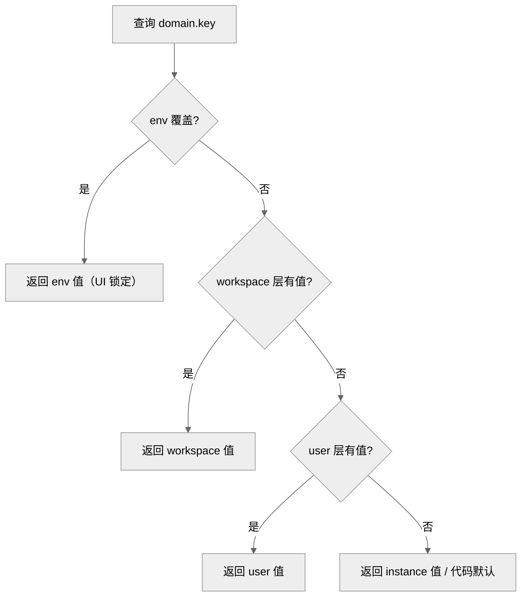

# DEV-003: 配置管理

> 面向开发者与运维：一次讲清配什么、放哪层、怎么改。前置阅读：DEV-002 §3（运行模式）。
>
> PLAN-0389 配置 proposed SPEC：[`spec/configuration/env-effective.md`](../../../spec/configuration/env-effective.md)。本文仍是 ConfigService/Config schema 的当前事实源；Runtime env/CLI 与 CP DB effective 分属不同进程边界。
>
> 现行模型（PLAN-0307/PLAN-0553 已落地）：**三层 `instance / user / workspace`**（作用域书写统一从大到小；解析链 `workspace > user > instance > 代码默认`）+ 凭证 **BYOK**（凭据域 `credentials` 为 SSOT；`provider_connections.credential_id` 只做 owner-neutral 引用；两级 `USER/WORKSPACE`；`SYSTEM` 归属已退役，见 PLAN-0364 M2）+ **env 覆盖锁定**（env 为最高部署权威，UI 显示 env 生效值并禁用该项）。端点以 `docs/api/openapi.yaml` 为准；认证、principal、授权和审计的冻结契约见根级 `spec/security/`（当前为 proposed）。

## 0.1 workspaceId 约束（PLAN-0559）

- 请求显式携带的 workspaceId（header/query）必须等于当前有效工作区，否则 403 WORKSPACE_FORBIDDEN。
- 未显式提供时使用有效工作区；配置层级、合并顺序与来源徽标不变（PLAN-0554）。


## 1. 三层所有权与十一域

ConfigService 按三层作用域 × 领域（Domain）组织配置；域集合为 `instance(14)`、`user(10)`、`workspace(10)`。`approval-policy`（PLAN-0364 决策 #9）与 `job-policy`（PLAN-0373 决策 #1）为**双显式例外**：instance 层可写默认、workspace 可覆盖、user 层不可写；由此 **`instance ⊇ user` 与 `instance ⊇ workspace` 恢复成立**，而 `workspace ⊄ user`、`user ⊄ workspace` 仍成立：

| Domain | instance | user | workspace | 备注 |
|--------|----------|------|-----------|------|
| `llm-provider` | ✅ | ✅ | ✅ | `profile`（默认身份整单元）+ 采样参数；**无任何 `*ApiKey` 键、无 base URL 键** |
| `context-policy` | ✅ | ✅ | ✅ | 压缩策略；结构化值为 JSON 文本 |
| `embedding` | ✅ | ✅ | ✅ | 整组 profile 对象 `{providerId, connectionKey, model}`（PLAN-0485，细则见 §3b）；固定模型/768 |
| `rag` | ✅ | ✅ | ✅ | `chunkSize` / `chunkOverlap` / `topK` / `minScore` |
| `pricing` | ✅ | ❌ | ❌ | `models`（provider/model → per-MTok 计价条目；instance-only 计价权威，PLAN-0343） |
| `agent-runtime` | ✅ | ✅ | ✅ | `useRegistry` / `useSupervisor` / `workersDir`；`instructions` **仅 instance**（决策 #17） |
| `agent-profile` | ✅（默认） | ✅（个人） | ❌ | `userName` |
| `user-preference` | ✅（默认） | ✅（个人） | ❌ | `theme` / `language` |
| `logging` | ✅ | ❌ | ❌ | instance 层唯一权威，可热更（决策 #23）；`centralTelemetryEnabled` = 中央遥测中继开关（PLAN-0522，默认 `false`，详见 DEV-004 §4） |
| `approval-policy` | ✅（平台 ADMIN） | ❌ | ✅ | 审批模式 `mode`（`manual` / `auto`）与要问清单 `askActionClasses[]`（actionClass 数组，PLAN-0407 T2.8：缺省 = 代码默认 8 项 `write`/`exec`/`delete`/`credential`/`CREATE_ACCOUNT`/`CREATE_TEMPLATE`/`MANAGE_WORKSPACE_AGENTS`/`SPAWN_AGENT`；在册 + `manual` → 弹审批、在册 + `auto` → 放行记 `allowed_by`、不在册 → 授权过后直过；缺配置回退默认清单，显式空数组 = 什么都不问）；**instance 层可写默认、workspace 可覆盖**，user 层不可写（显式例外）；审计来源层由 `DbPolicyContextProvider` 按 `ConfigService.effective(...).source` 回填（PLAN-0364 决策 #9，supersede PLAN-0337 选项①；env 命中视为 instance 钉死） |
| `job-policy` | ✅（平台 ADMIN） | ❌ | ✅ | `defaultTimeoutSecs` / `maxTimeoutSecs`（job 运行时限默认与硬上限，PLAN-0373 BL-22）；**instance 默认+上限权威、workspace 上限内下调、user 不可写**（与 approval-policy 同构的第二显式例外，决策 #1）；`maxTimeoutSecs=0`=上限未设不钳制（决策 #8），执行点在 CP `tools/call` 路由分叉前无条件覆写工具 `timeout`（决策 #5） |
| `agent-templates` | ✅ | ✅ | ✅ | Agent 角色模板域（PLAN-0374，细则见 §3a） |
| `context-templates` | ✅ | ✅ | ✅ | 上下文模板修订（PLAN-0414）；`id+version` 修订追加式不可变，只能按显式层读取 |
| `api-request-templates` | ✅ | ✅ | ✅ | API Request 模板域（PLAN-0439，细则见 §3b）：`templates` / `connectionDefaultTemplates` / `providerModelBindings`；发布版本不可变，模型 override 仅 user 层 |

已裁撤域：`infrastructure`（→ env）、`workspace-config`（→ env / 工作区 API）、`mcp`（→ `mcp_stdio_servers` / `mcp_remote_servers` 表，决策 #27）；键迁移：`llm-provider.contextPolicy` → `context-policy`、`user-preference.{defaultModel,maxTokens,temperature}` → `llm-provider`（决策 #13/#16/#39）。

**写权限**：instance = ADMIN；user = 本人；workspace = **可访问该 workspace 的 USER/ADMIN**（`ConfigController` 的 `hasAnyRole('USER','ADMIN')` + `requireAccessibleWorkspace`；决策 #37 的「owner」表述已由 PLAN-0337 冻结契约取代，`approval-policy` 亦适用）。**读掩码**：非 ADMIN 读 `agent-runtime`（含 `instructions`）被隐藏/掩码（决策 #33），含密字段按 admin 与否脱敏。

**解析链（单键通道，CP 进程内）**：

```text
per-call（run payload overrides / 转发头）
  > CLI --set（M3 目标）
  > env（部署权威；命中即锁定）
  > workspace > user > instance
  > 代码默认
```



锚点：`ConfigService.resolve()` / `EnvOverlayRegistry`（env↔DB 键映射唯一登记点）。

UI 入口 `/settings/config` 为**三个设置条目**：实例（仅 ADMIN，12 域）、工作区（当前 workspace，9 域，含 `approval-policy`、`job-policy`）、个人（user 层 9 域）。读取统一 `GET /api/v1/config/{domain}?layer=<instance|workspace|user>&includeMeta=true`——`envOverridden` 列出被 env 覆盖的键及其 env 生效值，UI 对这些键禁用编辑并展示 env 值；保存体自动剔除锁定键。`includeMeta=true` 在 resolved（不带 layer）与单层视图下都返回该元数据。

**PLAN-0554 逐键来源与实例默认值**：`GET /api/v1/config/{domain}/meta?layer=<instance|user|workspace>` 返回 `key/source/locked/writable/reason/instanceEligible/defaultPresent/overridable`，不含配置值。`instance` 仅 ADMIN；`user/workspace` 只返回该层可写域内、非 `INSTANCE_ONLY_KEYS` 的键；`pricing`/`context-templates` 等服务端专用域返回 `INVALID_DOMAIN`；`workspace` 缺上下文返回 `INVALID_LAYER_CONTEXT`。`source` 取值 `env|workspace|user|instance|code|none`（有 code default 才 `code`；模板域 explicit-only 无当前层值为 `none`）；`overridable` 仅在更具体层可写时为 true（`logging` 为 false）。`PUT /config/{layer}/{domain}` 对 env 锁定键返回 409 `CONFIG_ENV_LOCKED`；`DELETE /api/v1/config/instance/{domain}/{key}`（ADMIN）清除实例默认并回落 code default，同样拒绝 env 锁定键；导入跳过 env 锁定键并累计 warning。非 ADMIN `layer=instance` 一律 403，但 explicit-only 模板域（`agent-templates`/`api-request-templates`/`context-templates`）保留只读 builtin 访问；非 ADMIN effective read 过滤 `INSTANCE_ONLY_KEYS` 与 instance-only 域（如 `pricing`/`logging`），`envOverridden` 同步过滤。

## 2. 启动环境变量（.env 文件链 + CLI --set）

仅基础设施启动变量走进程启动环境变量（指服务启动前由 Shell、mise、`.env` 文件链或 `--set` 注入进程的变量，修改后通常需重启）。**模块内 dotenv loader 是唯一加载器**（`DotenvLoader.java` / `dotenv_loader.rs` / `dotenv_loader.py` 同一时序）：

```text
CLI --set KEY=VALUE（最高，启动日志掩码标注）
  > 进程已有 env（OS env / mise / 容器注入，快照后永不被文件覆盖）
  > .env → .env.$XIHE_ENV → .env.local（后加载覆盖先加载；支持 ${VAR} / ${VAR:-default}，未定义 WARN）
  > 代码默认
```

| 文件 | 内容 | 入库 |
|------|------|------|
| `.env` | base：跨环境共享（日志、JWT 有效期、附件策略、通道） | ✅ 仅非敏感占位值 |
| `.env.dev` / `.env.test` / `.env.prod` | 环境基线（`XIHE_ENV` 选择；test 端口 +10000 偏移、mock LLM；prod 严格安全开关） | ✅ 仅非敏感占位值 |
| `.env.local` | 个人覆盖（本机密钥/路径，environment-agnostic） | ❌ gitignore |

引导变量（不写文件）：`XIHE_ENV`（dev/test/prod）、`XIHE_LOAD_DOTENV=0`（逃逸开关）、`XIHE_ENV_FILE`（指定单文件）。**禁止 `.env.prod.local`**：生产配置只来自 `.env.prod` 入库基线或部署注入（IaC/CI secret）。

**业务域键禁入 env（硬约束）**：业务配置（模型/provider/域参数）以 DB 为唯一权威；env 与 DB 的重合属兜底路径，必须显式暴露（决策 #22）。当前注册表重合键为两组：`embedding.model ← XIHE_EMBEDDING_MODEL`（`.env` base 提供默认值）与 `job-policy.{defaultTimeoutSecs,maxTimeoutSecs} ← XIHE_JOB_TIMEOUT_{DEFAULT,MAX}_SECS`（**job-policy 两键定性为装机注入类**——BL-59 打包需求，PLAN-0373 决策 #8/风险 R4：走 EnvOverlayRegistry 登记正门 + 启动日志 `logStartupOverlays` + UI 锁定，**不得写成业务域可泛化的先例**）：命中时 CP resolved/effective 使用 env 值，UI 锁定显示（绕 UI 改 DB 无效，`layerEntries` 对锁定键剔除，避免 UI 看到的层值与实际生效值不一致），日志记录冲突与胜者。
**超时覆盖键**（`XIHE_MCP_TOOL_TIMEOUT_S` Agent / `XIHE_EXEC_COLLECT_TIMEOUT_S` Runtime / `xihe.mcp.forward-timeout-s` CP）登记为**本跳部署者覆盖**类：显式设置时该跳精确取该值并压制 CP 下发值；不参与 DB 域解析，正常路径由 CP 预算派生（PLAN-0308 决策 #21/#25）。

| 变量 | 说明 |
|------|------|
| `XIHE_CP_PORT` / `XIHE_AGENT_PORT` / `XIHE_RUNTIME_PORT` / `XIHE_UI_PORT` | 四模块端口（12631/12632/12633/12630，PG 12634） |
| `XIHE_CP_URL` | Agent/Runtime 回连 CP 的地址 |
| `XIHE_AGENT_API_TOKEN` / `XIHE_CP_API_TOKEN` | 模块间共享 service token（前者优先、后者回退；见 [DEV-024](DEV-024-authentication-matrix.md)） |
| `XIHE_CP_DATASOURCE_URL` / `XIHE_CP_DATASOURCE_USERNAME` / `XIHE_CP_DATASOURCE_PASSWORD` | CP 数据库连接 |
| `XIHE_CP_JWT_SECRET` | JWT 签名密钥（仅 CP 自身初始化） |
| `XIHE_WORKSPACE_HOST_ROOT` | host root：Runtime 进程级存储基目录（managed workspace 的父目录 + shadow 状态根；**不是**每个 workspace 一个根，也不是用户路径白名单）。源值可相对（`.env.dev` 的 `../../.xihe-workspaces` 以 `packages/runtime` 为基准；CLI/stack 描述符以 A03 检出根为基准），launcher 注入 Runtime 的进程值必须为绝对路径；Runtime 对遗留相对值做一次绝对化并告警。默认 `A03-xihe/.xihe-workspaces` |
| `XIHE_WORKSPACE_MATERIALIZE_TIMEOUT_SECS` | Runtime 物化总时限（秒；默认 600，自取得 per-workspace 锁后计时、排队不计入；超时置 `failed` 并署名，PLAN-0323 M-1） |
| `XIHE_JOB_TIMEOUT_DEFAULT_SECS` | `job-policy.defaultTimeoutSecs`（job 运行时限默认值，秒；PLAN-0373 决策 #7/#8——装机注入类重合键，env 命中即锁定，UI 显示 env 值且该字段不可改） |
| `XIHE_JOB_TIMEOUT_MAX_SECS` | `job-policy.maxTimeoutSecs`（job 运行时限硬上限，秒；PLAN-0373 决策 #7/#8——`0`=上限未设不钳制；env 命中即锁定，UI 显示 env 值且该字段不可改） |
| `XIHE_SANDBOX_MEMORY_MB` / `XIHE_SANDBOX_CPUS` / `XIHE_SANDBOX_PIDS_LIMIT` | 沙盒容器资源（默认 512MB / 2 CPU / 100 pids；env 部署权威，非法或越界值按字段回退默认并告警，创建容器时记录生效值） |
| `XIHE_LOAD_DOTENV` | `0`：各模块不从 `.env` 读取应用层配置 |
| `XIHE_LOG_LEVEL` / `XIHE_LOG_LEVEL_<MODULE>` | 日志启动引导等级（运行期权威为 DB `logging` 域，详见 DEV-004） |
| `XIHE_TLM_URL` / `XIHE_TLM_INGEST_TOKEN` | PLAN-0522 中央遥测中继的端点与项目令牌（server-to-server）；令牌仅部署注入、不入库文件；任一缺失时中央转发 fail-closed 关闭，本地 sink 不受影响（详见 DEV-004 §4） |

**业务域键禁入 env（硬约束）**：业务配置（模型/provider/域参数）以 DB 为唯一权威；env 与 DB 的重合属兜底路径，必须显式暴露（决策 #22）。当前注册表重合键为 `embedding.model ← XIHE_EMBEDDING_MODEL` 与 `job-policy.{defaultTimeoutSecs,maxTimeoutSecs} ← XIHE_JOB_TIMEOUT_{DEFAULT,MAX}_SECS`（后者为装机注入类，PLAN-0373 决策 #8）：命中时 CP resolved/effective 使用 env 值，UI 锁定显示（绕 UI 改 DB 无效），日志记录冲突与胜者。目标态为逐步把业务键移出 `.env*`。

**Agent env 兜底（离线/无租约路径，决策 #40；PLAN-0504 决策 #9 收敛）**：`XIHE_{PROVIDER}_API_KEY`（`openai`/`deepseek`/`xiaomi`/`anthropic`/`dashscope`）与 `XIHE_API_BASE`/`PROVIDER_DEFAULTS.api_base` 构成无 CP 租约时的兜底（fallback registry 不再读 config 层，`model` 留空）；**常规路径是 `provider_connections` 租约**（见 §3）。全层无 `profile` 时 Agent 不再有隐式默认：readiness fail-closed 为 `missing_credentials`（映射 `LLM_NOT_CONFIGURED`，决策 #10）。无租约且无兜底 key 的 run 在 `/chat` fail-closed 返回 503 `LLM_NOT_CONFIGURED`。

**secret 通道归位（决策 #37/T3.7）**：`XIHE_*_API_KEY` 一律标注**离线兜底**语义，常规路径为 CP 加密租约（DB 侧仅存信封密文）；secret 禁止写入入库的 `.env*` 文件（`.env`/`.env.$XIHE_ENV` 仅非敏感占位值），个人本地调试只允许 `.env.local`（gitignore）；**禁止 `.env.prod.local`**——生产配置只来自入库基线或部署注入（IaC/CI secret），本机文件覆盖生产不可复现、不可审计（反模式，加载器不设该层级）。

**危险默认 fail-fast（决策 #7/#25/#32/T3.4）**：各模块启动时校验最终生效值——显式 `XIHE_ENV=prod` 命中出厂态危险默认（JWT secret/服务 token/allow-dev-key/加密 key）即**拒绝启动**并列键与修复指引；未设或 dev 仅 WARN；发布门禁强制显式 `prod`。清单见 `spec/config-env-target.md` §6。

**本地模式（PLAN-0526）**：`XIHE_LOCAL_MODE=true` 是单机单用户部署的登录入口例外（默认关）。开启时 CP **必须**绑定回环地址（`server.address`，可用 `SERVER_ADDRESS=127.0.0.1` 注入），且在 `XIHE_ENV=prod` 或非回环绑定下**拒绝启动**；该键同时进 CP 危险默认校验（prod-only），契约见 [`spec/security/authentication.md`](../../../spec/security/authentication.md) §4。

**配置归属速查**：

| 配置类别 | 归属 | 生效方式 |
|---------|------|---------|
| 端口、DB 连接、JWT secret、模块间 URL、service token（解析顺序见 [DEV-024](DEV-024-authentication-matrix.md)）、Workspace 根 | 启动环境变量 / `.env.dev` | 重启生效 |
| API key 等凭证 | `credentials`（凭据域 SSOT；连接只存 `credential_id`；租约下发） | 运行时即时 |
| 模型、采样参数、context-policy、embedding、rag、agent 行为、user-preference | ConfigService（DB 三层） | 运行时即时（Agent 周期 pull + run 覆盖） |
| 日志等级 | ConfigService `logging` 域（instance）；启动早期回退 env | 热更（CP logback / Agent reload） |
| Agent env 兜底键 | Agent 进程 env | 仅无租约/CP 不可达时 |

## 3. ConfigService（运行时配置）

**方式 A：CP API**（运行时修改，立即生效）

```bash
# 实例层（ADMIN）：非密钥域配置（PLAN-0504：默认身份 = 整单元 profile）
curl -X PUT http://localhost:12631/api/v1/config/instance/llm-provider \
  -H "Content-Type: application/json" \
  -H "Authorization: Bearer $TOKEN" \
  -d '{"profile": {"providerId": "deepseek", "connectionKey": "default", "model": "deepseek-chat"}}'

# 用户层（本人）：个人覆盖（要求本人有同 provider + connectionKey 的 READY 连接）
curl -X PUT http://localhost:12631/api/v1/config/user/llm-provider \
  -H "Content-Type: application/json" -H "Authorization: Bearer $TOKEN" \
  -d '{"profile": {"providerId": "deepseek", "connectionKey": "default", "model": "deepseek-reasoner"}}'

# 清除本层以继承：空值即删除本层 profile 行
curl -X PUT http://localhost:12631/api/v1/config/user/llm-provider \
  -H "Content-Type: application/json" -H "Authorization: Bearer $TOKEN" \
  -d '{"profile": ""}'

# 工作区层（owner）：工作区覆盖（workspaceId 查询串或 X-Workspace-Id 头）
curl -X PUT "http://localhost:12631/api/v1/config/workspace/rag?workspaceId=$WS" \
  -H "Content-Type: application/json" -H "Authorization: Bearer $TOKEN" \
  -d '{"topK": "8"}'
```

**llm-provider 默认身份（PLAN-0504/0552，决策 #2/#4/#11/#12）**：默认身份是整单元 `profile` = `{providerId, connectionKey, model}`（JSON 字符串或对象），按 workspace > user > instance **首存在层**解析、整单元覆盖、不合并字段；写入必须是完整单元（部分 profile 400 `INVALID_REQUEST`）。`profile.providerId` 的写时接受集 = CP provider catalog 全量 id（`provider-catalog/providers.json`，经 `ProviderCatalogService.providerIds()` 派生，`GET /api/v1/provider-catalog` 同源）：catalog 增删 provider 无需改代码；catalog 外值以 `profile.providerId is unsupported` 拒绝。instance 层不校验连接（运行期由消费方 scope 解析到消费用户的 USER 连接）；**workspace 层只接受本 workspace 的 WORKSPACE 连接，user 层只接受本人的 USER 连接**（PLAN-0552 关闭 workspace→user 隐式回退）。legacy 键（`defaultProvider`/`defaultModel`/`*Model`/`*ApiBase`/`baseUrl`）已退役，写入即被 schema 拒绝（400，无兼容映射）。解析到已删/不可用连接时报 `LLM_PROFILE_CONFLICT`（409），不静默降层。配置页默认模型 = 连接选择 + 模型候选（scoped 目录），见 §3b。

凭证**不写 config 层**（`rejectProviderSecrets` 会以 403 拒绝任何 `*ApiKey`/secret/password/token 类键），统一走凭据域：`credentials` 保存加密密钥，`provider_connections.credential_id` 只做引用（PLAN-0553 硬切后连接不再有密文列）：

`isProviderSecretKey` 对通用 `token` 键名匹配必须排除 `maxTokens`：它是 `llm-provider` 的数值配置，不是凭证；`ConfigServiceTest.importJsonc_acceptsNumericValues` 覆盖该行为。

```bash
# 创建凭证连接（USER 默认；WORKSPACE 需为该 workspace owner；SYSTEM 已废除）
curl -X POST http://localhost:12631/api/v1/provider-connections \
  -H "Content-Type: application/json" -H "Authorization: Bearer $TOKEN" \
  -d '{"providerId": "deepseek", "apiKey": "sk-xxx", "scope": "WORKSPACE", "baseUrl": "https://api.deepseek.com"}'
```

**方式 B：JSONC 导入**（批量初始化）

```bash
cp config.import.example.jsonc config.import.local.jsonc  # 按十一域模型填写非密钥配置（凭证走 provider_connections）
curl -X POST "http://localhost:12631/api/v1/config/import?layer=instance" \
  -H "Content-Type: application/json" \
  -H "Authorization: Bearer $TOKEN" \
  -d @config.import.local.jsonc
```

`mise run dev:host` **不会自动导入**配置。CP ready 后如需导入，显式运行 `mise run dev:host:import-config`，或 `mise run xihe -- config import <file>`；需要本机管理员认证。导入为**按域合并覆盖**（只更新携带的键），旧模板若含 `*ApiKey` 会被 403 拒绝——删除这些键即可。

`mise run dev:full` 是独立的一次性 Compose 脚本，仍保留其原有显式环境变量触发导入的行为；不要把它的启动语义套用到日常 `dev:host`。

**XH CLI 与 Provider Connection**：`provider add/update/list/verify` 经 CP 认证 API 管理连接，密钥由 CP 写入凭据域并只把 `credential_id` 存到连接（PLAN-0553）。`dev init` 需要显式 provider/scope；无连接时创建，有连接时复用并 verify，不自动换 key。通过 `--api-key-env <NAME>` 指定当前进程环境变量，或在交互终端输入无回显密钥；CLI 不自行读取 `.env.local`，非交互任务必须由调用方安全注入变量。禁止把 key 值放在命令参数或 JSONC 中。

**连接显示名（`label`，PLAN-0555；长度与控制字符由 PLAN-0563 收紧）**：`label` 是显示名而非身份；写入口先 `trim`，要求 1-40 个字符（code point）且不含控制字符，并在 `(owner_type, owner_id, provider_id)` 内大小写不敏感唯一（V79 函数索引）。重名返回 409 `PROVIDER_CONNECTION_LABEL_CONFLICT`（`field=label`）；CLI 对该码给出可读提示，不再误报 `OPERATION_OUTCOME_UNKNOWN`。UI 的 composer 三段标签按「服务端会话 → 本地 binding → llm-provider profile」解析连接段，`label` 缺失时回退 `connectionKey`。

```bash
mise run xihe -- provider add xiaomi --scope USER --label xh-local --api-key-env XIHE_XIAOMI_API_KEY
mise run xihe -- provider update <connection-id> --api-key-env XIHE_XIAOMI_API_KEY
mise run xihe -- provider list
mise run xihe -- provider verify <connection-id>
mise run dev:host:provider-init -- --provider xiaomi --scope USER --label xh-local
```

Catalog 标为 manual discovery 的 Provider（如 Ark）创建连接时，还须明确提交模型 ID，例如 `--models doubao-pro,deepseek-v3`；模型发现方式只跟随 Catalog，CLI 不提供覆盖参数。remote-models Provider 拒绝 `--models`。列表与 verify 不回显远端模型列表。

Provider verify 的 ready 只表示 CP 当前 remote `/models` 响应结构有效（`data` 数组可为空），不代表模型 completion 成功。`test:e2e:host:real` 沿用 Agent 进程的 `XIHE_E2E_REAL_XIAOMI_KEY` 通路，不消费此处的 Provider Connection lease；两条路径不可相互替代。

**凭据管理域与轮换（PLAN-0495）**：`credentials` 表承载 owner 级独立凭据对象（USER/WORKSPACE 两级；`token`/`key_pair` 两形态；`lease`/`reveal` 单通道档位）。独立主密钥 `XIHE_CP_CREDENTIALS_KEY`（或 `XIHE_CP_CREDENTIALS_KEY_RING` JSON 环 + `XIHE_CP_CREDENTIALS_CURRENT_VERSION`，环须含 current）；prod 未配置 key/ring 或 `XIHE_CP_CREDENTIALS_ALLOW_DEV_KEY=true` 时 fail-fast 拒绝启动。密钥轮换经 `mise run xihe -- credential rotate`（internal 服务面，需 `XIHE_CP_API_TOKEN`）：扩环（旧+新，current=新）→ 批量重加密（CAS 回写、可续跑）→ 退役校验（按版本计数为 0 后方可移除旧 key）。契约见 `spec/security/credential-management.md`。

**导入导出契约（决策 #36/#37，T2.21/T2.25）**：导出 `GET /api/v1/config/export?layer=instance&includeSecrets=<bool>`（ADMIN）—— config KV + `provider-connections` 元数据（label/status/modelDiscovery/manualModels/enabled/ownerType/ownerId/baseUrl）；`includeSecrets=false` 仅排除明文 `apiKey`，**任何模式都不输出库内密文**；导出写 AUDIT sink（actor/时间/是否含密钥，不记响应体）且响应 `Cache-Control: no-store`。导入**不恢复任何凭证**——`provider-connections` 条目整体跳过并在响应 `{imported, skipped, warnings}` 中列出（owner id 跨实例不可映射），需人工经凭证 API/UI 重建。导出产物落盘使用 `config.export*.jsonc`（gitignored）。UI 实例页内提供导出（含可选明文密钥开关）与导入（文件 + WARN 清单）入口。

**配置 key 多点同步（硬约束）**：新增/修改 domain key 必须同步四处——（a）CP `config-schemas/*.json`（JSON Schema，同时约束 import 与 UI 保存）、（b）`config.import.example.jsonc` 模板、（c）UI `/settings/config` 表单、（d）UI `stores/config.ts` 域列表（`INSTANCE_DOMAINS` / `LAYER_DOMAINS`，决定各 tab 呈现与 `loadLayerDomains` 拉取范围；PLAN-0373 对账 V4 新增同步点）；任一漏改会导致 import 与保存同时 400，或该域在 UI 域列表漏拉取/漏渲染。

各模块客户端（层封闭，决策 #19）：instance/workspace 合并值经 `GET /internal/v1/config/effective/{domain}` 拉取（CP 按 workspace 上下文合并，含 env 覆盖）；user/workspace 覆盖随 run payload push（`userOverrides`/`workspaceOverrides`，决策 #3a；env 锁定键由 CP 剔除）：

| 模块 | 客户端 | 行为 |
|------|--------|------|
| CP | 内建 `ConfigService` | 直接读库 |
| Agent | `config_client.py` | 启动/周期拉取 workspace-bound effective；chat run 按 payload overrides 合成（instance → user → workspace，无副作用） |
| Runtime | 无 config client（决策 #4） | 物理配置走 env/CLI（决策 #29） |

## 3a. Agent 模板域 agent-templates（PLAN-0374）

- schema：`packages/control-plane/src/main/resources/config-schemas/agent-templates.json`；`templates[].roleId` 只引用同层 `roles[]`，模板不存 provider secret。
- 层读取边界（`AgentTemplateService.resolveForCreation` fail-closed）：instance 模板仅 ADMIN、user 模板仅本人、workspace 模板仅该成员；禁止跨层列举与 merged-effective 静默覆盖；重复 template/role UUID 或坏引用直接拒绝。UI 读取必须指定 `layer`；该域没有 legacy merged-config 视图，不纳入 `CONFIG_DOMAINS` 通用拉取。
- 写路径必须独立 `CREATE_TEMPLATE` 并审计 actor/scope/key diff，与 `CREATE_ACCOUNT`（principal 创建）分离；创建/修改模板不创建 principal。读路由 `GET /api/v1/agent-templates` 已开放（层可见性 fail-closed）；写 CRUD 与 `approval-policy.askActionClasses[]` UI 仍由 T3.1b 等 PLAN-0407 V44 canonical action，当前缺 action 一律 fail-closed。契约见 [`spec/agent/principal-workspace-binding.md`](../../../spec/agent/principal-workspace-binding.md)。

## 3b. API Request 模板域、Embedding profile 域与 LLM profile 域（PLAN-0439/0485/0504/0505）

**api-request-templates（PLAN-0439）**：

- 键为三个 JSON 字符串：`templates`（模板定义数组，含 `apiTypeId/apiTypeVersion/bodySource/status`）、`connectionDefaultTemplates`（`connectionId → {layer,templateId,version}`）、`providerModelBindings`（`connectionId → {model → ref}`，仅 user 层可写）。
- 写路径经 `ApiRequestTemplateService.putLayer`（ConfigService 对该域委托）：instance 写仅 ADMIN、user 写仅本人、workspace 写需 workspace OWNER/ADMIN；`connectionId` 必须在同层可见且类型兼容。
- 发布版本不可变（修改/删除已发布修订 → `409 API_REQUEST_TEMPLATE_REVISION_IMMUTABLE`）；draft 保留非法原文，发布诊断由独立 validator 负责，不自动修复。
- `templates`/`connectionDefaultTemplates`/`providerModelBindings` 只能按显式层读取（effective 合并被拒，见 `rejectEffectiveContextTemplates`）。
- **连接删除级联清理（PLAN-0505）**：删除 Provider Connection 时，同一事务内移除所有 user 层行的 `providerModelBindings[connectionId]`（含其他用户行，跨用户清理经连接所有权授权、仅计数不暴露内容）、owner 层 `connectionDefaultTemplates[connectionId]` 与指向该连接的 `llm-provider.profile` 行；`templates` 本体不动。删除前经 `GET /api/v1/provider-connections/{id}/delete-impact` 预览计数，UI 二次确认展示数量；清理数量与作用域入审计，预览与实际不一致以事务内实际计数为准。

**llm-provider profile（PLAN-0504/0505）**：

- 默认身份为单键 `profile`：整组对象 `{providerId, connectionKey, model}` 的 JSON 字符串；层间不合并字段（workspace → user → instance 首存在层），部分 profile 400，空值 PUT 清除本层以继承。
- 写校验：`providerId` 必须在 CP catalog；**workspace 层只接受本 workspace 的 WORKSPACE 连接，user 层只接受本人的 USER 连接**；instance 层免连接校验（运行期落到消费用户的 USER 连接，决策 #11）。跨 owner 的显式凭据授权由后续计划承接，写校验不再回退。
- 解析：按 profile 所在层选 owner（workspace → workspace、user → user、instance → 消费用户 USER）；`userId` 为空直接 409；解析到已删/不可用连接 → `409 LLM_PROFILE_CONFLICT`（不静默降层，决策 #12）；全层无 profile 时 Agent 无隐式默认，readiness fail-closed（决策 #10）。
- 过渡开关：`XIHE_CP_LLM_PROFILE_LEGACY_CONNECTION_FALLBACK`（默认 `false`）仅用于短期回退；置 `true` 恢复旧的 workspace→user 跨层回退，长期路径必须为严格按层解析。
- **删除级联（PLAN-0505）**：profile 指向的连接被删除时，指向该连接的 profile 行（instance/user/workspace 三层，providerId+connectionKey 匹配）随删除事务一并清除；畸形 profile 行跳过（不计数、不阻断删除），留给属主修复。
- 配置页以「连接选择 + 模型候选（scoped 目录）」编辑该单元（复用 0503 目录候选与漂移标注：存储连接/模型不可用时标注保留、不自动改写，候选为空可手填）。

**embedding（PLAN-0485）**：

- 本层值为单键 `profile`：整组对象 `{providerId, connectionKey, model}` 的 JSON 字符串；层间不合并字段，部分 profile 直接 400；缺省或空 PUT 清除本层以继承（解析顺序 workspace → user → instance）。
- 目标模型固定 `tongyi-embedding-vision-flash-2026-03-06`、维度固定 768；API Type `dashscope-multimodal-embedding/v1` 由 type contract 钉住 host（`dashscope.aliyuncs.com`）与路径，CP 拒绝自定义 host。
- env 重合键 `embedding.model ← XIHE_EMBEDDING_MODEL` 仍按决策 #22 显式呈现（命中即 instance 钉死）。
- `GET /api/v1/config/embedding/effective` 为只读解析（含 CP 下发的 `contract{modelId,dimension}`），缺失/冲突不报 5xx 而是返回 `code`；`POST /api/v1/config/embedding/test` 经 Agent 一次性租约探测，响应脱敏（无凭据/向量）。

## 4. Agent readiness 与模型目录

配置同步成功只表示 CP/Agent 配置来源可达，不表示 provider 可以实际调用。Agent 将 HTTP liveness、配置同步和 `llmReady` 分开暴露：

| `llmReady` | 含义 | 新 Chat 行为 |
|------------|------|------------|
| `unknown` | 必需 domain 同步失败、响应无效或状态未知 | fail-closed，返回 503 |
| `missing_credentials` | 全层无 `llm-provider.profile`（无身份，决策 #10）——不再有隐式 mock 默认 | **未就绪**（fail-closed）；`/chat` 返回 503 `LLM_NOT_CONFIGURED` |
| `invalid_credentials` | provider `/models` 或 Chat 返回认证失败 | 返回 `LLM_CREDENTIALS_INVALID` |
| `unreachable` | provider 超时或网络不可达 | 返回 `LLM_PROVIDER_UNREACHABLE` |
| `model_unavailable` | 默认/选择的模型不在可用 chat catalog | 返回 `LLM_MODEL_UNAVAILABLE` |
| `ready` | provider preflight 和当前模型均可用；**catalog 无该 provider（BYOK 无实例级凭证）时同样为 ready** | 允许新 Chat |

Agent 启动和周期 refresh 使用同一 atomic runtime snapshot。模型目录通过 `/internal/v1/agent/models` 返回 provider 状态、`chat` capability、`verifiedAt` 和 `configRevision`，不返回 key 或 base URL；UI 只展示 ready 且 `chat=true` 的模型。provider 目录条目来源于当前上下文可见的 READY `provider_connections`（CP `/api/v1/models` 汇总）。

**路由与工具能力错误（PLAN-0364 M3）**：`LLM_TOOL_ROUTE_UNSUPPORTED` = 所选路由不支持工具参数（native `xiaomi_mimo` 等无工具元数据；litellm 抛 `UnsupportedParamsError` 后映射，需改用 OpenAI 兼容连接）；`LLM_BASE_URL_MISSING` = `openai` / `custom_openai` / `openai_like` 路由缺 `baseUrl`（Agent 侧 fail-fast，禁止回落到 OpenAI 默认端点）。`LLM_REQUEST_REJECTED` = 提供方 4xx 拒绝请求（消息形态/参数不被接受，如 `content` 传空串数组），不可重试；三者已在 UI `errorMessages` 登记。

凭证只归凭据域（`credentials` 加密存储 + 租约；`provider_connections` 只存 `credential_id`）：USER 可读取脱敏配置与安全 provider 状态，但不能写入 `llm-provider` 凭证键；ConfigAudit 对 provider 凭证只保存 `present/missing` 和不可逆 fingerprint。ADMIN 配置 GET 的 raw-read 例外仅限配置 API 响应本身，不得扩展到 health、catalog、日志、trace 或截图证据。
