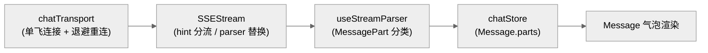

# DEV-010: UI 架构

> Vue 3 + Pinia + vue-router + Vite + Tailwind CSS 4 + reka-ui。UI 只与 CP 对话（`fetch POST` + 持久 SSE），不直接调用 Agent 或 Runtime。与 DEV-017 以"UI 实现 vs Session 领域"分界：路由/视图/组件/传输层归本文，store 职责边界与跨视图同步归 DEV-017。

### SPEC 指针

跨页面交互状态、设计系统和无障碍契约见根级 proposed SPEC：

- [`spec/ui/interaction-model.md`](../../../spec/ui/interaction-model.md)
- [`spec/ui/design-system.md`](../../../spec/ui/design-system.md)
- [`spec/ui/accessibility.md`](../../../spec/ui/accessibility.md)

这些 SPEC 不复制 OpenAPI/SSE schema，也不替代 feature PLAN 的具体页面流程。

## 0.1 工作区上下文（PLAN-0559）

- 工作区放 URL + sessionStorage；localStorage 只保留 token/user。
- 每个 workspace-scoped 请求带 X-Workspace-Id；切工作区清 workspace-scoped 缓存并丢弃旧响应。
- 角色 OWNER/EDITOR/VIEWER；VIEWER 隐藏写入口，服务端仍以 403 为准。
- 跨标签登出用 BroadcastChannel + storage 兜底；不广播工作区切换。

## 1. 路由与布局

`packages/ui/src/router/index.ts`：

| 路由 | 组件 | 说明 |
|------|------|------|
| `/` | redirect | → `/workspace` |
| `/workspace` | `WorkspacePicker`（AppLayout 内，无 tab 上下文时） | **显式工作区选择面**（PLAN-0608）：角色取 `GET /workspaces` 权威值；已有 tab 上下文时守卫重定向到 `/workspace/{id}` |
| `/workspace/:workspaceId` | WorkspaceView（AppLayout 内） | 工作台（文件树 / 主区 / dock 三栏）；可处于无 Session 空态 |
| `/workspace/:workspaceId/chat/:sessionId` | WorkspaceView（AppLayout 内） | 选中该 Workspace 内的 Session 并显示 Chat |
| `/workspace/:workspaceId/environment` | WorkspaceEnvironmentView（AppLayout 内） | Workspace 执行环境 |
| `/workspace/:workspaceId/settings` | WorkspaceSettingsView（AppLayout 内，PLAN-0560） | 常规（OWNER 可改名/删除）/ 配置（workspace 层 9 域）/ MCP 三区块；`?tab=config\|mcp` 直达 |
| `/workspace/:workspaceId/scheduled-tasks` | WorkspaceScheduledTasksView（AppLayout 内） | 定时任务；作为**中间标签栏**的一个标签参与路由投影（`router/index.ts`） |

所有 Workspace 路由共用 `AppLayout`。`AppLayout` 是**两层左栏 + 主区**：最左 `NavRail`（固定 **56px** 纯图标，无文字标签）+ 导航面板（默认 **280px**，可收起/可拖 220–360）+ 主区。工作台内容由 `WorkspaceWorkbench` 承载（结构见下一条），顶部有**中间标签栏** `WorkspaceTabBar`（现有路由的投影，不新增路由；`chat` 恒开、其余三个为按 workspace 持久化的打开集合）。无 tab 上下文访问 `/workspace` 时渲染**显式工作区选择面** `WorkspacePicker`（PLAN-0608）。Chat 是 Workspace feature 内的 Session 视图，不再有独立 `/chat` 路由；旧的未匹配路径回退到 `/workspace`。Session id 不能替代 Workspace id（PLAN-222）。

## 2. 视图分层

- **WorkspaceView**（`features/workspace/pages/WorkspaceView.vue`）：**装配层** —— 自身只做路由/布局编排，工作台内容由 `WorkspaceWorkbench` 承载（rail 56 + 导航面板 + 文件树 / 主区 / dock 三栏，结构见 §1 与本条）；有选中 Session 时挂载 Chat，否则显示创建 Session 空态；**遇到 `400 WORKSPACE_CONTEXT_CONFLICT` / `409 WORKSPACE_CONTEXT_REQUIRED` 回退到工作区选择面 `WorkspacePicker`**（PLAN-0608），不弹死路 toast。Workspace 创建入口统一为 `WorkspaceCreateDialog`（PLAN-0384：空态入口 + 工具栏「添加 Workspace」共用同一弹窗）。流程 = 存储方式（托管副本/直接使用目录）→ 仅 direct-attach 走 Runtime-visible source browser 选目录 → 真实 capability 预检驱动的执行模式卡片（MXC experimental / windows-host 高风险 / docker 后置禁用）→ 确认摘要与宿主风险确认 → 创建（`Idempotency-Key`）。托管副本 v1 仅文件导入（Docker 执行后置），不提供执行模式选择；工作区改名/删除走 `WorkspaceSettingsView`（`features/workspace/pages/WorkspaceSettingsView.vue`，PLAN-0560：常规区 OWNER 可编辑/删除 + 二次确认，配置区复用 `ConfigLayerPanels`，MCP 为 `WorkspaceMcpPanel`；旧 `WorkspaceSettingsDialog` 已退役）；移动端（<768px）为独立 IA（§7：树 Sheet + Chat 底部抽屉）。
- **ChatPanel**（`features/workspace/chat/components/ChatPanel.vue`）：Workspace Chat 的内嵌对话组件（消息列表 + 输入框 + SSEStream）；接收 `sessionId` prop；附件写入入口 `handleSend`。
- **FollowUpQueuePanel**（`features/workspace/chat/components/FollowUpQueuePanel.vue`，PLAN-0442）：ChatPanel 内联的 durable Follow-up 队列面，纯 snapshot 驱动——FIFO 计数（含硬上限 5）、逐项撤回、整队暂停时的 Continue、容量 footer；admitted child 不提供撤回，attempted `child_ambiguous` completed 项以消息状态回显。Run 进行中 `InputArea` 以 `chat-queue-button` 提供显式「排队」（`POST /api/v1/sessions/{sessionId}/follow-ups`，带 Idempotency-Key），与普通发送语义区分——队列未清空时普通发送由 CP 409 拒绝。刷新/重连后由 snapshot 恢复，不依赖 SSE 内存态；设计预览与用户视觉批准见 `plans/PLAN-0442-XH-run-guidance-follow-up/design.md` 决策 #24。
- **GuidancePanel**（`features/workspace/chat/components/GuidancePanel.vue` + `composables/useGuidance.ts`，PLAN-0530）：运行中 Run 的独立「指导当前运行」面，与 Send/Follow-up/Stop 完全分离（独立 i18n 命名空间 `chat.guidance*`）。数据唯一源自 CP 快照 `GET /api/v1/chat/runs/{runId}/guidance`（无 Guidance SSE 事件，裁定候选①）；提交走 `POST .../guidance` + `Idempotency-Key`。按 CP `sequence` 升序展示来源/时间/状态（`pending`/`consumed`/`terminal_expired`）。输入仅当 UI 投影状态 ∈ `{executing, thinking, awaiting_approval}` 时可用（映射 CP `{running, streaming, awaiting_approval}`）；Run 终态后输入隐藏但 **列表保留**（`ChatPanel.lastRunId`），切换 Session 时清空。刷新时机：挂载、提交后、streaming 停止、`runRecovery` 信号、会话 SSE 重连（`handleDerivedStateRefresh`）。终态收敛见 `spec/session/chat-run-operation.md` §Run Guidance。错误恢复（PLAN-0536）：`409 GUIDANCE_RUN_NOT_ACTIVE` → 内联横幅 + **清空草稿**（`useGuidance.submit` 返回 `ok|clear|keep` 判别结果）；其余错误保留草稿。前者无法在浏览器断言（409 到达时 Run 已非活跃、输入按 §3.1 卸载），由 `__tests__/GuidancePanel.spec.ts` 覆盖。
- **WorkspaceToolbar**：只保留**聊天级**控件（上传/刷新等）；**会话下拉已删除**（PLAN-0582 T4.1/S1）——会话切换只走导航面板；页面级入口（Environment / Settings / 定时任务）改由**中间标签栏**承接（`WorkspaceTabBar`，S3a），不再在工具栏按路由整页跳转；移动端收敛为 ＋ 新建对话 + ⋯ 溢出菜单。
- **FileNodeMenu**（`features/workspace/components/FileNodeMenu.vue`）：reka-ui `ContextMenu` 封装；文件：Rename/Move/Duplicate/Copy Path/Delete；目录：New File/New Directory/Rename/Move；文本走 `write_file` MCP，二进制走 `POST /api/v1/files/upload` FormData（PLAN-262 M0/B-3）。
- **Sidebar（导航面板）**：面板头 = **工作区行**（当前工作区名/切换/新建/导入/成员入口）+ 新建对话 + 会话搜索框 + 会话树；「New Chat」在当前 Workspace 打开创建 Session 流程；Session 列表点击跳 `/workspace/:workspaceId/chat/:sessionId`。**底部孤立「Workspace」导航项已删除**（PLAN-0582 S1）：工作区入口只在面板头，`<1024` 时面板变 sheet 抽屉；缺失工作区时 fail-closed。

## 3. 五组件族

位于 `packages/ui/src/components/ui/`，聊天界面自研组件（已替代旧第三方虚拟列表方案）：

设计经验（shadcn-vue 官方组件对照，详见 PLAN-243 附录 A）：

- **分层纪律**：对齐/头像/时间戳上浮 Message，Bubble 只管 surface（自研已做到，予以确认）。
- **状态显式化**：上传态用 `state` prop 驱动，不从 service 派生。
- **无障碍基线**：装饰图标 `aria-hidden`、不可用按钮 `inert` + `tabindex=-1`、思考态 `role=status`（缺失项，做 a11y pass 时补）。
- **BubbleGroup**：同发送者连发合并，治工具调用 burst 刷屏。
- **Footer actions 位**：copy/retry/feedback 标准位置，hover 栏向其收敛。
- **耦合结论**：五族本体零 store 引用（已取证）；耦合在容器层属正常分离；MessageItem 身兼三职可拆（观察项）。

| 组件族 | 用途 |
|--------|------|
| `message-scroller/` | 滚动容器：following-bottom → free-scrolling → anchored-to-message → settling-jump 状态机；`shallowRef` + `data-*` 避免高频响应 |
| `message/` | 消息卡片：Message / MessageGroup / Avatar / Content / Header / Footer |
| `bubble/` | user / assistant / system 气泡，cva 管理 |
| `attachment/` | 媒体/文件/动作按钮，state/size/orientation 变体 |
| `marker/` | 时间/状态分隔线 |

## 4. 传输层（会话级持久 SSE，PLAN-230）

> 分层原则：**传输基元全用第三方，自研只做会话语义**。基元：`@microsoft/fetch-event-source`（UI）、Spring `SseEmitter`（CP）、HTTP SSE；自研约 800 行：chatTransport（单飞/退避）+ useSSE + SSEStream + useStreamParser，以及 CP `SseEmitterManager`（单活/generation/租约/409）。市面方案（AI SDK useChat、TanStack ChatClient）解决的是标准协议通用聊天，自创会话语义无现货；跟踪 TanStack AI（见 PLAN-243 TD-2），多设备/多会话时重估。

- **chatTransport**（`services/chatTransport.ts`）：按 `sessionId` 单飞连接（`connectionGeneration` + `intentionalStops`）；`onerror` 指数退避（250ms 起，上限 5s）；`onclose` 调度重连（无次数上限，`intentionalStops` 才停）；401 清 token 跳 `/login`。
- **useSSE**（`features/workspace/chat/composables/useSSE.ts`，返回 `connect/disconnect/sendMessage`，未提供连接确保方法）：发送前由 `SSEStream` 手工确认连接（未连则 `connectSession` + 等待）；CP 侧 409（`SSE_SUBSCRIPTION_REQUIRED` / `CHAT_IN_PROGRESS`）由调用方处理，UI 无自动 409 重试分支。
- **SSEStream**：带 hint（`reasoning`/`text`）的 token 走 `chatStore.appendToParts` 追加；无 hint 时经 `useStreamParser.handleToken` 再 `replaceStreamingParts` 整量替换；`done` 仅结束 run；`heartbeat` 15s 不进业务气泡。
- **run 级分流（PLAN-0645 M2，2026-11-04）**：会话 SSE 是持久的，且同一连接可同时承载 **`maxConcurrentRunsPerSession`（默认 2）条 run**（M0/M1 已放开准入）。因此传输层到视图层全部按 `runId` 分流，禁止再假设"一个会话一个实时气泡"：
  - 回调签名：`onStart(runId?)`、`onToken(token, hint?, runId?)`、`onDone(outcome?, runId?)`；`onStart` 每个 run 只触发一次（新气泡），`done`/`error` 只收敛**自己**那个 run。
  - `useSSE` 的 scope 是 `Map<runId,{contentStarted}>`（`""` 为 runId-less 旧事件的兜底 scope，且永不抢占带 runId 的 token）；`isStreaming` 是会话级聚合（最后一个 scope 关闭才 false）。
  - `chatStore` 的 live 气泡以 `(sessionId, runId)` 复合键寻址（`getStreamingMessageId(sessionId, runId?)`、`appendToParts(..., runId?)`、`finalizeStreaming(sessionId, runId?)`…）；`202` 迟到时 `adoptRunId` 把兜底 scope 的气泡 re-key 到真实 runId（否则会多出一个气泡）。
  - `SSEStream.vue` 的 parser / 终态错误 / responder 归属都是 per-run（`parsers`/`terminalErrors`/`responders` 三个 Map）；envelope 的 `participantId` 不带 runId，由下一次 run 级回调消费并写进对应气泡。
  - **wire 前提（T0.2 条款，见 OpenAPI `GET /api/v1/events`）**：run 级事件必带 `runId`，CP 在 relay/dispatch 出口补戳（producer 显式值优先）。新增 run 级事件时必须带 `runId`，否则客户端无法分流。
- **useStreamParser**（`features/workspace/chat/composables/useStreamParser.ts`）：token 实时分类为 `MessagePart[]`（`text`/`reasoning`/`citation`/`artifact`）；`Message.parts` 替代旧 `marked`；代码渲染经 `MarkstreamCodeBlockAdapter` + `parts/TextPart`。

### 4.2 多主体线程渲染（PLAN-0659）

会话是**多主体**的（人类参与者 + 多个 Agent principal），同一条线程会混多个产出者。四个 UI 契约（全部是**呈现层投影**，不改 SSE wire、不改投递后端、不新增设计 token）：

- **run 分组（T1.1）**：`chat/runView.ts` 提供 `runShortCode`（**仅展示**，任何断言/身份一律用全文 `runId`）与 `formatRunDuration`（`createdAt → terminalAt`，在途不显示耗时、不挂定时器）。`MessageList` 按相邻 `runId` 分段：分组态下每个 run 一条 `RunGroupHeader`（run 短码 · 主体名 · 状态 · 耗时），组内消息缩进（`run-group-body` 左边框）；**run 数 ≤1 不分组**（单 run 不增噪音）；**失败/取消默认折叠**为单行 run 头，点击可展开。数据源：`GET /chat/sessions/{id}/runs` 摘要 + message 自带 `runStatus/terminalOutcome` 兜底；`ChatPanel.sessionRuns` 在**会话激活期只有追平循环一个消费者**（每个 tick 写摘要；终态点仅在无追平循环时补拉）——同一事件两个消费者会让调用次数语义漂移（BL-228 教训）。
- **actor 徽标（T1.2）**：`chat/actorView.ts#actorOf` 只从**服务端归因**派生（`Message.participantId` → 会话参与者花名册行）；无归因 ⇒ 不渲染、不猜 PRIMARY。`hasMultipleActors`（≥2 个不同产出者）决定是否给**过程行**（`ProcessRow` 的思考/工具卡）挂徽标：首字母圆点 + 名字，`data-actor-principal-id`/`data-actor-kind` 是 DOM 断言面。**颜色中立**（不引入 per-principal 色值，D31-10 裁定）：可辨靠首字母 + 名字 + kind。
- **投递语义（T1.3）**：`chat/deliveryView.ts` 输出消息头三态 `发送→(A) · @被@者(高亮 chip) · 抄送→(B,C)`。TO/CC 来自 composer 发送参数（`asParticipantId` / `cc`），由 `ChatPanel` 写成 `Message.delivery` 的**本地发送态视图**（不落 localStorage、不进 wire）；`@` 从正文 + 花名册重建（长名优先、只认完整 token）。三态去重（@ 不再进抄送名单）；只有 `role=user` 做 @ 重建。**限制（BL-239，P3）**：投递语义没有持久载体 ⇒ 会话重载后 TO/CC 丢失，@ 仍在。
- **委派 DAG（T1.4）**：`chat/delegationGraph.ts` 把 sessions 投影成父→子图（`kind=SPAWN` + `spawnedFromSessionId`，与 0655 会话树同源）；节点状态来自父会话 derived-state、预算来自根会话 delegation-usage。`DelegationDagPanel` 在右栏 dock（tab `delegation`，工具栏入口），SVG 自绘边（不引图库）；**截断/孤儿/环三种脏数据显式化**（`truncated` 提示、孤儿不硬挂、环按当前会话为根并防递归）。根=当前会话祖先链顶端；DFS 序、`depth` 从 0。
- **投影前提**：会话列表必须透传 OpenAPI `Session` 契约里 required 的 `kind`/`spawnedFromSessionId`/`spawnedAt`（`api.ts#normalizeSession`，曾丢过这三个字段导致 0655 树/0659 DAG 在真实链路恒空，`d880d705` 修复）。历史消息无 `participantId` 归因（**BL-197**）时：身份行与 actor 徽标都不渲染——不猜。

### 4.1 Workspace 级事件 SSE（PLAN-0350）

- `useWorkspaceSSE` 按 `workspaceId` 建立独立订阅，Workspace 无 Session 时同样启用；连接 key 使用 `workspace:<id>`，不与 Chat SSE 共用 Session 语义。
- `WorkspaceEvent` 只携带相对路径、变更类型、来源和 Workspace-local `sequence`；`Last-Event-ID` 由 `chatTransport` 保存并在重连时发送。
- `file_changed` 触发 Workspace store 刷新；未修改的打开文件重读，本地有未保存修改时只显示冲突提示；`snapshot_required` 触发既有 HTTP/MCP 文件树补偿。
- 文件内容、目录树和大数据不进入 SSE；完整契约以 `docs/api/inventory.md`、`plans/PLAN-0350-XH-channel-heartbeat/spec/` 为准。

## 5. 附件 UI 流 / i18n / 主题

- **附件**：`services/attachmentService.ts`（函数模块）批量上传 `POST /api/v1/sessions/{sessionId}/attachments` + 前端白名单/500 MiB 大小校验；上传入口在 `InputArea`（`ChatPanel.handleSend` 只负责发消息 + 透传 fileIds）；`InputArea` 有文本则合并发送、无文本则纯附件消息；`MessageItem` 用 `/api/v1/files/{fileId}` 渲染；workspace 文件经 `POST /api/v1/files/upload` 可写，单文件上限 64 MiB（附件只读约定见 DEV-017）。
- **图片**：拖拽/选择自动 Canvas 压缩（`maxDimension(file, 2048)`）；PDF 经 pdfjs-dist（动态 import）预览 + 文本提取。
- **i18n**：`t()` 国际化，`zh-CN`/`en-US` 双 locale；约定 `t()` 消息避免 `{...}` 占位（部分历史文案仍含，已知例外）。
- **主题**：dark / light / system（`ConfigSettings` 下拉选择）；reka-ui（shadcn-vue 封装层共存）+ Tailwind v4 HSL 变量。**默认视觉语言 = B（密集，D31-M2）**：token 在 `packages/ui/src/styles/main.css` 的 `:root`（正文 13px/1.45、3.5px 步进、圆角主档 4px、唯一强调色 `#2450c8`），A/C 仅经 `?variant=a|c` 作对比与回归覆盖，组件不得散落新色值。
- **反馈**：Toast（vue-sonner）为主要反馈渠道；另有确认弹窗（ApprovalModal/ConfirmModal）与表单内联错误；日志 console / IndexedDB 10k 两路有效，telemetry 发送当前禁用（详见 DEV-004）。

## 6. ChatRun 与 toolMode

`ChatPanel` 默认使用 `toolMode=none`；WorkspaceView 显式传入 `toolMode=workspace`。`SSEStream` 将 `provider`、`model`、`toolMode` 和新的 `Idempotency-Key` 一并提交。Chat UI、ChatStore 和 Chat 生命周期 UI 适配位于 `features/workspace/chat/`；SessionStore 与 CP canonical Session/Message/ChatRun lifecycle 不随 UI feature 迁移。

发送状态分为 transport run 与 assistant content 两层：CP 返回 `runId` 后才加入 user message，首个 token/reasoning/artifact 才创建 assistant。`error`、`partial`、`ambiguous` 会结束发送态并保留可恢复状态；空 assistant 直接移除，inline error 与 Toast 使用同一 payload。

## 7. Workspace 移动端独立 IA（PLAN-262 决策 15）

移动端（`<768px`，Tailwind `md:` 断点）不是桌面三栏的响应式压缩，而是独立信息架构：

- **单栏栈**：顶栏汉堡按钮（唤出文件树 Sheet）+ 面包屑 + Environment 入口；编辑器全屏；桌面左右栏 `hidden md:flex` 隐藏。
- **文件树**：`Sheet side="left"` 全高抽屉（`features/workspace/components/MobileWorkspaceSheet.vue`），树组件与桌面共用 `FileTree`（同一 store/受控 expanded）。
- **Chat**：底部抽屉（`features/workspace/components/MobileChatSheet.vue`，`Sheet side="bottom"` `h-[75vh]`）+ 右下角浮动 Chat 按钮；与桌面 ChatPanel 共用 Session store。
- **右键菜单**：移动端长按触发 ContextMenu（reka-ui 原生语义），复杂操作走底部操作 Sheet。
- **弹窗**：Create/Settings/Prepare 在移动端全屏 Sheet 化（`SheetContent side="bottom"`）。
- **验收**：桌面 1440 为 M3/M4 Visual 基线；移动 390px 独立 Playwright viewport + 截图验收（PLAN-262 §5.1）。

## 8. workspace 复杂 UI 基座（PLAN-262 决策 14）

workspace 文件管理 UI 基于 reka-ui 无头原语 + 仓库内本地拷贝式封装（`components/ui/context-menu/`、`components/ui/tree/`）；组件源码按 shadcn-vue 设计约定维护，不依赖 shadcn-vue CLI 包：

- **ContextMenu**（`ContextMenu/ContextMenuTrigger/Content/Item/Separator`）：键盘导航/焦点管理/ARIA/子菜单内置；`@select` 为选择事件（`preventDefault` 可阻止关闭）；长按=移动端右键。
- **Tree**（`TreeRoot/TreeItem`，受控 `v-model:expanded`）：`getKey=node.path`、`getChildren=node.children`；`expandedPaths`（store `Set`）↔ 数组双向映射；`update:expanded` 在搜索态下不回写（搜索展开为临时并集）。
- **约束**：`TreeVirtualizer` 封装已就位但默认关闭（当前树全量递归加载，虚拟化收益待大数据量验证）；`AlertDialogAction` 点击无条件关闭——需“校验失败保持打开”的场景（如删除二次确认）必须用普通 destructive `Button`（PLAN-262 E-3）。
- **测试约束**：reka-ui MenuItem 的程序化选择在 jsdom 下不可行（内部 armed ref 无法被合成事件置位，6 种组合已验证）；组件交互连接层由 Playwright 覆盖，单测只覆盖菜单内容判定与 store 分支（PLAN-262 §5.1 备注）。

## 9. 设置信息架构（PLAN-0752，已实施）

设置区不再是「一组路由各挂一页」：**层 × 域**是唯一骨架——**层由路由决定**（`/settings/instance/**` 与 `/settings/user/**` 各自是独立页面，URL 可分享、浏览器后退可用），域决定页签。

- **矩阵单一来源**：`packages/ui/src/lib/settingsIa.ts` —— `LAYER_DOMAINS`（instance 12 / user 9 / workspace 9，域清单以 CP `ConfigService.java:76-96` 为准）、`settingsLayerForPath()`（兜底页按路径推层，避免 404 顶着错的层标题）、`settingsDomainPath()` / `workspaceSettingsDomainPath()`、`knowledgeRedirectTarget()`。
- **路由**（`packages/ui/src/router/index.ts`）：`/settings/:layer/:domain` 承载 instance/user，`/workspace/:workspaceId/settings` 用 `?tab=` 承载工作区层，`/settings/*` 兜底 404；旧 `/settings/knowledge` 已改工作区重定向（知识库只有工作区承载）。
- **左栏**：`components/settings/SettingsSidebar.vue`（**按层分组、可折叠；不做层切换器**——层写在地址里，当前层默认展开，展开另一层只是「看一眼」，点其条目即跳该层路由）+ `components/settings/SettingsResourceNav.vue`（资源组；后端缺口是**标缺口的按钮**并弹解释，不伪装成可用入口）。全局设置只有**实例 / 用户**两层，工作区设置在各工作区内部（见下一条），左栏不出现工作区层。
- **权限两面不许混用**：`components/settings/SettingsPermissionGate.vue` —— `variant="no-atom"` 是信息条（`data-testid="settings-no-atom-notice"`，页面照常取数：CP 侧本就没有这个原子）；`variant="atom-denied"` 是 403 卡片（`data-testid="settings-atom-denied"`，点名缺失原子、明写「不是后端缺口」，主体不挂载 ⇒ 不发无谓请求）。五页判定表与请求数断言见 `internal/A03-xihe/docs/settings-m2-migration-matrix.md` §8.2（跨仓路径，one 私有层）。
- **工作区层入口是 tab 不是新页**：`features/workspace/pages/WorkspaceSettingsView.vue` 的 `general | config | mcp | members | credentials | knowledge`（`data-testid="ws-settings-tab-*`）。
- **证据**：PLAN-0752 `tasks.md` M2–M4 已完成；浏览器量测脚本在 `one/.tmp/xh/task-{78,81,82,89,91}/verify.cjs`（临时目录，不随仓分发，捕获见任务台账）。
