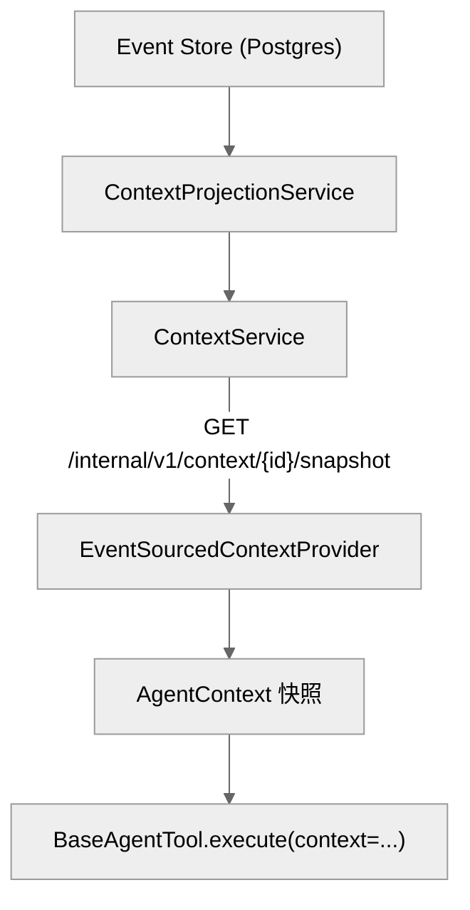

# DEV-013: Agent 架构与接口抽象

## 1. 概述

Agent 模块负责 LLM 编排、工具调用与上下文管理。为降低对 LangChain/LangGraph 的耦合，模块内引入了一层抽象接口（PLAN-033），并将对话上下文升级为 Event Sourcing 架构（PLAN-035）。

核心目标：

1. **可替换的编排框架** — 通过 `AgentRunner` 接口隔离 LangGraph 实现。
2. **可替换的工具实现** — 通过 `BaseAgentTool` 接口隔离 `BaseTool`。
3. **可观测、可恢复的对话状态** — 通过 CP Event Store 持久化事件，CP Context Projection Service（读模型构建）生成快照。

### SPEC 指针

Agent 执行、role/scope 绑定传播、Context/Tool 消费边界与 principal/Workspace 绑定契约见根级 SPEC：

- [`spec/agent/execution.md`](../../../spec/agent/execution.md)
- [`spec/agent/role-scope-binding.md`](../../../spec/agent/role-scope-binding.md)
- [`spec/agent/context-tool.md`](../../../spec/agent/context-tool.md)
- [`spec/agent/principal-workspace-binding.md`](../../../spec/agent/principal-workspace-binding.md)（`active`，PLAN-0374 V42 波次已实现）

execution/role/context 三份仍是目标态边界；独立 Agent principal、Workspace 绑定与 Session principal schema/入口已由 PLAN-0374 实现，PLAN-0381/0382 未冻结字段仍未实现。

## 2. 接口层

接口定义集中在 `packages/agent/src/xihe_agent/interfaces/`，该目录下**不直接 import `langchain*`**。

| 接口 | 文件 | 职责 |
|------|------|------|
| `AgentRunner` | `interfaces/agent_runner.py` | Agent 编排抽象：`stream()` / `create_agent()`（PLAN-0473 勘误：实际接口无 `reset()`；`create_agent()` 当前无生产消费者，观察项见 [`../../../spec/agent/agent-module-boundaries.md`](../../../spec/agent/agent-module-boundaries.md) §5） |
| `BaseAgentTool` / `ToolSpec` | `interfaces/tool.py` | 工具抽象：`execute()` + JSON Schema 声明 |
| `EventAdapter` | `interfaces/event_adapter.py` | 将框架原始事件翻译为 SSE `AgentEvent` |
| `LLMProvider` | `interfaces/llm.py` | LLM 后端抽象：`complete()` / `stream_complete()` / `with_model()` |
| `Message` / `TextMessage` | `interfaces/message.py` | 最小消息协议：`role` + `content` |
| `Event` / `EventEnvelope` | `interfaces/event.py` | 持久化域事件 |
| `EventStore` | `interfaces/event_store.py` | 事件存储抽象：append / read / fork |
| `AgentContext` / `ContextEpoch` / `ContextProvider` | `interfaces/context.py` | 事件重建（Context projection 读模型）后的上下文快照 |

### 2.1 AgentRunner

`AgentRunner.stream(messages, config)` 接收 `Message` 列表和 `RunnerConfig`，返回 SSE 层 `AgentEvent` 流。

其中 `RunnerConfig.context` 由 `ContextProvider.load()` 提供。

当前实现 `LangGraphRunner`（`agent_runner/langgraph_runner.py`）：

- 内部使用 LangGraph 的 `create_react_agent` + `astream_events`。
- 经 `EventAdapter` 将原始事件翻译为 SSE 事件。

### 2.2 BaseAgentTool

所有工具均实现 `BaseAgentTool`：

- `MCPAgentTool`（`adapters/mcp_client.py`）— 包装 LangChain MCP 工具。
- `ApprovalAgentTool`（`adapters/approval_tool.py`）/ `GenerateImageAgentTool`（`tools/__init__.py`）— 自定义工具。
- `LCToolAdapter`（位于 `agent_runner/tool_adapter.py`，PLAN-0473 迁入）— 将任意 `BaseAgentTool` 适配回 LangChain `BaseTool`，并承载共享 CP 事件 helper（D5 writer gate / bounded preview / append 失败台账）；registry 与 supervisor 均经 `agent_runner/graph_builder.py` 建图。

LangChain 特定代码收敛到 `agent_runner/`（`langgraph_runner.py`、`tool_adapter.py`、`graph_builder.py`）和 `adapters/`（sse/approval/mcp_client）。

### 2.3 LLMProvider

`XiheLiteLLM` 与 `MockChatModel` 实现 `LLMProvider`，方法为 `complete()` / `stream_complete()`。

**调用路径（直调，不经 CP）**：Agent 经 litellm **直调** provider；provider/model 来自 per-run 合成（CP `GET /internal/v1/config/effective/{domain}` 的 workspace-bound effective + run payload 的 user/workspace overrides；无租约时用 env 兜底 key，常规路径由 `provider_connections` 租约下发密钥，PLAN-0307 决策 #3a/#40）。CP 负责配置治理与 relay，不组装 LLM 请求；运行日志、catalog 和 health 不暴露 provider key/base URL。

- 为兼容 LangGraph 编排，`XiheLiteLLM` 仍继承 `ChatLiteLLM`。
- 未来切换到非 LangGraph 编排层时可移除该继承。

## 3. Event Sourcing 上下文管理

### 3.1 总体架构



锚点：`ContextProjectionService.java`、`ContextController.java:83`、`event_sourced_provider.py`。

- CP 是唯一真相源，负责事件持久化与读模型构建。
- Agent 无状态，通过 `/internal/v1/context/{sessionId}/snapshot` 获取读模型快照。
- 上下文模板（PLAN-0414/0415）：CP Session 钉 `context_template_layer/id/version`，admission 把模板修订复制进 `chat_runs.context_template_snapshot`；`/internal/v1/agent/chat` additive 传 snapshot、CP-owned `instructions` 和 path-only `componentSources`（Workspace tree 由 CP PolicyEngine + Runtime list resolver 提供）。`instructions` 的唯一来源是 AgentPrincipal `templateSnapshot.systemPrompt`（CP `resolveSystemInstructionsForRun`）；缺失或空白时 Agent 以 `BASELINE_UNAUTHORIZED` fail-closed，**没有进程级 fallback**（PLAN-0416 T3.1，原 `AGENT_INSTRUCTIONS` 常量与 `agent-runtime.instructions` 回退已删除）。Agent 构造 typed per-dispatch `ChatRunContext`/有序 `BuildContext`，只有 `system_prompt` marker 命中时才在文档位置加入平台/Agent instructions，不在 template-run 头尾 hidden append。AgentPrincipal ID/permission snapshot 不出 CP；组件/Run 不得扩大工具能力。`root_agents_md` 刷新值 `per_chat_run/per_session` 见 DEV-014 §8f。
- **分支上下文（PLAN-0410/V43）**：snapshot 携 `?runId`/`?branchId` 选择器（两者并存必须一致，未知/伪造 404、冲突 409 fail-closed，缺省=root）；Agent 只消费 CP 给定的 branch（`AgentContext.branch_id`），从不自选或回退整 Session history；run-scoped Event 写 `correlation_id=runId`，必需 append 失败使 Run 收敛失败而非静默续跑。
- 事件写入当前为同步；性能测试显示批量写入已足够快（~17k events/s），未引入异步队列。

### 3.1b 收缩管道与 prune（PLAN-0341）

- **装配**：`langgraph_runner.stream` 消费 CP 读模型 keep-recent → `prune_history_tool_results`（固定窗 `pruneWindowChars` 默认 80K chars，可配）→ 写 `context.prune` 墓碑；`HISTORY_TRUNCATION_LIMIT=20` 仅装配熔断，窗口起点落在 tool 结果时回退对齐（`_align_truncation_start`）。
- **配置**：`context_policy.resolve` 读 effective `context-policy`（`defaults`/`models` JSON）：`maxInputTokens` 覆盖 litellm 窗、`pruneWindowChars`、`recoveryBand`、`tokenizerRef`（受信命名空间 allowlist）；日志 `context_policy_resolved source=config|default`。
- **SUM**：压缩摘要只在 `epoch.system_messages`；`AgentContext.apply_event("compaction.applied" | "compaction.manual_applied")` 截断 keep-recent 且不把摘要塞进 `messages`（两类同构，见 §事件表）。

### 3.2 事件类型

| 事件类型 | 触发时机 |
|----------|----------|
| `session.created` | 创建 session |
| `prompt.admitted` | 用户输入进入对话 |
| `llm.token` | 模型流式输出 |
| `tool.called` | 工具被调用（PLAN-0381：writer gate 双形状——legacy `call_id/tool_name/tool_input` 或 v2 `schemaVersion=2/toolCallId/toolName/arguments`；arguments 超 4096 字符降级为显式标记对象，不静默改写） |
| `tool.result` | 工具返回（PLAN-0381：以同一 call id 与声明配对；gate ON 恒写 `status`、OFF 仅非 completed 写 `failed`；`result` 为有界 preview 字符串或 `{preview,truncated,artifactRef?,sizeBytes?,status?,errorCode?}` 对象——工具失败先落 `status=failed` 闭合事件对再 re-raise；回放进模型的历史 tool 正文统一 ≤4096 字符） |
| `context.source_changed` | AGENTS 等源变更（PLAN-0340：读模型改为 **L1 槽替换**，不再追加 history；失败 `status=failed` 清 L1） |
| `epoch.started` / `epoch.replaced` | epoch 开始/替换 |
| `runtime.state_cleared` | Runner 状态清理（PLAN-0473 勘误：`AgentRunner` 接口无 `reset()` 方法，该事件类型不在当前实现路径） |
| `session.forked` | 会话 fork；child seed 用读模型 `messages` + 可选 SUM 初始化 child history，child EventStore sequence 为本地 cursor；忽略 source `at_sequence`（PLAN-0410 T3.6） |
| `compaction.applied` | 上下文压缩——自动/overflow 触发，ChatRun-scoped（correlation=Run，PLAN-0410 §4）；PLAN-0341：`messages` 不再写入摘要，摘要仅 `epoch.system_messages`/`summary_hash` |
| `compaction.manual_applied` | 上下文压缩——**手动触发（无 Run）**，branch-targeted：correlation 恒 NULL、branch 为 CP 校验的显式值（PLAN-0410 D7-B1=C）；payload 与应用语义同 `compaction.applied` |
| `context.prune` | prune 墓碑（PLAN-0341 T1.2：`tool_call_id`/hash/size/首尾 + `pruned`；读模型按 hash 原地替换，防复活） |
| `context.compaction_circuit` | 恢复带熔断开/关（PLAN-0341 T1.3：`state=open|closed`；overflow 强制压缩绕过熔断） |
| `context.overflow_retry` | 溢出重跑审计（PLAN-0341 T1.1：runId + 预检 maxInputTokens） |
| `assistant.responded` | assistant 回复持久化（PLAN-294 M1；runner 流成功终态 append，读模型映射为 ai 消息） |
| `llm.usage` | run 用量镜像（PLAN-294 M3；CP relay 写入，压缩门信号源。PLAN-0343：payload 增 `model`（`provider/model`，pricing 查表键）与 `cost/costCurrency/costSource/costNote`（CP 终态一次映射；unmapped→`cost=null`+告警，禁 0） |

PLAN-0509 Run Trace 将耐久 `prompt.admitted` 独立投影为不含消息正文的 `input.admitted`；只从 `tool.called` / `tool.result` 提取 allowlist 标量，将未关联 MCP invocation 的 Agent 自定义工具安全投影为 `agent.tool`，与 MCP invocation 对应的调用由 MCP 事实规范表示并去重。配置来源只包含 Provider Connection、API Type、上下文模板的 ID/版本安全标量；读取只选 ChatRun 必需列与 JSONB 白名单路径，不加载模板正文。Trace 响应不包含输入正文、工具参数或结果正文。

两套事件命名空间不同，映射由 `LangGraphEventAdapter` 维护：

**调用链全局结构与 MCP 工具超时（PLAN-0308；结构来源 PLAN-0318 报告 §0.2）**

- **全局结构（星型，CP 居中）**：任意两模块无直连——Agent 只连 CP 的 MCP 端点，UI 只调 CP 公开接口，Runtime 只被 CP 调用（反向：Runtime/Agent → CP 心跳与拉配置）。**超时嵌套是三层不是两层**：工具调用 = Agent 等 CP → CP 等 Runtime → Runtime 等容器进程；中继层从头等到尾，每多一个模块多一层等待。**保持同步核心**：MCP 是请求/响应协议、LLM 循环必须拿到工具结果；长任务按策略边界走异步 job（发起段受预算、任务本体有时限、观测段短超时），传输层不做全链路异步（升级路径为绝对 deadline 传播）。
- **取值模型（决策 #25/#27）**：**CP 是唯一计算点**——预算 B 输入优先级 per-call > 数据库配置（`agent-runtime.systemToolTimeoutS` / remote `tool_timeout_s`）> 代码默认 30；CP 输出三跳最终等待值（Runtime = B、CP 转发 = B+2s、Agent = B+4s；固定余量仅兜内层挂死），经 run payload / 请求头下发。**模块侧只有三条判断（零算术）**：本模块 ENV 显式 → 用 ENV；per-call 性质标记存在 → 用下发值（压制本模块 ENV）；否则用下发值；都没有 → 代码默认。
- **上限（T3.1，2026-09-13）**：per-call 与数据库配置**同顶 30s**（`MAX_BUDGET_SECONDS`，代码常量）；per-call 超限 → CP 400 拒绝，遗留配置超限 → 告警后回落默认。超过 30s 的同步等待走异步 job，不放大预算。
- **传输兜底**：Agent 的 fastmcp 客户端显式 `timeout=3600s`（`SESSION_READ_HANG_BACKSTOP_S`），保证 SDK/会话默认值（`read=300s`）不抢先于逻辑授权值；权威等待界仍是 `asyncio.wait_for`。
- **头与关联键**：调用方 per-call 走入站头 `X-Xihe-Tool-Timeout-Per-Call`；出站 `X-Xihe-Tool-Timeout-S` / `-Origin` 只由 CP 设置并覆盖上游同名头（防绕过）；输出上限走 `X-Xihe-Tool-Output-Limit`；`toolCallId` 统一为 LangChain tool callback `run_manager.run_id`，经 EventStore、Agent SSE 与 `X-Tool-Call-Id` 贯通，不使用 LLM provider 的 ToolMessage ID。
- **错误署名**：超时错误写 `layer` / `effectiveSeconds` / `source`（env|cp|default）/ `valueOrigin`（per-call|config）/ `overriddenSeconds` / `origin=self|downstream`（容器守卫到界另带 `mechanism=guard`）；掐断层判定 = 时间线上最早的 `origin=self`（某跳 ENV 先到界属配置结果，非故障）。
- **已废弃表述**：旧的「四级解析链 + min 语义 + 冷启动 ×3（`firstToolCallDone`）」不再适用；冷启动宽限机制未实施，按 PLAN-0308 决策 #35 ④ **显式延期**（需要时再立）。
- 离线兜底：各模块 `XIHE_MCP_TOOL_TIMEOUT_S`（Agent）/ `XIHE_EXEC_COLLECT_TIMEOUT_S`（Runtime）/ `xihe.mcp.forward-timeout-s`（CP）仅作部署者**本跳覆盖**，正常路径由 CP 预算派生，各跳不做跨层比较。

**Agent Run 累计预算（PLAN-0492，2026-10-13）**

- **维度与键**：`agent-runtime` 域三组键——值键 `runMaxTurns`（一轮 = 一次完成的 LLM 调用，按 `llm_usage` 事件计）、`runMaxElapsedSeconds`（累计墙钟，审批/人工等待暂停计时）、`runMaxTokens`；硬上限键 `runMaxTurnsCeiling` / `runMaxElapsedSecondsCeiling` / `runMaxTokensCeiling` 仅 instance 层可写（`0` = 不钳制），生效值 = `ceiling > 0 ? min(值, ceiling) : 值`，钳制记 `run_budget_clamp`。任一值 `0` = 该维度仅观测（仍计数上报，不停止 Run）。代码默认：turns 25/100、elapsed 600/3600、tokens 38303/51070（2026-10-13 真实数据标定，p95=25535/15 run，复采脚本 batch `run-budget-calibration`，见 PLAN-0492 `evidence/m0-token-calibration.md`）。
- **归属**：Agent 从 CP 配置（合并链 + run payload 层覆盖）解析生效预算并在消费时执行；CP 拥有配置面、钳制语义与 durable 终态，不重复计算。
- **触发与终态**：超限时 Agent 发结构化 `error`（`code=RUN_BUDGET_EXHAUSTED` + `dimension=turns|elapsed|tokens`，SSE 映射必须透传 `dimension`）；CP relay 将维度写入 durable 终态（`errorDetail=budgetDimension=<dim>` + run history payload）并把 Run 收敛为 `failed`（已有助手内容时 `partial`）；UI 呈现本地化原因，接管复用普通发送/Follow-up Queue，不恢复旧 Run 图状态。
- **不变式**：预算耗尽不替代授权/审批/沙盒门禁；非 instance 层不能扩大上限（键级锁 + 钳制）。与输入窗口预算、per-tool 超时/输出上限相互独立。

**Agent Run 语义重复与无进展检测（PLAN-0493，2026-10-13）**

- **窗口与签名**：per-Run 进程内观察窗口（`observation window`：最近 `loopWindowSize` 次调用，默认 20；有界淘汰最旧、非权威——重启/淘汰只损失检测状态）；签名 = `sha256(tool_name + canonical_json(args))`（键大小写归一、trim、空参归一、易变字段剔除；不含 `toolCallId`）。三类**连续**信号：同签名重复、同类连续失败（同 error name/code/HTTP status）、幂等/只读工具的同签名同结果。
- **键与默认**：值键 `loopRepeatWarn/Refuse/Escalate`（2/3/5）、`loopErrorRunWarn/Escalate`（3/5）、`loopStaleResultWarn/Escalate`（2/5）、`loopWindowSize`（20）在 user/workspace 可写；四 ceiling（10/10/10/50，`0` = 不钳制）仅 instance 层可写，钳制记 `loop_guard_clamp`；`loopExemptTools` 只追加内置豁免清单（轮询/探活类，恒并集、禁通配符、≤64、非法回落内置并记日志）。默认值 2026-10-13 真实观测校准**全部维持**（`../plans/PLAN-0493-xh-agent-loop-progress-detection/evidence/m0-observed-repeats.md`）。
- **两级动作**：tier-1——达 2 次随结果追加提示（调用照常）、达 3 次**拒绝该次调用**且 Run 继续（不产生执行副作用，durable 事件对以失败闭合）；tier-2——达 5 次停流并发 `error(code=RUN_NO_PROGRESS, signal=repeat|error|stale)`，经 0492 `{stop, interrupt}` 同管道收敛 `failed`（有内容 `partial`）；`errorDetail` 不携带 signal（触发事实 = `errorCode`）。UI：有助手内容走消息错误框、零内容停止走恢复横幅（`failed` 态：原因 + 接续提示），接管复用普通发送/Follow-up Queue。
- **边界**：审批等待点重置连续计数（静默重试不计重复）；豁免只免检测不免预算；窗口/签名原文不出进程；检测不替代授权/审批/沙盒/预算、不新增 wire 状态；工具参数 schema 校验失败发生在观测点之前（模型反复发非法参数由 turns 预算兜底）——已知检测盲区，见 PLAN-0493 收尾报告。

**运行中 Guidance 消费（PLAN-0529，2026-10-18）**

- **消费点**：模型调用前置（`GuidanceInjectionModel` 包 `BaseChatModel`）。一次 LLM 调用开始 = 上一批已派发工具全部完成、本轮规划尚未发生 → 即母体契约的「整批已启动工具完成后、下一次规划前」；首批规划同样适用。不 interrupt、不改图拓扑、不写 graph state。
- **注入形态**：每条等待中的 Guidance → 一条 `HumanMessage`，正文为不可信信封 `[guidance] (source=user, seq=<n>)\n<content>`，按 CP `sequence` 升序（消费端防御性排序）；不进 system prompt。**瞬态**：只进该次调用的 messages 副本，不入 graph `messages`/checkpoint/EventStore，因此 consumed 内容不会随 checkpoint 进入续跑上下文。
- **读取与确认**：`GET /internal/v1/chat/runs/{runId}/guidance/pending` → 注入后 `POST .../{guidanceId}/consume`（`Idempotency-Key: guidance-<id>`）。三级去重：stream 内 `injected_ids`、CP 幂等、consume 返回 `409 GUIDANCE_ALREADY_TERMINAL_EXPIRED` → 记入并停止重试且不再注入。
- **失败语义**：CP 读取失败/超时 → fail-open（warn + 零注入，Run 继续）——Guidance 无授权语义，不影响安全；consume 瞬时失败 → 该 id 不记入 injected_ids，下一边界重读，靠 CP 幂等/409 兜底，**绝不重放已完成工具副作用**。
- **边界**：无 runId 或无 consumer（registry worker、单测）→ 整体禁用、零行为变化；不新增 AgentEvent 类型、无 Guidance SSE（UI 经 CP 快照感知）；不与 Follow-up/续跑共用状态。契约：`plans/archive/PLAN-0529-xh-guidance-agent-consume/spec/agent-guidance-consume-protocol.md`（归档 PLAN 工作包）。

| 层 | 事件 |
|----|------|
| SSE 协议 `AgentEvent` | `token` / `tool_call` / `tool_result` / `status` / `error` / `done`；工具事件携带 `toolCallId` + `origin`（`local`/`mcp`）供 CP 按通道事实记账，`request_approval` 工具事件抑制、以审批事件为正规记录 |
| 持久化域 `Event` | 见 §3.2 事件表 |

### 3.3 AgentContext 读模型

`AgentContext` 由 CP `ContextProjectionService` 从事件流生成，包含：

- `messages` — 当前对话消息列表。
- `epoch` — 当前系统上下文 epoch（`system_messages` + Context Sources）。
- `runtime_state` — 请求级运行时状态。
- `latest_sequence` — 读模型已应用到的最新事件序列号。
- `branch_id` — CP 为该 Run/snapshot 解析的分支（PLAN-0410；Agent 从不自行填写，缺省空串表示早于分支感知的旧快照）。

Agent 侧分工：

- `EventSourcedContextProvider` 仅调用 CP `/snapshot` 端点。
- `CrashRecovery` 经 `EventStore.read()` 读事件，再调 `AgentContext.apply_event()` 重建状态。

### 3.4 Context Source 变更感知（PLAN-0340）

CP `ContextSourceRefreshService`（**每 run** 在 `ChatController.execAsync` 的 `activeRuns` 串行域内调用）：

1. 经 Runtime 读 workspace 根 `AGENTS.md`，SHA-256（超 32KiB 截断标注）。
2. 对比 **session epoch `source_hash`**（首注入必发，不跨 session 抑制）；workspace 表仅作增量优化。
3. 变化 → `context.source_changed`（`created|updated` + `rendered_text` + sources）→ 读模型 **L1 槽替换**；I/O 失败 → `status=failed` 清 L1；未变 → `unchanged` 不发事件。
4. Runtime `GET .../git-facts`（**PLAN-0382 扩展为 workspace facts**：既有 branch/HEAD + 增量 `cwd/platform/shell/observedAt`，值来源表见 0382 spec §2.1；路径名为历史遗留）变化 → `context.env_updated`（含 `env_status` 四值）存 epoch；U2 **不**因 env 告警。Agent env block 只渲染 snapshot 中的 Runtime facts，host `cwd/platform/shell` 代填已移除；L1 仅 `l1_status=ok` 注入（fail-closed 族不注入，spec §3）。
5. Agent `_build_system_messages`：`L0 → L1(l1_rendered) → env 块 → SUM`；不受 20 条历史截断。

### 3.5 诊断回灌（PLAN-0342）

失败命令的原始输出在 Agent 侧转为结构化诊断并回灌（语言知识不下沉 Runtime，决策 #13）：

1. **提取（L0/L2）**：`LCToolAdapter._arun` 经 `extract_command_result` 容错解析 Runtime `CommandResult`（顶层或 `result`/`data`/`tool_result` 嵌套，`exit_code` 不可用即视为非命令结果）；仅非零退出按冻结规则 `path:line[:col]: message` 解析（path 需 path-like 锚定，severity 仅 error/warning/note，kind 由 command 保守推断）。未命中不猜测、原文不改写（L2，`confidence: low`）。
2. **去重与预算**：会话级 `DiagnosticsLedger` 按位置身份 `(file, line, column)` 做连续重复抑制——上一轮消失、之后复现的诊断重新回灌；解析成功的零退出记观察空集（回归信号）。预算：Top-N 20 / 单条 1k / 命令结果中段 48k 头尾保留（`truncate_middle` 仅作用于命令结果）。
3. **四通道（PLAN-0510 后口径）**：① 模型可见 = 不可信信封内 `<diagnostics>` 文本块（`items` 非空才追加）；② 结构化 = `ToolMessage.artifact = {"diagnostics": bundle}`（`response_format="content_and_artifact"`，不进模型 wire）；③ durable = `tool.result` payload 仅保留 `status`/`tool_call_id`/`tool_name`/占位符，`diagnostics` 与结果正文被 CP `ContextEventPayloadSafety` 丢弃；④ SSE = `tool_result.result` 为固定占位符，**不再携带** `diagnostics`。bundle 形状 `{items, total, confidence}`（`items` 为 Top-N 切片，`total` 为截断前计数）。
4. **UI 呈现**：`ToolCallCard.vue` 保留诊断渲染能力，但 PLAN-0510 后真实链路不再提供诊断数据；`useSSE` 兼容 `tool`/`toolCallId` 键名并写入本 run 内 `message.toolCalls`。自 PLAN-0572（V83）起，assistant 消息持久化有界 `toolCalls` 快照（结果仍为同一占位符），刷新后工具卡可恢复。
5. **边界**：只解析命令结果（其他工具内容不改写）；不解析 LLM 层失败；诊断不单独落盘（仅随事件 payload / SSE 透传）；跨 session 诊断账本（L1）后置。

### 3.6 LLM 摘要端点与 `llm/summarize.py`（PLAN-0354）

- **端点**：`POST /internal/v1/agent/summarize`（service Bearer；调用方仅 CP `LlmSummaryProvider`）。CP 在压缩时签发 2 分钟短租约并在请求中携带，Agent 经既有 CP `/internal/v1/provider-leases/redeem` 兑换后单次调用 provider（不新增凭据通道）。
- **请求契约（camelCase）**：`sessionId` / `runId` / `provider` / `model` / `credentialLease` / `providerConnectionId` / `connectionRevision` / `text` / `priorSummary`。`credentialLease` 与 `text` 必填 fail-closed（缺 → 400 `INVALID_REQUEST`）；租约兑换失败 → 503 `PROVIDER_CONNECTION_UNAVAILABLE`；provider 调用异常 → 502 + `_classify_llm_exception` 细分码（如 `LLM_PROVIDER_UNREACHABLE`、`LLM_NOT_CONFIGURED`）。错误体为 problem+json（`code`/`detail`/`retryable`/`requestId`，回写 `X-Request-Id`）。
- **组装（`llm/summarize.py`）**：`SUMMARIZE_SECTIONS` 固定六节 `[Goal]/[Work State]/[Next Move]/[Files&Artifacts]/[Errors]/[Recent]`；系统提示为固定常量，明确禁止输出 `[Constraints]`（SC/审批原文永不进 LLM，I3）；输入 = `priorSummary`（CP 已剥 `[Constraints]`）+ `text`（CP 已按单条上限 4000 chars 与 `pruneWindowChars` 预算截断）；`LLMConfig` 的 provider/model/apiKey/apiBase 来自兑换 grant，timeout/maxTokens/temperature 取进程 effective `llm-provider`，`max_tokens = min(config.maxTokens, 2048)`。
- **usage 三档**：`usage_metadata` 命中 → `source=real`；未命中 → 本地 `TokenCounter` 估算 → `estimated`；两者皆无 → `fallback` + 计数 0；`main.py` 追加 `model=provider/model`（CP pricing 查表键）。
- **边界**：端点不写事件、不碰 SC/审批、无持久化；请求/响应日志不含摘要正文与凭据。

### 3.7 type-specific Chat sender 与请求级 RAG 适配（PLAN-0439/0485/0416）

- **Chat sender（PLAN-0439）**：Chat 请求不再由 provider-neutral `messages` 序列化器重建；Agent 按连接的 `apiTypeId/version` 选择 type-specific sender/stream parser（内置 `openai-chat-completions`、`anthropic-messages`、`mimo-responses`），直接发送 CP 快照中的用户请求体：`${xh.*}` 单遍替换（`$${...}` 输出字面量）、结构化历史 splice 只出现在约定槽位；model 槽、凭据与 baseUrl 一律取租约 grant，模板声明这些字段会被 CP validator 拒绝。非 chat 类型在 dispatch 前 fail-closed。
- **RAG 请求级适配（PLAN-0485）**：`/internal/v1/agent/rag/{ingest,search,stats,embedding/test}` 按请求携带非密 `embeddingProfile` 与一次性 `embeddingCredentialLease`；Agent 逐请求兑换 grant 构造 request-scoped embedding adapter（不再持有全局凭据单例），并按 profile 的完整身份 tuple 建立/检索分区（langchain_postgres 过滤下推，WHERE 先于 ORDER BY/LIMIT）；维度来自 profile（fresh store 固定 768），profile/租约缺失或不匹配 → stable `409 EMBEDDING_PROFILE_*`，provider 故障按类别返回可区分错误码，响应不泄漏凭据或向量。

PLAN-0416 动态检索使用只读字符串 `${xh.rag_context}`，不改变授权 `instructions` 或稳定 ContextEpoch。只有原模板未转义 token 触发检索，`$${xh.rag_context}` 保留字面量。CP/Agent 同时限制在 API-native 数据槽：OpenAI user/assistant/tool `messages[].content`、Anthropic user/assistant 消息的 text block `.text` 或 tool_result 字符串 `.content`、MiMo 字面量 user/assistant/tool 角色的 `input[].content`。对象键、system/developer 角色与顶层 system/instructions 禁止注入。

Chat Run 的 `embeddingProfile` 与独立 `embeddingCredentialLease` 由 CP 按认证 scope 解析，Agent 兑换携 Run `runId`，不复用 Chat lease 或全局 embedding singleton。成功零命中渲染空字符串；profile/租约不可用与 provider/DB 查询失败在 Chat dispatch 前返回 `RAG_PROFILE_UNAVAILABLE`、`RAG_LEASE_*` 或 `RAG_QUERY_FAILED`，沿既有 Run 错误事件呈现。检索日志只记录 Run、错误码和异常类型，不记录原始 traceback、检索文本、向量或凭据。

每个 provider step 从原模板渲染数据槽并追加本 Run 原生 continuation，按最终序列化 request body 估算预算；provider usage 单独累计，缺失字段保持 unknown。

## 4. 崩溃恢复

PLAN-0416 的 snapshot `afterSequence` 只作游标提示，返回完整 branch 投影；空态恢复从 sequence 0 全量 replay。新 prune 以 sequence/toolCallId 定位 occurrence，纯内容 hash 只用于历史 tombstone 兼容。恢复不得重新引入已清除的工具结果或原生 carrier。

Agent 启动恢复流程：

1. 读取 `XIHE_RECOVER_SESSION_IDS` 环境变量（逗号分隔的 session ID）。
2. `CrashRecovery.recover_many()` 从 CP Event Store 重放事件。
3. 重建 `AgentContext`。

```python
recover_ids = _parse_recover_session_ids()
if recover_ids:
    recovered = await crash_recovery.recover_many(recover_ids)
```

恢复后的上下文可用于继续会话或审计；实际对话续接应配合 UI/CP 的 session 恢复机制。

## 5. 工具与编排适配

### 5.1 Supervisor 与 Registry

`agent/supervisor.py` 与 `registry/registry.py` 的 public API 已迁移到 `BaseAgentTool`：

- 内部经 `_adapt_tools()` / `LCToolAdapter` 继续使用 LangGraph 编排。
- 这是当前编排实现的合理依赖，已被隔离在 public API 之后。

### 5.2 MCPClientManager

`MCPClientManager.tools` 返回 `list[BaseAgentTool]`（`MCPAgentTool` 包装），完成工具层 public API 与 LangChain 的解耦。

### 5.3 Readiness、模型目录与工具模式（PLAN-247）

- Agent liveness 与 LLM readiness 分离；`unknown`、missing、invalid、unreachable 和 model unavailable 均不放行新 Chat。
- 配置 refresh 以 revision 为边界原子替换 runtime snapshot；provider model catalog 记录 status、reasonCode、capabilities 和 verifiedAt，不返回 key/base URL。
- `toolMode=none` 不调用 `_get_mcp_tools()`，也不注入 approval/image/MCP tools；只有 `toolMode=workspace` 才按请求 workspace 懒加载 MCP。MCP manager 发现结果不得跨 workspace 复用。

### 5.4 LLM 路由与工具能力（PLAN-0364）

- **路由来源唯一**：调用串为 `{route_provider}/{model}`，`route_provider` 来自 CP 租约（catalog 条目 `litellmProvider`）；Agent **不得**按工具/模型自行改写 slug（`XiheLiteLLM.bind_tools` 的 xiaomi→`openai/...` 静默切换已在 M3 移除）。
- **工具能力不匹配显式失败**：native `xiaomi_mimo` 无工具元数据，带工具请求由 litellm 抛 `UnsupportedParamsError`，Agent 经 `_classify_llm_exception` 映射为 `LLM_TOOL_ROUTE_UNSUPPORTED`；需要工具请使用 OpenAI 兼容连接（`litellmProvider: openai` + 显式 `baseUrl`）。**PLAN-0591 起**该判定前移为 catalog 驱动的**预发送门**（`supportedApiTypes[].capability.tools` 是唯一判定源；次序 = 渲染 → `validate_body` → capability gate → `begin_attempt()`，`api_sender.py:425-432`）：不支持的 apiType 在 dispatch 前即以 `LLM_TOOL_ROUTE_UNSUPPORTED` 失败（`attempt=0`、0 `tools/call`、0 文件），litellm `UnsupportedParamsError` 仅作兜底残余。契约见 `spec/capability-gate.md`；模型级能力残余见 DEV-018。
- **图像渲染器后置变换（PLAN-0605，M2 裁定 B）**：模板只负责文本槽；当 CP 在 dispatch 体带 `images[]`（**仅** `attachmentId/mimeType/sizeBytes`，无字节）且该 `apiTypeId` 在 `VISION_RENDERERS`（首批 `openai-chat-completions`）时，Agent 在模板渲染之后、能力门通过之后，把**本轮最后一条 user 消息**的 `content` 改写为 `[{type:"text",text:原文}, {type:"image_url",image_url:{url:"data:<mime>;base64,…"}}…]`——原文本逐字保留，其它消息与字段原样透传。字节凭 `runId` 从 CP 内部路由 `GET /internal/v1/attachments/{id}/content?runId=` 拉取（run/workspace/attachment 三元归属 + lease 已 redeem），只在内存组装 data URL，**不落盘、不进日志/SSE/DB**；拉取失败（403/404/413/超时）以 `LLM_VISION_ATTACHMENT_UNAVAILABLE` 失败，**不得**降级为纯文本。顺序契约见 `spec/capability-gate.md` §2a。- **OpenAI wire 必须有显式 baseUrl**：`openai` / `custom_openai` / `openai_like` 在 `baseUrl` 为空或空白时于 `XiheLiteLLM.__init__` fail-fast（`LLMRouteConfigError` → `LLM_BASE_URL_MISSING`），禁止回落到 OpenAI 默认端点。

## 6. 相关文件

- `packages/agent/src/xihe_agent/main.py`（app composition root）
- `packages/agent/src/xihe_agent/app_state.py`（共享单例/env 常量/纯 helper，PLAN-0473）
- `packages/agent/src/xihe_agent/api/`（HTTP 路由按域分组，PLAN-0473）
- `packages/agent/src/xihe_agent/interfaces/`
- `packages/agent/src/xihe_agent/agent_runner/langgraph_runner.py`
- `packages/agent/src/xihe_agent/agent_runner/tool_adapter.py`（`LCToolAdapter` + 共享事件 helper，PLAN-0473）
- `packages/agent/src/xihe_agent/agent_runner/graph_builder.py`（`create_react_agent` 唯一归属，PLAN-0473）
- `packages/agent/src/xihe_agent/context/`
- `packages/agent/src/xihe_agent/adapters/`
- `packages/agent/src/xihe_agent/llm/summarize.py`
- `packages/control-plane/src/main/java/com/cc01cc/p/xihe/cp/context/`

## 7. 相关 PLAN 与 SPEC

- SPEC：[Agent 模块边界与目录规范](../../../spec/agent/agent-module-boundaries.md)（PLAN-0473 归档时晋升，`active/implemented`）
- PLAN-0473（已归档：`plans/archive/PLAN-0473-xh-agent-architecture-boundaries/`）Agent 模块边界与结构规范化（`api/`、`app_state.py`、`tool_adapter.py`、`graph_builder.py`；registry/supervisor 建图收敛）— 本节 §1/§2.2/§6

- PLAN-0340 上下文源与注入（L1）
- PLAN-0341 上下文管道与 prune（overflow/prune/SUM/熔断）— 本节 §3.1b
- PLAN-0342 诊断回灌与工具卡片呈现（L0/L2 + 四通道）— 本节 §3.5
- PLAN-0343 用量与成本契约（usage 事件注入 `model`=`provider/model`；CP 终态一次映射 cost，unmapped→`cost=null`+log warn；schemaVersion 仍 1）— 本节 §3 事件表 `llm.usage`
- PLAN-0354 摘要提供方 seam 与 LLM 回退（Agent 摘要端点与 `llm/summarize.py`）— 本节 §3.6；CP 侧见 DEV-014 §10
- PLAN-0381 context history 与 tool output bounds（call id 配对、bounded preview、failed 事件闭合、双 provider 实测、回放 4096 界）— 本节 §3.2 事件表 `tool.called`/`tool.result`
- PLAN-294 上下文事件流与自动压缩门

- `PLAN-033-XH-agent-module-decoupling.md`
- `PLAN-035-XH-agent-context-architecture.md`

