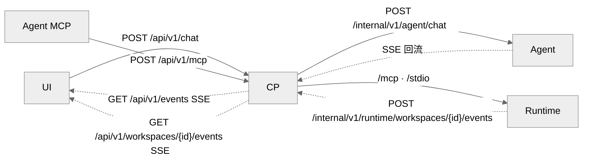

# DEV-014: CP 架构

> Control Plane（Java 25 + Spring Boot 4）是系统心脏：路由 + 认证 + MCP 反向代理 + 状态广播 + 会话管理 + 统一配置。约束：不做模块专属业务逻辑。与 DEV-016 以"CP 内部 vs 端到端工具路径"分界互引；端点以 `docs/api/openapi.yaml`/`docs/api/inventory.md` 为准，跨模块 ownership 和事件边界见根级 `spec/architecture/`、`spec/protocol/` 与 `spec/data/`；认证、授权、能力策略、审批和审计见根级 `spec/security/`（当前为 proposed）。

**本地架构校验（PLAN-0470 M2）**：CP 增加 test-scope ArchUnit 1.5.1，检查实际生产 Controller、应用组件及持久化类型的依赖，合成正反探针与生产检查分开。在 `packages/control-plane/` 执行 `mvn -o -q test "-Dtest=CpArchitectureTest"`，报告为 `target/cp-architecture/baseline.json`；探针入口为 `CpArchitectureRuleProbeTest`。初始严格规则仍因存量依赖失败，不表示当前源码已符合目标。逻辑归属图记录完整类型强连接分组，不把带上限的示例数当作总循环数，也不把 DTO/错误类型依赖环直接等同状态 writer 环。Compiler/Checkstyle 原用途与 error 级别不变。PMD 候选经实际局部试跑和依赖审计后未采用，未接入默认构建或生产 classpath。

## 1. 三通道

- **聊天通道**：`POST /api/v1/chat`（必填 `sessionId`/`branchId`/`content`，`202` + `runId`，指令发送）+ `GET /api/v1/events?sessionId=`（会话级持久 SSE，流接收）。CP 中转 UI↔Agent，流式分发到 UI。**注意**：CP 只转运聊天流量（租约/透传/审计），不组装 LLM 请求、不代理模型调用——模型调用由 Agent 直调 provider（见 DEV-013 §2.3）。
- **Follow-up Queue（PLAN-0442）**：`/api/v1/sessions/{sessionId}/follow-ups` 是 CP durable FIFO；每 Session 最多 5 条 outstanding。此版本要求部署保持**单个活跃 CP 实例**；多实例 CP 不在支持范围，因为 terminal handoff 使用进程内 after-commit wake，启动扫描只在实例启动时执行，不构成跨实例持久投递。入队/读取/撤回/继续不依赖浏览器 SSE；普通 Chat 在同一 Session admission 锁内要求队列为空。QueueItem 只在 CP 原子 admission child ChatRun 时物化为 Message，附件/branch 在 admission 时重验。终态事务先结算队列，dispatcher wake 等 `releaseRun` 释放本进程 single-flight 与 DB lease 后触发；启动扫描补偿本实例内丢失的 wake。多实例唤醒/恢复需独立设计与验收后才能启用。
- **Run Guidance（PLAN-0528）**：`/api/v1/chat/runs/{runId}/guidance`（`POST` 需 `Idempotency-Key` + `{content}`，`GET` 快照）承载运行中 Steering——Run-scoped、与 Message/Follow-up/EventStore 分离的 CP durable 记录（Flyway V77 `chat_run_guidance`）。作者由 TenantContext 派生；请求体不携带 `sourceKind`，服务端恒置 `user`（DB `CHECK source_kind='user'` fail-closed，guard 接入须新迁移 + Security 立项）。仅活跃 Run（`running|streaming|awaiting_approval`）接受提交（否则 `409 GUIDANCE_RUN_NOT_ACTIVE`）；同键幂等回放 `200`（仅 Run 属主；非属主 `403`，回放返回存储状态，终态不回转）。Run 终态事务内将未消费 pending 收敛为 `terminal_expired`（与 Follow-up settle 同位），不迁移到续跑新 Run。Agent 消费走服务间 `GET /internal/v1/chat/runs/{runId}/guidance/pending` + `POST .../{guidanceId}/consume`（consume 幂等；terminal-expired 后 consume 返回 `409 GUIDANCE_ALREADY_TERMINAL_EXPIRED`）。**无 Guidance 专属 SSE 事件**（裁定候选①）：UI 在提交后与 Run 终态事件时 refetch 快照。日志只记 id/sequence/status，不记正文。契约唯一冻结件：`spec/session/chat-run-operation.md` 的 `## Run Guidance`；跨层语义见 `plans/PLAN-0468-xh-chat-run-guidance/spec/target-contract.md`。延续 Follow-up 的**单个活跃 CP 实例**部署约束。**E2E-only 屏障（PLAN-0536）**：`/internal/v1/e2e/guidance-barrier/{runId}/{arm,release}` + `GET /{runId}` 仅以 `@Profile("e2e")` 注册（`dev`/`prod` 无该 profile，路由不存在；`/internal/v1/**` 已限定 `ROLE_INTERNAL_SERVICE`）。用途仅为确定「Guidance POST 已到 CP → 真实 cancel 成功 → release → 409」的时序；屏障挂在 controller 事务之外（service 事务内先锁 Session 再锁 Run，与 cancel 同序，停在那里会自死锁）。超时返回 `503 E2E_GUIDANCE_BARRIER_TIMEOUT` 且不落库。契约见 `plans/archive/PLAN-0536-xh-guidance-race-error-e2e/spec/e2e-guidance-barrier.md`。
- **MCP 反向代理通道**（`POST /api/v1/mcp`，另有同前缀 GET/DELETE）：JSON-RPC 解析 → 工具名提取 → 权限检查 → 请求改写 → 三层路由转发（详见 DEV-016）。CP 为纯 HTTP 反代，不依赖 MCP SDK。
- **状态分发通道**：Runtime/Workspace storage watcher → CP Workspace event ingress → UI Workspace SSE；ChatRun 仍独立使用 Session SSE，不把无 Session 文件事件塞入 Chat。

## 1a. 认证入口与单机本地模式（PLAN-0526）

- 认证入口为 `/api/v1/auth/**`（permitAll）：`register`/`login`/`refresh`/`me`。PLAN-0526 新增 `GET /bootstrap-status`（恒 200，`{initialized, localMode}`）、`POST /local-login`、`POST /local-password-reset`，并允许 register 在本地模式省略密码（服务端生成、201）。
- 单机本地模式由 `LocalModeService` 门禁：仅 `XIHE_LOCAL_MODE=true` + 回环来源 + `Origin`/`Host` 回环时可用，且签发对象必须是**唯一可登录用户（任意角色，含 ADMIN）**（否则 409）；本地模式跳过默认 admin seed，首用户获得实例级 `SUPER_ADMIN` **绑定**（PLAN-0610 起不再用 `ADMIN` 层级表述，见 `AuthController.java:58`）；其余一律 404 且不签发 token。门禁在应用层，`SecurityConfig` 不放开通配。
- PLAN-0558 登录防护：`/login` 按规范化账号 + 客户端 IP 双维度做固定窗口失败计数，达到阈值返回 429 `AUTH_RATE_LIMITED` + `Retry-After`；未知账号同计数并执行 dummy BCrypt；失败写 AUDIT JSONL，锁定/解锁写 `audit_logs`。计数为 CP 进程内有界表（单实例语义，重启清锁）；`X-Forwarded-For` 默认忽略，仅 `cp.auth.login.trusted-proxies` 命中的 `remoteAddr` 才解析；本地模式与 `/refresh` v1 不限流，`/register` 按 IP 限流且默认豁免回环。
- PLAN-0565 账号标识（裁定 #7）+ 决策 v29：`users.username` NOT NULL UNIQUE（V82 回填；字符规则与 agent 主体名/昵称共用 `NameFormat.PATTERN_SOURCE`＝英文字母（含大写）/ 中文汉字 / 数字，不得数字开头、不得含空格与符号，长度按列宽 ≤32）；注册可选自填（留空由 email 本地部分生成默认、冲突加序号，非法 400 `USERNAME_INVALID`/占用 409 `USERNAME_TAKEN`）；`LoginRequest` 字段由 `email` 改为 `identifier`——含 `@` 按 email 解析、否则按 username 解析，登录限流键与失败审计同步改口径（email 值仍 mask、username 公开可明文）。
- 契约见 [`spec/security/authentication.md`](../../../spec/security/authentication.md) §4/§5 与 `docs/api/inventory.md`。
- 新手首跑的完整链路（三条件 → onboarding → 建 Agent → 首条回复）与逐条可见判据见 [DEV-033](DEV-033-first-run-gold-path.md)。

## 1b. 实例所有权与 access token epoch（PLAN-0580）

- **实例 owner 是单例指针，不是第三种角色**：表 `instance_owner`（`id SMALLINT PK` + `CHECK (id = 1)`，行内 `owner_user_id` / `assigned_at` / `assigned_by`），指向的用户必须仍是 `users.role = 'ADMIN'`（不变式 I1）。所有权经 `PUT /api/v1/instance/owner` 转移：只有**当前 owner** 可发起（普通 ADMIN 仍 403 `NOT_INSTANCE_OWNER`），必须口令复核（401 `INVALID_CREDENTIALS`，复用 PLAN-0558 失败计数与 BCrypt 并发槽，不新增计数器），成功写 durable 审计 `instance_owner_transferred`；旧 owner 保持 ADMIN。
- **读面不泄漏账号标识**：`GET /api/v1/instance/owner` 任意已认证用户可读，返回 `{ownerUserId, assignedAt, isCurrentUser}`；无 ADMIN 时两个 owner 字段为 `null` 且 **200**（非 404）。响应刻意不含 `username`/`email`/`name` —— `/api/v1/users*` 是 ADMIN 面（PLAN-0581），在此暴露 owner 账号名等于给出账号枚举旁路。
- **守卫与写序**：`PATCH /api/v1/users/{userId}/role`（ADMIN-only）在单一事务内按固定顺序执行「实例锁 → 守卫 → `users.role` → default 集 resync（仅 `subject_type='user'`）→ `users.token_version + 1` → 审计」；锁序恒为 `instance_owner` 单例行 → 目标 `users` 行，首语句 `dbLockTimeout.apply()`（锁超时 → 503 `OPERATION_LOCK_TIMEOUT`，与 409 状态冲突严格区分）。守卫优先级：owner 保护（409 `INSTANCE_OWNER_PROTECTED`，审计 `user_role_change_denied` 用独立事务落库）先于 last-admin（409 `LAST_ADMIN`）；角色未变的请求是 200 空操作，不 bump 也不写审计。
- **access token epoch（`tv`）**：access token 除签名外还携带 `tv`（签发时的 `users.token_version`），唯一生产签发点 `AuthService.issueTokens`。每个请求由 `config/AccessTokenAuthenticator` 做一次按主键的用户行读取并比对，**三态 fail-closed**（`sub` 非 UUID / 用户行不存在 / `tv` 缺失或不匹配）一律按未认证处理 → 401 `AUTHORIZATION_REQUIRED`，**不得**变成 500；`JwtAuthenticationFilter` 与 `TenantContextInterceptor` 共用这一判定，撤销后的 token 既不建立 `Authentication` 也不写租户上下文。`InternalTokenFilter` 的 `cp.agent-api-token` 不是用户 access token，仍不写用户租户语义。详见 [`spec/security/authorization.md`](../../../spec/security/authorization.md) §4/§4.1。

## 1c. 用户管理面与双通道撤销（PLAN-0581）

- **用户管理面 6 条 route**（`controller/UserAdminController`，全部 `@PreAuthorize("hasRole('ADMIN')")`，与 0580 的 `UserRoleController` 共用 `/api/v1/users` 基路径但子路径不相交）：`GET /api/v1/users`（`q`/`role`/`status`/`includeDeleted`/分页，`size ≤ 100`，`createdAt` 倒序）、`GET /api/v1/users/{userId}`、`POST /api/v1/users`（closed 模式唯一建号出口，未给密码时一次性返回 `temporaryPassword`）、`PATCH /api/v1/users/{userId}/status`、`DELETE /api/v1/users/{userId}`（软删）、`POST /api/v1/users/{userId}/password-reset`（一次性临时密码）。**角色变更仍归 0580**（`PATCH …/role`），不在此面内。
- **唯一写者** `service/UserAdminService`：单事务固定序「实例锁（`instance_owner` 单例行）→ 目标 `users` 行锁 → 守卫 → 列写 → 双通道撤销 → durable 审计」；守卫优先级 `SELF_OPERATION_FORBIDDEN` → `INSTANCE_OWNER_PROTECTED` → `LAST_ADMIN`（后两者复用 0580 入口，但 last-admin **只统计可用 ADMIN**）；同状态请求为 200 空操作（不 bump、不审计）；拒绝审计 `user_admin_action_denied` 用独立事务落库，避免被守卫回滚吞掉。
- **双通道撤销**：access = `users.token_version` + claim `tv`（0580 交付，判定在 `AccessTokenAuthenticator`）；refresh = `users.session_version`（V86）+ claim `sv`（判定在 `AuthService.verifyRefresh`，四步：验签/未过期 → 行存在 → `status=ACTIVE` 且 `deleted_at` 为空 → `sv` 相等）。**禁用/软删/管理员重置密码**在同一事务同时 bump 两列（立即失效，不等 TTL）；**启用**不 bump（旧凭据不复活，需重新登录）；**角色变更只 bump `token_version`**，refresh 仍可用并按 DB 当前角色重签。非活跃账号在 access/refresh/login 三处一律走既有 401 语义，不产生 5xx、不泄露账号状态。
- **软删**：`deleted_at` + `status=DISABLED` 同写（V86 `ck_users_deleted_status` 兜底），v1 不可逆；`uq_users_email`/`uq_users_username` 保持原样（软删账号继续占用标识，决策 #7）。
- **注册策略**：`XIHE_AUTH_REGISTRATION_POLICY ∈ {open(默认), closed}`（bootstrap env，非 config 域），非法值启动 fail-fast；`closed` 时 `/auth/register` 在 0558 IP 限流之后、建号之前返回 403 `REGISTRATION_CLOSED`；localMode 不受影响。
- **D9 硬化**：`/internal/v1/config/effective/{domain}` 在 `userId` 与 `workspaceId` 都非空时校验成员关系，不满足 → 403 `WORKSPACE_FORBIDDEN`（复用既有码），置于 domain 校验之后、合并之前。契约见 [`spec/security/authentication.md`](../../../spec/security/authentication.md) §6 与 `docs/api/inventory.md`。

## 2. 会话级持久 SSE（PLAN-230）

- `SseEmitterManager` 按 `{sessionId, generation, emitter}` 存储，单会话单活；新连接替换旧连接（`chat_sse_replaced`），旧 `onCompletion` 用 `removeIfCurrent` 身份比对保护（误删记 `stale_cleanup_ignored`）。
- `POST /api/v1/chat` 先校验 `hasEmitter`（缺失 → `409 SSE_SUBSCRIPTION_REQUIRED`），再过 `SessionRunConcurrencyGate`：同会话非终态 run 计数已达 `agent-runtime.maxConcurrentRunsPerSession`（默认 2，PLAN-0645 M0/M1）才拒绝（`409 CHAT_IN_PROGRESS`）；cap 内并发提交各自 202。回滚口径：把该键设回 `1` 即恢复冻结的单飞行为，无需改代码。
- `done` 仅结束当前 `runId`，不关闭会话 SSE；`heartbeat` 15s 保活不进业务气泡。
- `requestId`/`runId` 由 `RequestIdFilter` 生成，经 `X-Request-Id`/`X-Chat-Run-Id` 显式透传至异步 `execAsync` 与 Agent（禁跨线程 MDC 继承）；`RequestIdFilter` 同时写 MDC `requestId` 并回写响应头。
- CP→Agent 聊天：`POST /internal/v1/agent/chat`（`stream:true`，SSE 回流）。

## 2.1 Workspace 级事件 SSE（PLAN-0350 首批）

- `GET /api/v1/workspaces/{workspaceId}/events` 按 `TenantContext` + Workspace membership 鉴权，不要求 Session 存在；订阅数按 Workspace 有界。
- Runtime 通过 `POST /internal/v1/runtime/workspaces/{workspaceId}/events` 上报归一化的相对路径/变更提示，CP 分配 Workspace-local `sequence` 并直接 fan-out。
- v1 不持久化 replay log；`Last-Event-ID` 发生 gap 时发送 `snapshot_required`，UI 通过既有 Workspace HTTP/MCP API 重建文件树和打开文件状态。
- 事件只携带摘要，不携带文件正文、完整目录树或宿主绝对路径；Workspace 删除提交后 CP 关闭相关订阅。

## 3. MCP 反代与工具命名空间

- `McpProxyController`：验 session-id HMAC 签名 + 提取 ws_id；`tools/list` 合并系统工具 + 各 STDIO server 工具 + 各 remote server 工具并建 tool→server 映射（5min TTL 缓存）+ sticky 别名落盘；`tools/call` 按三路（系统/stdio/remote）查表路由；命名 sticky（冲突仅新者加前缀，永不晋升）。
- **MCP caller 授权**：CP 按验证后的 Authentication 分流：User Bearer 仅调用 workspace UI 文件工具面，并经 membership + User grant；Agent internal service Bearer 的 `tools/call` 必须关联真实 application Session，并走 Agent principal grant path。`mcp-init` 不是 Session；Run/Invocation headers 不会把 User caller 转成 Agent。错误响应 requestId 沿用 RequestIdFilter，便于响应和审计关联；目标契约见 `spec/security/principal-workspace-scope.md`。
- **Agent durable caller gate（PLAN-0387 T3.2）**：在 grant、approval 与 Runtime dispatch 前，CP 核验 `sessionId/runId/toolCallId` 对应的 Session→ChatRun→`mcp_invocations(source=agent)`，匹配 owner、Workspace、Session、Run、Invocation 与 `toolName`，并要求 Run lease 与 invocation `active`。verdict 为空（无 invocation 行、Run 不存在）一律 fail-closed；UI-direct MCP 走独立路径。
- `ToolNameRewriter`（`read_file` ↔ `serverId__read_file`）：冲突时命名策略，已接线（PLAN-242 M2；全量前缀不取）。
- **CP-owned tool 的错误信封（PLAN-0649 M2）**：`spawn_agent`/`acquire_credential`/通用 CP 工具错误的 `result` 同时给两样东西——模型可见文本 `Tool error: <CODE>`（逐字节不变）与 `structuredContent.code`（仅码，无 `detail`/`status`，不把内部配额带上 wire），使 Agent 不必解析文本即可归类拒绝；码表权威在 CP（`DELEGATION_LIMIT_EXCEEDED`/`DELEGATION_POLICY_INVALID`/`SPAWN_ARGUMENTS_INVALID`/`SPAWN_EXECUTION_FAILED`/`ACQUIRE_EXECUTION_FAILED`/`TOOL_GRANT_DENIED`/`TOOL_CONTEXT_MISMATCH`，常量处 `cp/chat/ToolRefusalCodes.java`）。**码表是"已知码集合"，不是白名单**：形状合规的未知码必须原样显示，不得静默丢弃（否则新增码会变成"无原因失败"）。durable `tool.result` 侧只放行形状合规（`^[A-Z][A-Z0-9_]{0,63}$`）的 `refusalCode`，正文仍恒为占位符。
- **pre-dispatch 的三类拒绝都走工具结果信封（2026-11-04，0649 后续）**：`McpProxyController.handleToolsCall` 在派发**之前**有三道闸——上下文闸（`policy.hasCurrentAgentToolCall` 失败，审计 `agent_tool_call_context_rejected`）、授权闸（`policy.allowsByGrant` 失败，审计 `authorization_grant_denied`）、策略闸（`PolicyEffect.DENY`，审计 `deny`）。三者原先都返回裸 `403 FORBIDDEN` problem；MCP SDK 会把裸 HTTP 错误统一成 `Server returned an error response`，模型无法归类、卡片无 `refusalCode`（真栈实测：`spawn_agent` 六次失败全是这种形态）。现在统一返回信封（HTTP 200、`isError:true`、`content:"Tool error: <CODE>"` + `structuredContent.code`），但**码分两种**，因为给模型的可行动指引不同：
  - `TOOL_GRANT_DENIED`（授权闸 / 策略闸）= 没权限，**找管理员要授权**；
  - `TOOL_CONTEXT_MISMATCH`（上下文闸）= 调用上下文与 durable 的 Session/Run/Invocation/ToolCall 对不上，**重试无用，先修上下文**（stale run id、重放的 tool-call id、在别人的 run 里发起的调用）。
  durable 审计 action 与 SSE `tool_exec_denied` 事件名都保持原样（内部语义与 wire 码是两个关注点）。
- **会话权限快照不回溯（2026-11-04 补）**：`sessions.agent_permissions_snapshot` 在建会话时冻结（`SessionService.createAgentSession` → `resolveCapFor(principal, workspace)`），**之后改 workspace agent cap 只影响新会话**，既有会话继续按旧快照授权。真栈上"cap 已补 `exec`、委派仍 403"就是这条语义造成的（旧会话快照只有 `read`/`write`）。诊断第一步应比对**该会话**的快照而不是当前 cap。
- 服务间调用统一 `Authorization: Bearer`；自有 JSON 用 camelCase + RFC 9457 Problem Details（`code` + `requestId`）。

## 4. OAuth 与 token broker

- UI 发起 Authorization Code + PKCE；CP 保存加密 refresh token，按 user/workspace/server 发放短期 access token；负责 refresh/revoke。
- Runtime host-side connector 只收短期 access token（workspace sandbox 不承载远程 OAuth）。

## 5. 会话 / 附件 / 文件 / 遥测

- **会话**：服务端 Session/Message 为 canonical source；`GET /api/v1/sessions/{sessionId}/messages?branchId=` 要求显式选择路径，只返回该 path 可见的历史（含附件）。
- **派生会话协作（PLAN-0408）**：child ChatRun terminal 与 parent Inbox 由 CP 同事务提交；提交后 CP 向 parent Session SSE 发 best-effort `derived_state_changed` 四键 hint。恢复读只使用 `GET /api/v1/sessions/{sessionId}/derived-state`；SSE 不是数据源。parent 删除只清 Inbox，不级联 child Session/ChatRun。生命周期契约见 [`spec/session/derived-collaboration-inbox.md`](../../../spec/session/derived-collaboration-inbox.md)，wire 见 OpenAPI 与 route inventory。
- **附件**：`File` 实体（`sessionId` + `messageId`，`workspaceId` nullable），物理路径 `{attachments-base-path}/{sessionId}/{fileId}`；`POST /api/v1/sessions/{sessionId}/attachments` 批量上传（白名单校验、500MB 上限）；`GET /api/v1/files/{fileId}` 取流（注意 `ChatAttachmentController` 返回的元数据 URL 缺 `/api/v1` 前缀，代码不一致待修，UI 依赖带前缀形式）；orphan 附件 24h 定时清理。
- **Fork 附件复制（PLAN-0409）**：child bytes 使用新 Session namespace 和新 File row；fork copy 与 direct/Session-wide physical delete 共用 per-File 行锁，cleanup 必须严格验证 child namespace 已不存在。持久 request/recovery 见 V46 与根 fork/action SPEC。
- **文件**：`WorkspaceFileController` 转发 Runtime REST（含二进制上传）；`GET /api/v1/workspaces/{workspaceId}/environment` 为只读诊断视图。
- **运行资源释放（PLAN-0391）**：`POST /api/v1/workspaces/{workspaceId}/runtime/release` 由任何有 access 的成员发起（平台 `ADMIN` 复用 environment admin 旁路；非成员 404），`Idempotency-Key` 必填（≤128），回收该 Workspace 的运行资源（watcher + 内存实例 + Job 进程树，**不删除容器**）。durable 操作落 `workspace_lifecycle_operations`（`status` accepted/running/completed/failed/interrupted）。存在 active Job 或在飞释放 → 409 `WORKSPACE_BUSY`；注销窗口 → 409 `WORKSPACE_DESTROYING`；Runtime 不可达 → 502 `RUNTIME_UNAVAILABLE`。`environment` 的 `runtime` 子对象增量 `activeJobCount`/`releaseOperationId`/`reason`（`USER_RELEASED`/`AUTO_EVICT`/`DESTROYED`/`CLEANUP_FAILED`/`RUNTIME_UNAVAILABLE`）。
- **遥测**：`TelemetryController` 收前端日志（`POST /api/v1/telemetry/logs` 需 JWT；`/anonymous` 限流），写 `telemetry.log`。
- **审计**：`AuditLogger` 记录 MCP 工具调用与策略决策，持久化到 `audit.log`（脱敏 encoder），内存保留最近 1000 条查询视图。

## 6. ChatRun 与错误终态（PLAN-247）

- 公开 `POST /api/v1/chat` 的 readiness gate、SSE subscription 和**每会话 run 上限**（`maxConcurrentRunsPerSession`，默认 2；cap 满 → `409 CHAT_IN_PROGRESS`，PLAN-0645）通过后，CP 才创建 `origin=user_submission` 的 `ChatRun` 与 user `Message`；gate 前失败不产生历史消息。`origin` 不接受请求方设置。
- **Follow-up Queue admission**：`POST /api/v1/chat` 在 Session 锁内拒绝 outstanding Follow-up QueueItem（409 `FOLLOW_UP_QUEUE_NOT_EMPTY`）；Follow-up child 使用同一 admission path 和 `origin=user_submission`，但不会因自身 QueueItem 被普通提交护栏拦截。terminal + QueueItem 状态同事务提交；child dispatch 只在父 Run lease/single-flight 释放后进行。
- **单根（PLAN-0464 T1.1）**：`ChatRun` 是 Chat 生命周期唯一根，提交响应使用 `runId`；admission 冲突由 `chat_runs` 唯一索引映射为 409。终态、取消、恢复统一走 `ChatRunTerminalService`（写 `chat_run_history` + waiting link 结算 + Inbox + `llm.usage` ContextEvent + 事务后 `closeRunScope`）。
- `ChatRun.origin ∈ {user_submission, spawn, scheduled}`（`scheduled` 由 V59/PLAN-0489 放开，作空闲会话定时唤醒载体）；公开提交固定为前者。CP 内部 `ChatSubmissionService.createSpawn` 只接受父 Agent `spawn_agent` tool_call 对应的 durable `mcp_invocations` 行，校验父 run/invocation 与 child Session provenance，并绕过浏览器 SSE gate；waiting link 记录在 child `chat_runs` 行（`waiting_on_run_id`/`waiting_tool_call_id`）。PLAN-0407 T2.10 将 `spawn_agent` 暴露为 CP-owned logical MCP tool；Agent 经 MCPProxy 现有 grant/approval gate，CP local dispatch 执行 child transaction 并在 commit 后 handoff worker。`POST /internal/v1/agents/spawn` 保留为 CP internal service surface，不由 Agent 调用。
- user submission 以 `(userId, sessionId, Idempotency-Key)` 唯一约束；spawn 另以 `(userId, idempotencyKey) WHERE origin='spawn'` 部分唯一索引防跨 child-session 并发重复。同事件同 request hash 返回既有 run，不同 hash 返回 `IDEMPOTENCY_KEY_CONFLICT`。
- **权限权威源（2026-11-04 裁定「role 行是唯一权威源」）**：主体能力在**角色层**求值——`agent_principals` 的 role 绑定物化成 `source='role'` 的 grant 行，一原子一行；`createPrincipal(templateSnapshot)` 写下的 `source='template'` 行降级为 **legacy-only**（仅老库/老主体的求值回退），新主体不因模板原子获得能力，`setWorkspaceCap` 也不会接受只有模板原子支撑的 cap（403 `AGENT_PERMISSION_SCOPE_EXCEEDED`）。
- **委派的权限面（2026-11-04 裁定，task-25）**：`SPAWN_AGENT` 是 **workspace 作用域**动作原子，不是 instance-only —— 其效果是「在同一工作区内创建子 Session/Run」，且授权解析的是会话的 agent 主体 grants（`GrantAuthorizationService.allows(userPrincipalOnly=false)`），而非人类角色。agent 主体经内置角色 `AGENT_DELEGATOR`（V109，workspace 作用域，单原子 `SPAWN_AGENT`）**显式授予**；实例管理角色（含 capability 原子的 `SUPER_ADMIN`/`ADMIN`）对 agent 主体仍然禁绑（`PermissionAtomCatalog.agentPrincipalForbiddenAtoms`，capability 并集按原子判定、保留不动）。注意**会话快照在建会话时冻结**：先授予、后建会话才生效，事后授予不会改写已存在会话的快照。
- **子代理委派与持久链（PLAN-0630 M1-M3，已交付）**：委派边沿用 `sessions.{kind, spawned_from_session_id, spawned_from_run_id}` + `chat_runs.waiting_on_run_id`（不新增同义列，D30-01）；唤醒边是 `chat_runs.parent_run_id`（V105，UUID 可空、无 FK、自引用 CHECK + 部分索引；spawn run 不写此列）。`DelegationChainWalker` 一次 walk 同时给出路径、spawn 深度与 principal 路径（wake 边、spawn 边与 spawn session provenance 混合，512 节点遍历护栏），深度每次现算、不落库；祖先行缺失 fail-closed 为 `ancestor_missing`（结构断裂为 `tree_broken`）。`DelegationBudgetService` 只读 root 主体的 `delegation_policy`（V100，`DelegationPolicyValidator` 校验 `{maxCount,maxDepth}`；子代理自身的限额在其作为 subagent 时不生效），拒绝 `409 DELEGATION_LIMIT_EXCEEDED`/`DELEGATION_POLICY_INVALID` 并在回滚事务外写 `agent_spawn_refused` 审计；授权原子复用 `SPAWN_AGENT`，不新增 `DELEGATE`（D30-04）。唤醒链沿同一 walk 取代内存 `WakeChainRegistry`（已删除），环 key = 每跳 run responder principal（缺省回落 session principal），refusal payload 增 `parentRunId/rootRunId/wakeDepth/spawnDepth`。
- **Composer to/cc（PLAN-0630 M5b，D30-14）**：`POST /api/v1/chat` 接受可选 `cc: string[]`（participantId UUID）；cc 是旁听名单，非 UUID `400 INVALID_REQUEST`，非参与者/已禁用 id fail-closed 忽略，命中的 observer 只收 `wake_dispatch outcome=notify` 并推进 `mention_count`（不创建 run；被 `@` 的仍走 mention 路径正常响应），且不进入幂等 request hash。
- **显式 TO 多目标（PLAN-0665 M1）**：`toParticipantIds: string[]` 只接受本 Session 的 **AGENT** 参与者（人类目标 `400 INVALID_REQUEST`，待后续计划）；首个目标拥有本次 `user_submission` run（`runId` = `runIds[0]`），其余目标经**唯一** `TargetedWake` 入口派发为派生 run（wake 审计 `triggerSource="to"`、`trigger_source` 列写 `user`、`origin` 取 wake 载体既有分类 `scheduled`（真栈实测）、`parent_run_id` 恒 NULL）；响应新增 `runIds[]`（加法字段）。**读侧不得按 `origin` 归组同一消息**，按 `runId` / `messages.delivery` 归组。
- **运行时派发结果三桶（BL-283，2026-11-05 裁定）**：202 响应对每个 TO 目标恰好归入一类 —— `runIds[]`（已派发）、`deferredTargets[]`（**并发满顺延入队**，`reason="deferred"`）、`failedTargets[]`（**真失败**：DB 约束/网络/Agent 不可用），不变量 `runIds + failedTargets + deferredTargets == targets`。**deferred 不是失败**（原实现把它塞进 `failedTargets`，使"并发满"与"真派发错误"不可区分）。配套**事务边界**：唤醒准入（`ChatSubmissionService.tryCreateScheduled`）把 `409 CHAT_IN_PROGRESS` 作为**返回值**（空 `Optional`）而不是异常抛出 —— 异常穿过 REQUIRED 边界会把调用方（`WakeDispatchService.fire`）的共享事务标 rollback-only，deferred 入队与 `wake_dispatch` 审计随事务回滚、提交时变成 `UnexpectedRollbackException`（BL-283 根因；`ScheduledTaskDispatcher` 无外层事务故不触发，是其旁证）。同族先例见 PLAN-0660 T2.1 的 `judgeSpeakAs` 值化。
- **请求哈希与幂等（PLAN-0665 D6，supersede）**：`request_hash` 现覆盖**排序后的 `toParticipantIds`** 与 `asParticipantId`（后者此前遗漏，属既有缺陷：同内容换主体 + 同 `Idempotency-Key` 会 replay 旧主体的 run）。哈希值因此变化 ⇒ 升级前旧 `Idempotency-Key` 重放会得到 `409 IDEMPOTENCY_KEY_CONFLICT`（预期行为，非回归）；`cc` 仍不入哈希（notify-only）。投递受众随 user `Message` 落 `messages.delivery`（V120，JSONB 可空），刷新后可恢复（终结 BL-239）。
- Agent provider failure 进入 `failed`/`partial`，流断开或缺少终态进入 `ambiguous`；`ambiguous` 不自动 retry，人工确认后使用新的幂等键。
- **入站截断的 durable 痕迹（PLAN-0670 M2c / BL-293，V124）**：`chat_runs.context_truncation`（jsonb，可空）在**终态写**（`ChatRunTerminalService.terminalize`，唯一终态 owner）落库，值 = Agent `done.agentContextTruncation` 对象（`{droppedMessages, droppedBytes, keptMessages, keptBytes, limitMessages, limitBytes, strategy}`），与 UI 收到的 SSE 字段来自**同一次 `done` 解析**，不重新推导。未截断（或字段缺席/格式非法）保持 **NULL** —— 不写 `{}`、不写全 0；迁移/写入失败不改变终态列（`terminal_outcome`/`error_code`/`token_count` 等）。本批**不暴露读面**；UI 展示属 BL-292。
- **上下文模板合并（BL-284，2026-11-05）**：准入快照（`chat_runs.context_template_snapshot`）= API request template 的 `bodySource` + **context template**（`context-templates` 域，按 `workspace → user → instance → built-in` 确定性解析）的 `components`，两者在 `ApiRequestTemplateService.resolve(...)` 处**一次性合并并冻结**（读侧不得临时拼接，否则同一 run 的上下文会随时间变化、指纹失去意义）。职责分离：`bodySource` 只来自 API request template、`components` 由两侧合并。**合并规则（2026-11-05 裁定，supersede 首版"逐项相等否则 409"）**：组件**类型取并集**；**同一类型两侧都声明 ⇒ API request template 的配置优先**（它是该会话更具体的产物，context template 只是默认提供者）；顺序稳定（context template 顺序优先，共享类型就地替换为 API 版本，API 独有类型追加）——这样同一份输入的快照可复现。`409 CONTEXT_TEMPLATE_COMPONENTS_CONFLICT` **只保留给同一 manifest 内部重复声明同一类型**（非法输入）。内置上下文模板默认含 `agent_memory`（`maxEntries=24/maxTokens=4000`）与 `skill_catalog`（`maxSkills=40/includeDescriptions=true/sort=binding`，其中 40 = 组件缺省时的既有冻结默认，**加组件不得改默认值**）组件（BL-284/BL-285）。**部署口径（必须对外准确）**：上下文模板是 **append-only 不可变**的，**已发布过模板的部署不会自动获得新的内置默认** ⇒ 需重新发布一版含上述组件的模板并切换 `defaultTemplate`；**全新安装（实例层无存储）默认生效**——否则"修了但老环境没生效"会被误报成缺陷。
- **Run Trace 只读读面（PLAN-0509）**：`GET /api/v1/chat/runs/{runId}/trace` 校验当前用户对 Run 的所有权及其 Session 关联；首屏确定 `asOf`，不透明 cursor 固定水位并分页读取有界安全投影。若同 Session、Run 时间窗内发现 `run_id` 为空的 Runtime Job 候选，只将 `runtime_job` source 与整体 `completeness` 标为 `unknown`，不把该 Job 归属或投影为 Run 事件。完整 wire schema 见 [`OpenAPI`](../../api/openapi.yaml) 与 [`API inventory`](../../api/inventory.md)。
- `/api/v1/exec` 已删除，所有聊天 caller 统一迁移至 `/api/v1/chat`。
- **健康**：`/actuator/health`；方法级 `@PreAuthorize`（禁类级，避免与 `/health` 冲突）。

## 6a. 用量与成本契约（PLAN-0343）

- **唯一计算点**：`ChatController.persistUsageExtension`（run 终态，usage 事件到达即映射）——`mapUsageCost` 查 ConfigService **`pricing` 域**（instance-only，per-MTok：`models.<provider/model>.{inputPerMTok,outputPerMTok,currency}`）→ 注入 `cost/costCurrency/costSource/costNote` 后**同源**落三处：llm_usage extension（schemaVersion 仍 1）、context event `llm.usage`、UI SSE `usage` 事件（每 run 一次、done 前）。
- **unmapped**（无 pricing 条目或 source=fallback）→ `cost=null` + log warn `usage_cost_unmapped`（含 runId+model），禁 0；存量无 `model` 行原样保留、聚合计 partial。
- **内部聚合**：`cp/usage/UsageAggregator.aggregate(sessionId)` 只读（测试与 0355 消费）；**无公开 `/usage` 端点**（刻意，Q1-A）。
- **UI 一行**：ChatView（`/chat` 路由）与 WorkspaceView（工具会话）header 渲染 `in/out tokens · cost 或 未映射 · source 徽章`；不持久化，历史回查走 ledger。

## 6b. 上下文管道与溢出重跑（PLAN-0341）- **CTX-1**：`ChatController.safeErrorCode` 含 `CONTEXT_OVERFLOW`；`execAsync` 在终态之前「至多一次」——`tryOverflowRecovery` → `ContextService.compactForOverflow`（`trigger=overflow`，冷却门清零）→ `preflightRetryAfterOverflow(configuredMax)` → 同 `runId` 重派（`X-Overflow-Retry`）；首次溢出不转发终态；二次超窗显式文案。
- **CTX-2**：摘要分节 carry-forward + 缩减校验（失败降级截断）+ `context.compaction_circuit`（residual > `recoveryBand×soft` 开闸；恢复=较 open 时 residual 增长）；熔断只停自动压缩。
- **读模型应用**：`applyCompaction` 只写 SUM（`system_messages`/`summary_hash`）；`context.prune` 按 content hash 替换为 placeholder；PLAN-0381 M3：keep-recent 窗口 fuse（窗口首条不得为 tool 消息，声明与结果同进同出），同 call id 重投在 projection first-wins 幂等（`duplicate_declaration_ignored`/`duplicate_result_ignored` 日志）。
- **公开 API**：`POST /api/v1/sessions/{id}/compact` 必须提交所选 `branchId`（`upToSequence` 可选）；成功追加无 ChatRun correlation 的 `compaction.manual_applied`，活跃 run 返回 `409 BRANCH_LOCK`；OpenAPI 已登记。
- **U3/U4 SSE**：`context_overflow_retry`、`context_compaction_circuit`。

## 6c. source/env 状态与刷新（PLAN-0382，2026-10-01 冻结）

- **三态读取**：`RuntimeContextSourceClient.readAgents` 返回 `SourceRead(CONTENT|ABSENT|ERROR)`——`200 {found:false}`（PLAN-0427）= `ABSENT`；错误按 wire 表分流：传输/5xx → `unavailable`、4xx/畸形 200 → `failed`。重试 **≤1 次、立即、仅传输失败与 5xx**（CP 包规则禁 `Thread.sleep`，无退避 sleep）。
- **五值 `l1_status`**：`ok|missing|unavailable|failed|unknown`。`context.source_changed` 的 `status` 扩展承载 `missing/unavailable`，payload 同带 `l1_status`；projection 优先读 `l1_status`，legacy 事件按 `created/updated→ok、failed→failed` 派生。clear 族（failed/missing/unavailable）**同时清空 epoch `sources`**（BL-48，禁无标记回退）。
- **Q2=A fail-closed**：`unavailable/failed` 本轮不注入旧 L1（Agent 侧门同判）；`missing` 合法空不报错；**L1 无 last-known-good**。`ChatController.refreshForRun` catch 补发 `unavailable`（B6，run 不中断但 L1 fail-closed）。
- **env 四值 `env_status`**：`ok|not_repository|unavailable|unknown`；Runtime 不可达保留 last-known-good 仅翻 `unavailable`；幂等双规则（六值集+状态相同不发事件，`observedAt` 不触发，状态翻转必发）；超时 connect 2s/read 10s、重试同上。legacy 无 `env_status` 键 → `unknown`（spec §5 执行表）。

## 7. 取消收敛与对账（PLAN-0317）

- **`POST /api/v1/chat/runs/{runId}/cancel` 由 CP 自主收敛**（不等 Agent 回音）：并行转发 Agent 与调用 Runtime 取消端点，终态只写入 `chat_runs`/`chat_run_history`，并在同一事务结算 Run waiting link、Inbox 与审批历史；取消不回写 MCP invocation 的执行事实。Run 下仍活跃的 invocation 按 MCP 执行域规则收口。
- **关联键（PLAN-0463 冻结契约）**：Agent callback `toolCallId` 经 EventStore、Agent SSE 与 `X-Tool-Call-Id` 贯通；非 UUID 值统一 `nameUUIDFromBytes` 派生。CP 出站另注入 `X-Mcp-Invocation-Id` 与可选 `X-Job-Id`。
- **执行域记账（PLAN-0463 T1.2）**：gate 在 grant 校验**之前**建 `mcp_invocations`（`source=agent`，幂等键 `(run_id, tool_call_id)`）；SSE relay 的 `agent_tool` attempt 与 MCP Proxy 的 `cp_forward` attempt 同步落 `mcp_attempts`，流转事件追加 `mcp_dispatch_history`；**`arguments_preview` 形状约定（BL-220）**：只写**纯参数对象**（如 `{"prompt":"…"}`），**不是 JSON-RPC 信封**——Agent 事件侧（`McpRelayToolRecorder` 写 `payload.arguments`）与 MCP Proxy gate 侧（`McpProxyController.toolArgumentsPreview` 从 `params.arguments` 提取）必须同形状；读侧 `deriveSpawnContent` 容忍旧信封行（`params.arguments.prompt`）作双保险，但新写入一律纯参数；用户直连 mutation 建 `source=direct_user` invocation（**best-effort**：建行失败只记日志、不阻断执行）。Grant 工具上下文校验主路径 = `ChatRun lease + invocation active + scope`。Run 终态对账仍滞留 `active` 的 `source=agent` invocation（gate 建行、relay 丢失）。Session 硬删同事务删除其 MCP invocation 历史。
- **Runtime 不可达/未确认** → MCP dispatch attempt 落 `unknown` 并保留追偿：Runtime 复核结束后回调唯一端点 `POST /internal/v1/mcp/invocations/{invocationId}/late-termination`（append `mcp_dispatch_history`，`unknown → late_confirmed`）；不再有 item-keyed fallback，也不回改已终态。
- **恢复与对账**：启动恢复把崩溃遗留的 `cancelling` 收敛为 `cancelled`；`ChatRunReconciliationService` 周期（默认 5 分钟，宽限 10 分钟）收敛无 lease 且超宽限的非终态 run（`cancelling → cancelled`，其余 `ambiguous(CP_RECONCILED)`），并收口 ChatRun-owned waiting link、approval 与 active invocation；**本进程活跃 run 一律跳过**（防误伤）。
- **审批随 Run 终态收口**：`ChatRunTerminalService` 在同一终态事务中过期仍为 `pending`/`dispatch_unknown` 的 `approval_requests` 并追加 `approval_history(expired)`；`dispatching` 决策不被并发取消强行改写。UI Stop 在 CP cancel 返回后刷新权威 ChatRun 状态，避免已取消 run 的待审批重开条残留。
- MCP invocation history 是 append-only；Workspace Job history 只随领域状态前进写入。旧 Ledger 表不属于当前运行 schema，不得新增基于旧 Ledger 的读写路径。

## 8. 当前事实：PLAN-0328 审批与 workspace checkpoint 切片

- **审批策略**：策略面 = tool face 分类 + `approval-policy`（`mode` 与 `askActionClasses[]` 要问清单）+ grant reuse，与既有 UI 人工审批并行；ask 触发 = actionClass 在册：在册 + `mode=manual` → 弹审批，在册 + `mode=auto` → 放行并记 `allowed_by`，不在册 → 授权过后直过；缺配置回退代码默认清单，显式空数组 = 什么都不问（PLAN-0407 T2.8，见 §8e）。post-gate 的 run-scoped ASK 以 HTTP `409` 携带 JSON-RPC `error.code=-32003`、`error.message=APPROVAL_REQUIRED` 和 `error.data`（含 `approvalRequestId` 等安全字段）。无 run context 仍使用 legacy Problem Details 409。`/api/v1/policy/rules` CRUD 与规则裁决已退役（PLAN-0407 T2.8）；permission-rules UI 页退役随 PLAN-0374 T3.4 交付。
- **审批来源（PLAN-0371）**：`approval_requests.origin`（V25）区分 `cp_gate`（CP 门禁触发）与 `agent_relay`（模型经 `request_approval` 提问）；live/replay envelope 与 UI 审批卡片来源徽章已暴露该只读字段，legacy 行（V25 前）返回 null 且 UI 不渲染。
- **Checkpoint 切片记录（workspace 切片模型，PLAN-0338/0339）**：Runtime 负责影子 Git；CP 将 `run_checkpoints` 重建为 workspace slice rows（0339 V27，旧行物理清空、不做格式迁移）。每行含 `id`、`sliceRef`、`capturedAt`、`sourceRunId`、`sourceSessionId`、`predecessorRef`、`changedFiles`、`changedCount`、`opaqueNestedRepos`、`state`、`unrollableReason` 与 `revert` bookkeeping。`changedFiles` 是相邻链尾切片差异；前驱缺失时为空，不伪造全量清单；`state` 为 `captured | abnormal-captured | degraded | expired`，已回收行不进入公共列表。PLAN-0502 起新增 durable 列 `root_id`（V76）：切片归属到根，单根模型下等于 Workspace 身份；**不进入 API 投影**（多根前置，见 `plans/PLAN-0502-XH-workspace-multi-root-seams`）。PLAN-0641 起 capture outcome 另带 `nestedRepos[]`（本次 staging 检测到的嵌套仓清单，深度升序；**不落 durable**，durable 侧仍只有 `opaque_nested_repos`）。
- **Workspace checkpoint API**：成员经 `requireAccessibleWorkspace` 使用 `GET /api/v1/workspaces/{workspaceId}/checkpoints`、按 `sliceRef` 的 preview/revert/blob，以及需要 `{acknowledge:true}` 的 cleanup；保留 git-status、retention、GC。Runtime 内部由 CP 调用 `/checkpoints/capture`、`/gc`、`/cleanup`、`/revert/preview`、`/revert`、`/blob?sliceRef=&path=`、`/git-status`。完整请求/响应字段以 [OpenAPI](../../api/openapi.yaml) 和 [API inventory](../../api/inventory.md) 为准。PLAN-0641 增加嵌套仓发现读面 `GET .../nested-repos`（30 s TTL、声明/改/删根即 evict）与 execute-revert 的三个 409 门：`NESTED_REPO_DIRTY`（脏仓，`force=true` 覆盖并写 `nested_repo_force_revert` 审计）、`NESTED_REPO_UNCONFIRMED`（`acknowledgeNestedRepos[]` 逐仓确认）、`CROSS_ROOT_LEGACY_SLICE`（切片早于子根声明；分界由 `workspace_roots.created_at` vs `run_checkpoints.captured_at` 推导，零新列）。
- **回滚账本**：UI 触发的 `revert_checkpoint` 记录为 `kind=checkpoint`、`source=ui`；`revert` 记录 `state/at/counts/ref/attemptCount`，摘要只含计数、逐路径结果与安全原因，不含原始参数或文件内容。
- **规范入口**：完整策略与 checkpoint 设计、测试和剩余证据见 [PLAN-0328 evidence](../../../../plans/archive/20260918/PLAN-0328-XH-change-safety-net/evidence/m3-revert-and-ui-2026-09-16.md)。本文只保留当前边界，不复制设计。

## 8a. Workspace Job 能力透出（PLAN-0396）

- `GET /api/v1/workspaces/{id}/environment` 新增 `jobCapability`：CP 每次组装 environment 时调用 Runtime `jobs/capabilities`，把 0390 形能力（`canStart/canCancel/canStreamOutput/canIsolateFilesystem/available/unavailableReason`）白名单透传并附 `checkedAt`。
- 三态口径：200 直传；501 → `available=false` + `CONTAINER_JOBS_SERVED_BY_DOCKER`；不可达/超时 → `available=false` + `RUNTIME_UNREACHABLE`。**能力探测失败只降级本块**，不阻断 environment 其余字段。
- CP 不维护「哪些执行模式有启动器」的常量表：能力事实源唯一是 Runtime（避免第二份语义）。
- UI 依 `canStart && available` 决定入口可用性，`canIsolateFilesystem=false`（unrestricted host）必须在提示中显式标注无隔离；能力缺省时显示「能力未知」并禁用。

## 8b. Workspace 创建、目录选择与执行模式（PLAN-0379/0384）

- **删除（BL-174）**：`DELETE /api/v1/workspaces/{workspaceId}` 的授权是**能力判定**，不再是"仅 owner"：调用者是该工作区 `WS_OWNER`，或持 `cap:workspace:admin`（该工作区作用域、instance 作用域或 `cap:instance:admin`）。`WS_OWNER` 的原子集本就含 `workspace:admin`，故并集等价于"持该工作区管理能力"；**内容原子 `delete` 不构成删除工作区的凭据**（`WS_EDITOR` 可删文件，但删除工作区返回 `403 WORKSPACE_FORBIDDEN`）。自定义角色需要删工作区时授 `workspace:admin`。工作区不存在仍是 `404 WORKSPACE_NOT_FOUND`（不被 403 覆盖）。删除仍为软删（`deleted_at`），WorkspaceStorage 不删，Runtime 通知保持 after-commit best-effort；审计 `workspace_deleted` 追加 `actor` / `owner` / `crossOwner`（actor≠owner 时为 true），使跨归属的管理性删除与 owner 自助删除可区分。路由的角色门（`WorkspaceWriteGuard`）对该路由为 `SERVICE_CHECKED`：由 service 单点判，避免拦截器与 service 两套判决。
- **首用空白起步（PLAN-0614）**：`POST /api/v1/auth/{register,login,local-login,refresh}` **不再创建任何工作区**——只读该账号第一个活跃工作区（`AuthController.withFirstWorkspace`）；没有则 `AuthResponse.workspaceId=null`、`GET /api/v1/workspaces` 返回空数组，UI 停在选择面空态并引导创建第一个工作区。因此不存在"系统代用户创建的工作区"（I4），旧 BL-171（自动建的默认工作区用冻结 docker 后端）随之消失。首用步骤见 [DEV-033](DEV-033-first-run-gold-path.md)。
- **创建**：`POST /api/v1/workspaces` 接受 `storageMode`（`managed_import`/`direct_attach`）、`executionMode`、`hostPath`（仅 direct-attach）与 `Idempotency-Key`。**`storageMode` 必填、无默认值**（PLAN-0618 决策 #8：省略即 `400 INVALID_REQUEST` 并指向 `direct_attach`；`direct_attach` 必须带 `hostPath`/`executionMode`，"有默认值"本身就是假承诺）。v1 矩阵：`managed_import` 仅 `docker`（**已冻结**，见下条冻结门）；`direct_attach` 仅 `windows-mxc`/`windows-host` 且必带 `hostPath`；`profile`/`image` 仅 docker。direct-attach 在落库前先经 Runtime probe，probe 失败不落库。枚举值 `managed_import` **保留**（解冻后恢复使用）。
- **创建前能力预检**：`POST /api/v1/workspaces/capabilities/preflight`（USER/ADMIN）入参 `{storageMode: direct_attach, hostPath, executionMode}`，经 CP 复用 Runtime `capabilities/direct-attach/probe` 返回 `BackendCapabilitySnapshot` + `checkedAt`。Runtime 可达时 `available:false`（含 `reason`，如 `MXC_EXECUTABLE_MISSING`）仍是 200；Runtime 不可达/非法响应 → `502 RUNTIME_UNAVAILABLE`。CP 不缓存、不硬编码后端可用性。
- **能力 reason 保真**：`environment.capability` 与预检都保留 Runtime 返回的具体 `reason`（不再折叠为 `DIRECT_ATTACH_UNAVAILABLE`），UI 据此显示不可用原因。
- **模式切换**：`PATCH /api/v1/workspaces/{workspaceId}/execution-mode` 仅 Workspace owner/platform admin；运行中 Job → `409 WORKSPACE_BUSY`（不自动重放）；切换前重新 probe，成功后旧 execution binding 由 Runtime 终止（PLAN-0379 T3.5）。
- **Docker 后端冻结门（PLAN-0612 M4，2026-10-31 裁定）**：开关是静态 env `XIHE_WORKSPACE_DOCKER_BACKEND`（默认 `disabled`，非法值启动失败，见 [DEV-003](DEV-003-config-management.md) §2）。`disabled` 时：
  - 创建：`POST /api/v1/workspaces` **缺 `storageMode`** → `400 INVALID_REQUEST`（必填、无默认值，PLAN-0618 M2）；**显式** `storageMode=managed_import` → `409 BACKEND_DISABLED`，detail 指向 `direct_attach` 与 [DEV-031](DEV-031-sandbox-backend-contract.md)，**先于**任何行/execution spec 写入。
  - 既有 docker 工作区：`POST …/materialize`、`POST …/jobs`（启动 Job）、`POST /api/v1/files/upload`、`POST /api/v1/workspaces/{id}/imports` → `503 BACKEND_DISABLED`
- **chat / session 同样受该门约束（PLAN-0618 M1，BL-178）**：`POST /api/v1/sessions`、`POST /api/v1/workspaces/{workspaceId}/sessions` 与 `POST /api/v1/chat` 在写行或转发前走同一判定（`SessionService.requireBackendUsableWorkspace` → `WorkspaceBackendPolicy.requireOperationAllowed`），docker 工作区一律 `503 BACKEND_DISABLED`，不得把原始 Runtime 传输错误暴露给客户端；`direct_attach` 工作区不受影响。（fail-closed，不静默回退宿主）；读面（`GET …/environment`、Job 列表/输出、import 查询、附件下载）与 `PATCH …/execution-mode`（迁移出口）、`…/cancel`、release 保持可用，避免把已有数据/清理路径一并锁死；
  - 运行时内部不新增 docker 分支改动（2026-10-25 冻结补充）；**测试面同样冻结**（PLAN-0618 M3：CP 用 `@Tag("docker-frozen")` + Surefire `excludedGroups` 默认排除，`-Dgroups=docker-frozen` 单跑冻结组恢复；E2E 侧的冻结与 `--include-docker-frozen` 恢复口径由 M3 定稿）——`test:e2e:host` 不再有"显式注入 `enabled`"的豁免。冻结范围（产品面 + 测试面 + 默认值三面）与解冻步骤见 [DEV-018](DEV-018-known-issues.md)「docker 后端冻结范围」。
- **目录选择**：UI 复用 `GET /api/v1/workspaces/import-sources?path=`（Runtime-visible source browser），浏览器不伪造宿主绝对路径；UI 不新增相对/绝对路径限制，路径合法性由 Runtime 校验。

## 8c. Agent principal / Workspace Agent API（PLAN-0374）

- `POST /api/v1/agent-principals`（human `CREATE_ACCOUNT`，body `{name, templateId?}`）只建 principal+snapshot、不建 binding；`GET/PUT/DELETE /api/v1/workspaces/{workspaceId}/agents[/{principalId}]`：读=Workspace member，写=独立 `MANAGE_WORKSPACE_AGENTS`，PUT 仅改本 Workspace cap 且不超操作者/principal grants。创建/绑定/改 cap/解绑分别写 `agent_principal_created`、`workspace_agent_bound`/`workspace_agent_cap_updated`/`workspace_agent_unbound` audit。
- `POST /internal/v1/agents/spawn` 仅 service Bearer，body 严格 `{parentRunId, toolCallId}`；仅 CP internal service surface，主体/Workspace/chain 全部由 durable 数据派生（400/401/403/404/409）。Agent 生产 caller 通过 CP logical MCP tool `spawn_agent`，不直调该 route。`POST /api/v1/sessions` 要求显式 `agentPrincipalId`；principal-null 空 Session 首绑走 Chat admission CAS（403/409），无 lazy-create。
- 三个授权 action（`CREATE_ACCOUNT`/`CREATE_TEMPLATE`/`MANAGE_WORKSPACE_AGENTS`）默认 deny、彼此独立；wire 字段与错误码以 `docs/api/openapi.yaml`/`inventory.md` 为准，契约见 [`spec/agent/principal-workspace-binding.md`](../../../spec/agent/principal-workspace-binding.md)。
- **目标态：scope 三档 + 三段授权（PLAN-0622，未实现）**：`agent_principals.scope` ∈ `PERSONAL`/`WORKSPACE`/`INSTANCE`（存量回填 `WORKSPACE`），**scope 是"这是谁的主体"的归属标注，不是 principal 自带的授权范围**（BL-29 绑定式 scope；有效范围来自绑定位置 ∩ grants/cap）。创建按档分三个独立 action——`PERSONAL`=新增 `CREATE_OWN_AGENT`（user）、`WORKSPACE`=`MANAGE_WORKSPACE_AGENTS`（workspace）、`INSTANCE`=`CREATE_ACCOUNT`（instance）；**绑定**仍只认 `MANAGE_WORKSPACE_AGENTS` + 具体 workspace UUID（禁 `*`），且 `PERSONAL` 必须由 `owner_user_id` 本人绑定；**使用**无新增原子（成员 + 可见性 + cap）。契约正文见 [`spec/agent/principal-workspace-binding.md`](../../../spec/agent/principal-workspace-binding.md) 与 [`spec/security/principal-workspace-scope.md`](../../../spec/security/principal-workspace-scope.md)，术语见 [DEV-032 §1.1a](DEV-032-terminology.md)。
- **管理员授权写面（PLAN-0585，已退役）**：`GET/PATCH /api/v1/principal-grants/{username}` 随 PLAN-0610 W2（决策 #28）与 V88 同批退役：原实现把 `CREATE_ACCOUNT`/`MANAGE_WORKSPACE_AGENTS` 写进 `source='direct'` 行，V88 收窄 `ck_grants_source` 后该源不再合法；服务层两个入口统一返回 `410 PRINCIPAL_GRANTS_RETIRED`（先于目标解析/校验，不写 grant 与 audit 行；controller 类级 `hasRole('ADMIN')` 仍先拦非管理员）。能力改由访问角色绑定授予（W3：`/api/v1/roles`、`/api/v1/bindings`）；controller 路由在 W3 删除，UI 页 `/settings/principal-grants` 在 W5 删除（过渡态登记于 PLAN-0610 `evidence/w2-migration.md`）。历史实现：`PrincipalGrantController` + `PrincipalGrantAdminService`（现为退役门面）+ `PrincipalGrantActionCatalog`。
- **hook 订阅面（PLAN-0625 M2，D25-09/12/14）**：订阅文档是主体能力面的一段数据 `{"advisors":[{"kind","on":[actionClass]}]}`，落在 `agent_principals.hooks`（jsonb，`NULL`=无订阅），读面在 principal 视图与 `GET /workspaces/{id}/agents` 的 `hooks` 字段（对象；**不是数组**）。声明源是 config 域 `agent-templates` 的模板 `hooks`：创建主体时模板值作**缺省**，调用方在创建体里给出即覆盖（`AgentTemplateService.snapshotFromTemplate` 负责把它冻结进快照）。创建后由 `PATCH /api/v1/agent-principals/{principalId}` 维护（`null` 清空），校验只有一处（`HookAdvisorRegistry.validateSubscriptions`：`kind` 开放串、`on` 命中冻结白名单，未命中 400）。协商标识：预设守卫（`origin=SYSTEM_PRESET`）的订阅属于模板数据，改它得 `403 GUARD_HOOKS_IMMUTABLE`（与 `GUARD_CAP_IMMUTABLE` 分码）。**纪律**：顾问输出只呈现、不自动拒——D25-04/D25-16 的延伸，写在这里的目的是防止把 hook 读成"执行/放行面"。
- **主体记忆策略（PLAN-0629 M1，D29-21/D29-25）**：V92 建的 `agent_principals.context_policy`（jsonb，D23-20 明确它**不**属于 `context-policy` 配置域，而是主体上的一列）在本期接上实体映射、写面与读面。文档形状为 `{"memory":{"enabled":false,"writeMode":"off","passive":"off","types":["profile","fact"]}}`：`enabled` 默认 false（新主体默认无记忆）；`writeMode` 只接受 `off|tool`，**`judge` 是 M2 预留值**（出现即 400，detail 写明 planned for M2）；`passive` 只接受 `off|summary|judge`（默认 `off`，M1-6/D29-26）；`types` 是 `profile|fact` 的子集，空数组等同关闭；两层 `additionalProperties:false`，未知键 400；`null` = 清空（写 SQL NULL）。写面复用同一条 `PATCH /api/v1/agent-principals/{principalId}`（body 取 `{hooks?, contextPolicy?}`，至少一键，多余键 400，未出现的键保持原值），授权复用 disable 的 owner/workspace/instance 分档，**守卫的两份主体文档都锁**（守卫是系统资产，D25-03 同源）：改订阅得 `403 GUARD_HOOKS_IMMUTABLE`、改记忆策略得**新码 `403 GUARD_CONTEXT_POLICY_IMMUTABLE`**——记忆会影响裁决时的已知信息，属绕过路径。校验单一写点 `policy.ContextPolicyValidator.validate`，审计按面分记 `agent_principal_hooks_updated` / `agent_principal_context_policy_updated`。投影面三处一致：`AgentPrincipalView`、创建响应（新建为 `null`=关闭）、`WorkspaceAgentView`（工作区 agents 列表）。**纪律**：没有"直接生效的自动写"——D29-24 否决了会话结束/每 N 轮自动摘要写，显式写入只有 agent 工具（`MEMORY_WRITE` + 审批门）、UI、CLI 三条通道，durable `origin` 枚举 `tool|ui|cli` **无 auto 值**（机械防静默写）。**V99 落地**：记忆行落 `agent_memories`（**V107 起属于主体、不再按工作区分区**：行只有 `principal_id`，工作区仅作请求的授权上下文；列/约束/索引见迁移文件与 `AgentMemory`），去重键 `(principal, content_sha256)` 带 `WHERE deleted_at IS NULL`（命中只刷 `updated_at`，`source_ref` 保留首次出处）；`status` 与 `origin` 由两条 CHECK 双向锁死（`active ⇔ 非 passive`、`candidate ⇔ passive`，v1 只写 active）；`pinned` 只能由 `ui|cli` 设置且仅 active 行可置顶；`MEMORY_WRITE` 原子**只存目录、不进 USER/ADMIN/WS_* 默认集**（工具写默认拒，SUPER_ADMIN 按"全部 action 原子"定义持有）。服务层单一入口 `AgentMemoryService`（dedupe/软删/单一 normalizer），**M1-3 前无 API/UI**。**M1-6 被动写（D29-26/27）**：`passive=summary|judge` 打开系统侧写路径——`summary` 复用压缩已产出的摘要（不新增摘要 LLM 调用）、`judge` 再经既有 judge 缝（`JudgeModelClient`，与 `JudgeDecisionService` 同一个模型缝）判定"这段值不值得记"；两条路径**只写 `status=candidate`**（`origin=passive.summary|passive.judge`，V99 双向 CHECK 兜底，service 侧 `rememberPassive` 是唯一入口且拒绝显式 origin）；候选不进注入、不进 listing，只有显式通道（tool/UI/CLI）写入相同断言时才把它 promote 成 active（`audit_logs` 记 `memory_promoted`）。幂等键 = `source_ref`（`passive.<mode>:<sessionId>:<compactionCursor>`，写前存在性检查），因此同一次压缩重试不会重复写；被动写失败只记 `service=cp event=agent_memory_passive_write outcome=failed`，**绝不让压缩/会话失败**。**V107（用户裁定 2026-11-04）**：记忆跟**主体**走、不跟工作区走——同一 agent principal 跨工作区共享一份记忆，工作区只作为请求的**授权上下文**（`MEMORY_WRITE` 在该工作区求值、审计按该工作区落账），数据面去掉 `agent_memories.workspace_id`、去重键改为 `(principal_id, content_sha256)`；API 规范路径为 `/api/v1/agent-principals/{principalId}/memories?workspaceId=…`（`workspaceId` 必填），旧的 `/workspaces/{ws}/agents/{pid}/memories` 保留为 deprecated 别名；工作区层面的"指导文本"不叫记忆，叫**规范（AGENTS.md 类）**，另行设计。

## 8d. Branch-aware 上下文（PLAN-0410 / V43）

- **schema**：V43 `session_branches`（每 Session 恰一 root，partial unique；anchor composite FK 限定同 Session/同 parent branch）；`messages`/`chat_runs`/`context_projections` 增 `branch_id NOT NULL`、`context_events` 增 `branch_id NULL`；读模型唯一键改为 `(session_id, projection_type, branch_id)`。字段与索引以 `spec/field-matrix.md` 为准。
- **读路径**：`GET /internal/v1/context/{id}/snapshot` 增 `?branchId`/`?runId`——并存必须一致（409 `BRANCH_RUN_MISMATCH`）、未知/外 Session 404、**缺省两者 = legacy root snapshot**（fail-closed 只针对给了解析不了的选择器）。可见集 = Session/global（两槽 NULL）∪ 每层祖先段 `sequence ≤ child.fork_point_sequence` ∪ 当前 branch。
- **Event read view（PLAN-0470）**：`GET /internal/v1/context/{id}/events?afterSequence=` 返回固定七字段 read DTO：聚合id、sequence、type、对象payload、created_at、显式可空关联/因果键；具体snake_case字段与schema以OpenAPI的 `ContextEventReadView` 为准。不返回Entity id/userId/workspaceId/branchId，不改变append或branch派生规则。
- **Replay 响应与事务**：仅replay.events使用同一read view，原snapshot/envelope保持。原用例事务成功返回后映射DTO，映射失败为整批500/INTERNAL_ERROR，不返回部分结果、不伪造对象、不额外回滚已提交projection；原用例自身失败仍遵守原事务。局部decoder不得把JSON原message/cause写入通用错误日志，实际CP→Agent客户端和DB前后状态验证见该片集成测试。
- **写路径**：`events`/`events/batch` 接收 `correlation_id`，CP 校验同 Session 可解析 ChatRun 后派生 `branch_id`（解析失败零 Event row）；请求体出现 `branch_id` → 400 `INVALID_REQUEST`；`compact` body 可带 `branchId`。correlation 与显式 branch 冲突 → 409。
- **服务**：`BranchPathService`（`resolveAnchor`/`resolvePath`/`resolveVisibility`/`deriveBranchForRun`，全部 fail-closed，不静默回退 root）；`ContextService.resolveScopeBranch` 是 compaction/usage/circuit/snapshot 的单一 scope 解析点，兄弟分支互不污染。
- **Fork seed（PLAN-0410 T3.6）**：`ContextService.buildForkSeed` 同时按 source branch visibility 与 terminal anchor cursor 生成 normalized `messages` + 可选 SUM；PLAN-0381 M3：seed 消息整对象拷贝，携带 `tool_calls/tool_call_id/tool_name/status/truncated/artifact_ref/…` 配对字段（role/content 校验保持 fail-closed，child 投影配对不丢）；`latestCompaction` 服从同一 upper bound。Child `session.forked` 是 Session/global root event，CP 读模型应用 seed 且 compaction cursor 使用 child event sequence；parent L1 不复制，由 child pre-run refresh 重建。
- **并发**：`context_events.sequence` 由 Session 行锁串行（PLAN-0346）；first-root 绑定与读模型三键 upsert 同样串行于 Session 行（PLAN-0410 T3.1），判据 `BranchConcurrencyIntegrationTest`；错误面矩阵见 `BranchFailClosedMatrixIntegrationTest`。
- **公开面归属**：`POST /api/v1/chat` 必须显式携带 `branchId`（并纳入 request hash、固化到 ChatRun/user Message）；`POST /api/v1/sessions/{id}/compact` 必须显式携带 `branchId` 并追加无 ChatRun correlation 的 manual compaction；`GET/POST /api/v1/sessions/{id}/branches` 提供服务端 branch list/create；同会话消息读取用 `GET /messages?branchId=`。创建分支时 `sourceBranchId` 选择 anchor 可见路径，V43 的 `parentBranchId` 指向 anchor Message/Run 所属 branch。上述公开面与 `409 BRANCH_LOCK` 由 **PLAN-0409** 实现，本节只定义内部 data plane 与 fail-closed 语义。

## 8e. 授权查表与分级查询（PLAN-0407）

- **授权 = grant lookup**：`GrantAuthorizationService` 按 gate order **HardGuard L0 → grant 查表 → approval** 评估；单主体权限集 = 该主体 `default|spawn|direct|template` grant 的 union，操作授权 = 驱动链上每个主体 permission set 的 intersection（atom `{actionClass, resource?}`，`resource` 缺省 `*`，无 `effect`、未列出即 deny；仅工具调用边界重算）。**grant deny 不进入 approval、不创建 pending approval**；词表外 actionClass、空集合与评估异常 fail-closed 拒绝。原「无规则默认 ASK」翻转为无权限集命中即拒不弹。
- **HardGuard L0 保留**：代码内置（路径逃逸 / 关键路径删除 / 凭据嗅探），任何 mode/规则不可覆盖，不在退役范围内。
- **policy rules 裁决退役（PLAN-0407 T2.8，design #18/#19/#21）**：规则求值产 allow/ask/deny 的授权裁决路径与 `/api/v1/policy/rules`（list/create/conflicts/delete）已移除；`/api/v1/policy/domains` 词表与 ToolFace 分类保留；`policy_rules` 表与 `PolicyRuleService` 仅保留审批复用存储 + `policy_revision` 失效源（迁名后置）；permission-rules UI 页退役由 PLAN-0374 T3.4 承接。rules 中的 ask 语义迁入 `approval-policy.askActionClasses[]`（§8、DEV-003）。`LayeredPolicyResolver` 仅保留 shape-aware resource matcher 与 `manual/auto` 模式常量（审批存储侧 `ApprovalGrantWriter.RulePlan` 不在退役范围内）。
- **注册默认最小集**：新注册 USER 的 `source=default` 权限集 = `read/write/delete/exec/network` 五类（`credential` 不在 USER 默认集），仅本人资源由 subject 隔离 + workspace 成员隔离 + HardGuard L0 路径校验收口；断言 `GrantDefaultBootstrapIntegrationTest#registeredUserDefaultGrantIsMinimalAndEvaluatorScopesItToOwnWorkspaceOnly`。
- **内部分级查询**：`GET /internal/v1/queries/tier1/status`（沿 provenance 单向向下 + 同 workspace 免 grant 的状态元数据 `{sessionId, runId, state, at}`，无内容字段）与 `GET /internal/v1/queries/tier2/access`（同链规则 + `GrantAuthorizationService.allows` 单一内核的内容访问判定）；均 service Bearer，反向/链外/跨 workspace 403。契约见 `spec/security/principal-workspace-scope.md` §4 与 PLAN-0407 spec §5；OpenAPI/inventory 为准。

## 8e-2. 访问角色与绑定 API（PLAN-0610 W3-2a）

- **模型**：`roles` + `role_permissions`（只存原子名）+ `role_bindings`（role × subject × scope）。`scope_class`（`instance`/`both`）的 SSOT 在代码 `PermissionAtomCatalog`，`GET /api/v1/roles/catalog` 只是它的投影（18 原子 = 15 动作 + 3 能力）；API 不复制词表，新增原子自动出现在目录与写入校验里。
- **门是动作原子，不是 authority**：`/roles*` 与 `/bindings` 的 `@PreAuthorize` 写 `@requesterAuthority.holdsActionAtom('MANAGE_ROLES')`——`MANAGE_ROLES` 是动作原子，按决策 #23 只有**能力原子**才成为 `cap:<atom>` authority（`instance:super`/`instance:admin`/`workspace:admin`），因此它从 `source='role'` 的 grant 行用评估内核同一套 scoped 读评估（`RequesterAuthority`）。实例 ADMIN（有 `cap:instance:admin`、无 `MANAGE_ROLES`）因此**不能**管角色；工作区作用域的绑定写入还要求该工作区的 `MANAGE_WORKSPACE_AGENTS`。
- **agent 主体绑定面（PLAN-0667）与 cap 硬上限（BL-287）**：`/api/v1/agent-principals/{id}/roles|skills` 的绑定/解绑同事务重物化该主体 grants，但 agent 的**工作区 cap**（`WorkspaceAgent.permissionsSnapshot`，会话创建时写入 `Session.agentPermissionsSnapshot`）是授权交集的一环：角色原子超出 cap ⇒ 绑定入口返回 **409 `ROLE_BINDING_EXCEEDS_CAP`**（detail 只列超限原子名），不静默接受一个注定无效的绑定；`isSystem` 只表示 seed 绑定（V122 `role_bindings.is_seed`），用户自绑系统角色可解绑。
- **写入语义**：角色改原子 = 同事务 `RoleGrantMaterializer.materializeRole`（重算全部持有者 `source='role'` 行、能力缓存「立即 + afterCompletion」双失效、原子集真变化的持有者 `token_version+1`）；`PUT /bindings` 是**全量替换**（diff 写入，同 body 重发为真 no-op），提交前校验作用域兼容（400 `ROLE_SCOPE_MISMATCH`）、最小权限（403 `PRIVILEGE_ESCALATION`，只对**新增**绑定对判定）、以及实例「仍有 ≥1 个可用超管」（409 `LAST_SUPER_ADMIN`）。锁序沿用 `instance_owner → users`（角色编辑在 `instance_owner` 之后取 role 行锁，物化器再按 id 升序锁 users）。
- **错误映射**：并发死锁/序列化失败（`40P01`/`40001`）在 API 边缘统一映射为 409 `CONCURRENT_MODIFICATION`（可重试），与锁等待超时（`55P03` → 503 `OPERATION_LOCK_TIMEOUT`）区分开——两者都是 `PessimisticLockingFailureException` 的子类，靠异常类型特异性保序。
- **作用域判定统一**：`AccessScopeResolver` 的成员校验新增 `AuthzContext.canWorkspaceAdmin` 回落（round-4 P2），使「实例管理员不是工作区成员」不再被成员门挡住；回落本身不授权，后续原子评估仍决定动作是否放行。
- **`users.role` 清零（PLAN-0610 W4a，V89 前置）**：账号实体不再映射该列，产品代码 0 读 0 写——建号（注册/管理员建号/`DataSeeder`）只写账号行，实例 tier 由 `GrantDefaultService.ensureUserDefault` 写 `USER` 绑定（本地单用户的 `SUPER_ADMIN` 仍由 `AuthController`/`DataSeeder` 的 bootstrap 路径绑定）；`GrantDefaultService.ensureInstanceTierBinding` 只补空缺、**不再按列改 tier**（tier 变更只走绑定 API 或 owner 交接）；`AgentTemplateService` 实例层模板 ACL 由 `actor.getRole()==ADMIN` 改为 `AuthzContext.isInstanceAdmin(actorId)`（round-3 P1-4），超管因 `SUPER_ADMIN` 种子含全部能力原子同样满足；`UserAdminService` 的「最后一个可用管理员」守卫改判**实例 `ADMIN`/`SUPER_ADMIN` 绑定的 ACTIVE 持有者计数**（`countActiveUsersWithInstanceRoles`）。副作用（已写进测试断言）：活跃调用者自身的管理员绑定必然计入，因此经该 API 已无法把实例降到 0 个可用管理员，`409 LAST_ADMIN` 保留为对陈旧能力/绕过写入的纵深防御。列本身与 `ck_users_role` 由 V89 删除。

### 权限原子默认授予集（PLAN-0651，2026-11-05）

十个原子（N1–N10）在**代码侧**的默认集（`SystemAccessRoleCatalog` 是权威，迁移 V111/V114/V115 是它的物化）。
与 `DefaultSetAtomMatrixTest` 的硬编码矩阵**同源**——改这张表必须同批改测试，否则测试会红。

| 原子 | scope | SUPER_ADMIN | ADMIN | USER | WS_OWNER | WS_EDITOR | WS_VIEWER | AGENT_DELEGATOR | agent 可持 |
|---|---|---|---|---|---|---|---|---|---|
| N1 `MANAGE_AGENT_PRINCIPALS` | instance | ✓ | ✓ | — | — | — | — | — | 禁 |
| N2 `READ_INSTANCE_CONTENT` | instance | ✓ | ✓ | — | — | — | — | — | 禁 |
| N3 `WRITE_INSTANCE_CONTENT` | instance | ✓ | ✓ | — | — | — | — | — | 禁 |
| N4 `VIEW_SECRET_CONTENT` | instance | ✓ | ✓ | — | — | — | — | — | 禁 |
| N5 `MANAGE_SKILL_LIBRARY` | both | ✓ | ✓ | — | ✓ | — | — | — | **可** |
| N6 `MANAGE_PROVIDER_CONNECTIONS` | both | ✓ | ✓ | — | ✓ | ✓ | — | — | **可** |
| N7 `USE_WORKSPACE_RUNTIME` | both | ✓ | ✓ | — | ✓ | ✓ | ✓ | — | **可** |
| N8 `MANAGE_WORKSPACE_RUNTIME` | both | ✓ | ✓ | — | ✓ | — | — | — | **可** |
| N9 `MANAGE_WORKSPACE_POLICY` | both | ✓ | ✓ | — | ✓ | ✓ | — | — | **可** |
| N10 `MANAGE_WORKSPACE_MEMBERS` | both | ✓ | ✓ | — | — | — | — | — | 禁 |

**agent principal 禁授集合 = 16 项**（2026-11-05 裁定）：N1/N2/N3/N4/N10 + 三个凭证原子 + `CREATE_ACCOUNT`/`CREATE_TEMPLATE`/`MANAGE_ROLES`/`CREATE_OWN_AGENT` + `MANAGE_WORKSPACE_AGENTS` + 三个能力原子。
判据一句话：**实例域的东西 agent 不能碰；工作区域的东西由 owner 通过角色授予**（N5–N9 因此**可授**——禁掉会让所有 `WS_EDITOR` 绑定非法，且 agent 无法跑代码）。
唯一真相是 `PermissionAtomCatalog.ATOMS` 上每个原子的 `agentPrincipalForbidden` 标记，聚合函数从它派生（别再维护第二份清单）。

## 8f. 上下文模板与 Session 绑定（PLAN-0414）

- **配置域 `context-templates`**：仿 `agent-templates` 走显式分层读写（`ConfigService` 三层白名单注册、merged `effective()` 拒绝、非 ADMIN 读 instance 层 403、写入经 `ContextTemplateService` 追加式校验）；schema = `config-schemas/context-templates.json`，导入样例见 `config.import.example.jsonc` 注释块。与 `agent-templates`（Agent 角色卡）是不同概念，路由/键名区分。
- **版本不可变**：模板 `id+version` 修订追加式（修改/删除/跳号 → `409 CONTEXT_TEMPLATE_REVISION_IMMUTABLE` 或 400）；组件标记 `{{component:<instanceId>}}` 必须引用同模板实例，未知引用 400；workspace/user/instance 层的默认键范围按层校验（v1 workspace 不设默认、instance 仅 `defaultTemplate`）。
- **Session 钉住**：`sessions.context_template_layer/id/version`（V48，创建时按显式选择或解析 `provider/model 默认 → 用户默认 → instance 默认 → 内置模板` 落定；模型/Agent 侧字段变更不改绑定）；`PATCH /api/v1/sessions/{sessionId}/context-template` 显式换绑（未知修订 404 `CONTEXT_TEMPLATE_NOT_FOUND`），Session/list/detail 视图回读三字段。
- **Run 原子快照**：admission（`ChatSubmissionService.create`）从 Session 钉住修订复制 `chat_runs.context_template_snapshot` JSONB（V48）；在途 Run 与模板后续修订互不影响；运行期消费（CP 下发装配）归 PLAN-0415。
- **Agent build wire（PLAN-0415）**：复用 `/internal/v1/agent/chat`，additive 发送 ChatRun 模板快照、safe instructions 文本与 per-run `componentSources`；tree source 通过 `ContextTemplateSourceService` 调现有 Runtime `/files/list`，每次先经 CP `PolicyEngine` grant/verdict，限当前 Session Workspace、bounded depth/entries、no symlink/no traversal、只发送相对路径，不新 route/EventStore。AgentPrincipal ID/permission snapshot 不出 CP。
- **根级 AGENTS.md 刷新范围（PLAN-0415，用户 2026-10-04 裁定）**：active 值为 `per_chat_run`（每个 ChatRun 前刷新）/`per_session`（首次成功读取或明确 found:false 后，在该 Session 的 ContextEvent projection 固定正文/状态）；`unavailable/failed/unknown` 不算成功，后续 Run 重试；env facts 仍每 Run 刷新。旧值仅留归档 0414 历史，未上线不保留 wire 兼容。
- **根级 AGENTS.md 刷新范围（PLAN-0415，用户 2026-10-04 裁定）**：active 值为 `per_chat_run`（每个 Run 前刷新）/`per_session`（首次成功读取或明确 found:false 后，在该 Session 的 ContextEvent projection 固定）；`unavailable/failed/unknown` 不算成功，后续 Run 重试；env facts 仍每 Run 刷新。旧值仅留归档 0414 历史，未上线不保留 wire 兼容。
- **存量处置（用户 2026-10-03 裁定）**：**先清库、迁移纯 schema**——未上线开发库在升级前执行既有 `mise run dev:reset`（V14 dev-state 可弃先例）；V48 只 `ADD COLUMN ... DEFAULT/CHECK`，不携带 DELETE/数据拦截（升级路径测试的历史回填语义必须在完整链上可验证）；漏清库时旧行经 DEFAULT 自动钉内置默认模板，零回填代码。

## 8g. API Request Templates 与 Provider Connection Type（PLAN-0438/0439/0505）

- **连接模型**：每个 ProviderConnection 持一个 API Type（`apiTypeId/apiTypeVersion`，`operation` 只读派生）；模型身份 = `connectionId + modelId`，逻辑槽 = `providerId + connectionKey`；`connectionKey` 在 `(owner_type, owner_id, provider_id)` 内唯一、可跨 User/Workspace 重名；同 key 的 effective 集合里 Workspace 整条覆盖 User（禁用/未 READY/非 chat 时回退 User），不同 key 取并集（`ApiRequestTemplateService.effectiveConnections`）。**显示名（PLAN-0555；长度与控制字符由 PLAN-0563 收紧）**：`label` trim 后 1-40 个字符（code point）且不含控制字符，并在 `(owner_type, owner_id, provider_id)` 内大小写不敏感唯一（V79 函数索引 `uq_provider_connections_owner_provider_label`）；冲突返回 409 `PROVIDER_CONNECTION_LABEL_CONFLICT`（`field=label`），不改变连接身份与 profile 绑定。
- **模板与绑定**：配置域 `api-request-templates`（细则见 DEV-003 §3b）；解析顺序 Model override → Connection default → Type 内置 default；类型变更（`PATCH /provider-connections/{id}`，需 `expectedRevision` + `confirmedTypeChange` + chat 类型必带 `connectionDefaultTemplateRef`）在 CAS 串行化下原子清除不兼容模型 override，并按 `GET .../api-type-change-impact` 的 `incompatibleOverrides`/`sessionRebindCount` 预览计数（预览值 = 实际移除数）；`connectionKey` 不可改（`409 PROVIDER_CONNECTION_KEY_IMMUTABLE`）。
- **Session 钉住（V61）**：`sessions.context_template_layer/id/version` 改为全 NULL 或全非 NULL（unbound Session 显式）；NULL 准入返回 `409 API_TYPE_REBIND_REQUIRED` 直到 `PATCH /api/v1/sessions/{sessionId}/api-request-template` 显式换绑；admission 生成 API Request 快照，在途 Run 不受 Connection 后续变更影响。
- **Chat-only 门**：Session 选择器、CP 准入与 Agent 发送只接受 `operation=chat` 类型（embedding 等非 chat 类型伪造绑定 → `400 API_TYPE_OPERATION_MISMATCH`）。
- **凭据租约按 operation 校验**：`ProviderCredentialLeaseService.issue` 以连接的实际 operation 判据——chat 连接的 dispatch 租约校验 `requireModel`；catalog 枚举租约以通配 `model="*"` 发行（manual 连接的模型清单由 Agent 从兑换 grant 的 `manualModels` 返回，不触发模型注册校验）。
- **模板校验（独立、不落库）**：`ApiRequestValidator` 拒绝重复 JSON 键、对象键内变量、非法 `${xh.*}` 槽位与 runtime-owned 字段（`apiKey`/`authorization`/`credentials`/`headers`/`endpoint`/`baseUrl` 等）；`${xh.*}` 单遍替换、`$${...}` 输出字面量、结构化历史 splice 只允许出现在约定位置。
- **槽位集合（PLAN-0632 Gate G-0）**：模型可见面 = `spec/fixtures/xh-variables.json` 声明的槽，两侧共读该 fixture（CP `ApiRequestValidatorFixtureTest`、Agent `test_xh_variable_contract.py`），任一侧私加/改名/改分类都会红。CP 分类：`SCALARS = {user_input, agent_instructions, skill_catalog, agent_memory, model}`（`model` 只允许 `$.model` 恰好整串）、`rag_context` 走冻结的 RAG 路径白名单、`tools`/`conversation_history` 只允许结构化 splice。**新增 `skill_catalog`(0628 skills listing) 与 `agent_memory`(0629 memory) 两个上下文槽**：声明先于生产者落地，Agent 侧 `api/chat.py#xh_context_slots()` 是唯一取值缝；两者现各自由 `context/skill_catalog.py#render_from_component_sources`（0628 M1/M2a）与 `context/agent_memory.py#render_from_component_sources`（0629 M1-5）从 CP 的 `componentSources` 快照填充，共享 run 级 injection ledger（skills 1% / memory 2% floor、4% cap，淘汰序 nested→memory→skills）。只有**本 run 模板没有该组件**时才给空串；CP 报 `failed`（缺 principal / 会话-工作区绑定非法）时在带内显式说明而不是渲染成"没有记忆"，截断提示由渲染方预留预算（D28-41）；**未声明变量仍报错，缺值仍 `MISSING_VARIABLE`，不静默留空**。**内置种子改为每 chat apiType 两个不可变修订**：v1 = G-0 前的原始体（**逐字节冻结，永不原地改写**），v2 = 追加两个槽的当前种子；`builtinRef` 指向 **v2**，因此**新建 Session 默认带槽**，而既有 v1 pin（已建 Session、显式选 v1 的连接默认）**照旧解析成功**——"升级不会自动把新槽塞进已发布模板"由"发布修订不可变 + v1 保留可解析"保证，而不是靠不翻默认。
- **连接删除级联与阻断（PLAN-0505）**：`DELETE /api/v1/provider-connections/{id}`（204 保持）在单事务、单 `lockConnection` 行锁内完成——先查 `sessions.provider_connection_id` 引用（全行含 `delete_requested_at`，fail-closed），存在即 `409 CONNECTION_IN_USE` + `sessionCount`（RFC 9457 扩展字段）；随后按 scope 字典序（TreeSet 先例）跨 user 层清 `providerModelBindings[connectionId]`、清 owner 层 `connectionDefaultTemplates[connectionId]`、清三层 `llm-provider.profile` 命中行（畸形行跳过），`templates` 本体不动；清理计数（`removedBindings`/`removedDefaultTemplate`/`bindingScopes`/`removedProfiles`）入 `provider_connection_audit` 与结构化日志。预览面 `GET .../delete-impact`（`DeleteImpactView`，计数不含他人绑定内容）供 UI 二次确认；会话绑定写入 `SessionService.bindProviderConnection` 取同一连接行锁，与删除串行（无 check-then-act 悬空窗口）。

## 8h. Embedding Provider Connection 与 RAG 代理（PLAN-0485；profile 删除级联见 8g PLAN-0505）

PLAN-0416 Chat 消费：`ChatController` 仅在 admission snapshot 原始 native 模板含真实未转义 `xh.rag_context` 时，从认证 dispatch user/workspace 解析 profile，并签发绑定 Session/Run 的独立 embedding lease。wire 沿用 `embeddingProfile`、`embeddingCredentialLease`，与 Chat `credentialLease` 分离。Run-bound redemption 校验 Run/revision/operation，不按 Chat 模型能力误拒 embedding。profile/签发失败经现有 durable terminal/SSE 返回稳定错误，不向 Agent dispatch。发布校验按真实 JSON 路径和字面量数据角色限制，不能用伪装对象键或动态 role 注入 authority 槽。

- **类型与连接**：内置类型 `dashscope-multimodal-embedding/v1`（`operation=embedding`）由 type contract 钉住 host/路径（`https://dashscope.aliyuncs.com/api/v1`），CP 拒绝自定义 host；固定模型 `tongyi-embedding-vision-flash-2026-03-06`、维度 768；`modelDiscovery=manual`。
- **profile 解析**：`EmbeddingProfileService` 按认证 TenantContext 解析 `(providerId, connectionKey, model)` 整组 profile（workspace 覆盖 user，再 instance）；`GET /api/v1/config/embedding/effective` 只读返回 `contract{modelId,dimension}` 与解析结果（缺失/冲突给稳定 `code`）；`POST /api/v1/config/embedding/test` 经 Agent 一次性租约探测，响应脱敏。客户端传入的 workspace 必须先通过成员校验。
- **RAG 公开路由**：`/api/v1/rag/{ingest,search,stats,documents/{docId}}` 由 CP 从认证上下文解析 owner/profile 并代理到 Agent 内部路由（携带非密 `embeddingProfile` + 一次性 `embeddingCredentialLease`）；每条向量行按 `(workspaceId, connectionOwnerType/id, providerConnectionId, apiTypeId/version, modelId, dimension)` 分区，检索在 PostgreSQL 下推 tuple 过滤（WHERE 先于 ORDER BY/LIMIT），跨 scope 负向检索无返回。
- **迁移（V61 前）**：fresh store 固定 768；开发期旧 embedding 配置/向量经显式审计后可 reset/re-ingest，不保留 legacy 兼容（处置见 PLAN-0485 evidence）。

## 8i. Provider 工具能力数据（`capability.tools`）维护契约（PLAN-0591；2026-10-31 T4.3 裁定 A+C）

- **唯一判定源**：`provider-catalog/providers.json` 每个 `supportedApiTypes[]` 条目的 `capability.tools` 是工具放行/拒绝的唯一依据（缺失 = 不支持 + WARN）；provider 级 `supports.tools` 只是 any-route 汇总，`supports.toolsPartial` 表达混合态（`any && !all`）。混合态样例：`xiaomi` = `mimo-responses@1:false` + `openai-chat-completions@1:true` → `supports.tools=true` 且 `toolsPartial=true`（阅 `ProviderCatalogControllerTest#exposesV2RevisionAndPerApiTypeCapability`）。
- **维护责任人**：改 catalog 的人即该条能力数据的责任人。任何改动 `capability.tools` / `supports.tools` / `supports.toolsPartial` / `catalogRevision` 的 PR 必须同时带**证据指针**（见下条），否则不予合入；不得凭厂商宣传或模型名称推断填写。
- **每条 apiType 能力数据必须带证据指针**：证据登记在 `packages/control-plane/src/main/resources/provider-catalog/README.md`（与 `providers.json` 同级；JSON 本身为严格 JSON，**禁止**为加注释改 schema 或塞 `_comment` 字段）。当前条目：`xiaomi/mimo-responses@1=false` → BL-148 真实调用实证（`plans/PLAN-0564-.../evidence/bl148-real-lane-fixture.md` §4.4）＋ PLAN-0591 M3 四路 0 调用证据（`plans/PLAN-0591-.../evidence/m3-e2e-verification.md` §4）；`xiaomi/openai-chat-completions@1=true` → PLAN-0372 D5-B 冻结证据（`real-tool-roundtrip.spec.ts`）；其余单 apiType provider 初值沿用 provider 原值，证据状态记「待定」（`PLAN-0591/evidence/m0-capability-matrix.md`）。
- **复核触发条件（翻转前必须做）**：①厂商/模型宣称支持工具函数、②上游新增 apiType 或版本、③出现 provider 400 与工具相关的线上反馈、④季度复核到期——任一触发时，先按 PLAN-0591 `evidence/m0-hypotheses.md` 的 E2/E3 实验设计取证（区分「provider 忽略 tools」与「模型本轮不调用」），需要真实调用时至多 **1 次**且须用户书面批准、不 retry、不用于区分 H1/H2；**证据齐备后才允许把该条翻为 `true`**，翻转动作为纯数据变更＋证据指针更新＋`catalogRevision` 语义复核，不得与代码逻辑改动混在同一提交。模型级 capability（同 apiType 下单模型差异）仍按 provider 400 → `LLM_REQUEST_REJECTED` 兜底，属独立 backlog，不在本契约内。

## 9. Durable job 档案与续看（PLAN-0344）

- **档案（PLAN-0465 T1.2 迁 `workspace_jobs`）**：Job 状态是可变事实——`workspace_jobs` 行（`state` JSONB 保留 Job payload，`status`/`scope` 为同步查询列）按状态机前进 upsert（行锁串行化 + 唯一索引竞争重试一次；running → 终态一次性、终态不可回退/异终态覆盖丢弃）。canonical identity 是 domain `jobId`（=`workspace_jobs.id`）；`runtimeJobId` 为 Runtime backend handle。V56 已删除 `operation_item_id` anchor，pre-0465 `job_state` extension 不回填。每次状态前进同步 `workspace_job_history`（事件 `start/running/settle/cancel/orphaned/interrupted`）。字段与状态机冻结口径见 [PLAN-0344 job-freeze](../../../../plans/archive/20260918/PLAN-0344-XH-durable-job-continuation/evidence/job-freeze.md)。`scope` 取 `run/session/workspace`（缺省 `session`），是 Job 存活边界。
- **Start 与幂等（PLAN-0390 M2 / PLAN-0465 T1.2）**：`POST /api/v1/workspaces/{workspaceId}/jobs`（header `Idempotency-Key` 必填）在同一 REQUIRES_NEW 事务内创建 `workspace_jobs` 行与 start history，随后派发执行；幂等只由 domain 唯一索引负责（session 绑定 `(user_id, session_id, idempotency_key)`，session-less `(user_id, workspace_id, idempotency_key) WHERE session_id IS NULL`）；不再双写 legacy Ledger。Runtime start request 用 `jobId` 传域 ID；response 回显 `jobId` 并以 `runtimeJobId` 返回 backend handle。同 key 重放返回既有 Job（`200`，不产生第二个进程），同 key 但 input 不同 → `409 JOB_IDEMPOTENCY_CONFLICT`；缺 header → `400 IDEMPOTENCY_KEY_REQUIRED`；无 launcher → `501 JOB_BACKEND_LAUNCH_PENDING`；派发未确认 → `502 RUNTIME_UNAVAILABLE` 且档案落 `interrupted`。
- **Scope 收口**：run 进入终态收口该 `runId` 下 `scope=run` 的 active Job（`cancelReason=scope_run_end`）；session 硬删收口 `scope=session`（`scope_session_stop`）；Workspace 逻辑删除收口该 Workspace 全部 active Job（销毁路径落 `destroy_orphan`）。收口一律 best-effort 调 Runtime cancel，未确认时保留显式未确认态，不静默成功、不跨 scope 越界。
- **恢复**：`JobReconciliationService` 对账时若 Runtime `bootId`（`GET /internal/v1/runtime/diagnostics` 暴露）与档案 `runtimeBootId` 不一致，则该 Job 落 `interrupted`（`cancelReason=runtime_restart`）且**不自动重放**；SSE/HTTP 断线不改变 Job 状态。
- **三源回填**：① `McpProxyController` 在 start/get/cancel 工具成功后同步（best-effort，失败不影响派发）；② `JobReconciliationService` 周期（默认 5 分钟）只查档案内 running 的 jobId 走 Runtime `get_background_process`（不扫全容器），job 消失且非不可达 → `orphaned`；③ destroy 窗口内 Runtime `delete_workspace_handler` 在 destroying 标记后、容器 stop 前枚举存活 job 并随删除响应返回 `jobIds`，CP `markOrphanedForWorkspace` 落 orphaned（枚举失败 = fail-closed 全量落 orphaned）。
- **续看（PLAN-0465 T2.1）**：`GET /api/v1/workspaces/{workspaceId}/jobs/{jobId}/output`（Workspace access + `(jobId, workspaceId)` 双键归属；`jobId`=domain 身份）经 Runtime 内部路由读容器文件，并同时返回 `runtimeJobId`。分页按字节 `offset`（缺省 64KiB / 上限 1MiB），`nextOffset` 由 Runtime `utf8_safe_chunk` 保证恒为 UTF-8 rune 边界（CP 不做二次裁剪）；容器销毁 → 409 `JOB_OUTPUT_LOST`，终态但文件被 TTL 清理 → 409 `JOB_OUTPUT_EXPIRED`，Runtime 不可达 → 502。
- **计时**：运行时限按累计运行时间——空闲回收暂停前 `mark_jobs_paused` 打点、unpause 激活后折算 `paused_total_secs`，enforce 判定扣除暂停时长（消除「解冻即 timeout」误杀）。
- **唯一写者**：`workspace_jobs`（含 `state` 与 transition history）只由 CP 写；Runtime start request 接收域 `jobId` 并回显，后端 handle 独立返回为 `runtimeJobId`；status/output/cancel 使用 Runtime handle；Runtime 不写 CP 数据库。
- **单 Job 取消（PLAN-0366 / PLAN-0465 T2.1）**：canonical `POST /api/v1/workspaces/{workspaceId}/jobs/{jobId}/cancel`（Workspace access + `(jobId, workspaceId)` 双键）→ Runtime 内部路由 `jobs/cancel`（复用四阶段终止；`failed`=终止未确认）。已终态幂等 200 + 原状态 + `changed:false`；未确认 → 502 `JOB_CANCEL_UNCONFIRMED` 且档案不变；Runtime 404 → 档案落 `orphaned`（`cancelReason=job_missing`，与销毁/对账的 `destroy_orphan` 语义区分）；Runtime 不可达 → 502。取消 Job ≠ 取消 Run/对话终态；有效状态变化只写 `workspace_job_history`。

> **PLAN-0390 进度（2026-09-21）**：已落地 scope 字段（最终 schema version 1）、Workspace Job start（`Idempotency-Key` + V36 session-less 幂等）与 list 响应、Workspace access output/cancel、`interrupted` 对账。backend-neutral JobHandle/adapter、output cursor 完善、release/resume 和完整 scope termination 仍由 PLAN-0390 后续、0392–0395、0391 承接（接口冻结见 workspace 根 `plans/PLAN-0390-XH-execution-job-backends/spec/job-handle-contract.md`）。

## 10. 摘要 provider seam 与 LLM 回退（PLAN-0354）

- **接缝**：`ContextService.compact/compactForOverflow` 只依赖 `SummaryProvider` 接口；`RuleBasedSummaryProvider`（0341 基线，逐字不变）与 `LlmSummaryProvider`（`@Primary` 默认）两实现。契约源为 workspace 根 `one/plans/archive/20260919/PLAN-0354-XH-summary-provider-fallback/spec/summary-provider.md`（与本文冲突时以 spec + design 决策表为准）。
- **默认与回退（0355 裁定后）**：`context-policy.summaryProvider` 默认 `rule`（2026-09-19 质量门 reject → Q6-A 翻关分支生效，见 PLAN-0355 `evidence/gate-decision.md`；原默认 `llm`）；显式 `llm` 仍可开启。`rule` 为直属规则式（`provider=rule`、无 `fallbackReason`），不是回退。LLM 失败在 `LlmSummaryProvider` 内全捕获降级并填 `fallbackReason`（唯一枚举：`no_credential` / `lease_failed` / `timeout` / `agent_error` / `invalid_output` / `shrink_failed`），不抛出、不阻塞 run（I1）；`shrink_failed` 为产出未通过缩减校验后的实际应用降级（LLM usage 成本仍计）。
- **复测先决（F1）**：重开/重估 LLM 摘要前必须先修复 `shrink_failed` 降级截断摘要丢 `[Constraints]` 的缺陷（0355 实测 1/54 触发即丢 2 条约束；规则式路径同形态但样本未触发），并与「p95 ≤10s 且无 >15s 长尾」的 provider/model 按冻结判据复跑（PLAN-0355 `gate-decision.md` §4–§5）。
- **配置键**（`context-policy`；schema 与 `config.import.example.jsonc` 同步，UI 该域为 `defaults`/`models` JSON 透传表单、无需 UI 代码改动）：`summaryProvider`（`llm|rule`，默认 `rule`——0355 裁定后；显式 `llm` 仍合法）、`summaryModel`（可选 bare model 覆盖，provider 仍取 canonical pair）、`summaryTimeoutMs`（1000–60000，默认 15000；越界钳制到边界并 warn）。解析优先级 `models.<modelKey>` → `defaults` → 代码默认，`modelKey` = 解析后 `provider/model`。
- **模型/provider 解析（canonical pair，Q1-A；PLAN-0504 收敛）**：`provider` = `session.modelProvider` → 有效 `llm-provider.profile.providerId`；`model` = `summaryModel` → `session.modelName` → 有效 `profile.model`（首存在层整单元，legacy `defaultProvider`/`defaultModel`/`<provider>Model` 读取已退役）；任一缺失或 provider=`mock` → 不发起 LLM（`no_credential`）。
- **凭据与租约**：连接 = `session.providerConnectionId`（无 → `no_credential`）；CP 用新重载 `ProviderCredentialLeaseService.issue(..., expectedRevision, 2min)` 签发短租约（既有调用方保持 5 分钟默认）；兑换仍走 Agent→CP `/internal/v1/provider-leases/redeem` 既有通道，不新增凭据通道；pre-run/overflow 传 `runId`，手动压缩 `runId=null`（redeem 侧仅在 `lease.runId` 非空时校验）；租约 token/apiKey 不入日志。
- **事件字段（`compaction.applied` / 手动触发的 `compaction.manual_applied`，前向兼容追加；两类 payload 相同，见 PLAN-0410 field-matrix §4）**：`provider`（`rule|llm`，shrink 降级后为 rule）、`model`（llm 时 `provider/model`，rule 时 `""`）、`durationMs`、`beforeTokens`/`afterTokens`（chars/4 估算）、`source`（`real|estimated|fallback`）；`fallbackReason` 仅回退时存在；`usage` 仅 LLM 调用完成时存在（0343 同名，写入事件前经 `UsageCostMapper` 完成 pricing 映射；`unmapped` → `cost=null` + `costSource=unmapped` + warn，不按 0；`source=fallback` 不计价）。旧字段全部保留；事件不含摘要正文之外的任何正文。
- **输入有界与 SC 隔离（I2/I3）**：组装输入仅 `role: content`；单条上限 4000 chars（截断后缀 marker）；总预算复用 `pruneWindowChars`（默认 80000，区间 [2000, 2000000]，不新增预算键）；从最新向旧累计，放不下的旧消息跳过并在首行标 `[... N earlier messages omitted for summarization ...]`；`previousSummary` 先丢弃 `[Constraints]` 段，LLM 输出若自带 `[Constraints]` 一律丢弃，再由 `ConstraintExtractor` 逐字抽取并拼接（规则式保持 0341 段落位置，LLM 追加在末尾）。
- **事务边界（M0 新增）**：`compact()` / `compactForOverflow()` 不再标注 `@Transactional`——外部 HTTP 最长 60s 不得持有 DB 事务/连接（`cp.lock-timeout-ms` 默认 5s）；读模型读（`projectUpTo`）与事件写（`EventStoreService.append`）各自短事务，`ProviderCredentialLeaseService.issue` 自带事务；追加顺序、事件序列号与恢复带逻辑保持不变（`ContextServiceTest` 回归）。
- **传输层失败分类**：`AgentSummarizeClient` 使用 `HttpClient` 请求级 timeout `summaryTimeoutMs`（connect 2s）；超时（`HttpTimeoutException`）→ `timeout`，非 2xx / 连接失败 / 响应不可解析 → `agent_error`，均不重试；CP 对 Agent 任何非 2xx 一律记 `agent_error`（不区分细分码）。手动验证与失败对照见 spec §12。

## 11. Audit 只读视图与查询面（PLAN-0466）

- **读投影，不是账本**：`V55` 建 `v_audit_entries` 只读 VIEW —— 四域 UNION ALL + type tag（`chat_run` = `chat_runs` / `workspace_job` = `workspace_jobs` / `mcp_invocation` = `mcp_invocations` / `approval` = `approval_requests`），列集两档冻结：user 列集（type/entry_id/session/workspace/run/status/summary/source/error/时间/terminal_outcome/scope/cancel_reason/tool_call_id/approval_request_id）+ internal 扩展列（user_id/idempotency_key/request_id/runtime_job_id）；prompt、凭据、`arguments_preview`、`policy_summary` 原文与 history `payload` 列**不进 VIEW**。分页索引随迁移补齐（各表 `(user_id, created_at DESC)` + 缺的 `(workspace_id, created_at DESC)`），无表改写、无回填。
- **两条读路由**：`GET /api/v1/audit/entries?sessionId&workspaceId&type&status&page&size`（单条 SQL 分页，`created_at DESC, entry_id DESC`，owner 来自 TenantContext，`workspaceId` 须可访问否则 404 `WORKSPACE_NOT_FOUND`）；`GET /api/v1/audit/entries/{type}/{id}`（VIEW 行 + 该域 history 时间线，`mcp_invocation` 另带 attempts）。归属不符与不存在同为 404 `AUDIT_ENTRY_NOT_FOUND`；未知 `type`/非 UUID → 400 `INVALID_REQUEST`；未知 `status` → 空集。
- **字段边界**：user 视图无 `userId`/`idempotencyKey`/`requestId`/`runtimeJobId`、无 attempt `httpStatus`/`resultRef`；internal 视图（`GET /internal/v1/audit/entries/{type}/{id}`，service Bearer）只加引用不加数据，仍无 prompt/凭据/原始 arguments。`policy` 只给解析后的安全摘要（`SafePolicySummary.parse` / `ApprovalPolicySummary.parse`，approval 补 `allowedBy=null`/`reused=null` 以对齐 wire 契约）；读不出即省略，不猜值。
- **已退役读面**：V56 删除 public/internal operations list/trace 与 legacy item Job routes；UI 与服务消费者分别使用 Audit、Workspace Job、ChatRun 和 MCP invocation owner API。OpenAPI 与 [`inventory.md`](../../api/inventory.md) 不再列出 operations routes 或 Operation schemas。
- **UI**：AuditView 经 `api.listAuditEntries`/`getAuditEntry` 改读新路由；列表/筛选（type + status 动态选项）/详情/时间线/分页/错误态行为等价，policy verdict 块与 PLAN-0328 T1.15 测试标记保留。

## 12. Workspace 成员管理与账号标识（PLAN-0565）

- **成员 API**：`GET/POST /api/v1/workspaces/{id}/members`、`PATCH/DELETE /api/v1/workspaces/{id}/members/{userId}`；实现为 `WorkspaceMemberController` + `WorkspaceMemberService`（授权矩阵单点自持：先授权后查数据，0559 拦截器/守卫/枚举/租户解析零改动）。契约唯一冻结件：`plans/PLAN-0565-xh-workspace-member-management/spec/api-members-contract.md`；wire 见 `docs/api/openapi.yaml` 成员域。
- **权限矩阵**：OWNER 全功能；EDITOR 列表只读可见（裁定 #2）；VIEWER 列表 403、带 `X-Workspace-Id` 的写被守卫先行 403 `WORKSPACE_READ_ONLY`；非成员一律 403 `WORKSPACE_FORBIDDEN`（带/不带 header 同形）；instance ADMIN（JWT `role=ADMIN`，裁定 #3）可读列表 + 紧急移除（DELETE），不可添加/改角色；ADMIN 兜底为 API-only（无 header 调用走 fallback 上下文，UI 无此入口）。
- **写路径与并发**：POST/PATCH/DELETE 事务先 `findByIdForUpdate` 锁工作区行，锁内读 OWNER 计数与成员行——唯一 OWNER 移除/降级 409 `LAST_OWNER`（服务端强制，无角色例外）；POST insert-only（重复 409 `MEMBER_ALREADY_EXISTS`），role 仅接受 EDITOR/VIEWER（OWNER 不经 API 授予；legacy ADMIN/MEMBER 入参 400）。
- **账号标识**：见 §1a PLAN-0565 条；成员添加按 username 唯一查找（未注册 404 `USER_NOT_FOUND`），响应 `MemberView`（canonical role，存量 ADMIN/MEMBER 行投影 EDITOR，迁移显式后置）。
- **审计**：`workspace_member_added` / `workspace_member_role_changed` / `workspace_member_removed` 走 durable `audit_logs`（resourceType `workspace_member`，resourceId=目标 userId；detail 仅 role 信息，不落 email）。
- **成员事实收口（PLAN-0610 W3-3，round-4 P2-5）**：成员读写面不再直接访问 `workspace_users`，统一经 `policy/WorkspaceMembershipService`（唯一 seam）读 `role_bindings(subject_type='user', scope_type='workspace', scope_id=<ws>)` 的 `WS_OWNER`/`WS_EDITOR`/`WS_VIEWER`。同一实现服务成员 API、租户拦截器（`X-Workspace-Id` 校验）、D9 context access、`GrantAuthorizationService` 成员门、附件与 Agent 模板的成员判定，以及 `requireOwnerOrMemberAccess`；「谁能对工作区做什么」的矩阵仍分别属于各自 owner（0565 矩阵在 `WorkspaceMemberService`，instance ADMIN 旁路在 `AccessScopeResolver`/`AuthzContext`）。工作区创建者自动获得 `WS_OWNER` 绑定（取代 `workspace_users` OWNER 写入）；「我的工作区」列表改读绑定（`WorkspaceRepository.findActiveByMemberBinding`），因此经 `PUT /api/v1/bindings` 授予的成员身份立即可见。
- **过渡与退役（PLAN-0610 W4b 收口）**：W3-3 的过渡三件套——`workspace_users` 镜像、无绑定时的 legacy 回退、`memberWorkspaces` 并集——已随 V89 全部删除，`role_bindings` 成为成员的唯一事实。V89 同批 `DROP TABLE workspace_users`、`DROP COLUMN users.role`（含 `ck_users_role`）、`DROP COLUMN workspaces.owner_id`（含 `fk_workspaces_owner` 与两个 owner 局部索引；创建幂等唯一索引降为只按 `create_idempotency_key`），迁移前先校验「每个活跃工作区仍有 `WS_OWNER` 绑定」，不满足即整批回滚。
- **ownerId 派生（W4b 起）**：工作区视图的 `ownerId` 仍是 wire 契约字段（前端消费），但改为从该工作区**最早授予**的 `WS_OWNER` 绑定派生（`WorkspaceMembershipService.ownerOf`；无 owner 绑定时为 `null`，`McpProxyController` 的内部调用者身份缺 owner 时显式 404 `WORKSPACE_NOT_FOUND`）。`hostPath` 可见性、`ensureOwner`、执行模式切换判据与 `WorkspaceEnvironmentController` 的 host 路径可见性同样改用派生值；创建幂等改为按 `create_idempotency_key` 查行后校验调用者仍持该工作区的 `WS_OWNER`（`owner_id` 不再参与唯一键）。
- **epoch 口径（I4 收敛）**：工作区作用域的角色/绑定变更只做同事务物化 + 能力缓存「立即 + afterCompletion」双失效，**不** bump `token_version`——访问令牌不承载工作区角色，bump 会让被授权者（以及创建工作区的本人）为令牌里根本不存在的声明而全端登出；实例层绑定仍按 I4 bump。`PUT /api/v1/bindings` 对工作区作用域同样适用，并新增 409 `LAST_OWNER`（不得移除工作区最后一枚可用 `WS_OWNER`）。

## 13. 会话归属与显式工作区通道（PLAN-0608）

- **两条通道，一个判定**：`POST /api/v1/workspaces/{workspaceId}/sessions`（路径形式，优先）与 `X-Workspace-Id`（header，0559 解析）都汇入 `SessionCreationService` 的同一处 `SessionWorkspaceResolver`；两者同时给出且不一致返回 `400 WORKSPACE_CONTEXT_CONFLICT`，不允许「先到先得」的隐式选择。
- **B-narrow（只兜会话创建）**：两者都未给出且调用者活跃成员工作区 > 1 时返回 `409 WORKSPACE_CONTEXT_REQUIRED`；恰好 1 个（或 0 个）维持既有回退语义（回退到首个成员工作区 / 下游 401）。该收窄**只作用于会话创建**——`PolicyController`、`WorkspaceFileController`、`ChatAttachmentController` 仍使用既有回退值。
- **来源可判**：`TenantContext.workspaceSource` 记录本次解析来源（`header|claim|default`），与既有 `[TENANT] workspace_resolved … source=` DEBUG 日志同源，供排障与判据使用。
- **BL-182（主体缺失 = 403，不是 401）**：`ConfigController`×5 与 `PolicyRuleService` 的 `"User context is required"`、`WorkspaceJobController`×4 / `ScheduledTaskController`×7 / `McpSessionStatusController` 的 `"Authentication context is required"` 共 12 处守卫统一改为 **`403 FORBIDDEN`**（既有码，detail 文案保留）+ **warn 日志**（`event=context_guard_without_principal`，含 `detail`/`path`/`requestId`）。这些守卫在 `@PreAuthorize` 之后**正常不可达**，属不变式兜底（保险丝）：401 既不准确（主体其实已认证）又会被 UI 当会话过期强制登出；403 是权限语义且不触发登出，warn 让"不该发生"可查。入口收敛为 `ProblemDetailsHandler.missingPrincipal(...)` / `missingPrincipalException(...)` 两个方法。
- **BL-181（缺上下文 = 409，不是 401）**：**已认证但解析不到工作区上下文**（空白起步尚无工作区，或多工作区且未用 `X-Workspace-Id`/路径指定）在**所有** workspace 作用域端点统一返回 **`409 WORKSPACE_CONTEXT_REQUIRED`**（沿用会话创建既有码，`detail` = "Workspace context is required"），由 `ProblemDetailsHandler.workspaceContextRequired()` 与 `CpApiException.workspaceContextRequired()` 两个入口统一产出；原先 35 处 `401 AUTHORIZATION_REQUIRED` 已全部收敛。**`401 AUTHORIZATION_REQUIRED` 只保留给凭据缺失/失效**（无 token、签名/过期、`token_version`/`session_version` 失效）。理由：`/api/v1/**` 在 URL 层已要求已认证人类主体，401 既不准确又会触发 UI 的强制登出（`api.ts` 401 → 刷新 → 重放仍 401 → `forceLogout()`），空白起步用户点一下会话列表就被踢下线。
- **UI 口径（I6）**：登录不再把「登录响应里的工作区」写进 tab 上下文（那是回退值，不是用户选择）；无上下文时进入工作区选择页；创建会话走路径形式，`400/409` 时回到选择页而非只弹 toast。

## 14. 会话命令注册表与 `/export`（PLAN-0635 M3）

- **权威在服务端**（D35-02 裁定 A）：`GET /api/v1/sessions/{sessionId}/commands` 返回该会话**当前可用**命令；UI 只渲染，**不得自行过滤可用性**。响应纯标量 `{commands:[{name, source, available, reason}]}`，`source` 目前只有 `builtin`。
- **可用性复用既有 policy，不新造权限词**：`SessionCommandCatalog` 为每条命令声明一个**载具**——一个**既有 tool face 名**（如 `/export` → `read_file`），经 `PolicyEngine.evaluateVerdict(...)` 取 `effect`；`ToolFaceRegistry.builtinActionClasses()` 仍是唯一词表。**载具名不出 wire**（它是机制而非语义，暴露会让读者困惑"为什么 /export 是 read_file"）；排障靠结构化日志 `event=command_availability sessionId/command/policyTool/verdict`。
- **三档结果的呈现**：`ALLOW` ⇒ `available=true`；`ASK` ⇒ `available=false, reason=approval_required`（**不隐藏**——用户必须知道能力存在，UI 灰显 + 文案）；`DENY` ⇒ `reason=denied`；策略上下文读不出 ⇒ `reason=policy_unavailable`（fail-closed，不影响 run）。
- **`/compact` 不用 policy 门**，改**镜像其端点前置条件**：`POST /api/v1/sessions/{sessionId}/compact` 在活动 run 时返回 `409 BRANCH_LOCK` ⇒ 注册表对应 `reason=branch_locked`。原则：**UI 不得提供必然失败的命令**。该命令本身不新造端点（PLAN-294 decision #15 的既有入口）。
- **`/export` 是真产出**：`GET /api/v1/sessions/{sessionId}/export?branchId=` 由 `SessionExportService` 用既有消息读面（`MessageReadService.listVisibleMessages`）生成 Markdown，`text/markdown` + `Content-Disposition: attachment`；**不经 Agent、不调模型、不产生 run**（M1 桩的"发一句固定英文给模型"是反面）。有界：≤2000 条消息 / 单条 ≤20000 字符 / 整篇 ≤2000000 字符，截断在文档头以 `messagesTruncated`/`contentTruncated` 披露。
- **BL-295（2026-11-05，supersede BL-279 A1）**：**移除导出 413 预检**，导出语义收敛为"**有界导出**"而非"超限报错"。原因：BL-279 A1 的内存动机已被 **BL-279 B 流式**（`StreamingResponseBody` + 游标读 + 2M 字符 body）消除；而预检数的是 **session 全量行数**（不分 branch/可见性），实际会误挡"20k 会话里某分支只有 50 条可见"的合法导出。现在：对已授权 session/branch **恒 200**，唯一上限表达 = renderer `SessionExportService.MAX_MESSAGES=2000` + 文档头 `messagesTruncated`（及单条/整篇字符上限的 `contentTruncated`）；流式读取使内存与会话总条数解耦。被移除的 code/detail/日志：`413 EXPORT_TOO_LARGE`/`event=session_export_refused`。`MessageReadService.countSessionMessages` 仍保留给 `/messages` 的 `PAGINATION_REQUIRED` 天花板（PLAN-0670 M2b），与导出无关。
- **`/messages` 旧全量路径的硬天花板（PLAN-0670 M2b，2026-11-05）**：`limit`/`before` 都不带时保留旧契约（裸数组、不静默截断），但**兼容 ≠ 无界内存** —— 读取前先 `countBySessionId`，**> 2000** 条 ⇒ **`413 PAGINATION_REQUIRED`**（body 带 `messages`/`limit`，detail 指向 `limit`/`before` + `nextCursor`），**不读取任何消息行**；`≤ 2000` 仍走原全量路径（20k 夹具实测该路径单请求 ≈92 MB 堆、10 并发 873 MB，属 OOM 风险）。上限常量 `MessageReadService.MAX_FULL_READ_MESSAGES` **直接引用** `SessionExportService.MAX_MESSAGES`，两处守卫（导出/消息）共用同一个 2000 与同一套 `messages`/`limit` detail 结构，禁止出现第二个字面量。
- **堆水位诊断（PLAN-0670 M2b T2b.4）**：`SessionReadMemoryGuard` 在整段会话读面（`GET /messages` 旧全量路径、`/export`）估算响应字节约 2×内容字符数 + 每行 256B，超过阈值打一条 `event=session_read_memory_guard endpoint=… messages=… estBytes=… thresholdBytes=…`。**默认关闭**（`cp.read-memory-guard.enabled=false`，阈值 `cp.read-memory-guard.threshold-bytes` 默认 8 MiB），**日志不含任何消息内容/正文**。
- **v1 不含 skill 命令**：`/skill:<name>` 的候选必须来自 PLAN-0628 的 run 快照 listing（`skills_snapshot`）与按需正文（`skill_read`），两者在 0628 M2 前不落地（D35-07）；M3 只交付其形态设计。
- **C1 门**：两条路由均返回**纯标量 / 纯文本**，不经 Jackson-2 `JsonNode`（无 `JacksonNodeExit` 调用即无泄露面）。

## 14a. 受邀 HUMAN 的辅助读面（BL-298 / BL-299，2026-11-05）

- **统一原语**：`SessionReadAccess.requireReadable` = **owner 或 enabled invited HUMAN participant**；**manager 不含**（D1b：不能让 instance admin 读所有会话）；其余一律 404 `SESSION_NOT_FOUND`（not-区分，无存在性预言机）。写面/管理面一律继续 `requireOwned`，读面放宽不得外溢。
- **BL-299 逐面裁定（开放 3 / 保持 404 3）**：
  - **开放**：`GET /api/v1/chat/sessions/{id}/runs` —— 只读 run 元数据（`runId/status/origin/terminalOutcome/errorCode/时间戳/waiting*`），`messages` 读面已对 participant 暴露同一 run 的 `runId/status/terminalOutcome/errorCode`，**同域无新增泄露**；`GET /api/v1/sessions/{id}/commands` —— 只有命令名 + `available/reason`，是交互能力面；`GET /api/v1/policy/mode` —— 只有 session `mode` + `sessionRules` 数量，UI 需要它决定行为。
  - **保持 404（即"不是缺陷"的显式登记，禁止下次重复登记为漏开）**：
    1. `GET /api/v1/sessions/{id}/follow-ups`：快照 items 直接带 `content`/`attachmentInfos`/`pauseReason`/`childRunId`，是 **owner 尚未发送的草稿队列**（写入也只按 owner 授权）；对 participant 开放等于泄漏未公开内容，不是"会话可见性"问题。
    2. `GET /api/v1/chat/sessions/{id}/monitor`：运维聚合（`providerConnectionId`/`connectionRevision`、agent health、transport attempt/failed/partial、readiness、history），属**管理/可观测面**，不是会话内容读面。
    3. `GET /api/v1/events`（SSE）：事件流含 `approval_request`（tool/action/details/**argumentsHash**）、`tool_exec_approval_required`、`run_checkpoint`、`usage`/transport；未声明 `asParticipantId` 时还是 **observer 全量广播** ⇒ **订阅权限 ≠ 消息读权限**，必须先按事件类型做 allowlist 再开（BL-304，另批）。
- **写面边界**：`POST /api/v1/policy/mode` 仍 `requireOwned`（participant 404）；本轮测试显式钉住"读面开放 + 写面不开放"。
- **测试**：`SessionAuxReadFacesParticipantTest` 对每个开放面覆盖 participant 200 / owner 200 / 非参与者 404 / 跨工作区 404，并额外断言 participant 的 `POST /policy/mode` 404。

## 15. 同源 UI 静伺服（`cp.ui.static-root`，PLAN-0632 D32-06 / M2-3）

- **默认关闭，语义只有一条开关**：`cp.ui.static-root`（env `XIHE_UI_STATIC_ROOT`）为空 ⇒ `UiStaticServingFilter` 是纯 pass-through，请求原样进原链路；dev/host 两条车道仍由 Vite dev server 代理 UI，**行为零变化**（`UiStaticServingFilterTest` 第 1 组断言钉住这一点）。指向一个目录（安装版由 launcher 设为 `<install>\ui`）才启用。
- **为什么是 filter 而不是资源处理器/兜底 Controller**：SPA 外壳必须在登录前可读（UI 自身渲染登录页），而 `SecurityConfig` 以 `anyRequest().authenticated()` 收尾；`@RequestMapping("/{*path}")` 这类兜底还会抢在 actuator 的 handler mapping 之前。filter 挂在安全链之前（`HIGHEST_PRECEDENCE + 100`），把改动**只**关在"配置了静态根"这一情形里。
- **不吞 API**：`/api`、`/internal`、`/actuator`、`/v3/api-docs`、`/swagger-ui`、`/swagger-ui.html`、`/error` 按**段边界**匹配后原样回原链路 ⇒ 401 仍 401、404 仍 404，绝不返回 `index.html`。（安装版实测：`GET /` → 200 且是 SPA；`GET /api/v1/workspaces` 无 token → **401**；`GET /api/v1/does-not-exist` 无 token → **401**——未认证先于路由解析，带 token 的未知路由才是 404。）
- **SPA fallback 只给"无扩展名"的路径**：`/workspaces/abc/sessions/def` → `index.html`；`/assets/missing.js` → **404**。若把缺失资源答成 index.html，浏览器会拿到 `text/html` 当 JS 执行，把"少打包一个文件"伪装成运行期语法错误。
- **路径穿越**：请求路径解码一次后拒绝 `\0` 与 `\`，任一段为 `..` 即 400，且结果必须仍在 canonical 静态根内（符号链接解析后再比对）——读不到安装目录之外。四类编码变体（`/../`、`%2e%2e`、`%2E%2E`、`%5c`）都有断言。
- **缓存策略**：`index.html` `no-store`（否则升级后仍引用旧 hash 资源名），其余静态资源 `public, max-age=31536000, immutable`；`X-Content-Type-Options: nosniff`。
- **配置了但目录不可用 = 保持 inert**（warn 日志），不做"半个启用"：启动器的 `ui` 阶段会以"CP 未返回 `/`"失败并给出提示，比 CP 对所有路由答 404 好排查。
- **验证**：`mvn -o test -Dtest=UiStaticServingFilterTest`（27 条，覆盖未启用/启用/API 前缀/穿越/HEAD/缓存头）+ 安装版真机 `curl` 与 Playwright（M2-3 证据见 `plans/PLAN-0632-.../verify.md`）。

### 上下文闸拒绝也走工具结果信封（HTTP 200，2026-11-04）

`McpProxyController` 上下文闸（`hasCurrentAgentToolCall` 为 false：durable Session/Run/Invocation/ToolCall 不匹配）**不是**返回 HTTP 403，而是与授权闸/策略闸一致，返回 **HTTP 200 + 工具结果信封**：`isError:true`、`content:"Tool error: TOOL_CONTEXT_MISMATCH"`、`structuredContent.code="TOOL_CONTEXT_MISMATCH"`；同时保留审计 `agent_tool_call_context_rejected` 与 `[POLICY] … fail_closed` 日志。

**判据不变**：拒绝发生在 dispatch 之前 —— 不建 invocation、不起 attempt、不建 approval、不向 Runtime 转发。

> 排查提示：若测试或客户端出现"预期 403 却是 200"，先确认是不是这条（自 `92aa7ebd` 起形态变更）。