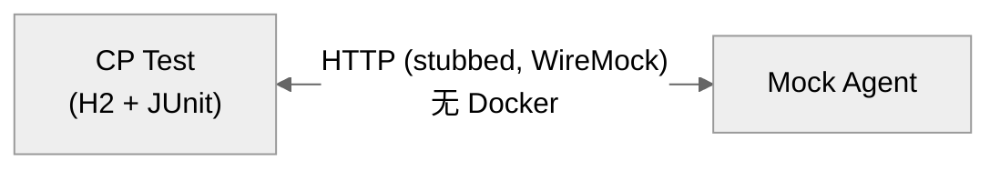
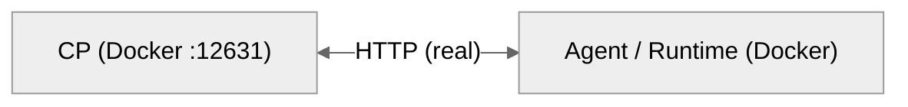

# DEV-021: 集成测试策略

> 面向测试开发者：T1/T2/T3 分层（§1-2）→ 目录规范（§3）→ 契约清单（§4，跨模块接口唯一索引）→ 运行/CI（§5-6）。E2E 见 DEV-020。

## 1. 分层架构

集成测试分三层，与 E2E 的 mock/real 分层一致但关注点不同——集成测试验证**模块间接口契约**而非用户交互流程。

```
┌─────────────────────────────────────────────────────┐
│                    E2E (DEV-020)                     │
│    浏览器 + host 全栈，验证完整用户流程              │
├─────────────────────────────────────────────────────┤
│  T3: Cross-module Real  ← 新增                      │
│     Docker partial stack（冻结），验证端到端模块通信 │
├─────────────────────────────────────────────────────┤
│  T2: Cross-module Stub  ← 新增                      │
│     WireMock/httpx mock，验证 HTTP 契约格式          │
├─────────────────────────────────────────────────────┤
│  T1: Module-internal     ← 已有                      │
│     Testcontainers/MockMvc，验证模块内部集成         │
├─────────────────────────────────────────────────────┤
│                    Unit Tests                        │
│     纯函数/组件逻辑，mock 所有外部依赖                │
└─────────────────────────────────────────────────────┘
```

### 各层对比

| 维度 | T1 模块内集成 | T2 跨模块 Stub | T3 跨模块 Real | E2E |
|------|-------------|----------------|----------------|-----|
| **验证目标** | 模块 + DB/内部依赖正确性 | HTTP 请求/响应格式正确 | 模块间真实通信正常 | 用户端到端流程 |
| **外部依赖** | DB (PG/H2) | 无 (WireMock/mock) | Docker partial（已冻结，见 §2.3） | host 服务（Windows native）+ 隔离 PG + 浏览器 |
| **运行速度** | ~10-30s | ~5-15s | ~60-120s | ~2-5min |
| **失败定位** | 模块内问题 | 请求格式问题 | 模块间兼容问题 | 任意层问题 |
| **CI 运行（目标态）** | 每次 | 每次 | PR + nightly | nightly |
| **框架** | JUnit/MockMvc, pytest, cargo | WireMock, httpx mock, mockito | pytest + httpx, cargo | Playwright |

> 两处口径按 2026-11-07 核对校准：①**「CI 运行」一列是目标态**，本仓当前**未接 CI**（`.github/workflows/` 下只有 `_disabled/` 旧工作流，见 §6）；②T3 行的 Docker partial 是**历史车道**（服务容器化冻结 2026-10-07），现行验收走 host 车道（§2.3）。

## 2. 三层详解

### 2.1 T1: 模块内集成

> 每个模块依赖的内部基础设施（DB、文件系统、Docker daemon）与模块代码的集成。

**已存在**，不是本层的重点增量，但列出以便完整理解架构：

| 模块 | 测试 | 框架 | 需 Docker |
|------|------|------|-----------|
| CP (Java) | AuthIntegrationTest, SessionIntegrationTest, ChatIntegrationTest, WorkspaceIsolationTest, ConfigControllerTest, ChatControllerNpeTest | Spring MockMvc + H2 或 Testcontainers PG | H2: ❌ / PG: ✅ |
| Agent (Python) | test_vector_store.py, test_registry_integration.py | pytest + real PG | ✅ |
| Runtime (Rust) | sandbox_test.rs, bridge_integration_test.rs | cargo test + Docker | ✅ |

### 2.2 T2: 跨模块 Stub 集成

> 用 WireMock（CP 侧）或 httpx mock（Agent 侧）或 HTTP mock（Runtime 侧）模拟对方模块的 HTTP 接口，验证"本模块是否正确组装了跨模块请求"。



**CP 侧模式**（WireMock）：

```java
// 仓内规范：继承 AbstractWireMockTest（静态 WireMockServer.dynamicPort()），
// 单参 configureProperties(registry) 注入 cp.agent-url / cp.agent-base-url
@SpringBootTest(webEnvironment = SpringBootTest.WebEnvironment.RANDOM_PORT)
@ActiveProfiles("h2")
class AgentChatIntegrationTest extends AbstractWireMockTest {

    @Test
    void chatRelaySendsCorrectRequestToAgent() {
        // Arrange: WireMock stub Agent SSE response（token 事件须带 content/type/run_id）
        stubFor(post("/internal/v1/agent/chat")
            .willReturn(aResponse()
                .withStatus(200)
                .withHeader("Content-Type", "text/event-stream")
                .withBody("event: token\ndata: {\"type\":\"token\",\"content\":\"hi\"}\n\n")));

        // Act: 通过 CP 公共端点触发 → CP 内部转发到 Agent
        String token = registerAndLogin();
        String sessionId = fixture.sessionId();
        String branchId = fixture.rootBranchId(sessionId);
        var response = restTemplate.postForEntity(
            url("/api/v1/chat"),
            httpEntity(Map.of("sessionId", sessionId, "branchId", branchId, "content", "hello"), token),
            String.class);

        // Assert: WireMock 验证 CP 发出的请求格式
        verify(postRequestedFor(urlEqualTo("/internal/v1/agent/chat"))
            .withHeader("Authorization", equalTo("Bearer dev-token-not-secure"))
            .withRequestBody(matchingJsonPath("$.content", equalTo("hello"))));
    }
}
```

**Agent 侧模式**（pytest-httpx）：

```python
@pytest.mark.integration
class TestConfigClientWithStub:
    async def test_sync_effective_domains(self, httpx_mock):
        # PLAN-0307：Agent 只消费单份 effective（无 layer 概念）
        httpx_mock.add_callback(lambda request: httpx.Response(200, json={
            "entries": {"profile": '{"providerId":"openai","connectionKey":"default","model":"gpt-4o"}'}
            if request.url.path.endswith("llm-provider") else {}
        }))
        client = ConfigClient(cp_url="http://localhost:12631", api_token="test")
        await client.sync()
        assert client.get_domain("llm-provider")["profile"] == (
            '{"providerId":"openai","connectionKey":"default","model":"gpt-4o"}'
        )
```

**Runtime 侧模式**（mockito / wiremock-rs）：

```rust
#[tokio::test]
async fn test_mcp_poll_config_parses_stdio_servers() {
    let mut mock_server = MockServer::new().await;

    // Arrange: stub CP stdio-servers 契约（generation + entries，PLAN-0307 决策 #27）
    Mock::given(method("GET"))
        .and(path("/internal/v1/workspaces/ws-1/stdio-servers"))
        .respond_with(
            ResponseTemplate::new(200)
                .set_body_json(serde_json::json!({"generation": 1, "servers": []}))
        )
        .expect(1)
        .mount(&mock_server)
        .await;

    // Act
    let url = format!("{}/internal/v1/workspaces/ws-1/stdio-servers", mock_server.uri());
    let result = poll_config_with_generation("ws-1", &url, TEST_TOKEN).await;

    // Assert
    assert!(result.is_ok());
}
```

### 2.3 T3: 跨模块 Real 集成

> 🧊 **lane 冻结（2026-10-07 用户裁定；2026-10-09 强化）**：T3 的 Docker Compose partial stack 车道随**服务容器化冻结**停用（只有 PostgreSQL 保留容器，CP/Agent/Runtime/UI 一律 host 进程；`mise run test:e2e:compose` / `test:e2e` 已在 `mise.toml` 注释）。本节的流程图与命令块保留作**历史参考**；现行验收走 **host 车道**：Windows native 服务 + 每轮隔离 PostgreSQL（T2 用 `mise run test:integration:t2`，真栈 T3 用 host 进程跑，见下方「host 车道」）。
>
> 历史口径：用 Docker Compose 启动部分模块栈（如 CP+Agent 或 CP+Runtime），通过真实 HTTP 端口验证端到端通信。
>
> ⚠️ **任务与本文的差异（已定处置 D-223：保留任务、只改文档）**：`mise run test:integration` 仍声明 `t3` 依赖、任务本体会尝试 `docker compose up`。该任务**不注释、不删除**——车道已冻结，任务保留是为了不切断既有引用与调用面（`test:integration:t2` 仍可直接用于 T2）。阅读者以本文为准：T3 的 compose 车道**不可用于验收**，真栈验收走上文「host 车道」。若日后决定移除 `t3` 依赖，属任务行为变更（B 类），另立裁定，不在文档层处理。



**Agent 默认收集面（BL-361，2026-11-06）**：`packages/agent/pyproject.toml` 已设 `addopts = '-m "not integration"'` ⇒ 默认 `uv run pytest` 会把 `tests/integration/**` **自动 deselected**（`test_vector_store.py` 等 host-only 用例不再在普通门里硬失败，输出里能看到 `deselected` 计数）。
host 车道：先注入 isolated runner 提供的 `XIHE_E2E_PG_DATABASE/USER/PORT`，再显式 `uv run pytest -m integration`；`integration` 标记缺失由元测试 `tests/unit/test_integration_markers.py` 拦截。
**实测计数（2026-11-07 重测）**：默认收集 **1488/1518，30 条 integration 被 deselected**；命令行再加 `-m "not docker"` 会**覆盖** `addopts` 的 `-m`（pytest 后置同名单值选项生效，不是取交集），收集 **1510/1518、只 deselect 8 条**（`@pytest.mark.docker` 全在 `test_cp_real_integration.py`）⇒ `not integration` 默认失效，30 条 integration 里实际会跑 22 条。`tests/integration/test_agent_cp_integration.py` / `test_cp_real_integration.py` 另有 `skipif(not cp_available)` ⇒ **CP 未起时这些用例会在 integration lane 内静默 skip**（不是失败）。恢复：先起 host CP（端口取 `XIHE_CP_PORT`，**stack-1 缺省 12631**，不是 8080；见 `scripts/lib/stack-ports.mjs`）再 `uv run pytest -m integration`。

**启动方式**：

```bash
# ⚠️ 历史参考（compose 车道已于 2026-10-07 冻结）：以下命令不再用于验收
# CP + Agent
docker compose up -d control-plane agent
# 等待健康检查后，运行 Agent 侧 T3 测试
cd packages/agent && uv run pytest tests/integration/test_cp_real_integration.py -v
# 或 CP 侧跨模块 T2（T2 本身不需要 Docker）
cd packages/control-plane && mvn test -Dtest="crossmodule/*IntegrationTest"

# CP + Runtime
docker compose up -d control-plane runtime
cd packages/runtime && cargo test --test cp_real_integration_test
```

**host 车道（现行，替代上面的 compose 块）**：

```bash
# T2：跨模块 stub，无 Docker、无真栈
mise run test:integration:t2

# 真栈 T3：先起 host 栈（仅 PostgreSQL 在容器里，四个服务是 host 进程）
mise run dev:host
# Agent 侧真 CP 用例（读 XIHE_CP_PORT，缺省 12631）
cd packages/agent && uv run pytest -m integration
# Runtime 侧真 CP 用例（该文件全部 #[ignore]，必须显式 --ignored）
cd packages/runtime && cargo test --test cp_real_integration_test -- --ignored
```

**T3 测试关注点**：

- 验证模块间协议兼容性（请求/响应格式匹配）
- 验证健康检查、重试、超时等非功能行为
- 验证真实序列化/反序列化（T2 用 stub 可能忽略序列化差异）
- 验证配置同步（ConfigClient 从 CP 拉取）

## 3. 测试目录规范

### 3.1 CP (Java)

```
src/test/java/com/cc01cc/p/xihe/cp/
├── auth/
│   └── AuthIntegrationTest.java              ← T1 (MockMvc + H2)
├── chat/
│   ├── ChatIntegrationTest.java              ← T1
│   └── ChatControllerNpeTest.java            ← T1
├── config/
│   ├── ConfigControllerTest.java             ← T1
│   ├── SecurityConfigTest.java               ← T1
│   └── TenantContextInterceptorTest.java     ← unit
├── entity/
│   └── UserTest.java                         ← unit
├── integration/
│   └── WorkspaceIsolationTest.java           ← T1
├── mcp/
│   ├── McpProxyTest.java                    ← unit (Mockito)
│   └── McpProxyControllerTest.java          ← unit
├── service/
│   ├── WorkspaceServiceTest.java            ← unit
│   └── WorkspaceServiceCustomPathTest.java  ← unit
├── session/
│   └── SessionIntegrationTest.java           ← T1
├── crossmodule/                        ← T2 + T3 新增
│   ├── AgentChatIntegrationTest.java         ← T2 (WireMock)
│   ├── AgentRagIntegrationTest.java          ← T2 (WireMock)
│   ├── AgentModelsIntegrationTest.java       ← T2 (WireMock)
│   ├── RuntimeMcpIntegrationTest.java        ← T2 (WireMock)
│   ├── RuntimeWorkspaceIntegrationTest.java  ← T2 (WireMock)
│   ├── RuntimeFileIntegrationTest.java       ← T2 (WireMock)
│   └── AbstractWireMockTest.java             ← T2 基类（静态 WireMockServer.dynamicPort）
├── AbstractIntegrationTest.java              ← Testcontainers PG
└── AbstractH2Test.java                       ← H2 基础类
```

### 3.2 Agent (Python)

```
tests/
├── unit/                                 ← 纯单元测试
│   ├── test_llm_base.py
│   ├── test_rag.py
│   ├── test_config_client.py             ← unit (in-memory, 无 HTTP)
│   └── ...
├── integration/                          ← T1 + T2 + T3
│   ├── test_vector_store.py              ← T1 (real PG, 需 Docker)
│   ├── test_registry_integration.py      ← T1 (需 Docker)
│   ├── test_agent_cp_integration.py      ← T3 (real CP)
│   ├── test_cp_stub_integration.py       ← T2 (pytest-httpx)
│   └── test_cp_real_integration.py       ← T3 (real CP, partial Docker)
└── conftest.py
```

### 3.3 Runtime (Rust)

```
tests/
├── artifact_test.rs                      ← unit
├── background_test.rs                    ← unit
├── escape_test.rs                        ← unit
├── mcp_tools_test.rs                     ← unit
├── unit_tools_test.rs                    ← unit
├── sandbox_test.rs                       ← T1 (Docker)
├── bridge_integration_test.rs            ← T1 (Docker)
├── mcp_multi_workspace_test.rs           ← T1 (Docker)
└── crossmodule/                     ← T2 + T3 新增
    ├── cp_stub_integration_test.rs       ← T2 (mockito/wiremock)
    └── cp_real_integration_test.rs       ← T3 (real CP Docker)
```

### 3.4 目录位置设计决策

集成测试和 E2E 测试原则上归入各模块 package 内，而非抽取到根级 `tests/` 或 `e2e/`。理由如下：

**T2 测试无法出包**，原因有三：

1. CP 的 WireMock 测试是 Java JUnit，需要 `pom.xml` 类路径、Spring `@SpringBootTest` 上下文、`AbstractWireMockTest.configureProperties` 注入端口。
2. Agent 的 T2 需要导入 `xihe_agent` 的 Python 模块。
3. 放到包外意味着为每种语言单独维护 build config 和模块导入路径，成本远高于收益。

**T3 测试技术上可出包，但存在位置浪费**：

- T3 测试本质上只是 HTTP 请求脚本——不需要模块内部的任何依赖。
- 但如果抽取到 `tests/integration/`，需要为每个模块的 T3 开辟独立的 build 配置（JUnit/pytest/cargo），而每个模块的 T3 测试数量通常只有 1-3 个（见 §4 契约清单）。
- 不如直接放在模块内测试目录，复用已有的语言框架配置，并在接口契约清单中统一索引。

**E2E 测试归属 UI 包的历史原因**：

- Playwright config 的 `webServer` 段配置了 Vite dev server 启动命令（`pnpm dev`），天然属于 UI 包。
- 约 213 个 spec 文件（mock 78 + real 132 + headed 3；2026-11-07 按 `packages/ui/e2e` 目录实测计数）中仅 4 个 cross-module spec（`cross-module-*.spec.ts`）涉及跨模块通信，其余均为 UI 组件测试。
- 为 4 个 spec 将整个 E2E 套件移出 UI 包，破坏其余同目录 spec 的相邻性，收益小于成本。

**索引优于移动**。跨模块测试不通过目录位置标记，而是通过接口契约清单（§4）统一索引。接口契约清单列出了每个跨模块接口、对应的 T2/T3 测试文件、所在模块。无论文件物理上在哪，一表可查。

| 维度 | 放模块内 | 放根级 |
|------|---------|-------|
| build 配置 | 复用现有 pom/pyproject/Cargo | 需为每种语言配独立 runner |
| 模块导入 | 自然可见 | 需额外 classpath/PYTHONPATH |
| 跨模块可见性 | 需索引表 | 目录即索引 |
| 多语言兼容 | 隔离 (各语言各自管理) | 需统一 runner 适配多语言 |
| E2E webServer 配置 | Playwright 直接调用 pnpm dev | 需额外配置或脚本 |

## 4. 接口契约清单

以下列出每个跨模块接口及对应的 T2/T3 测试覆盖：

### 4.0 PLAN-247 Chat 可用性契约

- Agent health 的 HTTP liveness 与 `llmReady` 必须分别断言；`unknown`、缺凭据、认证失败、provider 不可达和模型不可用不得被测试 helper 当作普通 `200` ready。
- CP `/api/v1/chat` 必须在 readiness/SSE/每会话 run 上限 gate（`maxConcurrentRunsPerSession`，默认 2；cap 满 → `409 CHAT_IN_PROGRESS`，PLAN-0645）后才创建 `ChatRun` 和 user `Message`；重复 `Idempotency-Key` 不得再次启动 Agent，同 key 不同 payload 必须返回 `IDEMPOTENCY_KEY_CONFLICT`。
- Agent chat 请求的 `provider`、`model`、`toolMode`、`runId` 和附件必须由 T2 body/header 断言；`toolMode=none` 不应产生 MCP `tools/list` 请求，workspace 模式的 MCP context 冲突必须失败而不是回退为空工具集。
- T3/Host 测试使用隔离 fake LLM 覆盖 missing、401、multi-token success 和 disconnect；服务不可达时测试必须失败或明确记录阻塞，禁止 `skip` 冒充通过。

| 接口 | 协议 | 方向 | T2 测试 | T3 测试 |
|------|------|------|---------|---------|
| Chat SSE persistence | `GET /api/v1/events?sessionId=` per-session (1 emitter/session, `generation` + `removeIfCurrent` 身份比对) → `POST /api/v1/chat` must find emitter (`409 SSE_SUBSCRIPTION_REQUIRED`) | CP internal | `SseEmitterManagerTest` (replacement / stale completion-timeout-error / `stale_cleanup_ignored` / send failure) | — |
| Chat SSE consecutive | 首条 `POST /api/v1/chat` 完成 `done` 后 SSE 仍可用，第二条不刷新返回 `202` | CP→Agent (stub) | `ChatIntegrationTest` (两轮 `202` + 助理只持久化一次) / `AgentChatIntegrationTest` (token/done 顺序 + `stream=true` / `X-Request-Id` / `X-Chat-Run-Id`) | `cross-module-chat.spec.ts` host named E2E (真实 CP/Agent/Runtime + 隔离 DB) — 连续消息、增量流、重复导航 |
| Chat SSE streaming | `XiheLiteLLM._astream()` 显式 `streaming=True` → `on_chat_model_stream` 多 token，`LangGraphEventAdapter` 按 `run_id` 去重，`on_chat_model_end` 仅 fallback | Agent internal | `test_sse_adapter.py` (多 chunk / end fallback / run 隔离) / `test_llm_base.py` (stream 参数 + provider 兼容) / `test_log_redact.py` (Authorization 脱敏) | 手工 CLI 真实流式：400 字长回复 → `bubble-content` 115 长度递增（0→704）+ `xh-incremental-stream-verified.png` |
| Chat SSE error/timeout | `error` + `done(error)` 仅一次终结信号；`missing done` 合成 `done(synthetic)`；`Agent down` / 401 / 超时 / 部分 token 后异常 | CP/Agent | `ChatIntegrationTest` / `AgentChatIntegrationTest` / `main.py` 失败路径 | Host `startup-failure` smoke + manual 断线恢复 |
| UI SSE lifecycle | `chatTransport` 单飞 + 退避重连 + 发送前手工确认连接；`useSSE` / `SSEStream` / `chatStore.replaceStreamingParts` | UI | `chatStore.spec.ts` (replaceStreamingParts) / `ChatStreamIntegration.spec.ts` (逐 token live 更新) / `useSSE.spec.ts` (close/reconnect/409) | `chat.spec.ts` / `chat-interactions.spec.ts` / `auth-flows.spec.ts` (重复导航/reload/session switch 不破坏新连接) |
| Chat (SSE) | HTTP POST → SSE | CP→Agent | `AgentChatIntegrationTest` | `test_cp_real_integration.py` |
| RAG Ingest | HTTP POST multipart | CP→Agent | `AgentRagIntegrationTest` | `test_cp_real_integration.py` |
| RAG Search | HTTP POST form | CP→Agent | `AgentRagIntegrationTest` | `test_cp_real_integration.py` |
| Models List | HTTP GET | CP→Agent | `AgentModelsIntegrationTest` | (E2E 覆盖) |
| MCP tools/list | JSON-RPC 2.0 POST | CP→Runtime | `RuntimeMcpIntegrationTest` | `cp_real_integration_test.rs` |
| MCP tools/call | JSON-RPC 2.0 POST | CP→Runtime | `RuntimeMcpIntegrationTest` | `cp_real_integration_test.rs` |
| Workspace Create | HTTP POST JSON | CP→Runtime | `RuntimeWorkspaceIntegrationTest` | `cp_real_integration_test.rs` |
| Workspace Delete | HTTP POST JSON | CP→Runtime | `RuntimeWorkspaceIntegrationTest` | `cp_real_integration_test.rs` |
| File Write | HTTP POST binary | CP→Runtime | `RuntimeWorkspaceIntegrationTest` | (E2E 覆盖) |
| File Delete | HTTP POST JSON | CP→Runtime | `RuntimeWorkspaceIntegrationTest` | (E2E 覆盖) |
| Config Fetch | HTTP GET | Agent→CP | `test_cp_stub_integration.py` | `test_cp_real_integration.py` |
| MCP Connect | Streamable HTTP POST | Agent→CP | `test_cp_stub_integration.py` | `test_cp_real_integration.py` |
| Config Fetch | HTTP GET | Runtime→CP | `cp_stub_integration_test.rs` | `cp_real_integration_test.rs` |
| MCP Config Poll | HTTP GET | Runtime→CP | `cp_stub_integration_test.rs` | `cp_real_integration_test.rs` |

### 4.1 WireMock stub 模式

每个 T2 测试遵循三步模式：

```java
// STEP 1: Arrange — Stub 远程模块响应（token 事件须带 content/type）
stubFor(post("/internal/v1/agent/chat")
    .willReturn(aResponse().withStatus(200)
        .withHeader("Content-Type", "text/event-stream")
        .withBody("event: token\ndata: {\"type\":\"token\",\"content\":\"hi\"}\n\n")));

// STEP 2: Act — 通过 CP 公共端点触发
ResponseEntity<String> resp = restTemplate.exchange(
    url("/api/v1/chat"), POST, httpEntity(request, token), String.class);

// STEP 3: Assert — 验证 CP 发出的请求格式
verify(postRequestedFor(urlEqualTo("/internal/v1/agent/chat"))
    .withHeader("Authorization", equalTo("Bearer dev-token-not-secure"))
    .withRequestBody(matchingJsonPath("$.content", equalTo("hello"))));
```

**禁止仅验证 status=200 的 stub 测试**。每个 T2 测试必须用 `verify()` 断言 CP 发出的请求 body/headers 包含正确字段——这才是 T2 的验证价值。

## 5. 运行命令

```bash
# 全量集成测试（T3 = 历史 compose 车道：服务容器化冻结 2026-10-07；现行验收走 host 车道，见 §2.3）
# 注：任务仍声明 t3 依赖、本体会尝试拉起 compose —— 属已定现状（D-223：保留任务、只改文档），不是待裁项；
# 纯 T2 请用 mise run test:integration:t2；真栈验收走 host 车道（见 §2.3）
mise run test:integration

# 各模块独立运行
# CP 全部测试（含 T1 + T2 unit + T2 crossmodule）
mvn test -pl packages/control-plane

# CP 仅跨模块 T2
mvn test -Dtest="crossmodule/*IntegrationTest"

# ⚠️ `-m` 口径（2026-11-07 实测，可复跑）：命令行 `-m` 会**覆盖** pyproject 的 `-m`，不是叠加——
#   ① pyproject `addopts = '-m "not integration"'`：裸 `uv run pytest --collect-only -q` ⇒ 1488/1518 收集、30 条 deselected；
#   ② 再加 `-m "not docker"`：`uv run pytest --collect-only -q -m "not docker"` ⇒ 1510/1518 收集、只 deselected 8 条
#      （`@pytest.mark.docker` 全在 test_cp_real_integration.py 那个类里）⇒ addopts 的 `not integration` 已失效；
#   ③ 因此下面这条**不是**「T2+T1」：它实际把 integration 车道 30 条中除 docker 子集外的 22 条收集进来真跑。
#      要跑默认门就用裸 `uv run pytest`；要只跑集成车道用显式 `-m integration`。
uv run pytest packages/agent/tests/integration/ -v -m "not docker"

# Agent T3（历史参考：compose 车道已冻结；真栈改用 `mise run dev:host` + `uv run pytest -m integration`，见 §2.3）
docker compose up -d control-plane agent
uv run pytest packages/agent/tests/integration/test_cp_real_integration.py -v
docker compose down

# Runtime T2（无 Docker）
cargo test --test cp_stub_integration_test

# Runtime T3（历史参考：compose 车道已冻结；真栈改用 `mise run dev:host` + 下面这条带 --ignored 的命令）
docker compose up -d control-plane runtime
cargo test --test cp_real_integration_test
docker compose down

# 覆盖率基线：本仓**没有**覆盖率基线工具（无覆盖率门禁脚本、无基线文件）⇒ 原先这里写的
# 「更新覆盖率基线 / mise run test:integration」不成立；`test:integration` 是集成测试任务，不产出基线。
# 覆盖率门禁的旧工作流已随 CI 一起停用（.github/workflows/_disabled/coverage.yml），见 §6。
```

## 6. CI 策略

**现状（2026-11-07 核对）：本仓库未接 CI** —— `.github/workflows/` 下只有 `_disabled/ci.yml`（四模块 unit 作业）与 `_disabled/coverage.yml`（CP 覆盖率），均未在运行；不存在 T2/T3/nightly 作业。**下表是目标态**，不是当前事实；接 CI 前 T1/T2 只能本地跑。

| 触发条件 | T1 | T2 | T3（历史车道） |
|----------|----|----|-----|
| PR (每次 push) | 目标：✅ | 目标：✅ | 目标：❌ |
| Nightly (每日) | 目标：✅ | 目标：✅ | 目标：✅ |
| 手动触发 | 目标：✅ | 目标：✅ | 目标：✅ |

T3 不进 PR 的原因：Docker partial stack 启动 + 测试 ≈ 2min，对高频 PR 反馈周期太长（该车道自 2026-10-07 服务容器化冻结后已停用，现行真栈验证走 host 车道 §2.3）。PR 中 T2 = 快速契约检查，nightly T3 = 全量兼容验证 —— 两者都是**接入 CI 后**的目标分工。

## 7. 参考

- `plans/archive/20260629/A03-xihe/PLAN-049-integration-test-design.md` — 实施 PLAN（已归档）
- `docs/i18n/zh-Hans/DEV-020-e2e-test-strategy.md` — E2E 测试策略
- 测试策略决策框架 — 维护在 workspace skill 中
- WireMock 文档：`http://wiremock.org/docs/`
- pytest-httpx 文档：`https://github.com/Colin-b/pytest_httpx`
