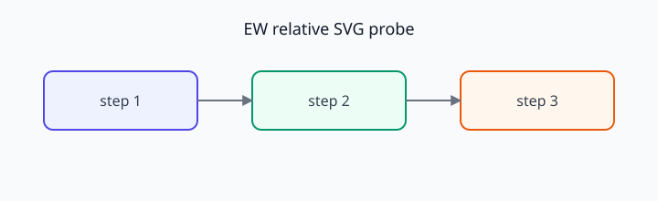
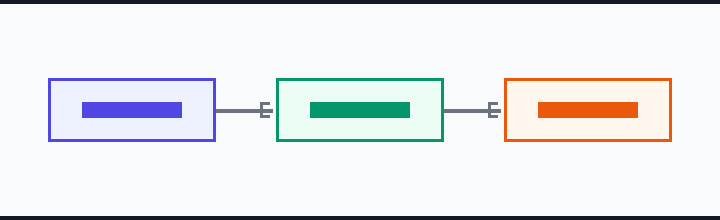

# QA-EW-IMAGE-IMPORT-PROBE: EW 相对图片导入联调夹具

> 这是临时联调文档，不属于产品手册；用于验证 EW 在导入 Project 文档时会发布同仓相对 SVG 与 PNG，并把渲染结果改写到发布地址。

## 1. 相对 SVG

下图引用文档目录下的 `qa/ew-image-probe.svg`。源文档保留相对路径；EW 导入后应把渲染 HTML 中的图片地址改写为 `media.cc01cc.com/project-docs/...`。

## 2. 相对 PNG

下图引用文档目录下的 `qa/ew-image-probe.png`，用于证明位图与 SVG 走同一条相对资源发布链路。

## 3. 验收口径

| 检查面 | 期望 |
| --- | --- |
| `body_markdown` | 保留 `./qa/ew-image-probe.svg` / `./qa/ew-image-probe.png` 作为源 |
| `rendered_html` | 两个 `` 均指向 `media.cc01cc.com/project-docs/{hash}.{ext}` |
| SVG 响应 | `Content-Type: image/svg+xml`，且带 `default-src 'none'` 的 CSP |
| PNG 响应 | `Content-Type: image/png` |
| 缺失或越界引用 | 导入硬失败；错误含文档路径、引用行与实际迁移提示 |

资源只允许放在 `docs/i18n/**` 内。`docs/i18n/**` 之外的引用不会被静默忽略，也不会生成线上 404；EW 必须拒绝导入并提示把资源迁移到文档目录下。SVG 还必须满足 DEV-030 §6.1 的大小与安全限制。

## 4. 清理

导入验收完成后，本文与 `qa/ew-image-probe.svg`、`qa/ew-image-probe.png` 可一并移除；它们不是长期文档资产。
