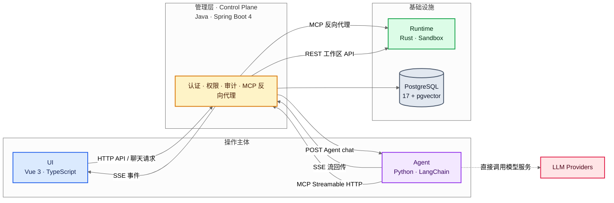

[English](https://github.com/cc01cc/xihe-project#readme)

<!-- 同步约定：架构图、Quick Start 命令、端口、技术栈摘要与根 README.md 同步；功能状态表仅由中文版维护。 -->

# 羲和 — 通用 Agent 多主体协作平台

**羲和，观天以授时，御日以成序。** 人与 Agent 各展所长，协力而行。

> **开发状态：** 项目仍在积极开发，API 和数据结构可能变化，不建议用于生产环境。

## 1. 快速启动

```bash
# 安装固定工具链
mise install

# .env.dev 已入库并含安全占位值；个人凭据仅写入 gitignored 的 .env.local

# 安装各模块依赖并启动日常 host 开发栈
mise run setup
mise run dev:host
# 查看开发/运维 CLI；配置导入与 Provider 初始化需显式执行
mise run xihe -- --help
```

**CLI（`xihe` 命令族，16 个命令组）**：`mise run xihe -- --help`。

| 组 | 用途 |
|---|---|
| `dev` | 本地环境检查 / Provider 初始化 |
| `config` | 配置导入 / 导出（instance 层） |
| `provider` | Provider Connection 增删改查 / verify / 限额 |
| `credential` | 凭据生命周期、绑定、reveal、轮换 |
| `agent` | Agent 主体创建 / 绑定 / 禁用 |
| `session` | 会话参与者读写 |
| `chat` | 发送一条消息（`chat send`） |
| `skill` | Skill 列表 / 导入 / 绑定 |
| `workspace` | 工作区列表 / 详情 |
| `job` | Workspace Job 列表 / 输出 / 取消 |
| `checkpoint` | checkpoint 列表 / revert 预览 |
| `scheduled-task` | 定时任务列表 |
| `audit` | 审计条目查询 |
| `status` | 实例状态汇总 |
| `verify` | 端到端自检 |
| `test` | host E2E 入口 |

另有 `version`（`--check`）与 `help` 两个顶层入口。示例：`mise run xihe -- status`、`mise run xihe -- config export --out cfg.json`、`mise run xihe -- provider list --scope WORKSPACE`。

exit code 契约：`0` 成功、`1` 业务/运行失败（含 `partial`）、`2` 用法错误（未知命令、未知选项、缺必填参数）。加 `--json` 时 stdout 固定为 `{ok,data}` 或 `{ok:false,error:{code,message}}`。

**当前门槛（还没有安装包）**：需要 Windows 宿主机上的 mise 固定工具链，以及 Docker —— Docker 里**只有 PostgreSQL**，Control Plane、Agent、Runtime、UI 四个服务由 mise 作为原生进程启动。原生打包（PLAN-0632）仍在进行中，**暂无下载安装包**，所以现在不能双击即用；最短路径就是本节的四条命令。首跑判据见 [DEV-033](DEV-033-first-run-gold-path.md)。

`.env` 与 `.env.dev` 已作为安全基线入库，无需复制或覆盖；个人凭据写入 gitignored 的 `.env.local`，不得提交或写入日志。日常开发中 PostgreSQL 使用 Docker，其余服务由 mise 在宿主机启动。`dev:host` 不会导入配置或创建 Provider Connection；启动前会先跑一次 `mise run check:runtime-target`（watch 只打印，FORCE 线 ≥20GB 或 H 余量 <5GB 会阻止启动）；需要配置时运行 `mise run dev:host:import-config` 和 `mise run dev:host:provider-init`。UI 默认端口为 `12630`（stack-1；并行多栈见 [DEV-002](DEV-002-developer-guide.md)「模式 D」）。`mise run dev:full` **已冻结禁用（2026-10-07：仅 PostgreSQL 保留容器，服务全 host；mise.toml 已注释）**，日常走 `dev:host`；环境说明见 [DEV-002](DEV-002-developer-guide.md)。

**本仓库可单独 clone 运行**，不依赖上层 ONE 工作区：`mise run check:standalone`（`mise.toml:395`）自检「不依赖 one 根」。端口默认值的**事实源在本仓库** `scripts/lib/stack-ports.mjs`；ONE 侧的 `config/ports.mjs` 只是编排镜像，改任一侧须同批改另一侧，并由 `mise run check:ports`（`mise.toml:401`）做 parity 校验（ONE 不存在时显式 skip）。

开发管理员密码通过 `mise run reset-admin` 临时重置；命令输出只用于本地登录，不要保存到脚本、源码或日志。

**首用是空白起步**：注册/登录后**不会自动创建任何工作区**（响应里的 `workspaceId` 可为 `null`），首屏是空态；点「创建你的第一个工作区」用 **`direct_attach`**（选一个宿主目录，执行模式由能力预检决定）建出第一个工作区，再建 Agent 与会话。完整步骤与「看到什么算成功」的逐条判据见 [DEV-033](DEV-033-first-run-gold-path.md)。

## 2. 架构

UI 与 Agent 是两个独立操作主体。Control Plane（CP）提供共享的路由、权限与审计；Runtime 提供受限的工作区执行能力。



聊天请求与 SSE 事件是两个方向的独立 HTTP 通道；Agent 直接调用模型服务，工具调用通过 CP 的 MCP 反向代理。协议与模块边界见 [DEV-001](DEV-001-system-architecture.md) 和 [DEV-014](DEV-014-control-plane-architecture.md)。

## 3. 模块与技术栈

| 模块 | 职责 | 主要技术 |
|---|---|---|
| UI | 人类交互入口 | Vue 3、TypeScript、Vite 8、Pinia、Tailwind CSS 4 |
| Agent | LLM 编排与工具选择 | Python 3.12、FastAPI、LangChain、LangGraph、litellm |
| Control Plane | 认证、路由、权限、审计 | Java 25、Spring Boot 4 |
| Runtime | 隔离工作区与进程执行 | Rust toolchain、rmcp 3、Axum 0.8 |
| 数据层 | 持久化与向量检索 | PostgreSQL 17、pgvector |
| 开发工具 | 构建与本地编排 | Node.js 24、pnpm 10、Maven 3.9、uv、Docker |

库依赖以各包 manifest 为准：`packages/ui/package.json`、`packages/agent/pyproject.toml`、`packages/control-plane/pom.xml`、`packages/runtime/Cargo.toml`。四个模块也各自在该 manifest 维护版本号；`GET /api/v1/version`、Agent health、Runtime `/ready`、MCP `clientInfo` 均从该来源派生，bump 清单见 [DEV-002 §7](DEV-002-developer-guide.md)。固定工具链见 `mise.toml` 和 `packages/runtime/rust-toolchain.toml`；Runtime 容器构建使用 `cargo build --locked`。

## 4. 功能状态

本表是**唯一维护点**（英文 README 只留一句指向这里）。进度只有三态：`✅ 已实现` / `🔄 进行中` / `⏸ 冻结`；确有边界的能力标 `✅（有限制）`，具体限制写在「当前边界」列。

| 功能 | 进度 | 当前边界 |
|---|---|---|
| 多会话管理 | ✅ 已实现 | 创建、切换、删除、重命名与搜索 |
| 聊天消息组件 | ✅ 已实现 | MessageScroller 与消息列表、时间线组件分工；多主体消息按 run 的真实回应者归因（头像 + 身份行） |
| Markdown 渲染 | ✅（有限制） | Shiki 高亮与 KaTeX 公式；未集成 Mermaid |
| SSE 流式 | ✅ 已实现 | 会话级持久连接与增量 MessagePart 渲染（PLAN-230） |
| MCP 反向代理 | ✅ 已实现 | CP 路由到 Runtime，并执行工具名与权限检查；CP 不签发也不接受 `mcp-session-id`，入站一律 403 `MCP_SESSION_INVALID` |
| 多用户认证 | ✅ 已实现 | JWT 注册/登录与 BCrypt 密码哈希 |
| PostgreSQL 持久化 | ✅ 已实现 | Flyway 管理 schema；H2 仅用于模块测试 |
| 工作区执行 | ⏸ 冻结 | docker 执行后端完全冻结（2026-11-01，PLAN-0618）：`storageMode` 必填、无默认值（缺 → `400 INVALID_REQUEST`），唯一可用值是 `direct_attach`；显式 `managed_import` → `409 BACKEND_DISABLED`；既有 docker 工作区的执行/文件/环境/会话/聊天 → `503 BACKEND_DISABLED`（fail-closed，不回退宿主）。产品面、测试面、默认值三面一起冻，范围与解冻步骤见 [DEV-018](DEV-018-known-issues.md)「docker 后端冻结范围」。host 模式不是进程沙盒，安全边界见 DEV-031 |
| 图片上传 | ✅（有限制） | 拖拽/选择上传，Canvas 压缩至 2048px；粘贴上传未实现 |
| 语音 I/O | ✅ 已实现 | 浏览器支持 Web Speech API 时提供 STT/TTS |
| PDF 处理 | ✅（有限制） | pdfjs-dist 预览与文本提取；提取路径不含 OCR |
| 主题系统 | ✅ 已实现 | dark、light、system |
| 国际化 | ✅ 已实现 | zh-CN / en-US；`src/i18n/locale.ts#applyLocale` 是统一入口，切换后持久化并同步 `<html lang>`（PLAN-0602） |
| 知识库（RAG） | ✅（有限制） | 文档分块、Embedding 与 pgvector；嵌入 profile 按 Workspace/User 整组配置（固定百炼 Multimodal-Embedding 模型、768 维），向量行按连接与 profile 分区；未配置 embedding profile 时 `/api/v1/rag/*` → `409 EMBEDDING_PROFILE_REQUIRED` |
| API 请求模板 | ✅ 已实现 | 按 ProviderConnection 的 API Type 编辑原生请求体；解析顺序 Model override → Connection default → 类型内置默认；发布修订不可变（PLAN-0439） |
| 多主体会话参与者 | ✅ 已实现 | `session_participants` 用多态引用存 HUMAN / AGENT，会话角色 PRIMARY / MEMBER / GUARD，`order_index` 单调递增（删除留空洞、不重排）；`@` 提及（含 `@all`）在提交时按当前 roster 最长匹配解析，歧义/未命中 fail-closed 并记 `unresolvedTokens`；唤醒策略 `ALL_MESSAGES` / `MENTION` / `SCHEDULE`，回应策略 `ALWAYS` / `WHEN_MENTIONED` / `JUDGE` / `MUTED`；`@all` 默认只 PRIMARY 回应；会话并发上限只作 UX 提示，真实并发由资源治理控制 |
| Agent 主体与权限 | ✅ 已实现 | `agent_principals` 三档 scope（PERSONAL / WORKSPACE / INSTANCE）+ `owner_user_id`；创建、绑定、使用是三段独立授权（默认 deny，不得合并为一个动作）；cap 走单一入口 `resolveCapFor` + grants；主体只携带模型意图（`default_model_*` / `allowed_models`），不绑死连接；connection / model 级并发与配额，超限 `429` + `Retry-After`。守卫 = 预置主体（`origin=SYSTEM_PRESET` + `presetId`），cap 只读固定、不可物理删、不可绑定工作区，经会话参与者 `role=GUARD` 进入；hooks 订阅形态 `advisors[{kind,on}]`（首个事件类 `approval.ask`，精确等值匹配），裁决只作审批输入，放行仍由 approval gate 执行 |
| 写操作审批门 | ✅ 已实现 | 结论沿用 policy 词汇 allow / ask / deny（不新造枚举）；审批历史落 `approval_history`，checkpoint 与 revert 走 `run_checkpoints`（Runtime 侧 shadow git）；AGENTS.md 类受保护文件按路径条件默认 ask，`auto` 不绕过；浏览器写文件不经 Agent policy；revert 延迟在冷缓存下仍超 PLAN-0328 冻结阈值（见 DEV-018） |
| Judge 决策 | ✅ 已实现 | 独立决策模型（`dashscope` 原生 apiType）判「该不该发言」，与发言 run 分开计量；失败或超时 fail-closed 不发言；`judge_decisions` 每次调用一行（含失败行），只写不读、无查询端点；agent→agent 唤醒链深度默认 3，超限/成环显式失败并审计 |
| 嵌套 AGENTS.md 注入 | ✅（有限制） | 子目录 AGENTS.md 随 read/list 工具按祖先链 JIT 加载（上界 workspace root；根级仍走既有 eager 注入），nearest-first + 去重；内容作为仓库数据注入专用信封 `untrusted-repo-instructions`，durable `tool.result` 不落注入正文；与 skills / memory 共用 `context/injection_budget.py` 预算账本，超限丢最远祖先；真栈走查与 `apply_patch` / `list_directory` 的行为面目前只有单测与干跑证据 |
| 工作区多标签 dock 与布局持久化 | ✅（有限制） | 右侧栏多标签（可同时开多个、上限 6）、放大态 `dockFocus`、关闭后激活相邻标签、满额有可见提示；布局按 workspace 存 localStorage（`xihe-layout-ws:<id>`），无服务端布局持久化；Agent 管理面板迁入标签（M3）未完成 |
| CLI（`xihe` 命令族） | ✅ 已实现 | `mise run xihe -- <command>`（`scripts/xihe.mjs`）：**16 个命令组**（dev / config / provider / credential / agent / session / chat / skill / workspace / job / checkpoint / scheduled-task / audit / status / verify / test，另有 `version`、`help` 入口）；`scripts/xihe-cli.test.mjs` 110 项测试；exit code 契约 0/1/2；覆盖面是开发与运维动作，不是终端用户入口（管理面扩展见 PLAN-0643） |
| 本地模式 | ✅ 已实现 | `XIHE_LOCAL_MODE=true` + CP 绑定回环 + `XIHE_ENV` 非 prod，三个条件缺一个 CP 启动即拒绝（fail-fast）；仅回环来源且 `Origin`/`Host` 回环时可用，签发对象必须是唯一可登录用户（否则 404/409），本地模式跳过默认 admin seed |
| 记忆（memory） | 🔄 进行中 | 已落 `agent_memories`（V99）+ CP 服务层 + `MEMORY_WRITE` 原子（默认不授予任何角色）；注入快照仍停在「数据就绪层」——api-request 模板的模型可见槽位尚未上线，所以记忆还不会进模型上下文；episodic、向量检索、`judge` 写入模式均未实现 |
| Skills 平台 | 🔄 规划中（未开工） | 只有冻结设计与 M1 任务书，无表、无代码；模型可见的 listing 槽位与 memory 合并成一次跨层变更，同样未上线 |
| Subagent 委派 | ✅（有限制） | subagent = 正常 session（有自己的参与者/PRIMARY/run 归属），预算制 `{maxCount, maxDepth}` 只递减 root session 预算。已交付：委派预算门（`agent_principals.delegation_policy` V100 + `DelegationPolicyValidator`，超限 `409 DELEGATION_LIMIT_EXCEEDED`、策略不可读/树断裂 `409 DELEGATION_POLICY_INVALID`）、spawn/wake 双链 walker（`DelegationChainWalker`，深度不落库，祖先缺失 fail-closed `ancestor_missing`）、唤醒边 `chat_runs.parent_run_id`（V105；内存 `WakeChainRegistry` 已删除，环按 principal 检测）、composer to/cc（cc = 旁听名单，只发 `notify` 并推进 `mention_count`，不建 run）。授权原子复用 `SPAWN_AGENT`，不新增 `DELEGATE`（D30-04）。**明确不做**（design §8）：会话树 UI（归后续 UI 计划）、跨工作区委托、跨实例委托、全局并发上限/排队 |
| 原生打包 / MVP 分发 | 🔄 进行中 | 目标是双击安装包 → 服务自启 → 浏览器访问 localhost；CP native image、Agent PyInstaller（实测 onedir 优于 onefile）、随包 pgvector 与 launcher 都已 spike 过，**暂无安装包可下载**，当前最快路径仍是本地 dev 模式 |

**Known boundaries**

1. **docker 执行后端冻结**：产品面、测试面、默认值三面一起冻，解冻时一起解冻；范围与解冻步骤见 [DEV-018](DEV-018-known-issues.md)「docker 后端冻结范围」。
2. **memory / skills 尚未接入模型可见面**：memory 已有表、服务层与注入快照（数据就绪层），skills 还未开工；两者都还不会出现在模型上下文里。
3. **暂不提供下载安装包**：原生打包进行中，当前最快路径是本地 dev 模式（mise + Docker 仅跑 PostgreSQL + 四个原生进程），不能双击即用。

## 5. 测试

```bash
mise run validate        # lint + typecheck + build + test
mise run validate:full   # 增加集成与 E2E（需要 Docker）
mise run test:e2e:host   # Host E2E：先停 dev:host（见 DEV-002 §5），每轮使用隔离环境
```

测试策略见 DEV-020/021/022/023；环境清理与 host 运行要求见 [DEV-002](DEV-002-developer-guide.md)。

## 6. 文档

完整索引见 [INDEX.md](INDEX.md)。中文、英文文档各自维护编号与索引。

| 文档 | 内容 |
|---|---|
| [DEV-001](DEV-001-system-architecture.md) | 系统架构与通信协议 |
| [DEV-002](DEV-002-developer-guide.md) | 环境搭建、运行模式与调试 |
| [DEV-033](DEV-033-first-run-gold-path.md) | 新手首跑：空白实例 → 首条回复（判据与 spec 断言映射） |
| [DEV-003](DEV-003-config-management.md) | ConfigService、环境变量与配置导入 |
| [DEV-004](DEV-004-logging.md) | 日志、脱敏与泄露扫描 |
| [USER-001](USER-001-user-guide.md) | 用户指南 |
| `AGENTS.md` | 开发指南与项目约定（仓库根目录） |

## 7. 理念

**Agent 不是工具，而是团队中的一个角色。** 人与 Agent 都有职责和权限边界；CP 负责统一策略与审计，Runtime 提供受限的执行空间。

## 8. License

Apache-2.0
