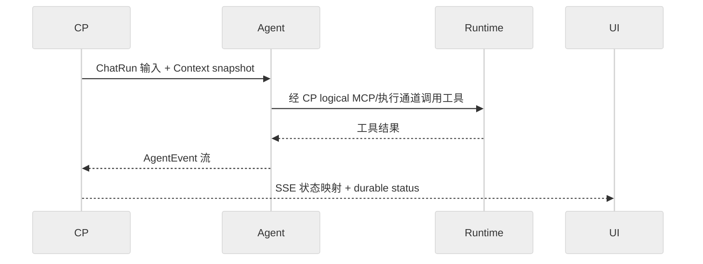

# Agent 执行模型

> 契约状态：`proposed`  
> 实现状态：`partial`  
> Profile：`architecture`  
> Owner：Agent owner  
> 消费者：CP、Runtime、UI、Security  
> 来源：PLAN-0387、PLAN-0529、DEV-013  
> 更新日期：2026-10-18

## 范围

本文定义 Agent Runner、工具适配、事件适配和一次 ChatRun 执行的边界。它描述 Agent 如何消费 CP 输入并产生可观察事件，不重新定义 Security authorization、CP durable record 或 Runtime 执行能力。

Agent Run 相关护栏（Context 预算、工具超时/输出、循环与无进展、取消/审批、接管、审计等）的跨域分类、owner 与实现状态导航见 [Agent Run 护栏总览](./run-guardrails.md)；该总览只链接本文与各 owner 规则，不复制或改变本文契约。

## 参与者与事实源

| 参与者 | 权威职责 |
|---|---|
| CP | 创建 ChatRun，计算可执行输入，拥有 ChatRun 终态与各域 durable records |
| Agent | 执行模型循环、工具调用和事件翻译；不得自行扩大授权 |
| Runtime | 承载文件、命令、进程和 MCP 执行 |
| UI | 消费 CP relay 的 SSE/HTTP 状态映射与响应，不把本地状态当作 durable authority |
| Security | 拥有通用 principal/role/scope/authorization 正文 |

`AgentRunner`、`RunnerConfig`、`AgentEvent` 和 `EventAdapter` 是 Agent 当前接口事实源；LangGraph 只允许位于接口实现之后。

## 规范条款

1. Agent MUST 只使用 CP 下发的 `sessionId`、`runId`、`workspaceId`、`toolCallId` 和 Context snapshot；MCP invocation/attempt 身份由 CP MCP execution domain 持有。
2. Agent MUST 通过 `AgentRunner.stream()` 产生统一事件；框架原始事件 MUST 经过 `EventAdapter` 翻译。
3. Agent MUST 将 `toolCallId` 同时用于对应的 tool call/result 事件；缺少稳定调用键时 MUST fail-closed 或沿用既有 adapter fallback，不得生成第二套跨层键。
4. Agent MUST 将取消、审批等待、provider failure 和 partial/ambiguous 结果交给 CP 的终态路径；Agent 本地 `done` 不得单独宣称 durable ChatRun 已完成。
5. `toolMode=none` MUST 不初始化 Workspace MCP；Workspace 工具模式 MUST 使用请求携带的 Workspace 绑定，禁止复用其他 Workspace 的已发现工具。

## PLAN-0416 输入预算与 provider usage

每次 provider step 前，Agent MUST 按现有 tokenizer/policy 估算序列化后的最终 API-native request body，覆盖 tools、history、RAG、instructions、当前输入及本 Run 的 continuation。不得只估算中立 history 或首个 step。超预算不得自动重放 provider 请求。

本地估算与 provider usage MUST 分开。provider 未返回的 input/output/cache/window 字段记为 unknown，不伪造为零；只累计实际报告的计数，不把本地估算冒充 provider truth。

## MCP 关联键与迟到终止

1. Agent MUST 为同一次 MCP 工具调用在 `AgentEvent.tool_call` 与 `AgentEvent.tool_result` 使用相同的 `toolCallId`；不得按阶段重新派生另一关联键。
2. Agent→CP 请求 MUST 发送唯一关联头 `X-Tool-Call-Id`，值为事件 `toolCallId`；不得发送 Ledger operation/item headers。
3. Agent MUST NOT 创建或选择 `mcpInvocationId`。CP 在 MCP gate 创建并拥有 invocation；CP→Runtime 发送 `X-Mcp-Invocation-Id`。Runtime in-flight cancel key 仍使用 canonical `toolCallId`；Runtime late-termination 经 MCP invocation route 报告 `mcpInvocationId`，不保留 itemId fallback。
4. 每次调用最多一个 canonical `toolCallId` 与一个 CP-owned invocation；header 缺失、冲突或 scope 不匹配时由 CP fail-closed，Agent MUST 不绕过 CP 自行执行或补造身份。

验证映射：Agent `tests/unit/test_mcp_client.py`；CP `McpInvocationIntegrationTest` / `GrantPrincipalPathResolverTest`；Runtime `tool_timeout.rs` 与 late-termination integration tests；HTTP route 以 `docs/api/openapi.yaml` 和 `docs/api/inventory.md` 为准。PLAN-0464/0467 已移除 Ledger compatibility headers 与 itemId late route。

## Agent Run 累计预算

PLAN-0492 实现。预算只约束「本次 Run 的累计消耗」，与输入窗口预算、per-tool 超时/输出上限相互独立（分类见 [Agent Run 护栏总览](./run-guardrails.md)）。

1. **维度与配置键**：`turns`（`agent-runtime.runMaxTurns`，一轮 = 一次完成的 LLM 调用）、`elapsed`（`runMaxElapsedSeconds`，累计墙钟，审批/人工等待暂停计时）、`tokens`（`runMaxTokens`，**比较对象是记账值**：`growth` 口径下每次调用记 `(input − cache_read) + output` 的累计，见下「记账口径」）。值键在 user/workspace 层可写；硬上限键 `runMaxTurnsCeiling` / `runMaxElapsedSecondsCeiling` / `runMaxTokensCeiling` 仅 instance 层可写（`0` = 不钳制），生效值 = `ceiling > 0 ? min(值, ceiling) : 值`，钳制时记 `run_budget_clamp` 日志。任一维度值 `0` = 该维度不启用（仍计数与上报，不停止 Run）。
2. **计算与执行归属**：Agent 从 CP 配置（合并链 + 随 run 的层覆盖）解析生效预算并在消费时执行；CP 拥有配置面与 durable 终态，不重复计算。
3. **触发与上报**：任一维度超限时 Agent MUST 停止执行并发出结构化 `error` 事件 `code=RUN_BUDGET_EXHAUSTED` + `dimension`（`turns` / `elapsed` / `tokens`），不得静默停止或本地宣称成功。
4. **终态与可读性**：CP relay MUST 将 `dimension` 记入 durable 终态（`errorDetail=budgetDimension=<dim>`、run history payload），Run 收敛为 `failed`（若已有助手内容则 `partial`）；UI 以本地化原因呈现耗尽维度，接管走普通发送/Follow-up Queue，不恢复旧 Run 图状态、不新增接管机制。
5. **不变式**：预算耗尽 MUST NOT 替代授权/审批/沙盒门禁；预算上限 MUST NOT 被非 instance 层扩大（键级锁 + 钳制）。

## 记账口径与两个数（task-101/B，2026-11-19）

1. **两个数并存**：`totalTokens` 是 provider 报的**真实消费**（语义不变），`budgetConsumed` 是**口径内记账**。预算判定只用后者；两者同批写入，缺一不可。
2. **`budgetAccounting` 配置键**（`growth` 默认 / `cumulative` 回滚开关）：`growth` = 每次 `(input − cache_read) + output`（缓存命中的前缀不重复计费）；`cumulative` = `input + output`（B 之前的规则，逐字节一致）。
3. **字段缺失 fail-open**：provider 不报 cache 计数（字段 `absent`）⇒ 按 `input + output` 全额计，**绝不当 0 计**；上报 `0` 是真实未命中，同样全额计但记 `0` 的 cache。判据是「字段在不在」，不是「值是不是 0」。**禁止自算 tokenizer**。
4. **与单次闸分工**：预算闸管**累计**，`CONTEXT_OVERFLOW` 单次闸管**峰值**，互不替代、阈值不改。缓存全命中的 900k 上下文可能只记账 2k，此时只有单次闸能拦下。
5. **可复算恒等式**：`Σ(旧口径 − B 口径) = Σ cache_read`（按 run 逐次调用对齐）；durable 面为 `context_events` 的 `llm.usage`（带 `inputTokens` / `cacheReadInputTokens` / `outputTokens` / `budgetConsumed`）与 `chat_runs.budget_consumed`（可空；历史行 NULL，**不是 0**）。

验证映射：Agent `tests/unit/test_run_budget_accounting.py`、`tests/unit/test_langgraph_runner_budget.py`、`tests/unit/test_run_budget_resolution.py`、`tests/unit/test_chat_budget_error_sse.py`；CP `ConfigServiceTest`（预算键/越权/默认）、`ChatIntegrationTest#budgetExhaustedConvergesToFailedWithDurableDimension`；host E2E `packages/ui/e2e/real/run-budget-exhaustion.spec.ts`（`--batch=run-budget`）。

## 上下文压缩开关与保真断言（task-110/B，2026-11-19）

上下文压缩 = 把**陈旧工具结果正文**换成占位符（既有 prune 语义，PLAN-0341 I5 tombstones 不变）；本节只新增「何时压」的开关与「压完必须还在」的断言，MUST NOT 改变占位符之外的裁切规则。

1. **`contextCompaction` 配置键**（`context-policy` 域，默认 `overflow`）：`overflow` = 每次 Run 都压（task-110 之前的行为，逐字节一致）；`budget` = 仅当组装后历史达到 `0.8 × maxInputTokens` 才压（阈值随模型窗口解析，未解析时按代码默认窗口 128k）；`off` = 回滚开关，生产截断点与 runner 侧装配保险丝都不压。非法值记日志后回落 `overflow`，不静默改成别的模式。
2. **触发点与顺序**：生产截断点（`api/chat.py`）在 `truncate_for_run` 之前求值——先压工具正文、再量 inbound cap，顺序仍是 prune → inbound cap（PLAN-0670 T2c.1）。触发估算复用同一套本地估值器（不引入第二套 tokenizer），且只决定**是否**压，不改 inbound cap、不改 `CONTEXT_OVERFLOW` 单次闸阈值。
3. **保真三元组**：压缩前后逐项比较**工具调用清单**（`tool_call_id` / `tool_calls[].id`）、**审批 id**（`approvalRequestId`）、**文件路径**；三者是事实位，MUST NOT 被摘要或占位符吞掉。被替换的正文若含事实，占位符后追加一行 `[preserved facts] approvalRequestId=… path=…`，使 markdown 级读取仍能看见事实；不含事实的正文保持裸占位符（形状不变）。
4. **失败不静默降级**：压完三元组不等 ⇒ 丢弃压缩结果、按**未压缩**历史继续，并记 `context_compaction_reverted reason=fidelity_mismatch`；压缩路径抛错 ⇒ 同样回退并记 `pruner_error`（含 stacktrace）。两种情形都在既有 `context.prune` 事件的 `compaction` 子对象里写 `reverted/reason/error/applied/mode/estimatedInputTokens/thresholdTokens`——不新增事件类型（CP 事件分类不在本节写范围），空 tombstones 的 `context.prune` 对投影是 no-op，故回退事件不会污染重建。
5. **读数口径**：`budget` 模式未达阈值时节省 MUST 为 0（不得有 tombstone、不得改 messages）；达阈值时节省 = 压缩前后历史字符差（可算，不靠估计）。验收读数 R1–R4 见 `internal/A03-xihe/evidence/2026-11-19-task110-context-compaction/`。
6. **不变式**：本节 MUST NOT 放宽 `CONTEXT_OVERFLOW` 终态、MUST NOT 用摘要替代事实位、MUST NOT 在压缩失败时宣称已压缩。

验证映射：Agent `tests/unit/test_context_compaction.py`（三模式 + 保真红/绿 + 抛错回退 + 节省可算）、`tests/unit/test_context_policy.py`（`contextCompaction` 解析与回落）、`tests/unit/test_tool_result_masking.py`（裸占位符形状不变）。

## provider 失败分类与 CONTEXT_OVERFLOW / LLM_OUTPUT_TRUNCATED 的可达性（task-27/Q-45，2026-11-19）

1. **单一实现**：provider 失败到错误码的映射只有一处 —— `packages/agent/src/xihe_agent/llm/error_classification.py` 里的**数据表**（`OVERFLOW_CODE_VALUES` / `OVERFLOW_PHRASES` / `OVERFLOW_PHRASE_GROUPS` / `EXCLUSION_*` / `SAFE_OVERFLOW_PARAMS` / `EXCEPTION_RULES`）。两条 transport 同源：raw-httpx 的真实聊天面 `ApiSender.stream` 非 2xx 分支调用 `classify_rejected_body(status, body)`；litellm 旁路（judge / worker / summarize）`app_state._classify_llm_exception` 调用 `classify_provider_exception(status_code, message, error_type)`。新增错误码 MUST 改这张表，MUST NOT 在调用点再写 if 链。
2. **判定顺序**：状态优先级不变（401/403 ⇒ `LLM_CREDENTIALS_INVALID`，≥500 ⇒ `LLM_PROVIDER_UNREACHABLE`）；只有 400/413 进入白名单判定；排除规则（`string_above_max_length`、`invalid 'user'` + `string too long`、非 `messages/input/prompt` 的 `param`）先于 T1/T2；再比对 `error.code == context_length_exceeded`，再比对短语表；**未识别一律 fail closed 到 `LLM_REQUEST_REJECTED`**（一次误判要白压一次上下文并重跑）。422/429 恒不参与；错误体按 64 KiB 有界读取，超出即当解析失败。
3. **CONTEXT_OVERFLOW 的产出点只有一个**：`packages/agent/src/xihe_agent/agent_runner/langgraph_runner.py:591`（litellm `ContextWindowExceededError` 分支），消费方是 CP 的压缩重试臂。第二条路径 —— `ApiRequestError`（非流式/流式发送失败）——只**转发** `e.terminal_code`，`retryable` 随分类带入（`ApiRequestError.retryable`，`packages/agent/src/xihe_agent/llm/api_request.py:33`），MUST NOT 在 runner 里写死 `False`；故 `CONTEXT_OVERFLOW` 字面在 runner 仍只出现一次。
4. **200 + 静默截断只告知、不重试**：provider 返回 200、`finish_reason` 为 `length`/`max_tokens` 且正文为空、无工具调用 ⇒ `LLM_OUTPUT_TRUNCATED`（`retryable=False`）。MUST NOT 归为 `CONTEXT_OVERFLOW`：`length` 也可能是正常 `max_tokens` 截断，误触发会白压一次上下文。正文非空时不做判定（与正常截断不可区分）。`finish_reason` 由解析结果携带（`NativeResponse.finish_reason`）；流式判定 MUST 用 `StreamParser` 的 `finish`，不得读 `audit.response_bytes`（该字段流结束才完整）。
5. **已知不覆盖（登记说明）**：流内截断（未收到收尾帧）仍归 `LLM_PROVIDER_STREAM_TRUNCATED`；工具调用参数被截断仍归 `LLM_TOOL_ARGUMENTS_TRUNCATED`；`mimo-responses` 的非 `completed` 状态在解析层即 502，不进入截断判定。三者均不在本节判据内。
6. **不变式**：MUST NOT 改变 `LLM_REQUEST_REJECTED` / `LLM_CREDENTIALS_INVALID` / `LLM_PROVIDER_UNREACHABLE` 的既有语义与文案；MUST NOT 让错误 detail 携带 provider 报文原文或凭据（分类只给安全 detail，报文只留在 `audit.error_bytes`）。

验证映射：`packages/agent/tests/unit/test_error_classification.py`（12 正例 + 8 反例矩阵、状态优先级、param 规则、64 KiB 有界、截断三态）、`packages/agent/tests/unit/test_context_overflow_reachability.py`（真 loopback 400 报文 → 真 `ApiChatModel` → 真 `LangGraphRunner` 终态事件；普通 400 不可重试对照；200 截断不产 `CONTEXT_OVERFLOW`）、`packages/agent/tests/unit/test_main.py`（litellm 旁路既有映射不变）、`packages/agent/tests/unit/test_api_request_runtime.py`（发送面既有 400 映射不变）。案例来源：`internal/A03-xihe/docs/q45-option-a-and-b.md` §B2/§B3 与 `internal/A03-xihe/evidence/2026-11-19-q45-overflow-classification/matcher-cases.json`。
## Agent Run 语义重复与无进展检测

PLAN-0493 实现。与累计预算（上节）相互独立、可同时生效：预算约束「消耗总量」，本节约束「动作重复性与进展」，两类触发各自上报、各自终态归因（`RUN_BUDGET_EXHAUSTED` / `RUN_NO_PROGRESS`）。

1. **判定窗口与签名**：Agent 进程内 **per-Run 观察窗口**（`observation window`：最近 `loopWindowSize` 次工具调用，默认 20；有界淘汰最旧、非权威——重启/淘汰只损失检测状态，照 `DiagnosticsLedger` 约定）。三类**连续**信号：同签名的重复调用；同类连续失败（同 error name/code/HTTP status）；幂等/只读工具的同签名同结果。签名 = `sha256(tool_name + canonical_json(args))`（deep key sort、键大小写归一、字符串 trim、空参归一、易变字段剔除清单；不含 `toolCallId`）。
2. **配置键**：值键 `loopRepeatWarn/Refuse/Escalate`（2/3/5）、`loopErrorRunWarn/Escalate`（3/5）、`loopStaleResultWarn/Escalate`（2/5）、`loopWindowSize`（20）在 user/workspace 层可写；`loopRepeatEscalateCeiling` / `loopErrorRunEscalateCeiling` / `loopStaleResultEscalateCeiling` / `loopWindowSizeCeiling`（10/10/10/50，`0` = 不钳制）仅 instance 层可写，钳制式同预算节并记 `loop_guard_clamp`。`loopExemptTools`（JSON 文本数组、禁通配符、≤64 项、items 1–128）只**追加**内置豁免清单（轮询/探活类），内置项恒并集不可移除；非法/缺失回落内置并记日志。默认值经真实观测校准（PLAN-0493 `evidence/m0-observed-repeats.md`，全部维持）。
3. **两级动作**：tier-1——达 warn 阈值（默认 2）随工具结果追加提示、调用照常执行；达 refuse 阈值（默认 3）**拒绝该次调用**并返回提示，**Run 继续**（拒绝不产生执行副作用，durable 事件对以失败状态闭合）。tier-2——达升级阈值（默认均 5）Agent MUST 停止执行并发结构化 `error` 事件 `code=RUN_NO_PROGRESS` + `signal`（`repeat | error | stale`），经 PLAN-0492 `{stop, interrupt}` 同一管道收敛，不新增动作/终态。
4. **边界与终态**：审批等待点重置连续计数（经授权/审批的静默重试不计入重复）；排除表只豁免检测、不豁免累计预算；触发事实仅 `errorCode` 跨 wire，窗口内部结构与签名原文不出进程。CP 收敛 Run 为 `failed`（已有助手内容时 `partial`）；UI 呈现本地化原因——有助手内容经消息错误框，零内容停止经恢复横幅（`failed` 态：原因 + 接续提示），接管复用普通发送/Follow-up Queue，不恢复旧 Run 图状态。
5. **已知边界（登记说明）**：工具参数 schema 校验失败发生在适配器观测点之前，模型若反复发送非法参数（如缺必填字段）将由 turns 预算兜底而非本节检测；属检测盲区，候选台账见 PLAN-0493 收尾报告。
6. **不变式**：本节检测 MUST NOT 替代或绕过授权/审批/沙盒/预算门禁；MUST NOT 新增 wire 状态；tier-1 拒绝 MUST NOT 终止 Run；上限 MUST NOT 被非 instance 层扩大。

验证映射：Agent `tests/unit/test_loop_progress_detection.py`、`tests/unit/test_loop_guard_resolution.py`；CP `ConfigServiceTest`（循环键/越权/默认/零值与通配符拒绝）、`ChatIntegrationTest#noProgressConvergesToFailedAndAllowsResume`；host E2E `packages/ui/e2e/real/loop-guard.spec.ts`（`--batch=loop-guard`，含 390×844 复验与执行计数断言）。

## 运行中 Guidance 消费（PLAN-0529）

- **消费点**：模型调用前置。一次 LLM 调用开始即「上一批已派发工具全部完成、本轮规划尚未发生」，是该 Run 的安全消费边界；不 interrupt、不改图拓扑、不写 graph state。
- **注入**：每条 CP `pending` Guidance 作为一条**带来源信封的 HumanMessage**（`[guidance] (source=user, seq=<n>)`）按 `sequence` 升序追加进该次调用的 messages 副本；**瞬态**（不入 graph `messages`、checkpoint、EventStore），故不会经 checkpoint 进入续跑上下文；不得提升为 system/developer 策略，不得作为授权材料。
- **确认与去重**：注入后调用 CP consume（幂等键 `guidance-<id>`）；stream 内 `injected_ids` + CP 幂等 + `409 GUIDANCE_ALREADY_TERMINAL_EXPIRED` 停止信号构成三级去重。consume 瞬时失败不记入 → 下一边界重读，绝不重放已完成工具副作用。
- **失败与禁用**：CP 读取失败 fail-open（零注入、Run 继续，Guidance 无授权语义）；无 runId/consumer 时整体禁用、零行为变化。不新增 AgentEvent 类型；CP durable Guidance 记录归 CP owner（`spec/session/chat-run-operation.md`），本 SPEC 只写 Agent 绑定/消费。
- 协议冻结件：`plans/archive/PLAN-0529-xh-guidance-agent-consume/spec/agent-guidance-consume-protocol.md`（归档 PLAN 工作包，workspace 根）与本仓库实现对应的 DEV 说明见 DEV-013。

## 执行边界

图下注释：Agent 不绕过 CP 直接拥有通用授权；图中 Runtime 调用表示既有 CP/Agent logical boundary，不新增直连协议。

## 状态、失败与恢复

- Agent stream 可以出现 token、tool call/result、approval request、error 和 done；CP 负责将它们映射为 ChatRun 状态与 owner-domain durable records。
- 断线后，UI/CP 通过既有 run 查询和 SSE 恢复机制恢复可见状态；Agent 不自行重放已完成的 tool call。
- provider 不可达、工具超时、审批过期和取消必须保留稳定错误码/终态来源；错误 detail 不得包含 token 或原始 secret。

## 实现差距

- Agent `EventType` literal 与 `AgentContext.apply_event()` 均覆盖 `context.prune`、`context.env_updated`；CP Event Store 自由字符串尚未形成跨层机器校验闭环。
- Agent payload 目前没有独立 Agent principal/schema；该 gap 由 PLAN-0374 与 Security 前置决策承接。
- MCP canonical `toolCallId`、CP-owned invocation 与 Runtime late-termination 关联由 PLAN-0463 落地；PLAN-0464/0467 已移除 Ledger headers、Job anchor alias 与旧 itemId late route。

## 验证映射

- 当前事实：PLAN-0387 `evidence/current-state.md`。
- 事件与消费者：PLAN-0387 `evidence/consumer-matrix.md`。
- 真实状态机、断线恢复和跨模块运行态：PLAN-0387 T3/V7，尚未宣称完成。
