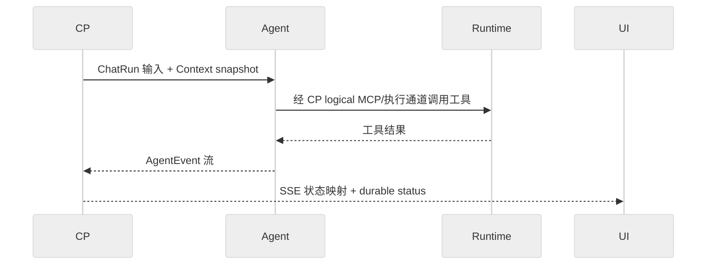

# Agent 执行模型

> 契约状态：`proposed`  
> 实现状态：`partial`  
> Profile：`architecture`  
> Owner：Agent owner  
> 消费者：CP、Runtime、UI、Security  
> 来源：PLAN-0387、PLAN-0529、DEV-013  
> 更新日期：2026-10-18

## 范围

本文定义 Agent Runner、工具适配、事件适配和一次 ChatRun 执行的边界。它描述 Agent 如何消费 CP 输入并产生可观察事件，不重新定义 Security authorization、CP durable record 或 Runtime 执行能力。

Agent Run 相关护栏（Context 预算、工具超时/输出、循环与无进展、取消/审批、接管、审计等）的跨域分类、owner 与实现状态导航见 [Agent Run 护栏总览](./run-guardrails.md)；该总览只链接本文与各 owner 规则，不复制或改变本文契约。

## 参与者与事实源

| 参与者 | 权威职责 |
|---|---|
| CP | 创建 ChatRun，计算可执行输入，拥有 ChatRun 终态与各域 durable records |
| Agent | 执行模型循环、工具调用和事件翻译；不得自行扩大授权 |
| Runtime | 承载文件、命令、进程和 MCP 执行 |
| UI | 消费 CP relay 的 SSE/HTTP 状态映射与响应，不把本地状态当作 durable authority |
| Security | 拥有通用 principal/role/scope/authorization 正文 |

`AgentRunner`、`RunnerConfig`、`AgentEvent` 和 `EventAdapter` 是 Agent 当前接口事实源；LangGraph 只允许位于接口实现之后。

## 规范条款

1. Agent MUST 只使用 CP 下发的 `sessionId`、`runId`、`workspaceId`、`toolCallId` 和 Context snapshot；MCP invocation/attempt 身份由 CP MCP execution domain 持有。
2. Agent MUST 通过 `AgentRunner.stream()` 产生统一事件；框架原始事件 MUST 经过 `EventAdapter` 翻译。
3. Agent MUST 将 `toolCallId` 同时用于对应的 tool call/result 事件；缺少稳定调用键时 MUST fail-closed 或沿用既有 adapter fallback，不得生成第二套跨层键。
4. Agent MUST 将取消、审批等待、provider failure 和 partial/ambiguous 结果交给 CP 的终态路径；Agent 本地 `done` 不得单独宣称 durable ChatRun 已完成。
5. `toolMode=none` MUST 不初始化 Workspace MCP；Workspace 工具模式 MUST 使用请求携带的 Workspace 绑定，禁止复用其他 Workspace 的已发现工具。

## PLAN-0416 输入预算与 provider usage

每次 provider step 前，Agent MUST 按现有 tokenizer/policy 估算序列化后的最终 API-native request body，覆盖 tools、history、RAG、instructions、当前输入及本 Run 的 continuation。不得只估算中立 history 或首个 step。超预算不得自动重放 provider 请求。

本地估算与 provider usage MUST 分开。provider 未返回的 input/output/cache/window 字段记为 unknown，不伪造为零；只累计实际报告的计数，不把本地估算冒充 provider truth。

## MCP 关联键与迟到终止

1. Agent MUST 为同一次 MCP 工具调用在 `AgentEvent.tool_call` 与 `AgentEvent.tool_result` 使用相同的 `toolCallId`；不得按阶段重新派生另一关联键。
2. Agent→CP 请求 MUST 发送唯一关联头 `X-Tool-Call-Id`，值为事件 `toolCallId`；不得发送 Ledger operation/item headers。
3. Agent MUST NOT 创建或选择 `mcpInvocationId`。CP 在 MCP gate 创建并拥有 invocation；CP→Runtime 发送 `X-Mcp-Invocation-Id`。Runtime in-flight cancel key 仍使用 canonical `toolCallId`；Runtime late-termination 经 MCP invocation route 报告 `mcpInvocationId`，不保留 itemId fallback。
4. 每次调用最多一个 canonical `toolCallId` 与一个 CP-owned invocation；header 缺失、冲突或 scope 不匹配时由 CP fail-closed，Agent MUST 不绕过 CP 自行执行或补造身份。

验证映射：Agent `tests/unit/test_mcp_client.py`；CP `McpInvocationIntegrationTest` / `GrantPrincipalPathResolverTest`；Runtime `tool_timeout.rs` 与 late-termination integration tests；HTTP route 以 `docs/api/openapi.yaml` 和 `docs/api/inventory.md` 为准。PLAN-0464/0467 已移除 Ledger compatibility headers 与 itemId late route。

## Agent Run 累计预算

PLAN-0492 实现。预算只约束「本次 Run 的累计消耗」，与输入窗口预算、per-tool 超时/输出上限相互独立（分类见 [Agent Run 护栏总览](./run-guardrails.md)）。

1. **维度与配置键**：`turns`（`agent-runtime.runMaxTurns`，一轮 = 一次完成的 LLM 调用）、`elapsed`（`runMaxElapsedSeconds`，累计墙钟，审批/人工等待暂停计时）、`tokens`（`runMaxTokens`）。值键在 user/workspace 层可写；硬上限键 `runMaxTurnsCeiling` / `runMaxElapsedSecondsCeiling` / `runMaxTokensCeiling` 仅 instance 层可写（`0` = 不钳制），生效值 = `ceiling > 0 ? min(值, ceiling) : 值`，钳制时记 `run_budget_clamp` 日志。任一维度值 `0` = 该维度不启用（仍计数与上报，不停止 Run）。
2. **计算与执行归属**：Agent 从 CP 配置（合并链 + 随 run 的层覆盖）解析生效预算并在消费时执行；CP 拥有配置面与 durable 终态，不重复计算。
3. **触发与上报**：任一维度超限时 Agent MUST 停止执行并发出结构化 `error` 事件 `code=RUN_BUDGET_EXHAUSTED` + `dimension`（`turns` / `elapsed` / `tokens`），不得静默停止或本地宣称成功。
4. **终态与可读性**：CP relay MUST 将 `dimension` 记入 durable 终态（`errorDetail=budgetDimension=<dim>`、run history payload），Run 收敛为 `failed`（若已有助手内容则 `partial`）；UI 以本地化原因呈现耗尽维度，接管走普通发送/Follow-up Queue，不恢复旧 Run 图状态、不新增接管机制。
5. **不变式**：预算耗尽 MUST NOT 替代授权/审批/沙盒门禁；预算上限 MUST NOT 被非 instance 层扩大（键级锁 + 钳制）。

验证映射：Agent `tests/unit/test_langgraph_runner_budget.py`、`tests/unit/test_run_budget_resolution.py`、`tests/unit/test_chat_budget_error_sse.py`；CP `ConfigServiceTest`（预算键/越权/默认）、`ChatIntegrationTest#budgetExhaustedConvergesToFailedWithDurableDimension`；host E2E `packages/ui/e2e/real/run-budget-exhaustion.spec.ts`（`--batch=run-budget`）。

## Agent Run 语义重复与无进展检测

PLAN-0493 实现。与累计预算（上节）相互独立、可同时生效：预算约束「消耗总量」，本节约束「动作重复性与进展」，两类触发各自上报、各自终态归因（`RUN_BUDGET_EXHAUSTED` / `RUN_NO_PROGRESS`）。

1. **判定窗口与签名**：Agent 进程内 **per-Run 观察窗口**（`observation window`：最近 `loopWindowSize` 次工具调用，默认 20；有界淘汰最旧、非权威——重启/淘汰只损失检测状态，照 `DiagnosticsLedger` 约定）。三类**连续**信号：同签名的重复调用；同类连续失败（同 error name/code/HTTP status）；幂等/只读工具的同签名同结果。签名 = `sha256(tool_name + canonical_json(args))`（deep key sort、键大小写归一、字符串 trim、空参归一、易变字段剔除清单；不含 `toolCallId`）。
2. **配置键**：值键 `loopRepeatWarn/Refuse/Escalate`（2/3/5）、`loopErrorRunWarn/Escalate`（3/5）、`loopStaleResultWarn/Escalate`（2/5）、`loopWindowSize`（20）在 user/workspace 层可写；`loopRepeatEscalateCeiling` / `loopErrorRunEscalateCeiling` / `loopStaleResultEscalateCeiling` / `loopWindowSizeCeiling`（10/10/10/50，`0` = 不钳制）仅 instance 层可写，钳制式同预算节并记 `loop_guard_clamp`。`loopExemptTools`（JSON 文本数组、禁通配符、≤64 项、items 1–128）只**追加**内置豁免清单（轮询/探活类），内置项恒并集不可移除；非法/缺失回落内置并记日志。默认值经真实观测校准（PLAN-0493 `evidence/m0-observed-repeats.md`，全部维持）。
3. **两级动作**：tier-1——达 warn 阈值（默认 2）随工具结果追加提示、调用照常执行；达 refuse 阈值（默认 3）**拒绝该次调用**并返回提示，**Run 继续**（拒绝不产生执行副作用，durable 事件对以失败状态闭合）。tier-2——达升级阈值（默认均 5）Agent MUST 停止执行并发结构化 `error` 事件 `code=RUN_NO_PROGRESS` + `signal`（`repeat | error | stale`），经 PLAN-0492 `{stop, interrupt}` 同一管道收敛，不新增动作/终态。
4. **边界与终态**：审批等待点重置连续计数（经授权/审批的静默重试不计入重复）；排除表只豁免检测、不豁免累计预算；触发事实仅 `errorCode` 跨 wire，窗口内部结构与签名原文不出进程。CP 收敛 Run 为 `failed`（已有助手内容时 `partial`）；UI 呈现本地化原因——有助手内容经消息错误框，零内容停止经恢复横幅（`failed` 态：原因 + 接续提示），接管复用普通发送/Follow-up Queue，不恢复旧 Run 图状态。
5. **已知边界（登记说明）**：工具参数 schema 校验失败发生在适配器观测点之前，模型若反复发送非法参数（如缺必填字段）将由 turns 预算兜底而非本节检测；属检测盲区，候选台账见 PLAN-0493 收尾报告。
6. **不变式**：本节检测 MUST NOT 替代或绕过授权/审批/沙盒/预算门禁；MUST NOT 新增 wire 状态；tier-1 拒绝 MUST NOT 终止 Run；上限 MUST NOT 被非 instance 层扩大。

验证映射：Agent `tests/unit/test_loop_progress_detection.py`、`tests/unit/test_loop_guard_resolution.py`；CP `ConfigServiceTest`（循环键/越权/默认/零值与通配符拒绝）、`ChatIntegrationTest#noProgressConvergesToFailedAndAllowsResume`；host E2E `packages/ui/e2e/real/loop-guard.spec.ts`（`--batch=loop-guard`，含 390×844 复验与执行计数断言）。

## 运行中 Guidance 消费（PLAN-0529）

- **消费点**：模型调用前置。一次 LLM 调用开始即「上一批已派发工具全部完成、本轮规划尚未发生」，是该 Run 的安全消费边界；不 interrupt、不改图拓扑、不写 graph state。
- **注入**：每条 CP `pending` Guidance 作为一条**带来源信封的 HumanMessage**（`[guidance] (source=user, seq=<n>)`）按 `sequence` 升序追加进该次调用的 messages 副本；**瞬态**（不入 graph `messages`、checkpoint、EventStore），故不会经 checkpoint 进入续跑上下文；不得提升为 system/developer 策略，不得作为授权材料。
- **确认与去重**：注入后调用 CP consume（幂等键 `guidance-<id>`）；stream 内 `injected_ids` + CP 幂等 + `409 GUIDANCE_ALREADY_TERMINAL_EXPIRED` 停止信号构成三级去重。consume 瞬时失败不记入 → 下一边界重读，绝不重放已完成工具副作用。
- **失败与禁用**：CP 读取失败 fail-open（零注入、Run 继续，Guidance 无授权语义）；无 runId/consumer 时整体禁用、零行为变化。不新增 AgentEvent 类型；CP durable Guidance 记录归 CP owner（`spec/session/chat-run-operation.md`），本 SPEC 只写 Agent 绑定/消费。
- 协议冻结件：`plans/PLAN-0529-xh-guidance-agent-consume/spec/agent-guidance-consume-protocol.md`（PLAN 工作包）与本仓库实现对应的 DEV 说明见 DEV-013。

## 执行边界

图下注释：Agent 不绕过 CP 直接拥有通用授权；图中 Runtime 调用表示既有 CP/Agent logical boundary，不新增直连协议。

## 状态、失败与恢复

- Agent stream 可以出现 token、tool call/result、approval request、error 和 done；CP 负责将它们映射为 ChatRun 状态与 owner-domain durable records。
- 断线后，UI/CP 通过既有 run 查询和 SSE 恢复机制恢复可见状态；Agent 不自行重放已完成的 tool call。
- provider 不可达、工具超时、审批过期和取消必须保留稳定错误码/终态来源；错误 detail 不得包含 token 或原始 secret。

## 实现差距

- Agent `EventType` literal 与 `AgentContext.apply_event()` 均覆盖 `context.prune`、`context.env_updated`；CP Event Store 自由字符串尚未形成跨层机器校验闭环。
- Agent payload 目前没有独立 Agent principal/schema；该 gap 由 PLAN-0374 与 Security 前置决策承接。
- MCP canonical `toolCallId`、CP-owned invocation 与 Runtime late-termination 关联由 PLAN-0463 落地；PLAN-0464/0467 已移除 Ledger headers、Job anchor alias 与旧 itemId late route。

## 验证映射

- 当前事实：PLAN-0387 `evidence/current-state.md`。
- 事件与消费者：PLAN-0387 `evidence/consumer-matrix.md`。
- 真实状态机、断线恢复和跨模块运行态：PLAN-0387 T3/V7，尚未宣称完成。
