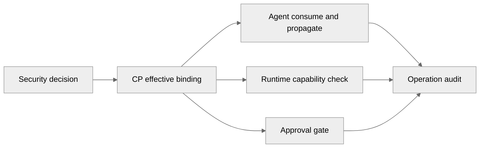

# Agent role/scope 绑定与传播

> 契约状态：`proposed`  
> 实现状态：`partial`  
> Profile：`security`  
> Owner：Security（通用授权）+ Agent（绑定传播）  
> 消费者：CP、Agent、Runtime、UI 审计  
> 来源：PLAN-0386、PLAN-0387、DEV-032、PLAN-0497  
> 更新日期：2026-10-13

## 范围与非目标

本文只定义 Agent 如何接收、传播和消费 Security 计算结果。principal、role、scope、resource、action、authorization decision 的 canonical 正文归 `spec/security/`；Agent 不复制这些模型。

独立 Agent principal、Workspace binding 与 grant 模型已由 PLAN-0374/0407 冻结并实施；账户/成员扩展与凭据模型按各自承接范围处理。本文不把 `Session.user_id` 当作 Agent principal，也不将 Agent-specific metadata 提升为授权来源。

## 目标输入

CP 是授权决定和 durable 身份的权威。Chat admission 时 CP 从请求绑定/校验 AgentPrincipal，并将其写入 Session 持久状态；ChatRun 通过 `sessionId` 关联该身份。CP→Agent payload 不复制 principal/role/scope/capability/approval 决定。Agent 使用 CP 下发的 `sessionId`、`runId`、`workspaceId` 等必要关联键和运行输入；Agent 调用 CP 工具时，CP 从 durable parent Run/ToolCall 重新解析授权，不信任 Agent 自报主体或 scope。

| 权威输入 | 权威来源与处置 |
|---|---|
| principal identity | CP 从 durable Session/Run 解析；不作为 Agent payload 的授权字段 |
| role/scope decision | Security/CP 计算并在 CP 授权边界执行；Agent 不计算、不改写 |
| capability envelope | CP/Runtime 在执行边界验证；Agent 不接收可扩大权限的决定副本 |
| approval result | CP approval gate 决定；Agent 只消费本次运行结果，不把 approval 当授权 |
| Session/Run Workspace binding | CP 从 durable Session/Run 校验；Agent 的 `workspaceId` 仅作运行上下文，不是授权证明 |

下表是职责映射，不是新增 wire schema，也不要求把授权材料放入 payload：

| 输入 | 责任 | Agent 行为 |
|---|---|---|
| durable principal reference + Session/Run keys | CP | 只保留关联键；不得提供另一授权权威 |
| effective run configuration | CP | 只消费授权后下发的配置值，不反推 role/scope |
| tool call identity | Agent/CP | 通过 `runId`/`toolCallId` 关联；CP 重新判权 |

此映射不是要求 CP→Agent 携带 principal/role/scope 等 authority-bearing 字段。公开 Chat `agentPrincipalId` 由 CP admission 校验并持久化；Agent 内部请求必须通过 Run/ToolCall 关联由 CP 反查身份。

## 规范条款

1. Agent MUST NOT 因“代表 User”或“属于子代理”获得隐式授权。
2. Agent MUST NOT 从工具名、Workspace 路径或模型输出推导 role/scope。
3. Agent MUST 保持 CP 下发的 Session/Run 关联键不变；工具调用由 CP 按 durable Run/ToolCall 重新解析 principal、Workspace 和 grant。Agent MUST NOT 把关联键改造成授权证明或向下游复制一份独立授权决定。
4. 一个 ChatRun MUST 只有一个 effective Workspace；跨 Workspace 使用必须创建独立 Session/Worker。
5. Security authorization、Runtime capability policy、operation approval 和 audit MUST 保持四个可区分的决策来源。
6. 授权撤销、scope 过期、capability 不支持或 approval 过期时，Agent MUST fail-closed，不得退回到 User-only 或默认 Workspace。

## 边界图

图下注释：Agent 是传播者和执行者，不是授权权威；Approval 通过不能跳过 Security 或 Runtime capability。

## Agent 主体角色/技能绑定配置面（PLAN-0667，proposed）

> 本节只定义"**谁来给 agent 主体绑定角色/技能**"的配置面；agent 的授权判定仍归
> `spec/security/authorization.md`（角色 → grants → 原子），本节不新增权限模型。
> 现行实现事实以 CP 代码 + `docs/api/openapi.yaml` 为准。

1. **端点归属**：绑定面挂在主体子资源下，与既有记忆面同一路径风格：
   `GET/POST /api/v1/agent-principals/{principalId}/roles`、`DELETE …/roles/{bindingId}`；
   `GET/POST /api/v1/agent-principals/{principalId}/skills`、`DELETE …/skills/{bindingId}`。
   **既有 user-only 的 `/api/v1/bindings` 保持不变**（不放开 `subjectType`），避免把 agent 语义混进用户绑定面。
2. **谁能绑 + 绑定 scope 由服务端定**：`MANAGE_AGENT_PRINCIPALS`（N1，instance 层原子）**或**
   `MANAGE_WORKSPACE_AGENTS`（在 `?workspaceId=` 授权上下文中求值）。工作区层的求值沿用记忆面的同一模式：
   `workspaceId` 只作**授权上下文**，不是绑定的存储键。
   **角色绑定 POST body 只收 `{roleId}`**：`scope_type/scope_id` 由服务端从授权上下文推导
   （有 `workspaceId` ⇒ workspace 作用域；无 ⇒ instance 作用域且需 N1），**调用方不得自报 scope**
   （否则等于把授权语义交给客户端）。角色定义是 instance 级、本身不带 scope，故不存在"从角色行复制 scope"。
   **actor ≠ subject**：agent 不得给自己绑定（由 `MANAGE_*` 原子与"仅真人 principal 可作 actor"共同保证，禁止新增旁路）。
2a. **候选读面**：能管理 agent 绑定的人 MUST 能读候选角色，但**候选仅含可绑定角色**——
   含任一禁授原子的角色**不出现在候选中**（UI 零策略复制），复用既有 `GET /api/v1/roles`
   （不新增候选端点、不加 `bindable`/`reason` 字段）；持 `MANAGE_ROLES` 的管理员视图保持返回全量。
   **绑定 409 仍是兜底**：绕过 UI 直接调 API 绑定时，`AGENT_PRINCIPAL_FORBIDDEN_ATOMS` 照常拒绝。
   无授权上下文时 workspace 层调用者 403。
3. **禁授原子（不可变）**：角色若含 `PermissionAtomCatalog.agentPrincipalForbiddenAtoms()` 中任一原子
   ⇒ **409 `AGENT_PRINCIPAL_FORBIDDEN_ATOMS`**；`detail` **只列原子名，不列资源**（不泄露实例资源面）。
   该集合由词汇表派生（instance-only 全集 + 全部 capability 原子 + `MANAGE_WORKSPACE_AGENTS` /
   `MANAGE_ROLES` / `MANAGE_WORKSPACE_MEMBERS`），**不得**在绑定入口被放宽；绑定入口拦截 + 物化后二次校验双保险。
4. **绑定生命周期**：绑定的 `isSystem` **只表示 seed 绑定**（由 seeding/创建默认值写入的默认授予），
   其 **不可删** ⇒ 409 `ROLE_BINDING_IMMUTABLE`；**用户通过 API 绑定系统角色**（角色行
   `is_system=true`，如 `WS_EDITOR`/`AGENT_DELEGATOR`）⇒ 绑定行 `isSystem=false`、**可解绑（204）**。
   不得把 `isSystem` 解释为"角色是系统角色"——那会让最常用的角色绑上即死结（2026-11-05 裁定，
   `role_bindings.is_seed` 列区分两者）；
   同一 `(roleId, subject)` 重复绑定 ⇒ 409 `ROLE_BINDING_EXISTS`；不可见角色/技能/主体 ⇒ **404**（not-区分，不泄露存在性）。
5. **即时生效**：绑定/解绑 MUST 在**同一事务内**重物化该主体的 grants（复用 `RoleGrantMaterializer.materializeSubject` 路径），
   使该 agent **新会话**的能力判定立即按新绑定生效；不得依赖缓存过期或后台任务。
   **cap 是硬上限（BL-287，2026-11-05 裁定）**：agent 的工作区 cap（`WorkspaceAgent.permissionsSnapshot`，
   会话创建时写入 `agent_permissions_snapshot`）是授权交集的一环——绑定角色若含**超出该 cap** 的原子，
   该原子实际不会被允许。因此绑定入口 MUST **fail-closed**：含超限原子 ⇒ **409 `ROLE_BINDING_EXCEEDS_CAP`**，
   `detail` 只列超限原子名；**不得**先返回 201 再静默无效。"即时生效"仅指 cap 内的原子；
   让 cap 随绑定扩展是产品语义变更（B 类），不在本面内做。
6. **技能绑定（v1）**：复用 `skill_bindings`（`subject_type='agent_principal'`，嵌套端点写入
   `scope_type='instance'`、`scope_id=null`，即"该 agent 全局可用"）；技能定义不可见 ⇒ 404，重复 ⇒ 409。
7. **审计**：每次绑定/解绑落 durable audit：`agent_principal_role_bind|agent_principal_role_unbind`、
   `agent_principal_skill_bind|agent_principal_skill_unbind`，字段 `roleId|skillId / actorId / workspaceId / result`。

## 当前差距与承接

- 当前 Agent metadata 只有 request/run/session/workspace/operation 关联信息，没有独立 principal/role/scope schema；按 design #6 这是边界选择，不是待补字段的缺口。
- CP→Agent 使用 service Bearer 与必要关联键；`userId` 是 owner/visibility 上下文，不是 Agent 授权来源。principal 与 grants 保留在 CP durable state。
- 凭据交付消费注记（PLAN-0497）：Agent 仅经 CP-owned 工具 `acquire_credential` 消费凭据——tool-call 边界由 CP 完成 `credential_use` 求交与既有 ask 审批，明文只进 Agent 进程内存、不落 durable/投影/审计（占位替换），reveal 为非 Agent 通道；契约正文归 `spec/security/credential-management.md` §7。
- 本 SPEC 仍为 proposed/partial；PLAN-0387 T3.2/V7 负责复核当前调用链、拒绝路径与失败恢复，不新增授权 payload schema。

## 验证映射

- 通用授权 owner：`spec/security/authorization.md`、`spec/security/principal-workspace-scope.md`。
- 当前差距：PLAN-0387 `evidence/context-boundary.md`、PLAN-0386 `evidence/consumer-validation.md`。
- Agent 不自行授权的真实验证：PLAN-0387 T3.2/V7，尚未完成。
