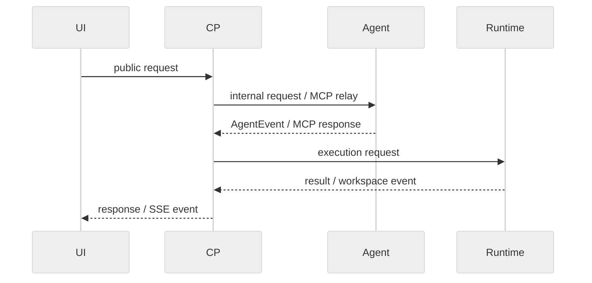
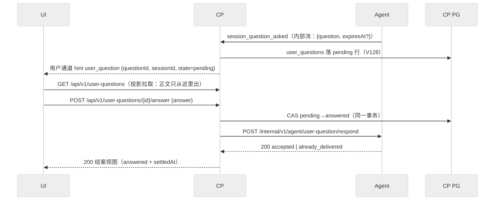

# XH 模块通信

> 契约状态：`proposed`；实现状态：`partial`；Profile：`protocol`；Owner：XH 跨边界 owner；来源：PLAN-0385（用户问答链路由 PLAN-0660 M5-B 承接）；更新：2026-11-06。
> 消费者：UI、CP、Agent、Runtime、跨模块调用方

## 1. 两类通信流

| 流 | 典型入口 | 事实源 | 主要规则 |
|---|---|---|---|
| 指令流 | REST、MCP、Runtime internal | OpenAPI/inventory/schema | request/response、错误、幂等、超时 |
| 状态流 | Chat SSE、Workspace SSE、Agent SSE relay、用户通道 | 事件实现与 durable record | 顺序、重连、重复、终态和恢复 |

## 2. 协议共性

- public route **MUST** 使用 `/api/v1`；service route **MUST** 使用 `/internal/v1`。
- service authentication **MUST** 使用 `Authorization: Bearer <token>`；不得引入自定义 token header。
- XH 自有 JSON **MUST** 使用 camelCase；MCP JSON-RPC 字段遵守 MCP 版本。
- HTTP 错误 **MUST** 使用 RFC 9457 Problem Details；`code` 和 `requestId` 是跨层定位键。
- 跨边界 ID 按 owner 传递：ChatRun 用 `runId`；MCP execution 用 `invocationId` 与 `toolCallId`；Workspace Job 用 domain `jobId`，Runtime backend handle 单独用 `runtimeJobId`。各层 **MUST NOT** 把不同 owner 的 ID 混作同一关联键。
- 不可信正文 **MUST NOT** 跨边界泛化：用户问答的 `question`/`answer` 只允许出现在 §5 的两条 wire 与投影响应上，不得进入日志、审计 detail、problem detail、会话 SSE 或用户通道载荷（只留 id 与长度）。
- OpenAPI、`inventory.md`、事件 schema 和代码类型是 wire source；本文只记录业务不变式和跨模块 ownership。

## 3. 超时、重试和幂等

| 边界 | 失败处理 |
|---|---|
| UI → CP | 显式 HTTP error；UI 按 endpoint 规则处理 401/409/5xx |
| CP → Agent | bounded timeout；Agent unavailable 进入显式 queue/circuit/error，不静默成功 |
| CP → Runtime | bounded connect/read timeout；unknown workspace、backend failure、timeout 显式失败 |
| 事件重连 | Chat 由 Session SSE 规则处理；Workspace gap 使用 `snapshot_required` + HTTP/MCP refresh；用户通道**无 replay**（丢 hint，靠投影重读收敛） |
| 重复请求 | durable idempotency key 或事件关联键；不得按展示文本匹配 |

具体 timeout 数值、错误 schema 和 route 参数以 OpenAPI/inventory/实现测试为准。

## 4. 证据与迁移

真实消费者验证至少覆盖 UI→CP、CP→Agent、CP→Runtime 和 Runtime→CP 事件 ingress。DEV/AGENTS 的稳定说明改为指针；旧 bridge、旧 route alias 和旧字段只保留历史 supersede 记录。

## 5. 用户问答链路（`ask_user`，PLAN-0660 M5-B）

不动式（invariants）：

1. **事实源唯一**：`user_questions` 行是唯一事实；`user_question` hint 只是 refresh 提示（用户通道无 replay，见 `spec/protocol/event-stream.md` §4）——UI 不得用 hint 拼装状态。
2. **只有 root run 可问**：CP 在 `recordPending` 用 `chat_runs.parent_run_id` 拒绝子 run（`409 SUBAGENT_QUESTION_REFUSED`）；CP 派发子 run 时在 Chat 请求体带 `parentRunId`（root run **不带该键**），Agent 的 `ask_user` 在发送前就拒绝（`code=SUBAGENT_QUESTION_REFUSED`，不产事件、不等待）。
3. **一门一人**：同一 run 已有 live approval ⇒ `409 QUESTION_APPROVAL_PENDING`；已有未决问句 ⇒ `409 QUESTION_ALREADY_PENDING`；两者都不落新行。
4. **顺序 = durable 先、hint 后；交付失败 fail-closed**：只有 Agent 回 2xx 才把答案记为 `answered`；非 2xx、超时或连接失败一律回滚，行留 `pending`（`502 AGENT_QUESTION_DELIVERY_FAILED`）。
5. **正文边界**：`question`/`answer` 只走「Agent→CP 内部流」与「CP→Agent internal respond」两条 wire；日志/审计/problem detail 只留 id 与长度。
6. **错误映射**（wire 以 OpenAPI 为源）：answer 面 400/401/404/409/502；respond 面 200/400/401/404/409；CP→Agent 投递失败恒 `502 AGENT_QUESTION_DELIVERY_FAILED`。
