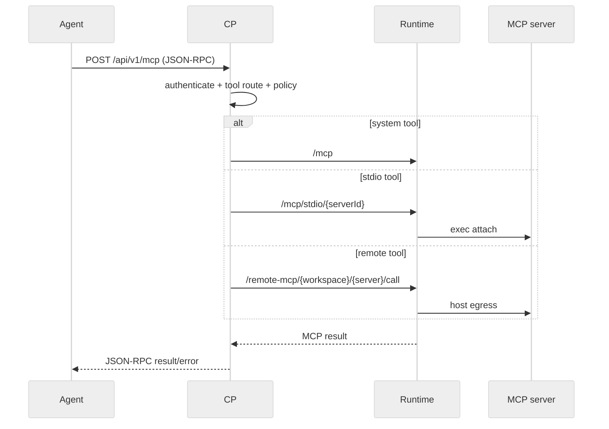

# XH MCP 通信边界

> 契约状态：`proposed`；实现状态：`partial`；Profile：`protocol`；Owner：CP/Runtime/MCP owner；来源：PLAN-0385；§3 工具面契约由 PLAN-0686 M1 T2.1 冻结（2026-11-07）；更新：2026-11-07。
> 消费者：Agent MCP adapter、CP MCP proxy、Runtime MCP session、Workspace lifecycle

## 1. 路由边界

- Agent **MUST** 只连接 CP logical MCP endpoint。
- CP **MUST** 负责认证、Workspace/session ownership、tool-name routing、policy gate 和 JSON-RPC relay。
- Runtime MCP v1 **MUST** 按当前 MCP protocol headers 保持 stateless；CP 转发所需 `Mcp-Method`/`Mcp-Name`。
- 逻辑 MCP 无协议会话：CP **MUST NOT** 签发或回传 `mcp-session-id`；入站请求携带该头 **MUST** 以 403 `MCP_SESSION_INVALID` fail-closed。Runtime stateless transport 与本条是两个不同边界。
- stdio 使用 Runtime host `exec attach` 会话；retired bridge、容器内 HTTP、容器端口和 Docker transport 不得进入 backend-neutral contract。
- remote MCP 由 Runtime host connector 出网；Workspace sandbox 不直接承担 OAuth 或 remote egress。

## 2. tools/list 与 tools/call

`tools/list` 的合并、tool→server 映射和 sticky alias 由 CP 拥有；`tools/call` 按 system/stdio/remote 三路路由。映射失效、server unavailable、unknown tool、MCP error 和 policy deny 必须显式返回，不得静默使用另一 Workspace 或默认 backend。

完整 JSON-RPC schema、协议版本和错误字段以 MCP wire implementation、OpenAPI/inventory 和 Runtime tests 为准。

## 3. 工具面与门禁（G8 只读工具）

> **局部冻结**：本节条款由 PLAN-0686 M1 T2.1 冻结（2026-11-07）。文件头契约状态仍为 `proposed`——§1/§2 其余边界未全部实现，**局部冻结不冒充全文冻结**。授权求值链的权威正文在 [`security/authorization.md`](../security/authorization.md) §2；本节只写 MCP 侧落点与拒绝形状，不复制模型。

### 3.1 工具面注册

CP 在授权与派发前 MUST 把每个经其转发的工具名解析为 **tool face**（`actionClass` + `shape`）；解析源唯一：`cp/policy/ToolFaceRegistry.java`（构造式登记，运行期不得由请求方自报）。

| 面（内置集） | 工具（现状） | `actionClass` | `shape` |
|---|---|---|---|
| READ | `read_file`、`read_file_range`、`list_directory`、`glob`、`grep`、`get_file_info`、`watch_directory`、`extract_pdf_text`、`read_command_output`、`list_background_processes`、`get_background_process`、`skill_read` | `read` | `STRUCTURED` |
| WRITE | `write_file`、`edit_file`、`delete_file`、`delete_directory`、`move_file`、`copy_file`、`mkdir`、`apply_patch` | `write` | `STRUCTURED` |
| EXEC | `execute_command`、`start_background_process`、`cancel_background_process` | `exec` | `INTERPRETER` |
| NETWORK | `web_fetch` | `network` | `STRUCTURED` |
| 单件 | `spawn_agent` → `SPAWN_AGENT`；`acquire_credential` → `credential_use` | 同左列 | `STRUCTURED` |

- 锚点：内置集 `ToolFaceRegistry.java:91-108`；构造登记 `:151-163`；`extraFaces`（第三方 MCP 工具按 workspace 上下文分类）与内建面同权求值，不由调用方声明。
- 未登记工具的 `faceOf` 返回 `UNCLASSIFIED_ACTION`/`OPAQUE`（`:171-174`）：授权 **MUST** fail-closed——`allowsByGrant` 侧无可匹配 grant 即拒；即便进入 verdict，也只允许显式审批（ASK），**MUST NOT** 继承 allow 或模式自动放行（`PolicyEngine.java:243-253`，注释明示 unclassified 永不免于审批）。
- `shape` 决定资源提取与路径语义：`STRUCTURED` 面按 `PolicyResourceExtractor.extract(body)` 解析资源；`OPAQUE` 不解析（`PolicyEngine.java:57-58`）。G8 三工具为 `STRUCTURED`，其入参路径/仓库标识按既有资源提取口径处理，不另造解析器。
- **G8 冻结**：`git_status`/`git_diff`/`git_log` **MUST** 进 READ 集（`read` 面、`STRUCTURED`）；**MUST NOT** 新增 action atom；**MUST NOT** 走 `extraFaces`（它们不是第三方 MCP 分类）。**注册状态（`030cfb8d`，2026-11-07 起为本实现事实）**：三工具已按本条注册——面登记 `ToolFaceRegistry.java:91-104`（随 `:158` 映射 `read`/`STRUCTURED`），CP 自有派发 `McpProxyController.java:94-96`（工具名常量）+ `:1536-1590`（`dispatchCpOwnedGit`）；`git_status` 复用公开读面同一条 `RuntimeCheckpointClient.workspaceGitStatus`（`:1547`，§3.5），`git_diff`/`git_log` 走 Runtime 只读端点。**本节冻结范围不变**：仍只冻结「进哪一面」与授权/拒绝语义；真链路证据（授权正反探针、审计读回）归 T2.3，本节不宣称。

### 3.2 门禁链（当前实现，逐条带锚点）

`tools/call` 的 CP 侧顺序（`cp/mcp/McpProxyController.java`）。**锚点约定**：本节行号以 HEAD `454666e6` 实测为准；行号会随代码移动，**检索时以 `类#方法` 为准**。

**调用面分类闸（在授权判定之前）**：`McpProxyController#handleToolsCall`（`:906`）在 `loadContext`/`allowsByGrant` 之前先按「调用面」分流，命中即直接 403 `FORBIDDEN`、**不进入 grant/verdict 求值**。下面四个前置拒绝点按执行顺序排列：

| # | 触发条件 | 审计 `action` | 锚点（现 HEAD） |
|---|---|---|---|
| ① | `access == null`（无已认证调用方上下文） | `caller_context_rejected` | `:913-916` |
| ② | 用户直连且工具不在 UI 工具路径（`!USER_WORKSPACE_FILE_TOOLS.contains(toolName)`，或携带 Agent 执行上下文头 `hasAgentExecutionContext(headers)`） | `caller_tool_denied`（detail `user caller is outside workspace UI tool path`） | `:917-921` |
| ③ | Agent 调用缺 application Session（`internalService()` 且 `applicationSessionId()` 空） | `agent_session_required` | `:922-925` |
| ④ | 用户直调 agent-only 工具（`spawn_agent`/`acquire_credential`/`skill_read`） | **无审计行**（现状缺口：三处直接 `return problem(...)`，未 `audit.record`；本文件只记录现状，不宣称已修） | `:939-961`（三条分支分别在 `:941`/`:948`/`:958`） |

- 这四条**不属**第 3 步所说的「裸 403」：它们发生在**授权判定与 verdict 之前**，表达的是「这条调用面路径不给走」，而不是「有没有 grant」。`GitReadToolsTest#userCallerIsRefusedBeforeAnyRuntimeContact:213-221` 把 ② 钉成 L0 断言（403 `FORBIDDEN` + `caller_tool_denied` + 零 Runtime 接触），与本判据不冲突。
- **用户直连 MCP 与 Agent-mediated 是不同授权路径**：用户直连只被放行 `USER_WORKSPACE_FILE_TOOLS` 白名单内的工具，过了 ② 才进入下文的 grant/verdict 链；Agent-mediated（CP 内部服务 + application Session）才走 grant/verdict 全链。两条路径被分类闸拒绝的成因不同，不得折算成同一条判据。

过了分类闸才进入下列顺序（即 `loadContext` 之后）：

1. **上下文加载**：`policy.loadContext(access.userId(), wsId, sessionId)`——一次加载同时供授权判定与工具面解析（`McpProxyController#handleToolsCall:1041`；T1.15）。`userPrincipalOnly = !access.internalService()`（`:1042`），即 CP 内部服务调用按「用户主体」口径求值。
2. **硬保护 + grants 判定**：`policy.allowsByGrant(policyContext, toolName, rewrittenBody, sessionId, userId, wsId, userPrincipalOnly)`（`McpProxyController#handleToolsCall:1043-1044`）。内部三步（`PolicyEngine#allowsByGrant:48-69`）：
   - ① `registry.faceOf(toolName)` → `actionClass`；`extraFaces` 非空时以该次 context 构建注册表（`PolicyEngine#allowsByGrant:53-58`）；
   - ② `HardGuard.checkWorkspaceResources` + `HardGuard.check`（L0，任何模式/规则不可覆盖）；命中即 `audit.record(..., "policy_hard_deny", ...)` 并拒绝（`PolicyEngine#allowsByGrant:59-65`）；
   - ③ `GrantAuthorizationService.allows(request)` / `allowsUserOnly(request)`——带作用域的 grants 一跳查表（`PolicyEngine#allowsByGrant:66-68`；语义见 authorization.md §2 第 6 步）。服务为空、上下文为空或 `toolName` 为空时**直接拒绝**（`PolicyEngine#allowsByGrant:50-52`）。
3. **拒绝三件套（缺一即违约）**（`McpProxyController#handleToolsCall:1043-1052`，即授权判定块）：① SSE `tool_exec_denied`，payload `{tool, reason: "authorization grant denied"}`（`:1045`）；② `audit.record(sessionId, toolName, "authorization_grant_denied", "no matching grant or workspace membership")`（`:1046`）；③ 编码 tool-result `TOOL_GRANT_DENIED`（`chat/ToolRefusalCodes.java:50`；`:1051`）。**MUST NOT** 返回裸 403（**在授权判定与 verdict 拒绝路径上**；本节开头的调用面分类闸四个前置 403 不属本条）——MCP SDK 会把 HTTP 错误折成泛化文本并丢 `refusalCode`，模型无法分类拒绝（0649 follow-up，`:1047-1050`）。
4. **策略 verdict**：`policy.evaluateVerdict(...)`（`McpProxyController#handleToolsCall:1053-1054` → `PolicyEngine#evaluateVerdict`）→ `DENY`/`REQUIRE_APPROVAL`/`ALLOW`。`DENY` → SSE `tool_exec_denied` + `audit.record(..., "deny", reason)` + 同一 `TOOL_GRANT_DENIED` 编码结果（`:1057-1063`）；`REQUIRE_APPROVAL` → SSE `tool_exec_approval_required` + `audit.record(..., "approval_required", reason)` + 既有 approval 卡面（`:1105-1108`）；`ALLOW` → `audit.record(..., "request", rewritten)`（`:1055`）后派发。
5. **派发前快照**：`policy.faceOf(policyContext, toolName)`（`:1115`）→ `SafePolicySummary.buildSnapshot(verdict, face, policyContext, reusedSessionGrant)`（`SafePolicySummary#buildSnapshot:1117-1119`）。快照只挂**实际派发**的调用；deny / 未获批不落账本（`:1111-1113`）。

引擎内部另有 `policy_check`/`policy_verdict`（`PolicyEngine#evaluateVerdict:216,249-250,276-277`）、`policy_hard_deny`（`:230`）、`policy_allowed_by_mode`（`:280`）。**制度拒（无 grant）不进 approval、不建 pending approval**（authorization.md §2 第 6 步已冻结）。

MCP 侧审计动作（T2.3 读回契约，新增动作须同批改本节与 [`security/audit.md`](../security/audit.md)）：

| 场景 | `action` | `detail`（现状） | 落点 |
|---|---|---|---|
| grant 未命中 | `authorization_grant_denied` | `no matching grant or workspace membership` | AUDIT JSONL |
| L0 硬保护命中 | `policy_hard_deny` | `kind:reason` | AUDIT JSONL |
| 策略 DENY | `deny` | `verdict.reason` | AUDIT JSONL |
| 需审批 | `approval_required` | `verdict.reason` | AUDIT JSONL |
| 放行并派发 | `request` | 重写后的调用体（文件侧截断） | AUDIT JSONL |
| 模式放行 | `policy_allowed_by_mode` | `verdict.allowedBy` | AUDIT JSONL |

### 3.3 默认授予集（不重铺角色格）

- G8 三工具**不新增原子**：进 READ 集 ⇒ 判据 = 主体是否持有 `read`；求值按 `atom-contract.md` §2 的并集语义（instance 行 ∪ 本 workspace 行），异常即拒。
- 现状种子（`policy/SystemAccessRoleCatalog.java`）：`BASE_ATOMS` 含 `read`（`:78-83`），实例角色 `SUPER_ADMIN`/`ADMIN`/`USER` 与工作区角色 `WS_OWNER`/`WS_EDITOR`/`WS_VIEWER` 的默认原子集都含它（instance 种子 `:109-150`、workspace 种子 `:151-201`）⇒ **默认集下所有已认证账号都可调用 G8 只读工具**（实际调用另受 workspace/会话归属前置约束，见 §1 与 authorization.md §1）。这是产品判定：只读 git 信息与现有 read 工具同权，不额外收紧。
- 三工具 × 默认集（无新增种子，仅沿 `read` 面）：

| 工具 | 面 | 默认持有者 | 依据 |
|---|---|---|---|
| `git_status`、`git_diff`、`git_log` | `read` | 实例 `SUPER_ADMIN`/`ADMIN`/`USER`；工作区 `WS_OWNER`/`WS_EDITOR`/`WS_VIEWER` | `SystemAccessRoleCatalog.java:78-83,109-150,151-201` |

- 「默认授予集」的交付方式 **MUST** 沿用 `atom-contract.md` §5（Flyway 种子 + 代码镜像 `SystemAccessRoleCatalog` + 校验断言，三处同批）。本节**不重铺角色格、不产生第二份默认集事实源**；G8 若需收紧（如仅 `WS_VIEWER` 及以上），必须改种子/`atom-contract.md`，不得在本文件加例外。

### 3.4 可见性（现状与差距）

- **原则**：工具可见性 MUST 与 `read` 面同源，不另立矩阵（`tools/list` 与 `tools/call` 共用同一 face 解析）。
- **现状**：`tools/list` 只做目录合并（system tools + stdio 合并 + CP 自有三件套，`McpProxyController.java:325-340,565-610`），**没有**按 grants 过滤的分支；未持 `read` 的主体在目录里仍可能看到工具，调用时才被 fail-closed 拒绝。因此「未授权不可见」目前**不是**既有保证。
- **冻结条款（已裁定）**：G8 三工具的 v1 判据 = **「不可调 + 可审计」**（调用侧 fail-closed + 拒绝有审计留痕）。目录侧过滤 **descope**，不在 v1 判据内（PLAN-0686 `review/round-2.md` P1-1 裁定 B，台账 D-63）；若未来要做目录过滤，属**新增实现**，须同批改本节 + `verify.md` V2 + OpenAPI/inventory。本文件不把未实现行为写成契约。

### 3.5 写型与拆分闸（不冻结未来矩阵）

- v1 **只读**：`commit`/`branch`/`tag` 类写型工具不在 v1；T2.2 **MUST NOT** 注册、**MUST NOT** 进 WRITE 集。
- 未来写型 **MUST**：① 显式分类进 WRITE 集或独立 action class（禁 `UNCLASSIFIED`）；② 复用既有 `approval_requests` + `ApprovalService` + `ApprovalAgentTool`（0 新表）；③ 审批矩阵与审计字段先在自有 PLAN 的 SPEC 冻结，再实现。
- **本文件不冻结未来写型审批矩阵**：没有实施面的设计叫猜测，冻结会迫使后续实现「为守文本而扭曲」或「改 PLAN 打自己脸」。
- **拆分闸**：出现任一情形 ⇒ MUST 拆独立子计划、不并入 0686 v1：写型工具数 > 只读；需扩展 approval 策略/设施；需触碰 `ShadowGit`/checkpoint 边界（BL-207）。G8 只读工具 **MUST** 读真实工作树，**MUST NOT** 调 `ShadowGit` 私有存储；`git_status` **MUST** 复用既有只读路径（`RunCheckpointController` 的 `GET /api/v1/workspaces/{workspaceId}/git-status` → `RuntimeCheckpointClient.workspaceGitStatus`），不得复制 git 逻辑。
- **系统 git 前置（BL-207）**：三工具读真实工作树，前提是宿主系统 `git` 可执行——Runtime 探针要求 `git --version` 可解析且 ≥ 2.20（`packages/runtime/src/checkpoint.rs:54` 的 `MIN_GIT_VERSION`，`probe`/`require_git`）。git 不可用时三工具 **MUST 显式失败**：Runtime 口径为 HTTP `503` + `application/problem+json`，含 `code="CHECKPOINT_UNAVAILABLE"`、`reason`、非空 `detail`；`reason` 按实测三分——缺二进制/无法探测 ⇒ `GIT_UNAVAILABLE`，版本低于 2.20 或 `git --version` 不可解析 ⇒ `GIT_TOO_OLD`，其余 git 执行失败 ⇒ `GIT_FAILED`（`packages/runtime/src/checkpoint_revert_api.rs:737-766` → `packages/runtime/src/checkpoint_api.rs:783-789` → `packages/runtime/src/main.rs:3261-3276`）。MCP 工具面 **MUST** 以失败 tool-result 返回（`isError=true`，错误文本或 structured 字段携带同一 `reason`），**MUST NOT** 把「缺 git」伪装成空状态、空 diff、空列表或成功结果，**MUST NOT** 回退 `ShadowGit` 影子库取数。工作区**没有** `.git` 不是错误：按 `isRepository=false`、`entries=[]` 显式返回且不 spawn git（`packages/runtime/src/checkpoint.rs:3299-3311`）；**有** `.git` 而 git 不可用才走上述显式失败，两侧 MUST 在响应中可区分。

### 3.6 验证映射（T2.3 可直接照做）

**读回口径**：MCP 工具/策略审计走 **AUDIT 审计流**（JSONL，`packages/control-plane/src/main/resources/logback-spring.xml:27-49`，`${LOG_DIR}/audit.log`）。每行的 `message` 字段承载 `workspace=… | actor=… | session=… | tool=… | action=… | detail=…`（`AuditLogger.java:88-97`），其中 `detail` 在文件侧截断 100 字符（`:85-87`）；`audit_logs` 表只承载 `recordDurableChange` 类动作（如 `authorization_atom_hit`，`AuditLogger.java:261-280`），**不承载**上述工具/策略动作。T2.3 断言以审计流为准，不得把表行当唯一证据；示例：`rg '"action":"authorization_grant_denied"' <LOG_DIR>/audit.log`（JSONL 里该片段位于 `message` 内，按 `authorization_grant_denied` 全文匹配即可）。

| 探针 | 前置 | 动作 | 可观测结果（含读回） |
|---|---|---|---|
| P-a 只看 | 主体持有 `read`（`WS_VIEWER`+ 或实例 `read`），且为该 workspace 成员 | 真实 Agent run 调 `git_status`（并及 `git_diff`/`git_log`） | tool-result 成功且与工作树实际一致；审计流新增 `tool=git_status action=request`；**无** `authorization_grant_denied` |
| P-b 只看 | 构造无 `read` 的主体（仅 `workspace:admin` 或空原子）且在该 workspace | 同一 run 调 `git_status` | 无副作用；返回编码 `TOOL_GRANT_DENIED` tool-result（**非裸 403**）；SSE `tool_exec_denied`；审计流新增 `action=authorization_grant_denied`、`detail=no matching grant or workspace membership`；**无** pending approval 行 |
| P-c 未知工具 | 调用未登记工具名（此处「未登记」指 `ToolFaceRegistry` 无该工具面，**不是**工具目录里不存在；目录中不存在名字走 §2 的显式错误路径：实测 400 `UNKNOWN_TOOL` + 审计 `unknown_tool`，`McpProxyController#handleToolsCall:983-989`） | `tools/call` | `TOOL_GRANT_DENIED`；审计流有 `policy_hard_deny` 或 `authorization_grant_denied` |
| P-d 目录基线 | 同 P-b 主体 | `tools/list` | 记录当前行为为基线（目录仍含三工具）；v1 不要求过滤，**不判失败** |
| P-e 回归 | G8 合入后的 L1 波次 | checkpoint capture/restore；`git_diff`/`git_log` 与 CLI 对照 | checkpoint 链绿（V4）；读工具不改 index/refs（前后 `git status` 一致）；运行日志无 `ShadowGit` 路径命中 |

